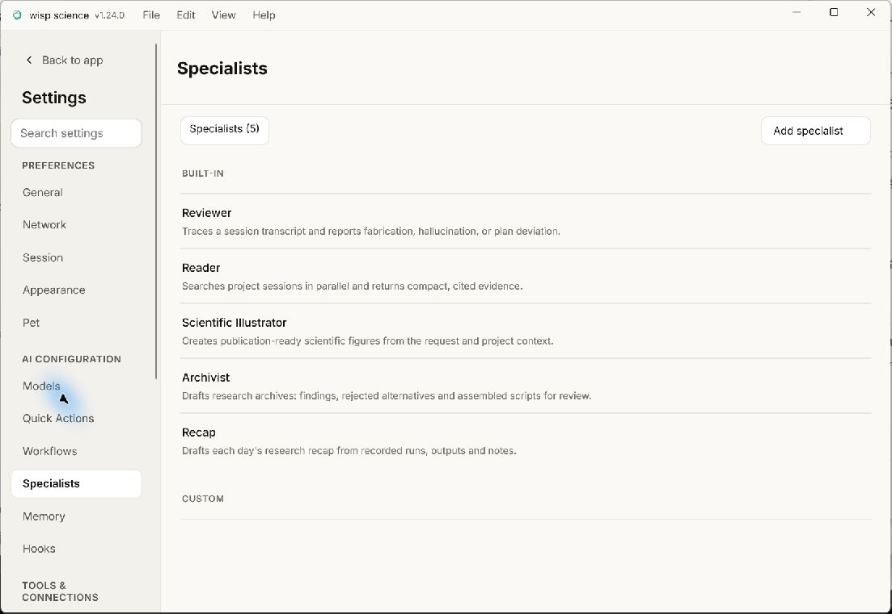
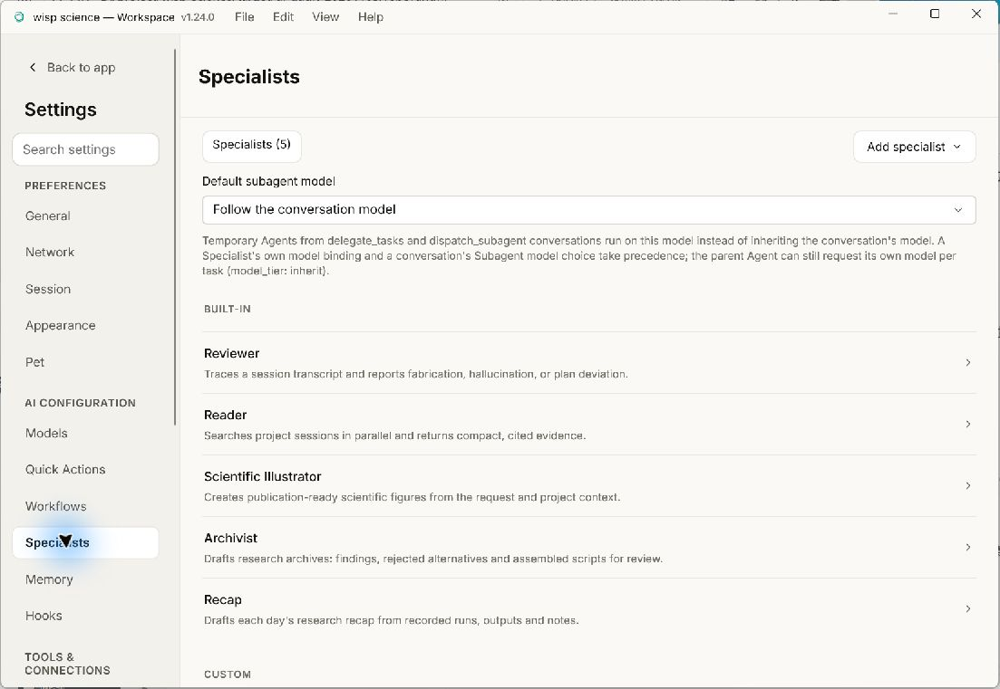
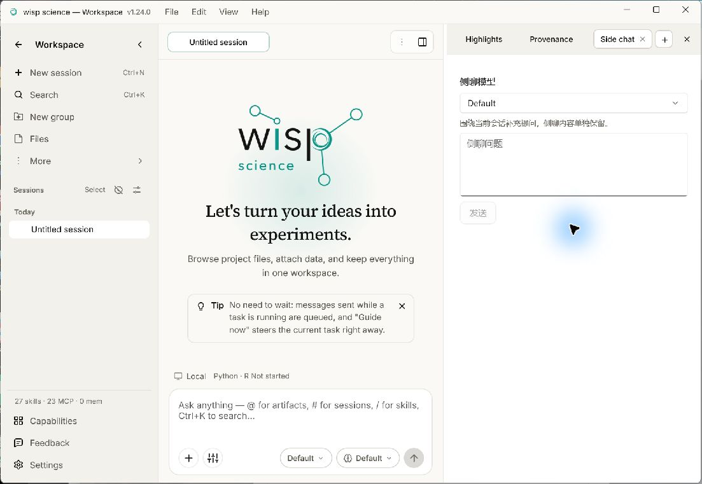
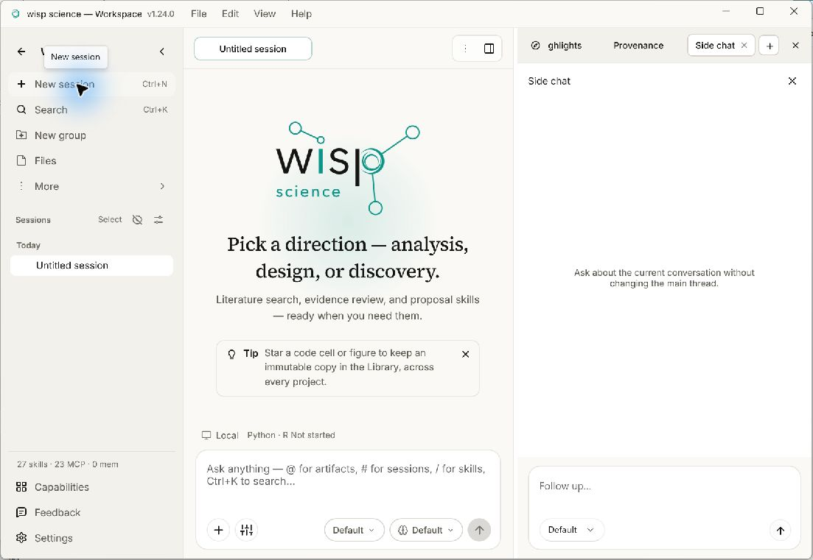
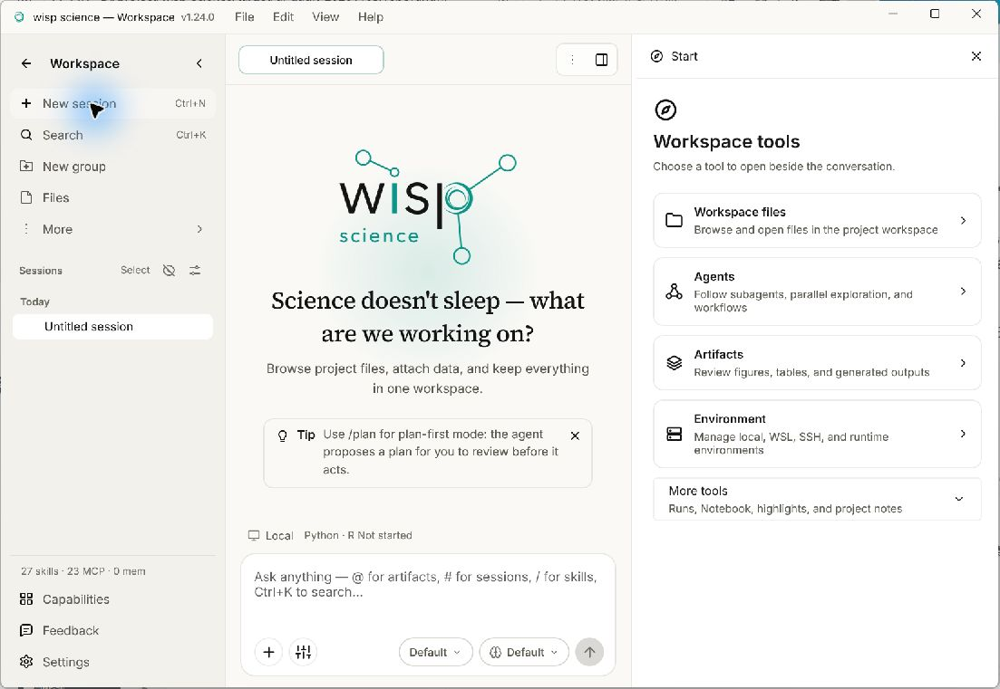

# Windows native parity: PRs #1332–#1351

The WinUI preview now connects the native workbench actions introduced in this
range to the existing Rust desktop host. No second database writer or WebView
project activation was added. Build with `scripts/build_native_windows.ps1`.
An alternate browser database still requires a matching running host descriptor.

## Inspector and example parity (2026-11-05)

The inspector has a **Start** page with common tools and a **More tools** group.
Only tools actually opened appear in its tab strip; existing saved tabs remain
available. The compass returns to Start without discarding the open tabs.
Agents, Notebook, Highlights, Provenance and Side chat follow the selected
language. Empty file, artifact and transcript panels use the shared WebView
copy and centered layout. Side chat keeps its composer at the bottom, with
the model picker and send action together. Agents includes **Manage workflows**.

**Settings → Specialists → Default subagent model** lists chat models and
**Follow conversation model**. An unavailable saved model remains visible;
failed saves keep the last acknowledged selection. Home search offers project
settings and skills only after the host's restored project is confirmed among
the user's visible projects.

Capabilities reserves its scroll gutter so the five summary cards wrap to
three plus two at the standard dialog width. WebView refreshes the runtime
snapshot when this dialog opens, including the active workspace path.
Example transcripts retain Copy but hide editing, review, memory, branch,
excerpt, exploration and undo actions. Native local Markdown links without a
verified opener use the same code appearance as unavailable WebView paths;
external web links keep their link appearance.

Regression coverage was added for model persistence and failures, launcher
restoration, search scope, localized empty states, local link rendering,
read-only example actions and refreshed capabilities. Tests require explicit
authorization under `AGENTS.md`; a successful build alone does not verify UI
behavior. Manual comparison should cover both languages, Start → tool → Start,
empty Files/Artifacts/Notebook/Highlights/Provenance, Side chat's bottom input,
Specialists model selection, home search, and immediate Escape from capabilities
and the model picker. Small font rasterization and spacing differences between
WinUI and WebView are outside this correction.

Validated on Windows with the local ContractTests runner (mock hosts only) and
the two Playwright cases **Example project shows bundled demos as read-only
transcripts** and **capabilities refreshes the workspace snapshot when reopened**.
Both cases ran in parallel against the compiled WASM assets and mocked Tauri
bridge. WinUI Release x64 and the WebView desktop host were also rebuilt and
checked through Computer Use. Dark/high-contrast themes and macOS were not
visually checked in this pass.

| Surface | Before | After |
| --- | --- | --- |
| Specialists default model |  |  |
| Side chat |  |  |

In Settings → Appearance, switching between System, Light, and Dark keeps the
chosen theme card focused. Tab from Dark reaches the color palette; System and
Light share the light palette and Dark retains its own choice. The selected
settings category and theme captions immediately adopt the new palette. Palette
and font fields use the same proportion of each row as the WebView controls.
When the live preview moves below the controls (1100 px or narrower), removed
and added code sit side by side, with the color stripe inside the number gutter.
Compare the 588 px [WinUI capture](assets/native-windows/appearance-compact-winui.jpg)
and [WebView capture](assets/native-windows/appearance-compact-webview.jpg).

Skill and transcript tables display and copy a pipe escaped inside inline code
as a literal pipe. Code outside tables keeps its backslashes.

On the project landing page the five shortcuts stay together. Their group and
the three project commands share a row as soon as both fit beside the brand;
the wrap point follows the measured, localized buttons. At 820 px and below
the actions move under the brand. The footer link aligns with the bottom of the
content even when the native options menu is taller than its label.

The New project and Project settings forms use 92% of the window width, up
to 560 px and with at least 20 px on either side. Clicking a text field's
caption or help places the caret in that field. Enabling the standard layout
in New project adds the folder guide alongside the user's own context.

In the workspace composer, **Agent options** uses the same three-slider icon
as WebView. Click a switch or its label to operate it. **Full Permission**
first opens a centered warning over the workspace. Cancel or press Escape to
return to the still-open options menu with permission off. A second Escape
closes the menu. Neither opening nor cancelling the warning creates a session.

In **Settings → General**, clicking the language, workspace folder or send
shortcut label focuses its field. Checking local executable paths leaves the
other preferences editable. The reply updates only the environment card:
it does not replace the workspace input, move its caret or save its draft.
The path editor disables repeat submissions until it receives a reply.

In **Settings → Network**, each proxy picker sizes to its translated options
(up to 140 px). Choosing **Custom proxy** reveals the address next to the
same focused picker; Tab moves into the address. The address expands to use the
space on its line. Clear and Save wrap independently on smaller windows. The
badge continues to show the saved mode while a different mode is being edited.

In **Settings → Session**, a numeric field's caption and hint focus its input,
as the WebView label does. Arrow keys can then adjust that value immediately.
Disabled dependent fields remain disabled when their label is clicked. Numeric
labels, hints and values use the reference's medium weight and input insets;
top-level settings headings use the WebView h2 weight.
The Session card ends with the same 22 px pane inset after scrolling to the
bottom; an unused results container no longer adds an extra gap.

## Appearance on startup (2026-11-05)

General and Appearance use the active palette for settings text. An empty
workspace path, font or search field shows a placeholder distinct from an
entered value. The language and send-shortcut pickers reserve space for the
longest option in the current language, within the available row width.

If the database has no saved appearance yet, the native window keeps the theme,
palettes, fonts and input preferences from its local settings, as WebView does.
Opening Appearance and using the theme or font shortcuts start from these same
values. The next explicit edit preserves the other preferences. Once the host
has saved settings, they take precedence over the local copy.
Built-in font families remain placeholders in the editor unless explicitly
chosen. The Appearance heading's spacing scales with the selected UI font.

For separate local profiles, set `WISP_PREVIEW_SETTINGS_PATH` to an absolute
JSON file path to isolate the native window preferences as well as the database.

## Connection results for ACP agents (2026-11-05)

In Settings → Models → ACP agents, **Test connection** shows the agent's
reported name and version, the ACP protocol version, and the available sign-in
methods inside the agent's row. Checking another agent leaves the first row
intact. Editing a profile's command invalidates its previous result.

The agent editor keeps missing-field and save errors above Cancel and Save.
An unsuccessful save preserves the inputs. A confirmed save returns to the
ACP list supplied by the host and shows **Agent saved** above the rows.
Retrying a new agent after an unconfirmed reply reuses its ID; Cancel drops
the draft and its message without writing.
Drag the arguments field's lower-right corner (or focus it and use the arrow
keys) to resize it without changing the arguments.

## Live activity on the home page (2026-11-05)

While Home is visible, **Recent sessions** follows the desktop host's live
turns. Waiting for approval takes precedence over running. The project card
counts include sessions outside the five recent entries. A status transition
updates the labels on the existing cards; opening a recent session still
selects that exact conversation. Both columns respect project privacy.
If the host is offline or too old to report activity, a note below Recent
sessions identifies the labels as saved state. It disappears when live updates
resume. Reading activity neither starts a turn nor marks a reply seen.

## Project sync on home cards (2026-11-05)

Each home card shows its folder snapshot state or its last relay sync next to
the session and artifact counts. A configured backend enables **Sync now**;
projects using folder snapshots also expose it without a global backend.
**Copy device code** is available only on non-snapshot cards with a configured
backend. It copies directly to the local clipboard without displaying the code.
Remote Access settings retain backend setup, the sync guide and joining.

Sync runs only when clicked. A conflict opens a choice between the remote
version and this device. Cancel or immediate Escape returns to the project
list without resolving it. Ordinary sync reports transferred files and how
many paths were left local.

## Editing settings across categories (2026-11-05)

General, Session, Pet and **Remote Access → Manual project sync** share their unsaved preferences for as long as Settings
is open. For example, change the maximum iterations in Session, visit General,
then return to Session: the number stays as entered. Save from any of these
pages to apply the combined changes and return to the app. Cancel discards them;
a failed save leaves the form open for a retry. Only the fields edited in this
window override the current host settings. Input shortcuts and the update-check
toggle still take effect immediately. Local interpreter paths use their own Save,
and invalid numeric input still requires correction or explicit discard.

The sync backend, URL and folder stay in the draft when you visit another
category or open a messaging device's details. **Save** commits the combined
preferences; it does not start a sync. A replacement relay token stays in
memory until Save or Cancel, and an existing keyring token never fills the
password box. The channel binding and device forms still save independently.

## Workspace capability summary (2026-11-05)

The expanded project sidebar shows skills, MCP packages and memory files from
the active project's inventory. The icon rail omits the text. A missing reply
leaves the summary hidden; confirmed zero counts remain visible. Switching
projects discards the previous counts, and returning from Settings refreshes them.

**Capabilities** opens a scrollable dialog over the current workspace. Its five
tiles come from the same enabled/configured inventory as the WebView: bundled
and project skills open Skills, bundled and project MCP open Connections, and
memory files open Memory. These counts can differ from the sidebar totals.
The dialog also includes runtime information and the local tool paths. **Edit
paths** starts a draft; **Cancel** discards it. **Set up environment** starts a
new conversation with the environment setup prompt. Simply opening the dialog
does not create a session or run a tool. Escape closes the dialog and returns
to the current project. Both shells allow scrolling to the actions in a short window.

## Project navigation in narrow windows (2026-11-04)

At window widths of 900 logical pixels or less, the project sidebar becomes
a 56-pixel icon rail. Project switching, search, files, More and settings
remain available beside the conversation. Sessions show their title initial
or their live activity indicator. Hover for the full name; right-click for
session actions. Widening the window restores labels. Ctrl+B hides or restores
navigation at either width; a sidebar you hid stays hidden across a resize.

Workspace search (Ctrl+K) groups matching projects, files, conversations and
commands. Command search (Ctrl+Shift+P) groups actions by purpose. Both use
the app language for labels, hints and empty states; project names and
conversation titles stay as entered. From the search field, Up and Down wrap
between selectable results, skipping headings. Escape returns to the workspace.

Both palettes dim and blur the whole window, including the title bar. The
mouse and arrow keys share one highlighted result; a selected project or
conversation shows its Ctrl+Enter shortcut to open a new window. Shift+Enter
in an editable conversation attaches the selected file or conversation (or
the first eligible result). Workspace search keeps its quick commands below
the results even when there are no matching documents. Ctrl+K and Ctrl+P
can also open above project chat history; Escape returns to that search.

In the command palette, search by command ID, translated name, keyword, or
group name. “Import and export” in an open project lists Codex, Claude Code,
session archive import, and current project export in that order. The first
two open the importer with the chosen source selected. “Open settings” and
Ctrl+, open Models; the home and sidebar gears still open General. The
Appearance group includes separate commands to increase or decrease UI and
code size by one, between 0 and 30. Help links and update checking also work
from the landing page. Only a scrolling result list fades into the footer.

Quick setup opens on the first launch of a new profile and can be reopened
from the command palette (Ctrl+P), including above Settings. It has the same
four steps as WebView: welcome, features, optional DeepSeek model setup and
optional local environment paths. Enter advances one step; Escape goes back
one step or closes the welcome screen. Leaving the wizard returns to the
underlying settings form with its draft intact. The palette and wizard follow
the language currently previewed in General, even before it is saved.
Skipping the key writes no models. A supplied key uses the regular host keyring path, configures
Pro then Flash (the active model), and binds Flash only to an unassigned Reader.

Open **Privacy mode** with Ctrl+Shift+H or from the command palette. Select the
projects to conceal, then choose **Hide selected**. Their home cards and recent
sessions disappear together; workspace search and the calendar respect the
same selection. **Restore all** shows them again and remembers the selection
for next time. Editing the checkboxes and pressing Escape changes nothing.
The WebView and WinUI share the saved selection; a window reads it at startup
and when it regains focus. Project data and conversations stay in place.

Home cards use the same relative time in both versions, including projects
older than a week. Hover over the time in WinUI for the exact date.

In **Settings → Skills → Add skill**, WinUI and WebView offer the same global
and project destinations, with paths read from the active workspace. The
project-only option explains that moving or deleting the project folder also
moves or removes the Skill. Escape dismisses the menu while keeping Skills
open. Both clients require a host that understands scoped installs before
opening the picker. The completion message shows where the Skill was installed
and identifies any copy that still takes precedence.

In the expanded project sidebar, Back and Collapse occupy its two ends.
The project switcher uses the space between them and truncates long names.
As a visual check, open a short project name and a long one at the same
window width: Collapse should stay at the same position, and keyboard focus
should move from Back through the project name to Collapse.

The Skills catalog shows the number of same-name packages. The detail lists
each directory, marks the active copy, and identifies a shadowed copy with the
same SKILL.md. Both clients offer promotion without overwriting a global
package and require confirmation before removing an eligible project copy.
Escape dismisses that confirmation and leaves the skill detail open.

Codex and Claude Code each open a centered import dialog over the current
project. Choose a source or search the cached list; only Refresh requests a
new scan. Click a title to expand its preview, Import/Update for that row,
or Import all for pending matches across pages. Pagination appears above 25
matches. Opening or previewing does not import anything. The combined entry
in the project switcher still offers destination and provider selection.

Inside a project, choose **Search this project's chat history** from workspace
search or press **Ctrl+Shift+F**. It searches saved questions, replies and tool
output, including shelved conversations. Matches are literal, newest first,
with 50 messages per page. Open a match to go to its turn without restoring
a shelved conversation. If old history cannot be located unambiguously, the
conversation opens with a notice rather than jumping to an unrelated turn.
The bundled read-only project browser can also search a separately opened
database and reveal a saved message without a running desktop host. Selecting
a saved tool result expands its output. From the shelved sessions list,
Escape closes search first and returns to that list.

## Home at intermediate window widths (2026-11-04)

Above 820 effective pixels, the home keeps the wordmark and tagline on the
left. When the toolbar does not fit on one line, its shortcuts sit above
Research assistant, Import project and New project on the right. Long button
labels can wrap without pushing the project list down. At 820 pixels and
below, the actions move beneath the brand and the lists become one column.

If a workspace path does not fit on a card, the folder name remains visible at
the end; hover to see the full path. Recent-session status stays next to the
title, and a long title yields space to the badge.

## Editing project settings (2026-11-04)

On the home project card, **Project settings → Cloud-drive folder** reports a
failure directly beneath the sync button. A read-only folder shows the reason
returned by the host. If the connection breaks before a reply arrives, the
dialog explains that the result is unknown. In either case your edits stay in
the form, and the app does not retry the action on its own. While waiting for the
folder reply you can continue typing or press Escape to leave. Save and the
sync button remain disabled until the request finishes.

From the home project card or the open workspace, drag the lower-right corner
of Description or Agent Context to resize it. Keyboard users can Tab to the
grip and use Up or Down. On a short window, the entire form scrolls to the
action row. In the home dialog, dismissing the Agent Context confirmation with
Escape keeps the edit and selects the project name again. A second Escape
closes the form without saving. If the local settings host has stopped, opening
the form rediscovers it and reads the same project again. Failed edits and
cleanup-policy writes are never automatically resent.

In the workspace, use the arrows or Up/Down to adjust run retention in days.
A step commits immediately; typing commits on Enter or leaving the field.
Clearing a value turns cleanup off for that category. These settings apply
independently of the project form's Save button.

## Editing the New project form (2026-11-04)

Drag the lower-right corner of **Description** or **Agent Context** to change
its height. The focused grip also accepts the Up and Down arrows. On short
windows the whole dialog scrolls, including its title and the Cancel / Create
row. Closing the dialog and reopening it from the same project list restores
the five draft fields and selects the name; the editors return to their normal
heights. The draft stays in this window's memory and is cleared when entering
a project or switching databases.

## Reconnecting a settings page (2026-11-04)

If the desktop service stops, opening Settings keeps the selected category
visible and offers **Reconnect**. A read failure inside a category offers
**Reconnect and reload** next to the error. Both actions read settings again
for the same database; they do not resend a save or discard an unsaved draft.
The bundled host can restart for the default database. For another database,
start its matching desktop host, then reconnect.

On General, the eight local environment paths use the same label column,
spacing and compact action buttons as the WebView. Long paths wrap within
the card.

## Sending a follow-up during a turn (2026-11-04)

The rightmost button in the native conversation input follows the WebView.
An empty input shows a square **Stop** button while a turn runs. Typing a
follow-up or adding an attachment, reference or quote switches that button
to the queue arrow. Click it or use the configured send shortcut to queue
the follow-up. Once the host accepts it, the queue card appears and Stop
returns. Clicking Stop shows a status message above the input while the
current turn is being interrupted; switching sessions does not carry the
message into another conversation.

## Resizing the conversation input (2026-11-04)

Drag the top edge of the message box up or down to set its height. Before a
manual resize, the box grows with its contents up to 220 logical pixels. After
a resize, it keeps the chosen height (80–400) across conversations and restarts;
the message and attachments are unchanged. Keyboard users can focus the edge
and press Up or Down. The send, resize and drop hint appears on hover or focus
and is hidden at window widths of 640 or less. **Agent options** opens above
the same left edge as **Add**. Opening a side panel keeps the model, effort and
send controls alongside **Add**: long labels shorten first, and controls become
smaller when the conversation pane is 440 logical pixels wide or less. The
toolbar wraps only when the visible controls would otherwise overlap.

## Returning to Storage (2026-11-04)

**Settings → Storage** remembers which project you were viewing when you switch
categories or close and reopen Settings in the same window. Reopening Storage
scans again. Until the scan finishes, you can browse the previous figures or
leave the page. If the project no longer exists, the refreshed view returns to
**All projects**. A failed scan leaves the previous figures visible; use the
refresh button to retry. Changing databases starts with a fresh overview.

## Finding a settings page (2026-11-04)

**Search settings** filters the navigation without closing the current page or
discarding its draft. Section names and keywords work in either language: for
example, `代理` finds Network in English, and `font` finds Appearance in Chinese.
Group names match the current display language, so `Preferences proxy` works in
English and `基础偏好 proxy` works in Chinese. With no matches, the sidebar
shows a short hint. In narrow windows it wraps beside the search field. Clear
the search field to restore all categories. From a detail page with a header
back button, such as an OpenAlex credential or a model editor, selecting its
category again follows the same route back to the list. The query stays in
place, and editors retain their usual unsaved-change handling.

## Network and package mirrors (2026-11-04)

In **Settings → Network → Package mirror**, both the round back button and
the **Network** breadcrumb return to the proxy list. Escape does the same.
Reopening the form retains unsaved Conda, pip and CA entries. **Cancel** restores
those three fields to their saved values without changing drafts on the proxy
list. Saving one scope shows its confirmation; editing a field hides it
immediately. Opening Package mirror clears feedback from the previous scope.

## Workflow node editor (2026-11-04)

In **Settings → Workflows**, double-click a node to edit it. Task ID and node
type share a row on wide windows and stack at 720 logical pixels and below.
Run activity keeps its context, frozen specification and execution limits together
in two columns. Use the arrow keys or the steppers to adjust a limit. Incoming
tasks appear as removable chips under **Runs after**; open **Edit dependencies**
to change them. These edits affect the draft until you save the workflow.

For Agent nodes, **Capabilities** shows the selected names and expands to a
wrapping row of options with risk labels. Only capabilities offered by the
current project can be toggled. If its catalog is empty, existing selections
stay visible in the summary and are preserved in the draft. A failed catalog
request displays an error when the section is expanded. Under **Advanced execution controls**,
the optional budgets, runtime and output schema use the same field order as the
WebView. Clearing a runtime uses the policy default; entering zero removes
the runtime limit. The model picker marks external models, and selecting an
external executor clears the model override. Archivist and Recap are document
reviewers and do not appear as assignable task specialists.

For a manual comparison, open the same three-task workflow in both clients.
Check the wide and narrow editor, increment and restore a run limit, remove
and restore a dependency, and press Escape with the node-type picker open.
The first press should dismiss the picker and the second should return to the graph.
Scrolling the form pins the compact heading; clicking outside the sheet also
returns to the graph with the same node selected and the draft intact.

## Produced artifacts and progress in environment runs (2026-11-04)

In **Environment → View runs**, the **Produced** links under **Latest output**
open the registered artifact in the preview and dismiss the run list. The
links come from the selected environment’s graph edges. When no conversation
is selected, the reader uses the artifact’s owning conversation without
creating a session. An exploration uses its own reader and checkpoint.
Refresh reloads links; ordinary progress polling does not refetch unchanged
links unless the run list or a harvest timestamp changes.

Transfers show the phase and current file on one line, then recorded bytes,
speed, ETA and file counts above the meter. An unknown transfer size does
not show a fictitious percentage or ETA. A method-search summary has
separate fields for phase, candidate/success counts and the best score.
Choose **Review method search** to see its frozen evaluation contract, audited
baseline, progress, candidate lineage and adaptive strategies. The run list
grows with the review and scrolls when it reaches the window bounds. Narrow
windows stack the fields. Promoted outputs open the exact artifact version
registered on this run; preview and export do not follow the latest file.

In a writable project, the available actions follow the recorded status:
approve and start a draft, pause or cancel an active search, or resume or
cancel a paused one. If a reply is lost, refresh the contract to check what
actually happened before taking another action. Background polling never
resends the request. Archived sessions cannot change the run. An exploration
can see the run summary but cannot inspect a live candidate ledger that was
not recorded in its checkpoint.

Manual comparison used the same frozen sample in the repository WebView and
WinUI: 21 candidates, 17 successes and a best score of 0.571700. In WinUI,
the selected method opened its saved version, all four lifecycle transitions
changed the available buttons, and losing the start reply left the write
count at one after refresh. A narrow Chinese window showed one column and
disabled both lifecycle actions for a read-only run. These checks used
in-memory run state; they did not launch a real search.

In **Settings → Models → Add API access**, the key field receives initial
focus only if the selected endpoint has no reusable key. The same applies
when opening a quick-setup preset. Editing the Base URL does not move focus.
The explanatory paragraph above the model entries now has the spacing of
the WebView form.

In **Settings → Quick Actions**, the action name and bound workflow share a
label baseline on wide windows. The **Show for selected text** checkbox has
a visible check mark, and the disabled Save button is dimmed until the draft
is valid. An empty action list no longer suggests creating an action when
there are no workflows to bind.

Manual comparison: with the same in-memory runs in both frontends, open
the QC text artifact from the sibling conversation and compare its saved
contents. Check the 25% download, then a download with unknown size. If the
artifact lookup fails, the run cards remain visible; using the run list's
refresh restores the link without reopening the dialog. For provider setup,
compare an endpoint with a reusable key and one without it. Neither check
requires saving a model or entering a real key.

At the default desktop window size, General, Network, Session and Models
were compared against the installed WebView v1.22.0 with the same settings.
General also matched the repository WebView at a maximized window size:
workspace settings are on the left and notifications on the right, inside
one card. Restoring the window stacks those sections again.

## Environment run actions and result review (2026-11-04)

In **Environment → View runs**, cancel a submitted or running job, or explicitly
force cancellation once its status becomes **Cancelling**. The run card's
cleanup shortcut does not force removal of unharvested outputs. For a finished
SSH-direct run, **Results & cleanup** opens its remote workspace: browse folders,
filter by name, and select files or directories to download or remove. Delete shows
the selected paths for confirmation; cleaning the entire workspace has a
separate confirmation. Escape first cancels confirmation, then closes the
review, leaving the parent run list open. Opening and closing this browser
does not dismiss a conversation's review prompt.

Runs from another conversation in the same writable project scope can be
managed here. Inherited and archived scopes allow browsing without changes.
When a cancellation or card cleanup reply is lost, polling never resends it:
refresh the list explicitly and check the current state before trying again.
Hosts that do not report run permissions do not expose the new actions.

For visual comparison, the repository's WebView frontend and the published
WinUI controls were opened with the same three in-memory records. Both show
the status before the actions, a centered results dialog, named filter,
file icons, right-aligned sizes and a selection-dependent Download button.
Manual checks covered filtering, folder navigation, selected-file download,
the nested Escape sequence, read-only entries, and normal versus forced
cancellation after an interrupted reply. No real job or server file was used.

The final x64 bundle was also opened against the existing zero-session project.
The home screen and centered New project form rendered; Escape returned without
creating anything. Refresh in **Local → View runs** kept its zero count and
empty message. At the default window size, both the installed WebView v1.22
and WinUI showed General's settings form beside its navigation and the
notifications section on the first screen. On Pet, the empty preview began
about 319 DIPs from the left in both windows, with the description starting
at about 530 DIPs. A narrow Chinese/dark check showed the centered tile above
the copy without changing any settings. Release builds and C# contract-project
compilation succeeded; automated tests were not run.

## Using an environment run in a publication (2026-11-04)

In **Environment → View runs**, each run now has **Use in publication**.
It opens the project's publication workspace with that exact run, including
runs from another conversation in the same project. Choosing a draft, item
or claim only updates the form. **Bind exact evidence** requires a purpose
and confirms the binding; frozen revisions cannot receive new evidence.
Escape dismisses an open dropdown first, then the binding step. Closing the
page restores the project and its environment pane. With no publications,
the page shows the same creation fields and initial revision label as WebView.

Manual check: in the same empty project, compare **More → Publication** at
the default window size. The form starts about 340 DIPs from the top of each
window, the initial revision is prefilled, and Create is disabled until a
title is entered. In a separate in-memory window using the shipped controls,
select a sibling conversation's run, switch from draft A to draft B, enter a
purpose, and bind. The resulting evidence targets that run and draft B once.
Opening the step without a draft and pressing Escape leaves the creation form
open without writing evidence.

## Default window size and environment run records (2026-11-04)

WinUI opens with the same 1100 × 760 logical client size as the WebView. The
initial size accounts for the display scale and window frame, and fits within
the monitor's work area on smaller screens. Resizing the window still switches
between the regular and compact layouts. Workspace modal sheets, including
**New project**, center in the full client area and dim the custom title bar.

At 150% Windows display scaling, computer-use checks on both executables showed
the project and recent-session headings in two columns, and the General settings
card starting beside the navigation with **Notifications & updates** visible
on the first screen. The New project form was approximately 560 DIPs wide
in both. Its top edge was about 45 DIPs from the window top in WebView and
43 DIPs in WinUI (previously 62). The name field received focus, Create was
disabled while blank, and immediate Escape returned to the existing project list.
In English the home slogan balances “with Wisp Science” and “by your side.”
at the default size and fits on a single line when maximized. Network and
Session were compared on both executables without changing preferences.
The three Appearance theme samples now scale their line spacing, thickness
and insets with each sample's content area, as in the WebView.

Open **View > Open execution contexts**, then **View runs** on an environment.
This works in a project with zero sessions, without creating one. The window
shows only that environment's records within the current project and exploration
scope. Its header shows the count and a refresh action. An empty result says
“No runs recorded yet.” A failed refresh keeps the last list and shows an error.
**Latest output** loads the command and up to eight lines of saved output on
demand; **Retry** repeats only that read. Escape returns to the environments.
Viewing these records does not contact the machine or start a job.

The environment window also opens a run in the publication workspace. The
conversation's **Runs** tab remains a separate view.

The published WinUI app with its rebuilt Rust host and the installed WebView
were opened on the same project with zero conversations. Both displayed
**Local**, a count of **0** and the empty notice. Refresh kept that result;
Escape closed only the dialog and returned focus to View runs. Both projects
still showed zero sessions and zero artifacts on return to the home screen.

In a separate native window with in-memory data, the local environment showed
two runs from different conversations and the SSH environment was empty. A
failed list read retained the previous rows; a failed detail read showed an
inline Retry which restored the command and eight lines of output. The transfer
row was also inspected in English and Chinese. No real job or transfer was run.

## Project Environment panel (2026-11-04)

Open **View > Open execution contexts** to see local and attached environments
in one group, followed by SSH and WSL candidates. Search matches both a display
name and the context ID. Attaching a candidate moves it into the current group;
removing it makes it available again. Clicking a card opens Machine information
with its probe status, type and capabilities. Each card has its own runtime
and interpreter controls. The settings link opens the Environments category;
Back to app returns to the panel.

Browsing environments in a project with no conversation does not create one.
Machine information, runtimes and interpreter configuration are available there.
Attaching a server and opening a terminal still require a session in this
preview. Viewing recorded runs does not. Remote file/storage dialogs are
not reproduced here yet.

Manual verification used computer-use in the installed WebView v1.22.0 and the
published WinUI executable on the same empty project. Both showed one local
environment with UNKNOWN status, no probe data and Ubuntu as an attach
candidate. On WinUI, immediate Escape from machine information, runtimes or the
interpreter editor kept the Environment panel open. Following the settings link
and returning also kept it open. Both real projects remained at zero sessions
and zero artifacts. A separate native window with in-memory SSH/WSL entries
covered searching by ID and attaching/removing a match (2 → 3 → 2 environments).
No SSH connection or runtime was started. Contract test sources compiled;
automated tests were not run.

## Live updates in the conversation Runs tab (2026-11-04)

With a session and the workspace side panel open, Runs refreshes every five
seconds, or every second during a running turn or active run with recorded
progress. Its tab shows the current conversation's active count even while a
different panel is selected. Zero leaves the tab label unnumbered. Reads share
one in-flight request; navigating away or closing cannot apply an old response.
A slow read shows a delay warning after ten seconds. A failed read keeps the
last list, retries automatically and clears its warning on recovery. Polling
does not repeat a command or clear a failed command's warning.

The elapsed time, heartbeat age and configured timeout use WebView's English
and Chinese labels. Heartbeats update the clock without rebuilding the cards.
A changing row keeps its output viewer: a reader following the tail stays at
the bottom; a reader further up keeps their scroll offset. The Completed group
keeps its disclosure state as runs finish.

Manual verification used computer-use on the native controls with synthetic
session data: active count 2 → 1, expanded Completed count 2 → 3, a background
tab losing its badge at zero, and a failed read recovering without a click.
An output update and the move to Completed both preserved a measured offset
of 26. The final build also showed elapsed/heartbeat/limit in both languages.
On the deployed app, opening and cancelling New project, viewing General
settings and opening Runs from an existing sessionless project were checked
without creating a project, session or job. Build and contract-test sources
compiled; automated tests were not run. A populated WebView run list was not
available for a live comparison; its behavior was compared against the source.

## Separate conversation Runs tab (2026-11-03)

View > Open session runs, the command palette and conversation run links now
open a dedicated Runs tab instead of Environment. The optional tab can be
closed, reordered, restored and reopened from Add panel. Existing saved tab
layouts and the four default tabs are unchanged. Projects without a conversation
show the empty Runs surface without creating a frame or reading session data.

The list uses WebView's conversation scope and ordering: submitted, running,
cancelling and paused rows appear in Active, newest first; other states appear
under Completed, initially collapsed, ordered by end time (creation time for
drafts), creation time and ID. Unscoped runs and runs from another conversation
are excluded; file transfers follow the same grouping. The centered empty state,
group headings, refresh action and status labels use the shared WebView strings.
Cards show status, context, command, available output and progress. Native run
details and the existing result-review actions remain accessible from this tab.

Run reads no longer require successful context discovery. A failed refresh
keeps the last list, marks it potentially outdated and offers explicit retry.
Late reads cannot reopen the panel after navigation or overwrite a newer detail
selection. Escape closes a run detail or the topmost tab menu while leaving the
Runs tab open; result-review confirmation remains above its parent view.

Validation: Release publish and compilation of contract-test sources passed;
automated tests were not run. Added/updated checks cover grouping, scope, sorting,
saved tabs, palette availability, sessionless reads, independent context failures,
retry and out-of-order navigation. Computer-use review uses the production pane
with memory-only records for EN/ZH, light/dark, large fonts, narrow layouts,
completed disclosure, detail Escape, tab-menu Escape, close/reopen and read-failure
recovery. Installed WebView v1.22.0 was inspected for the menu route; its view-only
example suppresses the right pane, so list structure was compared to the checked-in
SessionRunsPane source. No real run was started, cancelled or harvested.
The deployed app was then opened on an existing project with no conversation:
View > Open session runs showed the centered Runs surface; Escape dismissed the
side panel. Returning home confirmed both user projects still had zero sessions
and zero artifacts.

Polling and active counts were added in the next increment above. The WebView
monitor card's side-chat actions and inline environment details still differ.

## Windows update dialogs (2026-11-03)

Help > Check for updates and General settings now share the WebView's centered
480-pixel update dialog. It uses the same localized checking, available,
up-to-date and failed states, independently scrolling Markdown release notes,
and Windows actions: Don't remind me, Later and Open Releases. Windows opens
the release page; the backend's in-app download/install path is macOS-only.
HTML comments in release notes are hidden without removing adjacent text or
changing line endings. Fenced, indented and inline code examples retain literal
comment text. Release notes use the shared Markdown
body font (serif in English), heading scale, list indentation and inline-code
treatment, with the update dialog's 13-pixel text and 1.55 line height.

Escape closes only the update dialog and returns focus to its settings trigger.
Unrelated General drafts remain mounted. Don't remind me commits only the
independent update preference; a later General Save/Cancel cannot replay or undo
it. A successful acknowledgement must match the requested bool. Failed or
ambiguous writes retain the confirmed preference and cannot replay from the
same dialog. Failed checks keep a usable Releases link; reopening performs a
new explicit check. Closing cancels the lifetime and ignores late results.

Computer-use inspected the production component in English/Chinese, light/dark,
large text and narrow windows, including current/error states, long-note
scrolling, Tab containment, immediate Escape, simulated reminder success/failure
and release URL routing. It exposed a clipped primary action when large English
buttons wrapped; note height now accounts for measured title, hint and footer
heights. The memory-only General flow preserved an edited workspace draft and
the independently acknowledged reminder value through Cancel. No real reminder
preference or project/session data was changed.

The native publish and contract-test source compilation passed. Tests were
added for layout, state transitions, late completions, exact acknowledgements,
General draft isolation and comment rendering; automated tests were not run.
The real app's Help and General entry points were inspected against the shared
host, including live release notes, layered Escape and restored trigger focus.
That check also caught and fixed a visible release-title metadata comment.
The installed WebView v1.22.0 was opened for direct computer-use comparison of
the loading/result states and Windows actions; this exposed the remaining
release-note font/list difference and led to reuse of the shared prose styles.
The final DLLs were deployed with matching staging/fixture/bundle hashes and
rechecked in the real app with live notes. The final memory fixture repeated
the General opt-out acknowledgement and large-English narrow layout. Both user
projects still show zero sessions/artifacts; the native app was left on home.
Advanced Markdown/HTML fidelity and whole-app parity remain outside this increment.

## Windows title bar and menus (2026-11-03)

The native window now has a persistent 38-pixel application title bar matching
the WebView hierarchy: logo, project-aware title, host version, and File, Edit,
View and Help menus. Home and project menu entries share the WebView action
order, localization keys and shortcut labels. New project, settings, search,
commands and existing project tools use the native routes. Claude conversation
import selects Claude on entry. Ctrl+N opens New project on home; Ctrl+P,
Ctrl+B, Ctrl+comma and F10 expose their corresponding workbench actions.

The title elides before menu buttons or the OS window controls are displaced.
Caption hit regions follow client width and display scale after resizing.
Menu flyouts join the window Escape stack, including when opened above a
dialog. Closing the top menu leaves its parent dialog intact.

Help > Check for updates initially opened a read-only status dialog. The later
Windows update-dialog increment above replaces its General-settings handoff
with the WebView release-page flow. Merely checking does not download or install
an update.

Computer-use verified the production title-bar component in English/Chinese,
light/dark, long project names and 20-point text at a 554-pixel client width.
It exposed a stale-width measurement that pushed controls off-screen; the title
bar now uses the current client width. The memory-only fixture verified the
Claude action route, F10, update result/error/retry and two separate Escape
presses for menu then dialog. No unhandled exception was recorded.

The final native publish passed and was deployed with matching DLL hashes.
Computer-use checked the real app at restored/maximized sizes, File > New
project, immediate layered Escape, Ctrl+N, Ctrl+comma, General settings, and
project title/menu switching. No project/session creation or settings save was
performed. Contract test source compares menu catalogs against the WebView Rust
source and covers update read/retry/disposal behavior; it compiled, but the
automated tests were not run.

Remaining differences are explicit: OS caption buttons retain their native
height/behavior; menu actions are disabled while native settings/editors or
dialogs are mounted; Runs currently routes to the combined hosts/runs pane.
Pointer-hover menu switching and every menu destination have not been manually verified.
This increment does not establish whole-app parity.

## Home project removal (2026-11-03)

Home project cards now expose the WebView Delete icon alongside star, settings,
export and new window. The card's context menu retains Show in File Explorer.
Actions use the same subdued idle treatment and become visible on hover/focus.

Removal opens a 560-pixel choice dialog: Cancel, Remove from Wisp only, or
Delete project and local data. The last choice opens a 520-pixel confirmation
with the directory, permanent-deletion warning and a five-second countdown.
Escape/Back returns to the first choice; a second Escape closes it. Returning
to data deletion starts a fresh countdown. Dialogs wrap and scroll in small
windows and use the window Escape stack independently of focus.

The explicit-project `native_project_delete` command reuses the WebView deletion
pipeline, including exploration guards, runtime shutdown, workspace-root and
symlink handling, database removal and sync-key cleanup. Native callers do not
select an arbitrary WebView. Existing bindings to the removed project fall back
only if they still reference it when deletion finishes.

The native confirmation allows one request. An unconfirmed or mismatched result
shows an error and cannot be replayed from that dialog; closing refreshes the
project list. A successful acknowledgement must match both project and choice.
Test source covers the shared request fixture, explicit scope, countdown/reset,
file-preserving choice, concurrent clicks, lost replies and late completions.
Automated tests have not been run.

Computer-use compared the installed WebView v1.22.0 dialogs with the production
native component at the same desktop scale. It verified immediate Escape on
both layers, Back, countdown reset/unlock, English and Chinese copy, long paths,
20-point UI text in a narrow window, light/dark presentation, both simulated
success choices and an interrupted response with no replay. It caught and fixed
excess button line height, disabled danger-button colors and focus loss after
rebuilding the dialog. Tab remains within the mounted confirmation, including
its error state. The real project card opens the dialog, Escape returns focus
to that same Delete action, and existing projects remain unchanged. All
submissions used a memory-only transport; real deletion was not exercised.

Native publish, contract-test source compilation and the offline Rust Release
host build passed. The deployed review bundle contains the new native DLLs and
host executable, with matching staging/deployed hashes. Computer-use repeated
the real two-layer cancel flow against that host, confirmed the disabled
five-second action and restored Delete focus, then opened/cancelled New project
without the former missing-theme-key error. Both existing projects remain at
zero sessions/artifacts; no real deletion or settings save was performed.

A read-only comparison also covered General, Network and Session settings in
the installed WebView v1.22.0 and WinUI at the same desktop scale. Their section
order and main content widths are aligned. Native title-bar height, divider
rendering and small spacing differences remain; this is not a whole-app parity
claim. Current WebView CSS still specifies the network row dividers, so these
were not removed merely because some lines are faint in the installed build.

## Rendered preview selections (2026-11-03)

Rendered Markdown and formatted JSON now offer Add to chat / Add and return in
generated previews, registered artifact dialogs and center file tabs. Truncated
text previews may quote their visible head. These quotes retain the mounted
file path or `artifact:` identity and use a preview location without claiming
original-file lines. Unchanged source previews still retain exact source lines.
Selection validation uses the displayed text and the existing reader/session
guards; hidden link destinations and undisplayed tails cannot become quotes.

Markdown text selection expands inline-code chips and retains paragraph breaks.
Its explicit Copy command and Ctrl+C use that same visible-text projection:
WinUI's default RichTextBlock copy omitted inline-code containers. Ordinary
source editors retain native editing commands. Lists inside block quotes follow
the renderer's independent list-marker style.

Native publish and contract-test compilation passed. Test source covers rendered
text, inline code, lists, table cells, code fences, JSON formatting, clipped
previews, quote limits and source/session identity. Automated tests were not run.

Computer-use checked production components with an in-memory host:

- Ctrl+C and right-click Copy were pasted into the memory-only composer and
  retained `alpha = 42`; cross-paragraph copying retained its newline.
- Registered Markdown quotes retained both paragraphs, inline code and
  `artifact:code-snapshot`; Add and return closed the dialog. Immediate Escape
  closed only its selection bar, leaving the artifact dialog open.
- Markdown table-cell and code-fence selections retained `scripts/notes.md`.
- With automatic actions disabled, formatted JSON kept its explicit Chinese
  menu. A rejected quote retained the preview and showed retry feedback; a
  successful retry retained `scripts/config.json`, preserved the existing
  draft and returned to chat without invented file-line metadata.
- Raw code still quoted the second `alpha = 42` occurrence at source line 3
  after a Chinese/emoji prefix. No file save or message send was performed.
- The editable source regression kept native Cut/Copy/Paste/Select all beside
  quote actions. An unsaved `alpha = 99` quote retained line 2, its unsaved
  marker and the original composer draft, with zero backend writes.

Both inspected fixtures recorded zero backend writes and no unhandled exception
log. Staging, the final fixtures and the deployed review bundle have matching
native DLLs. Computer-use verified the restarted actual home at restored and
maximized sizes; both existing user projects remain at zero sessions/artifacts.
The Rust host and user project/session/settings data were unchanged.

Truncated content
and nested quoted-list validation have compiled source coverage only in this
round. Cross-control selection (for example from a paragraph into a separate
table or code block), the full Run/Explain/side-chat/custom action menu, touch/pen
behavior and the earlier Shift+F10 verification gap remain open. Whole-app
parity is not claimed.

## Artifact source selections (2026-11-03)

Generated file previews, registered artifact dialogs and center file tabs now
share the file editor's localized Add to chat / Add and return actions for
complete, unchanged source previews. Mouse selection honors the live selection
quick-actions preference; native Copy/Select all and the explicit quote menu
remain available when automatic actions are disabled. Quoting preserves the
current draft, exact selected lines, and the mounted generated path or registered
`artifact:` snapshot identity. Reader reloads, closed previews, changed content,
fabricated text/positions and unsaved metadata on immutable artifacts are rejected.

Highlighted WinUI text includes element-boundary offsets between syntax runs.
Those offsets are mapped to source UTF-16 positions and checked against the
actual selected characters, rather than searching for the first matching text.
This preserves repeated code, Unicode prefixes and multi-line selections.
ContentDialog's implicit Escape close is now canceled when a selection surface
above it consumes the key, so the first press leaves the parent artifact open.

Native publish and contract-test compilation passed. Test source was extended
for highlighted offset mapping, repeated/Unicode/multiline source, immutable
artifact identity, source positions, reloads, truncated content and JSON source
mapping limits. Automated tests were not run; the two existing historical-run
nullable warnings remain.

Computer-use exercised production components with an in-memory host:

- Generated source: selecting the second `alpha = 42` occurrence after a Chinese
  and emoji prefix quoted line 3, with `scripts/analysis.py` as its source. The
  automatic bar, immediate Escape and native context commands were checked.
- Artifact dialog: selection spanning colored runs quoted lines 2–4 and retained
  `artifact:code-snapshot`. Immediate Escape closed the bar while leaving the
  dialog open. Add and return closed the dialog and preserved the existing draft.
- Center tab: Chinese actions, live automatic-off preference, explicit context
  actions, rejected-quote feedback and a successful retry returning to the
  conversation tab were checked. The source remained open after rejection.
- File editor regression: native Cut/Copy/Paste/Select all remained alongside
  quote actions. Edited `alpha = 99` quoted line 2 with the unsaved marker and
  preserved the draft. No source save or message send was performed.
- Pretty-printed JSON retained its formatted display and native copy menu.
  Quoting is deliberately unavailable when formatting changes source positions.

Both fixtures recorded zero backend writes and no unhandled exception log.
The deployed review bundle matches the DLLs inspected in both fixtures.
Computer-use verified the restarted actual home, with both existing user
projects still at zero sessions/artifacts; the host and user settings were unchanged.
Full selection action parity remains open: rendered Markdown, formatted JSON
source maps, truncated previews, Run/Explain/side-chat/custom actions and
touch/pen behavior are not covered by this change. The previous Shift+F10
verification gap also remains; this round does not claim whole-app parity.

## File-panel source selection actions (2026-11-03)

The file-panel source editor now uses localized selection actions instead of a
permanent Chinese quote-button row. Mouse selection shows a bounded horizontal
Add to chat / Add and return bar when selection quick actions are enabled. The
same actions are appended to the native text context menu, preserving Copy,
Select all and editable Cut/Paste commands. The preference reaches an already
mounted editor without replacing its source or unsaved text.

Selections are captured before an action takes focus. Quoting retains the source
path, exact line span and unsaved marker while preserving the conversation draft.
An edit invalidates a previously captured revision. Failure retains the source
and offers localized retry feedback; success clears the selection. Outside
clicks, scrolling, resizing, source unload and disposal dismiss the floating
surface. The first Escape dismisses an open selection surface; when none is open,
selected text no longer adds an invisible layer above the preview.

Native publish, manual fixture build and contract-test compilation passed.
Contract source covers line-ending normalization, unsaved multiline selections,
focus-independent capture, changed revisions, surrogate boundaries and selection
limits. Automated tests were not run; two existing historical-run nullable
warnings remain.

Computer-use inspected the production file panel and composer with in-memory
content. English/Chinese mouse menus, the keyboard Menu key, native editing
commands, immediate Escape, disabled automatic actions, narrow-window layout,
failed quote feedback, a successful retry and Add and return were checked.
Both ordinary and unsaved quotes retained `analysis.py` and line 2; the latter
retained the unsaved marker. The original draft stayed unchanged and the fixture
recorded zero backend writes, with no unhandled exception log.

Staging, the inspected fixture and the deployed review bundle have identical
native DLLs. Computer-use verified the restarted actual home and both existing
user projects at zero sessions/artifacts. The host and user settings were unchanged.

Shift+F10 has a scoped editor accelerator but remains unverified: repeated
computer-use attempts produced Shift events without an F10 event in the fixture's
XAML key trace. The keyboard Menu key did open the expected actions. This is a
remaining verification gap, not a claim that Shift+F10 passed.

This change covers the file-panel source editor. Generated/registered source
previews, the full Run / side-chat / Explain / review / custom-action selection
menu and whole-app parity still require further work.

## Transcript selection actions (2026-11-03)

Conversation text and embedded code now keep their explicit Copy, Add to chat
and Quote in side chat context menu when automatic selection actions are off.
With the preference on, mouse selections show a horizontal Highlight, Add to
chat and Quote in side chat bar near the selection, bounded by the visible
window. Right-click replaces the bar with the context menu in one step.
Both surfaces participate in the existing window Escape stack and close when
their source unloads or the conversation changes.

Add to chat uses the same eligibility check as the quote command: current
project/session, writable destination, valid source and bounded attachment size
and count. It retains the draft and captures selected text before focus moves.
Side-chat quotes reuse the existing conversation quote provenance.

Native publish, contract-test compilation and the final manual fixture build
passed. Contract source covers explicit quoting with automatic actions disabled,
draft preservation, invalid/oversized selections, stale project/session sources,
read-only destinations and attachment limits. Automated tests were not run;
the two existing historical-run nullable warnings remain.

Computer-use checked user text, assistant rich text and embedded code in the
production conversation component with in-memory data. English and Chinese
menus, disabled automatic actions, keyboard context actions, draft-preserving
quotes, side-chat quoting and read-only Add disabling were inspected. The final
build showed a fully visible bar near the right edge and for code in a narrow
window; immediate Escape closed it without moving focus. Right-click replaced
the bar without stacking menus. The fixture recorded zero backend writes and
no unhandled exception log.

The three native DLLs match across staging, the inspected fixture and the
deployed review bundle. Computer-use verified the restarted actual home with
both user projects still at zero sessions/artifacts. The Rust host and user
settings were unchanged; the application was left on home.

Custom quick actions, Explain, touch/pen automatic selection and historical-page
quote eligibility remain outside this change. Native source-file previews and
whole-app parity still require further work.

## Document selection quick-action preference (2026-11-03)

Embedded PDF and Office readers now honor the existing `selection_popup_enabled`
preference. Turning it off suppresses automatic quote actions while retaining
right-click and Shift+F10 access to the selected text or cell. Changes reach an
already mounted reader without reloading its document. A visible selection menu
consumes the first Escape; a selection whose menu is disabled and unopened does
not add an invisible Escape layer above its containing preview.

Native publish, the manual fixture build and JavaScript syntax checking passed.
Playwright source covers disabled automatic actions, explicit context actions,
live updates, retry feedback, Excel source coordinates and Escape ordering.
Automated tests were not run.

Computer-use checked the production Word and Excel readers plus a PDF artifact
dialog in an in-memory fixture. Word selection stayed quiet while disabled;
right-click and Shift+F10 exposed actions; one Escape dismissed the menu while
keeping the document. Live on/off changes preserved the selection and did not
increase document reads. Word and Excel quotes retained the original draft and
their file/page or Results/B2 provenance. PDF keyboard context actions dismissed
before the dialog, while Escape with an unopened disabled menu closed the dialog.
The fixture recorded zero backend writes. PPTX and the new failed-quote assertion
have source coverage rather than additional real-window verification this pass.

The three native DLLs and preview script match across staging, the inspected
fixture and deployed review bundle. Computer-use verified the restarted actual
home with both existing user projects still at zero sessions/artifacts. The Rust
host was unchanged; the app was left on home without changing user settings.

This addresses the embedded document readers only. Native source-text selection,
the transcript context menu, the full WebView quick-action/side-chat/explain/
annotation menu and whole-app parity still require further work.

## Quote captions and Office locale (2026-11-03)

Composer quote cards now follow WebView's source caption: a literal file/artifact
path, the selected conversation-excerpt caption, or the shared localized
`attachment.quote` label for plain selections. Tooltips show source plus quoted
text, without the native-only Chinese provenance prefix. The underlying page,
sheet/cell, project and unsaved-source metadata and composed message are retained;
display language does not rewrite them.

Office readers now receive the existing shared loading, document-specific error,
formula and workbook-bound labels from the native locale catalog. The initial
native loading placeholder uses that same label. Invalid base64 also reports the
appropriate Office error instead of calling every failure a PDF error.

Native publish, contract-test compilation, the final manual fixture build and
JavaScript syntax checking passed. Contract source checks captions/tooltips,
literal titles and unchanged provenance; Playwright source checks both locales,
all three Office error types, formula labels and bounded-workbook warnings.
Automated tests were not run. The two historical-run nullable warnings remain.

Computer-use checked English Formula and Chinese 公式, an Excel quote card showing
`results/table.xlsx` with its original draft preserved across the language switch,
and corrupted Word previews in both languages. The final rebuild also displayed
the shared English Loading label before the document-specific English error.
Synthetic checks had zero backend writes and no unhandled exception log. Other
Office failure types and truncation messages have source coverage, not additional
real-window verification in this pass.

The three DLLs and updated preview script match across staging, the final fixture
and deployed review bundle. Computer-use verified the restarted actual home and
both existing user projects at zero sessions/artifacts. The Rust host and user
settings were unchanged; the app was left on home.

## Inline Office artifact quotes (2026-11-03)

The Office previews embedded beneath the artifact list now expose the same two
selection actions as the dialog and center readers. The current mounted entry
and content determine the source; generated files use their output path and
registered snapshots use `artifact:<id>`. Add preserves the open preview and
existing draft. Add and jump closes that preview and uses the workspace's existing
return-to-composer callback. Example recordings without a quote callback retain
their read-only behavior.

Native publish, the contract-test project build and the manual fixture build
passed. New contract-test source covers DOCX/XLSX/PPTX locations, pending/retried/
closed/replaced readers, content identity, invalid selections and source paths.
Automated tests were not run. The contract build retains two pre-existing nullable
warnings in the historical-run tests.

Computer-use exercised the production workspace artifact pane and composer with
synthetic files. Word Add kept the preview and original draft; first Escape
cleared its selection, second Escape closed only the preview. Excel Add and jump
closed the preview and added `42` with `Results / B2` metadata. A registered Word
quote used `artifact:word`. After switching the in-memory conversation, its old
preview rejected a new quote, kept the document/selection and displayed retry
feedback; the new draft stayed empty. The fixture recorded four reads, zero
backend writes and no unhandled exception log. PowerPoint is covered by compiled
contract-test source only, not a new real-window check in this pass.

Staging, fixture and deployed DLL hashes match. Computer-use verified the restarted
actual app's home; both existing user projects remain at zero sessions/artifacts.
The bundled Rust host and user settings were unchanged. Full selection-menu
parity remains open; quote captions are addressed in the section above.

## Artifact and center document quotes (2026-11-03)

PDF/Office selection actions in artifact dialogs and center document tabs now
connect to the current conversation draft. Add keeps the reader open; Add and
jump closes the dialog or selects the conversation tab and focuses its composer.
Existing draft text is retained. Generated outputs keep their file path, while
registered artifacts use the same `artifact:<id>` source identity as WebView,
rather than their internal storage path or mutable workspace alias.

The mounted reader supplies project, session and source identity. Replaced,
closed or truncated content, mismatched document kinds and stale conversation
scopes are rejected. Queued navigation checks that its source is still current.
Render reuse also checks source references so a value-equal replacement cannot
retain the old quote callback.

Native publish, the contract-test project build and the in-memory review build
passed. New contract-test source covers registered/generated identity, reload and
close invalidation, malformed selections, duplicate quotes, preserved drafts,
cross-session/project rejection and read-only conversations. Automated tests were
not run; the contract project was compiled only.

Computer-use checked the production artifact dialog, workspace artifact-list
entry, center reader and conversation composer with synthetic PDF data. A regular
Add kept the modal open. Add and jump returned from the center reader to a composer
containing both quote cards and the unchanged draft. A registered-artifact quote
used `artifact:snapshot`. Switching the in-memory conversation while retaining an
old center reader caused its next quote to show retry feedback, keep the reader
open and leave the new draft empty. The list-entry check accepted the correct
file/page/text and closed the dialog. All checks recorded zero backend writes;
the final fixture had no unhandled exception log.

The three DLL hashes match between native staging, the final review fixture and
the deployed review bundle. Computer-use verified the restarted actual app's
home, with both existing user projects still showing zero sessions and artifacts.
The Rust host was unchanged; the app was left on home.

Inline Office quote wiring is addressed above. The full WebView selection action
menu remains open. These are synthetic-data checks of production UI components;
real-user document round trips and whole-app parity are not yet proven.

## Document selection action placement (2026-11-03)

Native PDF/Office readers with a quote callback now show their existing quote
actions beside the selected text or spreadsheet cell, rather than reserving a
permanent toolbar row. The popup follows the topmost visible selection fragment,
tracks nested document scrolling, disappears when the selection leaves view and
returns when it becomes visible again. It wraps within narrow windows and uses
the shared plus/chat SVGs, selection labels, theme colors and typography. The
embedded popup stays below navigation/status rows so failure feedback remains
readable. Office readers no longer reserve an empty navigation row.

Rejected quotes retain the selection and enable retry; accepted quotes clear it.
The first Escape clears the selection/popup while keeping the reader open, and
the next Escape reaches its owner. Page/renderer changes retire stale selections.
Selection coordinates remain inside the renderer; native scope and quote payload
validation are unchanged.

Native publish and the in-memory review fixture compiled successfully. Both
JavaScript modules passed syntax checking. Updated/added Playwright source covers
popup visibility, unchanged document position, narrow-window bounds, scrolling,
failure feedback, acceptance, spreadsheet metadata and Escape order. Automated
tests were not run.

Computer-use checked the production reader with synthetic PDF, DOCX and XLSX
files: English/light UI14 and Chinese/dark UI20, including a 570px physical-width
window. The Chinese popup wrapped to two rows with all actions visible. Rejected
PDF quoting preserved the text, and an accepted retry produced one in-memory
draft with the selected text and jump flag. PDF Escape closed the selection before
the document; spreadsheet Escape left the sheet open. In Word, horizontal
scrolling hid an offscreen selection's popup and restored it when scrolled back.
The final fixture recorded no backend writes or unhandled exception.

The three DLLs and four changed rich-preview assets have matching hashes in
staging, the review fixture and the deployed bundle. Computer-use verified the
restarted actual application's home; both existing user projects still showed
zero sessions and artifacts. No user settings/project data were changed. The
actual app was left on home, and the Rust host was unchanged.

This aligns placement of the two existing actions, not the entire WebView
selection menu. Quick actions, side-chat/explain/annotation actions, selection
preferences remain open. Artifact dialog/center quote callbacks are addressed
in the sections above, including inline generated Office previews.
Real-user document-to-composer round trips and whole-app parity are not proven.

## PDF image decoding and ICC color (2026-11-03)

The native PDF viewer now packages the same OpenJPEG and qcms WASM resources
as the WebView build. PDF.js loads them from the local preview origin, with
worker fetching enabled so embedded ICC profiles remain active. Previously,
JPEG2000 figures could disappear while text still rendered, and ICC images
silently fell back to their alternate color space. No external decoder fetch
or new third-party download was introduced.

A checked-in, synthetic two-page fixture contains a lossless six-color
JPEG2000 image and a linear-RGB ICC gray image beside an sRGB reference.
New Playwright source checks the canvas pixels, both local decoder requests,
and absence of external requests. The authoring script requires Pillow only
when regenerating the fixture. Automated tests were not run. Native publish,
the manual fixture build and JavaScript syntax checking passed.

Computer-use compared the same fixture before and after this change in the
production artifact dialog, English/light UI14 at a narrow window and 50%
zoom. Before: the six image blocks were absent and the ICC gray was darker
than its reference. After: all six blocks appeared, and the two gray blocks
matched visually. Page navigation and Escape worked; the fixture recorded
3 reads and 0 writes. These are synthetic-document checks, not proof of every
PDF color profile or a real-user document/quote round trip.

Staging, fixture and deployed review DLL/asset hashes match; the two WASM
files also match the checked-in WebView resources. Computer-use verified the
restarted actual app's home and normal/maximized General settings. Both user
projects still showed zero sessions and artifacts. No user settings or project
data were submitted. The app was left on General; the Rust host is unchanged.

The document quote action layout, image region selection/pins, HTML/Office
fidelity and broader application parity still need comparison.

## PDF toolbar, sizing and navigation (2026-11-03)

The native local PDF renderer now uses the WebView fit-to-width baseline
(240–1000px), a centered combined page/zoom bar, shared chevron/minus/plus SVGs,
28px buttons and theme colors. Page labels, controls and PDF status messages
follow the selected language. Zoom spans 25–400% in 25-point steps, and clicking
the percentage resets to 100%. Wheel input zooms; dragging page whitespace pans
while text glyphs remain selectable. The fit raster is rendered at up to 2x
display density within the existing pixel budget. CSS zoom scales the canvas
and text layer together without rerasterizing on each zoom step.

Resizing rerenders the fit raster with the current page and zoom. Native
viewport-only updates retain the PDF WebView instead of recreating its document,
including provenance-tab switches. Page Up/Down and arrow keys navigate within
the document. Artifact dialogs also forward those keys before focus enters the
embedded PDF; editable code drafts, modifiers and open menus keep their normal
keyboard handling. Escape remains in the existing window-level overlay stack.

Native publish and the manual fixture passed compilation. JavaScript syntax
checking passed. C# regression source compiled with zero errors and the two
existing historical-run nullable warnings. Added/updated Playwright source
covers fit width, scrolling, zoom boundaries and reset, resize retention, native
key forwarding, glyph selection and Escape. Automated tests were not run.

Computer-use checked a synthetic two-page PDF in English/light UI14 and
Chinese/dark UI20, including a 596px-high client area: first/last-page controls,
25%/400% disabled zoom boundaries, wheel input, percentage reset, whitespace
panning and selecting the actual word “Alpha.” Maximizing, restoring and
switching provenance tabs preserved the document page and zoom without further
file reads (3 reads, 0 writes). Escape closed the Chinese dialog without first
focusing its document. The final pass verified Page Down from the outer source
code area and Page Up remaining in the editable code draft; no draft was inserted.
One final-check process showed a blank surface and ignored input; restarting
that isolated in-memory process restored it, and the checks then passed with no
unhandled-exception file. The transient blank-window cause is not established.

The final three native DLLs and the three changed rich-preview assets have
matching hashes in staging, the manual fixture and the deployed review bundle.
Computer-use verified the restarted actual application's home; both existing
user projects still had zero sessions and artifacts. No user settings, projects
or conversations were modified, and the Rust host was unchanged.

These are local synthetic-document checks, not a real-user PDF/quote round trip.
JPEG2000/ICC decoder packaging is addressed above. The document quote action
layout, image region selection/pins, and HTML/Office parity remain outstanding.
Whole-app parity is not complete.

## Raster zoom and panning (2026-11-03)

The shared native raster viewer now follows `ZoomableFilePreview`: 100% fits the
available width, rather than shrinking an image to fit both axes. Tall images
can therefore be panned at 100%. Zoom spans 25–400% in 25-percentage-point steps;
the percentage is a reset button, and the separate fit button is removed. The
centered toolbar uses 28px bordered buttons, 4px gaps and the scaled 12px label.
The shared icons retain the native application's SVG icon source.

Wheel gestures zoom by one step and are consumed before the parent scroller.
Dragging overflowing content pans both axes with pointer capture; release,
cancellation and capture loss end the drag. Images smaller than the viewport
are centered horizontally and aligned to the top. Zoom changes do not grow the
viewport, reread the file or replace the decoded image. Viewport and provenance
tab changes continue to resize the existing raster surface.

Native publish and the manual fixture build passed. Regression source for
fit-to-width, portrait overflow, short viewports, aspect ratio, stable viewport
dimensions, zoom steps and bounds compiled with zero errors and the two existing
historical-run nullable warnings. Automated tests were not run.

Computer-use verified Chinese/dark UI20 in a 596px-high client area: panning at
100%, wheel zoom to 125%, the disabled 25%/400% boundary buttons, horizontal and
vertical panning at 400%, percentage reset, and consuming wheel input at the
lower bound. Switching to Inputs and maximizing an open dialog retained 125%
without additional file reads (3 reads, 0 writes). Escape closed the dialog.
English/light UI14 was checked through the artifact list, image modal and main
area preview. The in-memory fixture ended at 9 reads, 0 writes and 0 drafts,
with no unhandled exception. These checks used production components and
synthetic data; they do not prove a real-user image/provenance round trip.

The three native DLL hashes match staging, the fixture and the deployed review
bundle. Computer-use also checked the restarted actual application's normal and
maximized home and populated General settings. Existing user projects still
showed zero sessions and artifacts; no settings or project writes were submitted.
The app was left maximized on General, and the Rust host was unchanged.

Image region selection, annotation pins and attachment actions still need
parity work. PDF uses its separate rich renderer and is not covered by this
raster change. Whole-app parity remains unproven.

## Artifact dialog layout and provenance details (2026-11-03)

The native artifact dialog now follows the WebView viewport limits: 880px normal
width, 1240px HTML width, a 52vh figure limit (66vh for Office documents), and a
30vh provenance limit, within the overlay margins. Short windows give space to
the header and details by shrinking the figure. The frame and content resize
together without closing the dialog or replacing an edited code draft. WinUI's
existing template frame is updated explicitly because changing size resources
after opening otherwise leaves the frame clipped at its original dimensions.

Provenance tabs now use the canonical active/inactive colors. Input paths use
monospaced bordered rows, with accent text only for produced inputs that can be
opened. Environment packages use monospaced name/version columns, right-aligned
muted versions and row separators. Logs are selectable wrapping text, using the
independent code size. The code draft starts at 180px and its right-aligned Cancel
and Insert actions remain reachable through the detail scroller in short windows.
Insertion continues to prepare a conversation draft; it does not execute code.

Raster previews retain their decoded image, zoom and scroll state when only the
viewport changes, including provenance-tab changes. Tiny figure areas no longer
force an 80px image height beyond their available space. The read-only code
viewport also resizes in place, and its open text menu blocks gallery navigation.

Native publish and the in-memory review build passed. Regression source compiled
with zero errors and the two existing historical-run nullable warnings; no
automated tests were run. Added cases cover viewport limits, short/empty detail
panes, narrow HTML, Office dimensions, minimized geometry and image aspect ratios.

Computer-use checked production components in English/light UI14 and Chinese/dark
UI20, including a 596px-high client area. It verified all four detail tabs, a long
wrapped plain input path, 30 environment rows through the last row, and 45 log
steps through the final wrapped line. Immediate Escape closed the log menu alone;
the next Escape closed the modal. A 125% raster zoom survived changing tabs.
Maximizing and restoring an open dialog resized its frame and retained its code
draft. The synthetic draft callback was exercised once without backend writes.
Failure/Retry retained the image, then restored code. This fixture uses synthetic
in-memory data, not a real-user execution-history verification.

The final three native DLL hashes match staging, the manual fixture and the
deployed review bundle. Computer-use verified the restarted actual application
in normal/maximized home and opened the read-only second Example's five-table
artifact list and 7-by-2 Table 5. Existing projects remained at zero sessions and
artifacts. The Rust host was unchanged, and no user settings or project writes
were submitted. The fixture reported no unhandled exception; its final pass
rechecked the scaled Retry/Cancel buttons and keyboard access to the footer.

HTML and Office size rules have source/compilation coverage, but their complete
specialized renderer layouts still need live comparison. Raster zoom controls,
image-library actions on generated paths, remote paths, Example file actions and
publication bindings also remain pending. This is not whole-app parity proof.

## Read-only code and text viewers (2026-11-03)

File side previews, center tabs and the provenance Code tab now share the native
counterpart of WebView's `RpCodeView`: a separate nonselectable line-number gutter,
unwrapped selectable source, horizontal scrolling and shared syntax colors.
Code font and size follow the independent Appearance code preference; changing
them updates the gutter and source without another read. Long-file scrolling
keeps the complete gutter available, including the final blank lines. Text-menu
Escape closes the menu before its containing preview or dialog.

Display preparation preserves indentation and Unicode while normalizing Windows
line endings. JSON files receive indented, key-sorted display with last-duplicate
key semantics; malformed JSON remains readable as plain source. Original copy and
export payloads remain unchanged. Registered scripts receive the CODE badge and
can infer their language from the displayed filename when storage uses an opaque
path. Scripts mentioned in tool output are still excluded from generated-output
discovery, matching WebView's protection against traceback and import noise.

Native publish, regression-source compilation and the in-memory review build
passed. The regression-source build reported zero errors and the two existing
historical-run nullable warnings. Added regression source covers line endings,
empty/trailing lines, Unicode, filename inference, JSON ordering and duplicate
keys, untouched source, truncation metadata and script-discovery boundaries.
Automated tests were not executed.

Computer-use checked production components with a synthetic 55-line Python file
and JSON file: English/light and Chinese/dark, UI14/20, independent Code12/20,
wide/narrow, sidebar and center previews, and an image's provenance Code tab.
Horizontal scrolling retained the gutter; vertical scrolling reached lines 54
and 55, both blank. Select All selected source without gutter digits. Immediate
Escape closed only the text menu, then the containing preview/modal, retaining
the artifact list. Code-size changes kept the read count unchanged. The fixture
finished with nine reads, zero writes and no unhandled exception. Its transport
is synthetic; it does not establish real-user file/provenance round-trip parity.

The three native DLLs were deployed with matching staging, fixture and bundle
hashes. After restart, computer-use checked normal/maximized home and populated
General and Appearance settings, including the independent code font/size fields.
The existing user projects still showed zero sessions and artifacts. The Rust
host binary was unchanged; no project, session or settings mutation was submitted.
The actual application was left on Appearance for review.

The reference is `RpCodeView`, `CodeFilePreview`, `text.rs::code_lang` and
`styles/alignment.css`. The existing native tokenizer supports fewer languages
than highlight.js; unsupported grammars display plain text. Editable source and
runtime editors, remaining specialized viewer layouts, remote paths, Example file
actions and publication bindings still need work. Whole-app parity is unproven.

## Generated-file provenance (2026-11-03)

Generated-file viewers now load Code, Log, Inputs and Environment through the
same execution-history query as WebView. A new path-based native reply validates
project, session, schema and the requested path without inventing a registered
artifact ID. Missing records use the canonical empty message. File content and
provenance load independently: a slow or failed history query leaves the preview
visible, and Retry reloads the details. Closing, navigating or cancelling a read
discards old replies. Center-tab reader copies retain the path-based lookup.

The host reads execution metadata only, including records for files that have
since moved or disappeared. It does not execute code or read arbitrary file
bytes. Generated files still do not acquire registered-artifact library actions.

Native publish, C# regression-source compilation and the in-memory review build
passed; the C# build reported zero errors and the two existing historical-run
nullable warnings. Added Rust and C# regression source covers scope validation,
unregistered paths, missing records, independent loading, failure/Retry and late
results. Automated tests were not executed, and Rust test source was not compiled.
The offline Rust Release host build also passed (25m 45s), with the existing
unused `serde::Serialize` warning in `file_browser.rs`.

Computer-use exercised the production native viewer with a synthetic image:
all four populated tabs, input-link versus plain-path presentation, missing
records, explicit failure/Retry, pending provenance with the image already
visible, and immediate Escape followed by a late reply. The list remained open
and the closed modal did not return. English/light UI14 at wide size and
Chinese/dark UI20 at narrow size were visually checked. Moving the image to a
center tab retained its preview. The fixture recorded 19 reads, zero writes and
no unhandled exception. It uses an in-memory transport; it does not prove a real
user's execution-history result.

The three native DLLs and Release host were copied to the review bundle with
matching hashes, then the real application and its bundled host were restarted.
Computer-use verified normal/maximized home, the complete New project form and
immediate Escape, populated General settings, and the read-only second Example's
five tables and 7-by-2 Table 5 preview. Both existing user projects remained at
zero sessions and artifacts. No create/save/send action was submitted.

The reference is `ArtifactModal` in `ui/src/app_support/previews.rs` and
`artifact_provenance_for_path` in `src-tauri/src/session_export.rs`. Read-only code
rendering was subsequently aligned in the section above. Remote paths, Example
file actions, publication bindings and remaining specialized
viewer details still need parity work; this is not whole-app parity certification.

## Registered inline previews and readable text heads (2026-11-03)

Default tile clicks now use the same file-kind rule for generated and registered
artifacts: image, PDF and file-backed CSV open the modal; other files open below
the retained artifact list. Registered side previews call the existing scoped
artifact-ID reader, rather than resolving the displayed logical path as a new
workspace file. The preview header includes the kind badge and the body shows
the logical path. More still offers an explicit modal or center-tab action.

Markdown and converted text documents use the shared native document typography,
including headings, emphasis, lists, quotes and tables. Truncated text retains its
available head and shows the canonical localized shown/total-size notice. The
additional 8,000-line rendering cap matches WebView. Original-file export remains
independent of this bounded preview. Appearance changes rebuild presentation
without another file read; unchanged catalog refresh and list/grid changes keep
the selection. Removing or replacing a source invalidates pending reads.

Native publish, regression-source compilation and the in-memory review fixture
build passed. Compilation reported zero errors and the two existing historical-run
nullable warnings; automated tests were not executed. New regression source covers
registered-ID routing and scope, unchanged selection, failure/Retry, replaced or
removed sources, UTF-8 byte counts, line clipping and localized truncation notices.

Computer-use exercised production components in English/light and Chinese/dark,
UI14/20 and wide/narrow layouts: registered Markdown with headings/list/quote/table,
generated Markdown, retained truncated log text, explicit read failure and Retry,
same-session refresh, list/grid, and a registered CSV modal over the existing side
preview. Immediate Escape closed the menu or CSV modal alone; the next Escape
closed the side preview while retaining the list. The fixture recorded 11 reads,
zero writes and no unhandled exception. No user project data was created or edited.
The reference rules are the current WebView tile callback, FilePreview renderer
and text-preview clipping helper in `ui/src/main.rs` and `app_support/previews.rs`.

The final bundle was restarted and checked with computer-use in normal and
maximized views. The second read-only Example still exposes all five tables and
the 7-by-2 Table 5 preview. Its header badge now uses the canonical 10px scaled
type, letter spacing and table accent. Staging, review-fixture and deployed DLL
hashes match. The application remains on that read-only preview.

Generated-file provenance was subsequently added in the section above. Remote-file
paths, Example file actions, publication bindings and specialized viewer details
are still pending. This is
incremental parity work, not evidence of complete whole-app parity.

## File artifact actions and viewer routing (2026-11-03)

File tiles now expose the WebView Download and More controls. The menu follows
the canonical order: Artifact Viewer, center tab, attach to chat, reveal in Files,
file manager, provenance and download. Capabilities are checked again when an
action runs; read-only conversations cannot attach files. Inline tables, CSV,
FASTA and equations do not acquire file actions. Publication evidence binding
remains a separate unimplemented menu entry.

Generated image, PDF and file-backed CSV entries now open the existing artifact
modal; inline CSV retains its side preview. Generated paths can also open center
tabs. The shared reader distinguishes generated paths from registered artifact
IDs, including across a fork into a center tab. It never submits a generated ID
to registered-artifact, library or provenance commands. Generated-file provenance
currently has an explicit unavailable message; registered provenance is unchanged.

Downloads resolve the original file through the existing scoped host export
command, independently of preview bytes. Cancelling a save picker or closing the
reader before a late picker result prevents the copy. Opening a menu or preview
does not create a project/session or submit a model request. Menus participate in
the panel Escape stack above its still-mounted inline preview.

Regression source covers modal-kind routing, inline/file distinction, menu order,
project/session scope, file-path RPC routing, center-reader forks, full-source
export, save cancellation and late read/picker results. Tests are compiled only;
automated execution remains unapproved. Live file-manager launch, actual saves,
chat attachment and remote-file actions are not exercised against user data.

Native publish and regression compilation passed with zero errors and the two
existing historical-run nullable warnings. Computer-use exercised the production
workspace pane and center-file surface in an in-memory fixture: generated CSV
and image modal previews, inline CSV, center tab, cancellation at the save picker,
Reveal in Files, list/grid, English/light, Chinese/dark, narrow layout and UI14/20.
Immediate Escape from More leaves the parent preview open. Visual review caught
and fixed a menu extending past the window edge and stale menu font sizing after
a live typography change. A simulated read failure showed Retry; one explicit
retry produced the CSV preview. The fixture recorded zero writes and no unhandled
exception. Generated-file provenance remains unavailable, rather than incorrectly
claiming that no provenance was recorded. Registered non-modal file routing is
addressed above. File-viewer layout details, remote paths and the read-only Example action surface
still need further alignment; this does not establish whole-app parity.

The deployed binary was restarted and inspected with computer-use after the final
build. Normal and maximized home views loaded, both existing projects still showed
zero sessions and artifacts, and the existing empty inspection project opened.
Its Files empty state and Add panel menu were checked: immediate Escape closed
only the menu; a second Escape closed the narrow overlay. The bundled second
Example retained all five tables and opened the 7-by-2 Table 5 preview beneath
the list. The native window remains on that read-only preview. Staging, fixture
and deployed DLL hashes match; no actual project/session, settings or provider
mutation was submitted during this review.

## Current artifact catalog and persistent preview (2026-11-03)

The workspace Artifacts tab now shares a catalog and pane with the Example
viewer. It merges generated tables, CSV, FASTA, equations and file references
with registered artifacts. Latest normalized file paths win; hidden path
components and superseded entries are excluded. Logical paths determine display
groups while registered IDs still address the existing scoped artifact reader.
Directory groups precede inline types, with localized labels, counts and metadata.

Collapsible groups support list and grid layouts. Opening an inline preview keeps
the list mounted above it; closing the preview restores the full-height list.
Unchanged catalog updates preserve the selected preview. Registered artifacts
retain their existing modal reader. Escape closes the topmost modal or preview
before the parent panel. The inner close action is explicitly named Close preview.

Native publish and regression-source compilation passed (zero errors and two
existing historical-run nullable warnings). Automated tests were not executed.
New regression source covers normalized deduplication, hidden/missing references,
logical paths, group order, metadata, language changes and selection retention.
Computer-use exercised production components with an in-memory transport: list
and grid, collapsed groups, table previews, registered CSV and provenance, immediate
Escape, unchanged refresh, UI14/20, English/light, Chinese/dark, wide/narrow and
the empty state. The transport recorded zero writes and no unhandled exception.
The refresh fixture uses a same-session snapshot replacement, rather than the
Example navigation API which deliberately resets selection.

The deployed build was also opened with computer-use: the second bundled Example
shows a Tables group containing all five tables, list/grid switching, and the
7-by-2 Table 5 preview alongside the retained list. Switching view modes keeps
that preview open; immediate Escape closes only the preview. Staging, fixture
and deployed hashes match. The native window remains on this read-only example.

WebView 1.22.0 was reopened for a real-window comparison of the second Example
recording and its Generated / Table 5 directory. That installed version disables
the Example panel toggle and did not open a preview from Table 5; artifact-list
layout is therefore grounded in the repository's WebView implementation and CSS,
not claimed as a completed live side-by-side comparison of that pane.
File-row actions are addressed above. Remaining differences include some file-viewer layouts, sticky
group headings, missing-file probes and discarded-source markers. Whole-app
parity remains ongoing.

## Reply-local generated outputs (2026-11-03)

Assistant and completion replies now expose the WebView-style Generated count
and collapsible directory. The cached projection follows the WebView scanner for
Markdown tables, CSV/TSV and FASTA fences, equations, uploaded files and recorded
file changes. File changes belong to the following final answer within the same
user turn; older occurrences of an exact path are marked updated and disabled.
They no longer appear as ordinary assistant messages. Raw model-context inspection
still retains those source rows. Directories stay left-aligned with the response,
with a 680-DIP width limit and a scrollable tree.

Clicking an output opens a shared read-only preview in the workspace panel or
the Example viewer. Tables/CSV, FASTA and equations work directly from recorded
content. File-backed outputs use the existing scoped reader and artifact surface;
recordings without file bytes show an explicit unavailable message. Failed reads
have an explicit Retry action. Closing, cancellation, source removal, supersession
or session changes invalidate pending reads. Example previews become an overlay
in narrow windows; Escape closes the visually topmost sidebar or preview first.

Regression source covers extraction, numbering, ownership, deduplication, stable
identity, localization, caching, missing bytes, retry and late-read rejection.
It was compiled, not executed: automated tests remain unrun under the repository
permission rule. Native publish and regression compilation passed (two existing
nullable warnings in historical-run tests).

Computer-use exercised production components in an in-memory review window:
table/CSV/FASTA/equation selection, folder expansion, absent recording files,
English/light and Chinese/dark, UI14/20, narrow overlay and wide docked preview,
immediate Escape, and a sidebar above the preview. Manual failed-read, Retry,
successful CSV read and completion after Escape preserved zero writes. This
review caught and fixed centered directories, standalone file-change rows and
the preview's stale accessible name on loading/error paths. The deployed second
Example recording shows Generated · 4 for the first answer and Generated · 1 →
Table 5 for the last, matching the prior WebView comparison. Its 7-by-2 preview
also exposed literal Markdown and over-wide columns; generated inline tables now
render emphasis/code inside cells and fit columns to the pane while preserving
horizontal scrolling for wider matrices. The final native build was rechecked
on this real recording, including immediate Escape. Staging, review fixture and
deployed DLL hashes match. Artifact-list integration is addressed above. Full
file-preview layout and remaining Example toolbar actions still need comparison; this is not a claim
of whole-app parity.

## Message headers, user bubbles and attachments (2026-11-03)

Assistant headers now show the canonical `ui/logo.svg`, localized uppercase
brand, the message's recorded model in a monospace pill, and its timestamp when
present. Missing timestamps remain absent. The time formatter accepts seconds
and milliseconds and distinguishes today, earlier days and earlier years.

User bubbles render literal text rather than Markdown, with UI size + 0.5,
1.55 leading, 10-by-15 padding and the WebView's asymmetric corners. Messages
over 12 lines or 600 Unicode scalars have Show all / Show less; both the visible
label and accessible name change together. Transport metadata becomes separate
typed context cards instead of leaking into the bubble. Copy retains the source
message. Model-context inspection retains the full literal source.

Recorded user uploads now appear as separate image, file and context rows.
Image cards follow the 22vw, 148–220-DIP sizing rule, with a 154-DIP thumbnail
and hover/focus filename. File and context cards use the canonical icons and
localized type labels. Registered `uploads/` paths in the current displayed
user transcript can use the existing scoped read-only preview, without copying
the file into the draft again. Assistant-mentioned or unreferenced paths do not
gain that capability; navigation and existing backend scope checks still apply.
Unavailable/example-only attachments remain visible without a working action.

Regression source covers literal text and metadata parsing, Unicode/line
truncation, historical timestamps, responsive image sizing, shared logo export,
and attachment reads isolated from other messages and conversations. Automated
tests were not run. Native publish and regression compilation passed with two
existing nullable warnings. Computer-use exercised the production conversation
page with an in-memory transport: literal Markdown, full/short English and Chinese
messages, accessible toggle labels, metadata cards, timestamps, image/text reads,
image read failure, and immediate Escape from both success and error previews.
The fixture recorded no project writes and no unhandled exception file. A narrow
review caught the fixed-width image card; the final build was rechecked with
responsive images, UI 14/20, Chinese/dark, long-message expansion and wrapped
context cards. Staging, fixture and deployed bundle hashes match.

Computer-use also opened the deployed homepage and the second Example recording;
the canonical logo and recorded `deepseek-v4-pro` pill are visible there. That
read-only recording remains open. The same-size comparison still shows a small
intrinsic-width/line-wrap difference in the user bubble. Reply-local generated
directories are addressed above; full file-preview layout parity and the Example
toolbar remain open comparison work. Whole-app parity is not claimed.

## Response typography, code and tables (2026-11-03)

A same-window-size computer-use comparison of WebView 1.22.0 and the native
second Example recording confirmed that response text still used the ordinary
UI font and compressed default leading. Assistant answers now share the native
Markdown block renderer with skill documents while retaining the transcript
parser, images, math and code actions. English responses use the bundled serif
font at UI size + 1 and 1.62 leading; Chinese uses the UI font at UI size + 1.5
and 1.78 leading. Commentary keeps UI size and 1.5 leading. Headers, paragraphs,
nested hanging lists, quotes, inline-code chips and strikethrough follow the
corresponding Markdown styles. A paragraph receives a lead bar only when its
first non-whitespace inline is strong, matching the WebView classifier.

Response code has the WebView's compact overlay Copy icon, UI-scaled code size
and theme syntax colors. Syntax tokens are exported from the canonical CSS for
all native palettes. Markdown code normalizes CRLF/CR to the HTML LF form for
display and Copy: this also fixes a Windows-only blank line caused by splitting
CR and LF across differently colored text runs. Generic code/table copy labels
are localized. Response tables now have the bordered header, localized copy
pill, serif/Chinese font rule and UI size - 1 cells. Preferred widths and minimum
word widths are measured using the same rich-text control as display; narrow
tables preserve short Latin headers, wrap ordinary prose and can scroll when
their minimum widths exceed the viewport. CJK minimums permit glyph wrapping.

Native publish and regression compilation passed (two existing nullable
warnings); automated tests were not run. Regression source covers locale and
commentary metrics, extreme sizes, true versus mid-sentence bold leads, Markdown
code line endings, CJK/Latin minimum-width segmentation, and theme syntax-token
inheritance. The Rust host was unchanged.

Computer-use checked the production page in a memory-only fixture: English/light
and Chinese/dark, wide/narrow, UI 14/20, mounted font changes, nested lists,
quotes, inline code, strikethrough, code/table rendering and exact code/TSV
clipboard content. The first narrow review caught short table headers splitting
into letters; the final build uses rich-text measurement and whole-word wrapping,
and `Name`, `alpha` and `beta` remained whole at 20-DIP UI size. The fixture
produced no unhandled-exception file and made no project writes or model calls.

At 03:17 Asia/Shanghai, the reviewed assemblies and palette were deployed to
`target/native-windows-workflow-20261029`; staging, fixture and bundle hashes
match. Computer-use then opened the actual homepage and second Example
recording, inspected its analysis section and table against the WebView sample,
and left that recording visible. Message author/model metadata, generated-output
counts, user-bubble spacing and Example toolbar behavior remain separate
comparison work; whole-app parity is not yet complete.

## Bundled Example project (2026-11-03)

The homepage now includes the WebView's Example project card after pinned
projects, with all six recordings from the canonical `seed/manifest_*.json`
resources. Its native sidebar opens complete read-only transcripts without a
database activation, host polling, model call or file extraction. The initial
welcome page, responsive sidebar, selected-recording status, capped 280-DIP
tab and localized read-only footer follow the WebView layout. Composer and
conversation creation are absent, and transcript selection cannot mutate a
project. Copy title and Copy to a project are available from each recording's
menu.

The 520-DIP copy dialog shows the destination and warns that bundled files and
memory notes will be written. It calls the existing Rust
`copy_demo_to_project` command through the native allowlist; no second writer
was introduced. Pending requests cannot repeat or dismiss, unknown outcomes
cannot retry automatically, and late replies cannot navigate a closed page.
Escape closes the target dropdown before its parent dialog and also handles
recording menus and the narrow sidebar.

Native publish and contract compilation passed; the release host built in
19m40s with its existing unused-import warning. Contract compilation retained
the two existing nullable warnings. Regression source covers all six manifests,
seed expansion, legacy recordings, artifact placeholders, inert viewing,
destination validation, duplicate prevention, unknown outcomes and late replies.
Automated tests were not run.

Computer-use opened all six recordings in a production-page memory fixture and
checked English/light, Chinese/dark, wide/narrow and 14/20-DIP text. The dropdown
and dialog Escape sequence passed. A simulated successful copy recorded one
request and one navigation; a second, failed copy left navigation at one and
disabled resubmission. No actual project files were written. No unhandled
exception file was produced. The final tab-width adjustment was checked in the
deployed app.

At 02:45 Asia/Shanghai, the assemblies and rebuilt host were deployed to
`target/native-windows-workflow-20261029`; staging, fixture and bundle DLL hashes
match. Computer-use then checked the actual normal/maximized homepage, welcome
page, sample transcript, copy dialog and immediate Escape without moving focus.
The actual Copy action was not submitted. Both existing projects still showed
zero sessions and artifacts. The app was left maximized on the loaded General
settings page.

The subsequent response typography work above addresses the tighter native
sans-serif body text and Chinese-only code/table Copy labels. Example-page toolbar actions are disabled;
WebView shows enabled Trajectory/Need you controls whose example-mode behavior
has not yet been verified. Whole-app parity remains in progress.

## Hooks editor geometry and text scaling (2026-11-03)

A computer-use comparison with installed WebView 1.22.0 at the same maximized
window size confirmed that Hooks reserved a scrollbar gutter even when the page
fit, narrowing its rows by 10 DIPs. It now reserves that space only on overflow.
Event, matcher and timeout inputs use the WebView's 14-DIP scaled font and
medium-weight field labels. The command editor measures three lines in its
current font instead of fixing its height at 62 DIPs; changing text size keeps
the original command, matcher and selection in the mounted editor.

The same review found multiline commands expanding list rows. List summaries
now collapse CSS whitespace and ellipsize on one line; the editor and project
trust review continue to show full original commands. Chinese/dark, 20-DIP
narrow-window inspection also exposed stale fixed hint line heights. Hints now
use the shared dynamic line-height binding, allowing fallback glyphs to fit.

Native publish and contract compilation passed (two existing nullable warnings).
Regression source covers command-summary whitespace, source preservation and
finite measured editor heights; automated tests were not run. Computer-use
checked the production page through a memory-only transport: English/light,
Chinese/dark, wide/narrow, 14/20-DIP text, single-line summaries, three-line
editable originals, size changes while editing, and immediate Escape closing
only the event menu before a second press returns to the list. Writes stayed
at zero; no hook command was executed and no actual preference was saved.

The reviewed assemblies were deployed to
`target/native-windows-workflow-20261029` at 02:07 Asia/Shanghai. Staging,
memory-review and deployed assembly hashes match; the Rust host was unchanged.
The memory harness now includes the production-style root Escape accelerator
as well as its HWND fallback; the two-press menu/editor sequence was rechecked.
Computer-use then verified the deployed app's normal/maximized homepage,
existing empty inspection workspace, Hooks list, new-hook editor and immediate
Escape dismissal without moving focus into the editor. General loaded fully
and was left maximized. No real settings were saved or hooks executed.

That comparison also identified the missing bundled read-only Example project
on the native homepage; the subsequent Example project work above addresses
its card and browsing flow. The whole-app alignment goal remains active.

## Error-message cards and Resume (2026-11-03)

Assistant `Error: ` messages and settled live failures now use the WebView-style
error card: compact error badge, wrapped original message, Copy, Resume and
localized provider guidance. The shared classifier preserves the WebView's
cause precedence, including quota before context limits and ACP before provider
errors. Completed work remains in the transcript; live failures are projected
without changing stored messages. Copy contains only the original error text.

Resume sends one empty-message request bound to the displayed conversation,
host epoch and settled request. It preserves composer drafts and references,
uses the shared compaction-resume uncertainty ledger, and cannot automatically
retry after an unknown outcome. ACP/read-only cards omit Resume; pending,
running, stale and unconfirmed states disable it. The Rust host accepts the
matching settled failure while retaining payload deduplication and ACP rejection.
Late replies cannot navigate or replace another conversation's draft.

Native publish and contract-test compilation passed with two existing nullable
warnings; the release host compiled in 24m55s with the existing unused-import
warning. Regression source was added, but automated tests were not run.
Computer-use checked the production page through an in-memory transport:
English/light and Chinese/dark, wide/narrow, 14/20-DIP text, long-message wrapping,
Copy's exact text, one empty Resume, draft/reference retention, pending duplicate
clicks, navigation before a late response, provider hints, ACP and read-only
states. The final build also confirms localized unknown-outcome guidance,
Reload without replay, and a matching acknowledgement clearing uncertainty.
These checks made no real provider request or database mutation. Actual model
continuation remains unverified; whole-app parity work remains active.

The inspected DLLs and release host were deployed to
`target/native-windows-workflow-20261029` at 01:30 Asia/Shanghai. Staging,
in-memory review and deployed DLL hashes match; the bundled host matches the
release output. Computer-use then checked normal/maximized home, New project
with immediate Escape (no missing `bg-input` resource), the existing empty
inspection project, and fully loaded General settings. The app remains
maximized on General. No actual setting, project or session was created/saved.

## Pet settings hero alignment (2026-11-03)

The configured pet preview keeps its 116-DIP width, followed by the WebView's
24-DIP gap and left-aligned copy. The unconfigured question-mark tile has
auto margins in WebView: it centers in the space left by the actual text,
instead of sitting against the card's left padding. At the 720-DIP viewport
breakpoint the preview and copy stack with a 24-DIP row gap; only the empty
tile centers in its row. Copy is capped to the available width and 560 DIPs.
The settings value and pet activation behavior are unchanged.

Native publish and contract-test compilation passed. Regression source covers
the breakpoint, narrow widths and invalid measurement budgets; automated tests
were not run. Computer-use inspected the production page with an in-memory
transport in Chinese/dark and English/light, narrow/wide and resizing back to
narrow; writes stayed at zero. The deployed actual Pet page also confirms the
correct adjacent preview/copy placement. No pet directory was selected or saved.

## Context-window overflow recovery (2026-11-03)

New active-turn provider context-limit errors now offer the WebView recovery
chooser: Compact and continue, Continue in a new conversation, or Pause
conversation. The 560-DIP dialog uses the shared English/Chinese copy,
recommended option tint, descriptive option cards and inline error state.
Generic HTTP errors, quota/balance errors, ACP sessions and read-only sessions
do not trigger it. Reopening a saved error or repeatedly polling a dismissed
failure does not reopen the chooser. Window-level Escape closes only this
surface; busy creation consumes Escape without cancelling an unknown mutation.

Compact first opens the existing semantic-compaction confirmation. Only the
matching successful completion can send one empty-message `resume` request;
cancel, failure, navigation and host replacement cannot continue a stale turn.
The additive `resume`/`resume_after` native send fields default to an ordinary
send for old clients. The host validates the previous completed request,
deduplicates the complete payload, rejects attached user context/ACP choices on
resume, and rejects queuing resume as a new message. It delegates to the same
`send_message` resume path as WebView, including the existing remote turn origin.

New-conversation recovery stages the shared continuation instruction and one
canonical source-session reference, then uses the existing native send flow.
The source draft, attachments and references are preserved. A late creation
cannot navigate or send after the user leaves. Unknown creation/resume outcomes
remain visible and are never replayed automatically; an unconfirmed creation
disables duplicate creation while leaving compact/pause available. Real model
recovery and real new-session sending require separate validation.

Validation so far: native publish and contract-test compilation passed (the two
existing nullable warnings remain); automated tests were not run. Computer-use
checked English/light and Chinese/dark, wide/narrow layouts, 14/20-DIP text,
immediate Escape, cancel without sending, successful compaction followed by one
resume, failed compaction without resume, one new conversation/send with the
source reference, creation failure, source-draft retention, late creation after
navigation, and an intervening request cancelling continuation with a dismissible
explanation. The final inspected DLLs match staging. All mutation checks used an
in-memory transport and no provider. A further delayed-creation desktop check
confirmed that Escape keeps the busy chooser open and a repeated click leaves
the counts at one creation and zero sends, with the source draft intact. The
fixture was closed without an unhandled error. The final release-host build
including the queue-resume rejection passed in 26m31s, with the existing unused
`Serialize` import warning. The native DLLs and matching host were deployed to
`target/native-windows-workflow-20261029` on 2026-11-03 at 00:54 Asia/Shanghai.
File hashes match staging and the final host output. The actual app was restarted
and computer-use checked normal/maximized home, New project followed immediately
by Escape, the existing empty inspection project, loaded General and corrected
Pet settings. It was left maximized on General. No real settings save, provider
request, project/session creation or remote action was performed. Live recovery
against a real provider remains unverified.

Additional read-only desktop review (2026-11-03): the deployed General,
Session, Appearance and Network pages were inspected against the current
`settings_view.rs` / `settings.css` structure. Session limits, dependent fields,
context settings and follow-up grouping are present; Appearance has theme cards,
palette selection, font controls and the live preview. Immediate Escape closes
the palette menu while preserving the Appearance page. Network route groups and
the package-mirror summary render without a load error. No preference was
changed or saved; the app was returned to General.

The generic error-message gap found during that review is covered by the
error-card and Resume work documented above.

## Idle semantic-compaction advice (2026-11-02)

Reopening an eligible idle conversation now offers WebView's localized
“Semantic compact?” dialog at the committed idle-hour threshold (24 by default;
0 disables it). Recent, blank, ACP, running and read-only conversations do not
prompt, and ranking-only timestamps are ignored. Both typed and deserialized
JSON integers preserve zero and custom thresholds without overflow.

Not now and immediate window-level Escape dismiss the advice for that session
in the current window. Accept opens the existing semantic-compaction
confirmation; it does not start a model request or discard the composer draft.
Navigation, new user activity and host replacement invalidate stale advice.
Optional settings failures leave conversation loading usable. The dialog waits
for existing overlays to close and adapts to narrow windows, theme and text size.

Validation: native publish and contract-test compilation succeeded; automated
tests were not run. Regression source covers preference parsing, thresholds,
eligibility, dismissal, drafts and late responses. Computer-use checked the
production controls with an in-memory transport: English/light and
Chinese/dark, 14/20-DIP text, wide/narrow layouts, immediate Escape,
accept-to-confirmation, repeated reopening, recent/disabled/custom-hour states
and a late response after leaving the conversation. The corrected build showed
no prompt for zero and the exact 6-hour copy for a custom threshold. No model
request was sent. Real idle transcript activation remains unverified; the
existing inspection project has no saved sessions.

The deployed DLLs match the inspected fixture. Computer-use also checked the
actual updated preview's normal/maximized home, New project with immediate
Escape, the existing empty inspection workspace and loaded General settings.
The app was left maximized on General. No real preference, project, session or
model request was created. Whole-app parity remains ongoing; the WebView
context-overflow recovery chooser is a confirmed remaining gap.

## Context health and handoff summary (2026-11-02)

Context Usage now follows WebView's head-epoch health rules: the latest freed
ratio, a relative drop across compactions, two low-yield compactions, dangerous
window occupancy and observed conversation pressure. A large compaction count
alone never warns. Undone/sibling epochs and synthetic token breakdowns do not
inflate the warning. The shared English/Chinese health line and warning offer
Compact, New session and Handoff summary, wrapping in narrow windows.

The handoff dialog uses WebView's 680-DIP width, instruction field, editable
monospace note, progress/error state and Cancel/Regenerate/Start actions. The
new scoped `native_conversation_handoff` adapter delegates to the existing
`generate_session_handoff` command; it does not write the source transcript.
Only an explicit Start creates a destination and sends the edited note through
the existing conversation pipeline. The source draft is retained; attachments,
quotes and references are not copied. Navigation invalidates late generation,
and unknown creation outcomes never replay automatically. Escape dismisses the
handoff first while preserving the context panel, including during generation.

Validation: native publish, Rust release host build and contract-test compilation.
Automated tests were not run. Regression source covers thresholds, live head
chains, synthetic breakdowns, scoped generation, cancellation, late replies,
ineligible sessions, failed creation, source-draft retention and destination
send contents. Computer-use checked English/light and Chinese/dark, wide and
narrow windows, 14/20-DIP UI type, all four health states, failed generation and
explicit recovery, note editing, one create/one send, and Escape during delayed
generation. The manual fixture used only in-memory data and no model provider.
Live model generation and real new-session sending remain unverified.
The deployed preview was restarted with its matching bundled Rust host and
checked through Computer Use: normal/maximized home, New project followed by
immediate Escape, the existing inspection project's empty workspace and loaded
General settings. It was left maximized on General. No real project/session,
preference change or model request was created during the checks. Whole-app
parity remains ongoing; this section records the verified scope only.

## Expanded compaction records and history actions (2026-11-02)

Compaction records now use the WebView's collapsed status header, check icon,
before/after token counts and reduction. Expanding reveals the Markdown
checkpoint, automatic/manual strategy, epoch and first retained turn. Automatic
continuation stays a short localized status line. Undone records retain the
shared strikethrough title and dimmed appearance; unavailable actions are dimmed
and expose the host's reason. Narrow layouts wrap text and actions.

Undo uses the existing scoped `native_conversation_context_undo` route with the
expected head epoch; it requires the current snapshot's explicit eligibility.
Read-only, ACP, running/reviewing, stale host and uncertain operations cannot
submit it. Pending guards survive navigating away and back. An unknown outcome
remains visible and never automatically replays; explicit successful Reload
allows another deliberate attempt. Replies validate project/session/epoch and
cannot change another session's draft. Rewind maps the exact retained global
user index to the existing durable turn and opens the existing confirmation.
The revision is captured when opening that confirmation. A window-level Escape
closes the dialog first, then the most recently expanded visible compaction card.
No backend route, polling loop or database writer was added.

Validation: native publish and contract-test compilation passed. The only build
warnings are the two existing nullable warnings in `NativeHistoricalRunTests`;
automated tests were **not run**. Added regression source covers malformed and
legacy records, counts, paged checkpoint offsets, eligibility and host identity,
unknown outcomes, explicit reload, reply validation, in-flight navigation guards,
and preservation of another session's draft. Computer-use of the production
page/model with an in-memory transport verified expansion and Markdown metadata,
older-head disable reasons, failure/Reload/deliberate retry, undone styling,
precise rewind identity and draft retention, and immediate Escape layer order.
Chinese/dark and English/light UI size 20 were inspected at narrow width.
Inspection fixed disabled-action contrast and constrained long action/status
text. The final fixture verified that a delayed old-session reply leaves the new
session unchanged; returning shows the confirmed outcome and original draft.

Deployed at 22:19 Asia/Shanghai to
`target/native-windows-workflow-20261029/Wisp.Science.ParityReview.exe` (native
PID 19420; exact bundled host PID 70448). Staging, inspected fixture and deployed
DLL/icon/locale hashes match; the Rust host is unchanged. Actual normal/maximized
homepage, the existing zero-session inspection project, and loaded General
settings were checked. The actual app is left maximized on General; fixtures are
closed, without an unhandled-exception log. No real settings save, model send,
project/session creation, undo or rewind occurred. Build logs and hashes are in
the bundle's `BUILD-INFO.txt`.

This iteration completes expanded records and Undo/Rewind. Epoch health/nudge
actions and whole-app parity remain incomplete.

## Full transcript and model context view (2026-11-02)

Session toolbars and Context Usage now share the WebView's Full transcript /
Model view switch. Compact toolbar layouts expose both entries in their existing
overflow menu. Model view reads the scoped `native_conversation_context` route,
keeps the head's raw working-set order, and excludes history paging, branch links,
message-history actions and Processed folding. System instructions and archived
outputs use compact disclosures; checkpoints render as Markdown with the shared
label. Archive rows show the shared archive icon, tool name and archive reference.
The usage panel also shows the current epoch, checkpoint presence and kept turns.

Model context has its own read lifecycle, independent of usage-panel placement or
closure. Switching back, changing sessions, restarting the host or losing the
built-in context discards stale replies. ACP does not read this route. Failures
remain visible until explicit Retry; three conflicting transcript revisions stop
with a localized retry message. Retry controls stay mounted across passive polls.
New live turns append once; opening during a running turn replaces that turn's
partial persisted suffix with live content. Completion reloads the persisted head
even when the last stream text is unchanged. Drafts stay in the composer.

Validation: native publish and contract-test compilation passed, with only the
two existing nullable warnings in `NativeHistoricalRunTests`. Regression source
covers scoped/late reads, retry and contention, ACP guards, raw model ordering,
checkpoint normalization, live suffix replacement, epoch summaries and shared
icons/labels. Automated tests were **not run**. Computer-use of the production
page/model/toggle with an in-memory transport verified both switch locations,
raw system/checkpoint/answer/archive order, full-history restoration, loading,
empty results, visible failure and explicit retry, stable retry controls, session
switch before delayed reply, streaming updates without duplication, and opening
model view during generation. Chinese/dark UI size 20 at a narrow window and
docked/floating panel switching were inspected; Escape closed the panel while
preserving the selected transcript view. Host write counters stayed zero.

Inspection caught and fixed narrative folding in model view, selected-label
contrast, a frozen partial live answer, and retry control replacement on polling.
The actual compact toolbar overflow is source-reviewed; the real inspection
project has no saved session, so its session toolbar is not exercised there.

Deployed at 21:37 Asia/Shanghai to
`target/native-windows-workflow-20261029/Wisp.Science.ParityReview.exe`. The three
native DLLs match final staging and the inspected fixture; the shared history icon
and locale catalog match, and the Rust host is unchanged. The final completion
refresh was rechecked with computer-use: one initial read, no new read during the
live turn, one read at completion, seven unique rows and zero writes. Actual
startup, normal/maximized homepage, the existing zero-session project and loaded
General settings were inspected. The actual app is left maximized on General;
all fixtures are closed, without an unhandled-exception log. No real settings
save, model send or project/session creation occurred. Hashes and logs are in the
bundle's `BUILD-INFO.txt`. Expanded compaction cards and Undo/Rewind, epoch
health/nudge actions, and remaining whole-app parity are still outstanding.

## Context usage docking and floating layout (2026-11-02)

Context Usage now opens docked above the composer at the conversation-column
width, with a viewport-relative height limit. Clicking elsewhere closes the
docked panel while allowing the same click to reach the original control.
Dragging the header at least 8px undocks it; floating panels stay open on outside
clicks, can be moved and resized, and return to the composer through the Dock
button or a header double-click. Floating geometry is clamped to the window and
stored in the native preview preferences; mode remains in memory and starts
docked on the next launch. The resize handle also supports arrow keys.

Moving between modes reparents the same controls, preserving the expanded
category, detail scroll position and loaded read. Floating headers and summaries
remain fixed while categories and long details scroll independently. The shared
icon catalog supplies Dock/Resize, and accessible labels and tooltips follow
locale/theme changes. Escape closes a model menu above the floating panel first,
then the panel. Closing/unloading removes pointer handlers and releases capture.

Validation: native publish, fixture publish and contract-test compilation passed.
Regression source covers the 8px threshold, grab offset, remembered size, bounds,
minimum sizes, small/zero viewports, invalid geometry and restart defaults; shared
asset regressions cover icon and locale exports. Automated tests were **not run**.
Computer-use of production controls with an in-memory transport verified immediate
Escape, outside-click focus, sub-threshold drag, undock/move/resize, independent
detail scrolling, both docking actions, geometry on reopen, menu/Escape order,
Chinese/dark UI size 20 at narrow and minimum panel widths, keyboard resize, and
window-resize clamping. Inspection exposed and fixed the resize button's pointer
capture and hit area. Switching placement retained one loaded read and zero host
writes. Final localized handle and resizing changes were rechecked after publish.

Deployed at 20:37 Asia/Shanghai to
`target/native-windows-workflow-20261029/Wisp.Science.ParityReview.exe`; the three
native DLLs match staging and the inspected fixture, shared placement icons match,
and the Rust host is unchanged. Actual startup, the existing zero-session project,
and loaded General settings were checked with computer-use. The actual window is
left maximized on General; all fixtures are closed with no unhandled exception
log. No real settings save, model send or project/session creation occurred.
Hashes and logs are recorded in the bundle's `BUILD-INFO.txt`.

Full model-context/checkpoint views, epoch health/nudge actions and the remaining
whole-app parity work are still outstanding.

## Context usage categories and details (2026-11-02)

The native Context Usage surface now shows the WebView's seven ordered categories,
including zero-token rows, with distinct swatches and a segmented bar relative to
the full context capacity. The summary and row values use the shared K/M display
conventions; percentages use half-up rounding, cap at 100%, and follow the 70/90
warning bands. Missing limits remain explicitly unknown. Compaction clears the
old category counts until fresh usage arrives, attributing the remaining total
to Conversation instead of retaining an obsolete split.

The six non-conversation categories expand one at a time to show the exact system
prompt, rules, skills or tool name/description text from the existing scoped
`native_conversation_context` read. Zero-token categories remain inspectable.
The model validates project/session identity, caches one read per opening,
invalidates on usage/model/host changes, and rejects replies after closing or
changing scope. Failure stays visible with an explicit Retry; polling never
replays a failed read. ACP and historical views do not fetch built-in head details.
Long text wraps and scrolls independently, remains selectable, and follows the
selected locale, theme and UI font scale. Escape closes the topmost surface.

Validation: native publish and contract-test compilation succeeded, with the two
existing `NativeHistoricalRunTests` nullable warnings. Added regression source for
bucket fallback, token formatting, warning thresholds/overflow, exact section
decoding, scope validation, cache invalidation, failure/retry, stale replies and
unsupported views. Automated tests were **not run**. Computer-use of the production
controls with an in-memory transport verified seven-category rendering, exact
multi-line text, single-category expansion without another request, immediate
Escape, visible failure and explicit retry, and Chinese/dark UI size 20 in a narrow
window. Inspection found and fixed a horizontal scrollbar and tight detail line
spacing; the rebuilt surface was checked again.
An explicit pending-reply fixture also verified that closing the panel and
switching sessions before releasing the old reply leaves the new session's
details empty, without another read or any write. A fresh open fetched the new
scope; the high-usage indicator and usage-to-compaction/Escape transition were
checked with writes still zero.

Deployed at 19:51 Asia/Shanghai to
`target/native-windows-workflow-20261029/Wisp.Science.ParityReview.exe`; native DLLs
match staging and the inspected fixture, and the Rust host is unchanged.
Computer-use rechecked startup, the existing zero-session project and loaded
General settings. The actual window is left maximized on General (native PID
69104, bundled host PID 22816); all fixture windows are closed with no unhandled
exception log. No real settings save, message or project/session creation occurred.
Hashes and build logs are recorded in the bundle's `BUILD-INFO.txt`.

The full model-context/checkpoint view and epoch health/nudge actions remain
outstanding; the docking/floating follow-up is documented above. This change does
not claim full context-panel or whole-app parity.

## Manual compaction entry points (2026-11-02)

`/compact` and the Context Usage header's shared compact icon now open the same
confirmation modal as WebView. A bare command or the usage action selects regular
mode; `/compact <instruction>` selects semantic mode and prefills the instruction.
Opening/cancelling performs no host write. Only Start sends the reviewed command.
The usage entry preserves the composer draft; slash execution consumes its
command text but keeps staged references, attachments and quotes. Unknown command
prefixes such as `/compact2` are not intercepted.

Mode and instruction edits now live in the session model so a page remount can
restore an unsent dialog. Unsent confirmation is distinct from running compaction
and is not settled by snapshot polling. The existing request identity, uncertain
send protection, explicit retry and Escape behavior remain shared across both
automatic and manual entry points. Read-only, running, paused and ACP conversations
cannot start a native compaction. Project drafts show the prerequisite without
creating a session. The context popover and command hints now follow the selected
locale; the compact icon is exported from `compose_icon`, not a separate glyph.

Validation: self-contained native publish and contract-test project compilation
passed (the same two existing nullable warnings in `NativeHistoricalRunTests`).
Tests were added for command parsing/discovery, no-send confirmation/cancel,
instruction retention, semantic payload, read-only/ACP/running/paused gates,
project-draft no-creation, localized usage and the shared icon export. Automated
tests were **not run**. Computer-use checked the actual production page/model with
memory-only transport: usage-to-modal and slash-to-modal routes, immediate Escape,
regular Start, edited multi-line semantic Start, mode switching without losing
the instruction, read-only disabled action, ACP restriction, and Chinese/dark
UI size 20 at ~620 DIP width. A project draft's command left sends/creates at zero.
An additional computer-use fixture reparented the production page immediately
after editing its instruction: the recreated dialog kept the selected semantic
mode and exact Chinese text, with sends/creates still zero; Escape then dismissed
only that dialog. Review windows reported no unhandled exception.

Deployed at 19:20 Asia/Shanghai to
`target/native-windows-workflow-20261029/Wisp.Science.ParityReview.exe`. The three
native DLLs match the final staging build and inspected fixture; the shared
compact icon is present, and the Rust host hash is unchanged. Computer-use
rechecked the actual homepage, existing zero-session project at normal/maximized
sizes, and loaded General settings without a connection error. The window is
left maximized on General; all memory-only review windows are closed. Native PID
30796, bundled host PID 37308. No real message, project/session creation or
settings save was performed. Hashes are recorded in the bundle's `BUILD-INFO.txt`.

Remaining work includes the full model-context/checkpoint view, context
usage dock/float behavior, idle compaction prompts, and broader app
parity. The existing Rust host and persistent settings are unchanged.

## Automatic compaction after a model change (2026-11-02)

The native conversation now honors `semantic_compact_on_model_switch`. An accepted
HTTP model change in a nonempty conversation starts `/compact --semantic` through
the existing native send route, after reading the current preference. Empty
conversations and project drafts do not trigger it; rejected switches, ACP-bound,
read-only or running conversations do not initiate it. The command never consumes
the user's composer text, attachments, references or quotes.

The modal uses the WebView's shared English/Chinese copy, regular/semantic mode
choices, optional instruction, progress lock, failure actions, blur backdrop and
560-DIP width. It scrolls within short windows and participates in the window
Escape stack. Escape is consumed while running and dismisses only the modal after
failure. Focus stays inside the dialog; the selected mode retains its accent
border while disabled. A confirmed terminal snapshot closes successful work.

Compaction has its own request identity and per-project/session state. Polls and
Reload never replay it. An explicit retry of an unconfirmed operation reuses its
original identity and payload; a confirmed failure allows a new operation. Closing
an unconfirmed dialog retains the send guard and Reload can reopen it. Returning
to a running session restores its progress. Late replies cannot open a modal in a
different session. A changed host epoch requires a fresh explicit operation.

Validation: native self-contained publish and contract-test project compilation
passed. `NativeModelCompactionTests` adds coverage for preference gating, ordering,
draft retention, completion/failure, retry identity, no polling replay, cancellation
and stale navigation. Automated tests were **not run**. Computer-use exercised the
production page/model with a memory-only transport: English/light progress,
failure and retry; Chinese/dark at UI size 20 and a ~620-DIP-wide window; immediate
Escape during progress and after failure; response loss, Reload without replay,
dismiss/reopen protection, and recovery without losing the draft. Inspection
caught and corrected disabled-mode borders and background keyboard focus.

Deployed at 18:36 Asia/Shanghai to
`target/native-windows-workflow-20261029/Wisp.Science.ParityReview.exe`; the three
native DLL hashes match staging and the inspected fixture. The Rust host was
unchanged. Computer-use rechecked the actual homepage, existing zero-session
project at normal/maximized sizes, General and Session settings. The model-switch
compaction preference remained off. The actual window is left maximized on
General; all memory-only review windows are closed. Native PID 42704, bundled
host PID 68576. Hashes and details are in the bundle's `BUILD-INFO.txt`.

Limits: no real model call or saved setting was changed. This adds the automatic
model-switch path; a dedicated native model-context/checkpoint view remains
follow-up work. Whole-app parity remains
incomplete.

## Draft HTTP model selection and ACP transition notice (2026-11-02)

Selecting an HTTP model before a project has a conversation now follows the
WebView's `set_active_model` route without a session ID. It changes the shared
default for new conversations, preserves project draft text/quotes/references,
and updates the selected menu check and effort profile only after a confirmed
response. It does not create a frame or send a message. Existing conversations
retain their bound model and confirmation flow. Returning from provisional ACP
to another HTTP profile clears the ACP choice only after confirmation.

Rejected or mismatched responses preserve the displayed choice and draft;
explicit Reload reconciles the default without replaying the write. Navigation
invalidates late replies, and older catalog reads cannot overwrite a newer
confirmed selection. First send still creates one frame using the default.

Successful ACP draft transfer now displays the shared WebView translation in a
window-centered, bottom-aligned passive notice for 1.6 seconds. It wraps within
the viewport, does not intercept input or focus, and is removed on navigation
or page unloading. Failed and stale creations do not announce success.

Regression sources cover default selection without session creation, invalid
profiles, draft/context retention, first-send identity, provisional ACP return,
failed/mismatched responses, explicit reconciliation, cancellation, stale reads
and writes, and ACP success-notice eligibility. The native publish, regression
project compilation, and manual fixture publish succeeded. The contract build
has the same two existing nullable warnings; automated tests were not run.

Computer-use exercised the production page with an in-memory transport:
default selection and menu check at zero creates/sends; failed selection with
retained choice/draft; explicit Reload without another write; first send with
exactly one frame using the selected default; and successful/failed ACP
transitions. English/light 14px and Chinese/dark 20px at 620-DIP width were
inspected. Visual review caught XAML's oversized-radius ellipse clipping the
notice, which was fixed using half the measured height. The final pass also
reparented the page during adoption and verified that its deferred notice still
appears after layout. Notices expire automatically and do not take focus.
The fixture closed without an unhandled exception log. No real model or ACP
process was invoked by these checks.

Final DLL hashes match staging, the review fixture, and the existing
`target/native-windows-workflow-20261029` bundle. Computer-use restarted the
actual app, inspected home and the existing inspection project at normal and
maximized sizes, and followed Default model menu → Manage models → General.
It remains maximized on General settings. The real catalog still has one HTTP
profile and no ACP agents, so selection mutations were exercised only in memory;
no real settings were saved, session/project created, or model message sent.
This change does not alter the Rust protocol. Remaining model parity includes
legacy persisted empty ACP selection and semantic compaction after switching.
Wider application parity remains incomplete.

## Provisional ACP selection and draft transfer (2026-11-02)

The WinUI composer now distinguishes an unsent ACP choice from a connected ACP
conversation. Selecting a configured ACP profile in a project draft or an empty
HTTP conversation updates the selected label/check without creating a frame,
writing a setting, or launching an agent. Another ACP profile can replace that
choice, and returning to the original HTTP profile clears it without a write.
The choice is scoped to the project/frame and survives in-memory navigation and
empty snapshot refreshes. HTTP effort, Fast, and Plan controls no longer describe
the provisional ACP choice as if it were an HTTP model. The research assistant
continues to disallow external ACP agents.

Choosing another ACP agent from a conversation with content creates one ordinary
empty frame and moves the draft text, staged files, references, and quotes into
it. The old transcript remains, but no duplicate draft is stashed on the source.
A failed creation leaves the source draft in place; a late response after
navigation cannot move another project's draft or redirect the active cursor.
The first explicit send carries the provisional profile through the native
protocol and existing shared ACP turn pipeline. Project drafts create their
frame only when an explicit action requires one. No new ACP process is started
by the picker itself.

`SendRequest.acp_agent_id` is optional for existing clients. The host validates
the configured identity, preserves stored binding identity, rejects remote ACP
sends and queued profile overrides, and includes the selection in its request
deduplication digest. The native client captures the selected profile with the
draft before asynchronous send work. Uncertain sends retain the draft/choice
and are not replayed automatically. The new-frame callback adopts the already
opened conversation model before the shell navigates to it.

Acknowledged empty frames now receive a temporary active sidebar row because
persisted history intentionally omits them. Refresh retains this row; a saved
history entry replaces it, and leaving the empty frame removes it. These frames
use the native conversation snapshot instead of the persisted-only transcript
endpoint, which rejects empty frames. Ordinary New conversation and lazy first
send use the same adoption path without creating a second frame.

Regression code covers zero-write selection, unknown profile rejection, project
scoping, snapshot stability, first-send identity, uncertain-send retention,
draft movement without duplicates, failed creation, stale navigation results,
backward-compatible request decoding, and request-ID reuse with another ACP
selection. Browser regression code also covers empty-frame adoption, refresh,
cross-project guards, navigation cleanup, saved-row replacement, and skipping
persisted-only transcript reads until the frame appears in history.
C# regression sources were compiled, not executed. Computer-use
exercised the production page with an in-memory transport: two ACP choices and
HTTP return at zero creates/sends/writes; failed creation with retained draft;
successful creation and draft transfer; source/target navigation; first-send
identity; and a project draft creating exactly one frame on first send. The final
pass also verified the localized English creation failure. No real model or
external agent was invoked. The fixture closed without an unhandled exception.
The final browser-adoption pass used a transport that rejects persisted-only
transcript reads for newly created frames: the accepted frame and moved draft
survived refresh without an error, duplicate frame, or send.

Native publish and contract/fixture builds succeeded (the two existing nullable
warnings in NativeHistoricalRunTests remain). The offline Rust release host
build succeeded with the existing unused import warning in file_browser.rs.
Automated tests were not run.

The staged, inspected, and deployed DLL hashes match. The newly compiled Rust
host was copied into the same `target/native-windows-workflow-20261029` bundle
and restarted with the native app. Computer-use inspected the actual home,
existing inspection project at normal/maximized sizes, Default model menu,
Manage models route, and General settings. The app remains maximized on General.
The real catalog contains one HTTP model and no ACP profiles, so ACP selection
and first-send behavior were checked with the in-memory transport only. No real
project/session was created, model request sent, or setting saved.

Existing empty frames created by older native versions with a persisted ACP
selection retain the host's immutable-selection rule; they are not silently
rewritten. Remaining parity includes that legacy flow, the ACP new-session toast,
other HTTP model selection in project drafts, semantic compaction after model
switching, and the wider application. Full parity is not claimed.

## HTTP model-switch confirmation (2026-11-02)

Choosing another HTTP model in a conversation with messages now opens the same
confirmation as the WebView: shared localized title and copy, a separate warning
when the destination profile does not support image input, Don't ask again, No,
and Yes, switch / Ignore & switch. The centered 480-DIP card uses the shared
blurred backdrop, scrollable hint, wrapping action row, and responsive margins.
Empty conversations switch directly. No and immediate window-level Escape leave
the model, transcript, and draft unchanged and return focus to the model trigger.
Navigation, unloading, and a conversation becoming unavailable dismiss the prompt.

The checkbox is persisted in native preview preferences only after a confirmed
host response. A rejected, cancelled, or stale response cannot suppress later
prompts. The conversation model now reports whether its model write was accepted
for the current cursor and rejects writes to running, read-only, or ACP sessions.
The ordinary workspace and research assistant share this preference. WebView
localStorage and native preferences remain separate. No Rust protocol changed.

Regression code covers explicit/missing vision capability, successful switching
without creating a session or losing draft text, failed/cancelled writes, late
responses after navigation, and running/read-only/ACP guards. Native publish,
the contract-test project build, and the in-memory review build succeeded. The
contract build has the two existing nullable warnings in NativeHistoricalRunTests;
automated tests were **not run** under the repository permission rule.

Computer-use exercised production controls with an in-memory transport: both
warning variants, immediate Escape, No, one failed write with unchanged model
and unsaved checkbox, successful switching and remembered bypass, and direct
empty-conversation switching while retaining the draft. English/light 14px and
Chinese/dark 20px at 620-DIP width were inspected. The final visual pass also
corrected checkbox-label spacing. The fixture was closed without an unhandled
exception log. Navigation invalidation is source-reviewed and covered by added
model tests; those tests remain unexecuted.

The final DLLs were matched across staging, fixture, and the existing
`target/native-windows-workflow-20261029` bundle. The actual app was restarted,
the existing inspection project was opened in normal and maximized layouts,
and its Default model menu and Manage models route were inspected. It remains
maximized on General settings. The real configuration has only one HTTP profile,
so real confirmation and mutations were not exercised. No real project/session
was created, no model request was sent, and no settings were saved.

Remaining model-flow differences include provisional ACP selection in drafts,
draft transfer when selecting another ACP agent, and semantic compaction after
a model switch. Whole-app parity remains in progress.

## Unified model menu and inline ACP session options (2026-11-02)

The composer model picker is now a scrollable menu matching the WebView's model
list structure: HTTP chat profiles, an ACP group with local-stdio captions,
selected checks, inline session options, and Manage models. Duplicate labels show
provider/model details; all HTTP choices retain those details in tooltips. Image
and video-only profiles remain filtered. Long names truncate, and the trigger
uses the selected ACP label without an extra prefix. Empty catalogs do not show
a placeholder picker. The previous separate ACP creation/options entries have
been removed from Agent options.

ACP parameters use label/value rows with native selectors and compact switches.
A single current mode is displayed as text, including when no available choices
were returned; explicit mode config suppresses the duplicate mode row. Confirmed
value updates retain the live selectors so choosing an option does not dismiss
the parent menu. Escape closes a selector before the model menu, returns focus,
and works immediately after opening. Opening another composer menu closes this
one. Reopening starts at the top; the bounded body scrolls to all parameters and
management. Read-only/running sessions can inspect but not mutate. The model
management route is wired for the workspace and retained assistant settings route.

Release publish and the contract-project build passed (zero errors, two existing
nullable warnings). Added regression code covers ordering, media filtering,
duplicate labels/details, exact active identities, retained HTTP alternatives in
ACP sessions, empty catalogs and standalone mode presentation. Tests were compiled
but not run. The Rust host and protocol were not changed.

Computer use in `target/manual-model-menu-review` exercised production controls
with an in-memory transport: HTTP selection/check update, draft text retention,
Manage models routing, locked HTTP alternatives in an ACP session, parameter
scrolling, nested Escape/focus, a confirmed parameter change without closing the
menu, one failed write with retained confirmed value and no automatic replay,
and read-only inspection. English/light at 14px/1188-DIP and Chinese/dark at
20px/620-DIP were checked. The final rebuilt controls additionally passed the
single-mode text, selected-Agent no-op and immediate-Escape checks. No permission
or authentication control was activated. The fixture closed without an unhandled
exception log.

The existing bundle at `target/native-windows-workflow-20261029` was updated at
16:16 Asia/Shanghai; staged, reviewed and deployed DLL hashes match. Computer use
checked home and the existing inspection project at normal/maximized sizes,
opened its real Default model menu without creating a session, and followed
Manage models to the Models settings page. The application is left maximized on
General settings; review fixtures are closed. No real model/ACP selection, model
request, project/session creation, remote connection or settings save was made.

This is menu/presentation parity, not completed backend-selection parity. The
existing native host still locks switching away from a bound ACP session and
choosing a different ACP agent uses the existing explicit-new-session route.
WebView provisional ACP selection in empty sessions/drafts, draft transfer when
starting a different ACP conversation, and HTTP model-switch confirmation remain
follow-up work. The assistant management route was source-reviewed; its dedicated
nested-window check is still pending, along with connectivity diagnosis and
broader app parity.

## Draft Agent options without eager session creation (2026-11-02)

Opening Agent options in a project with no active conversation now reads the
project/global specialist, model, ACP and compute catalogs without creating a
session. This matches the current WebView menu. Plan, auto-review and permission
state remain unset/off on the draft; compute inherits the global default without
inventing session membership. Reviewer configuration remains a shared specialist
setting and can be changed without a session. Specialist selection retains the
WebView's no-session no-op behavior.

Explicit session-dependent actions prepare a session first, then apply the
captured choice to the confirmed project/session. Plan does not depend on unrelated
catalog loading. Opening Compute, managing environments, opening/cancelling Add
SSH host and inspecting reviewer choices do not create a session. Unconfirmed
creation blocks follow-up writes and automatic retries but leaves the menu
available for inspection. Navigation and late replies retain generation guards.

Computer use also found WinUI retaining an old toggle animation after closing
the menu and switching from an enabled session to a draft. The option toggles now
restore their template's visual state on load without changing `IsOn` or emitting
a mutation. Reopening the draft correctly displays off, including disabled
controls after a failed create.

Release publish succeeded. Regression code covers draft catalog reads with no
session identity, filtered reviewer choices, rejected premature session writes,
shared reviewer saves, read recovery, late responses, and returning from an
enabled session to a draft. The contract project compiled with zero errors and
two existing nullable warnings. Automated tests were not run.

Manual computer use in `target/manual-draft-options-review` exercised production
controls with an in-memory transport: opening/reloading without creation, reviewer
save without a session, Compute/Add-host cancellation, explicit remote default
and attachment, auto-review, Plan despite catalog failure, retained composer text,
one failed creation with no follow-up write, and disabled-but-inspectable recovery.
The final rebuild additionally verified off/on/off visuals across a session-to-draft
transition and failed creation/reopening. No permission control was activated.
The fixture is closed and produced no unhandled exception log.

The existing bundle at `target/native-windows-workflow-20261029` was updated at
15:40 Asia/Shanghai. Staged, reviewed and deployed DLL hashes match. Computer use
checked its home and existing inspection project at normal/maximized sizes,
opened draft Agent options, Compute and Add SSH host, then immediately dismissed
the dialog with Escape. Returning home reread the project as `0 sessions 0 artifacts`.
The actual app is left maximized on General settings. No real project/session,
model request, SSH connection or settings save was made. Comparison used current
WebView source/shared copy; dedicated assistant nested-dialog verification,
connection diagnosis, ACP menu placement and wider app parity remain incomplete.

## Compute host shortcut and keyboard verification (2026-11-02)

The Compute menu now includes the shared Add SSH host action above Manage
environments. It closes both menus and opens the existing Environments host
editor directly over the conversation. Opening and cancelling need no settings
load, host write or connection. The shared form retains its validation, explicit
save/test actions, failure feedback and confirmed-save lifecycle. The next menu
opening rereads hosts and contexts. The captured project is retained by the
dialog. No duplicate SSH/authentication form or storage path was introduced.

Modal workspace sheets retain their parent surface and restore its focus when
closed; a root rerender also remounts retained parents. This supports the
research-assistant route without replacing its conversation with Settings.
That nested assistant route has been reviewed in code but still needs a dedicated
computer-use check; it was not opened against the real assistant state this round.

The keyboard follow-up used production controls and a review window with both
the real app's XAML Escape accelerator and native window hook. Actual key presses
filtered `ub` to Ubuntu; Enter committed IME text without changing membership.
Escape cancelled an active IME composition first, then closed the Compute
submenu and returned focus to its parent button, then closed the Agent menu and
returned to its trigger. An open default dropdown closed before either menu.
In-app focus diagnostics and visible focus rings confirmed these transitions;
the CUA accessibility focus report sometimes remained on the composer. This
resolves the prior unverified typing/focus report without a production key patch.

Release publish and the contract-project build passed (two existing nullable
warnings). Added regression code covers the standalone draft's zero-I/O open and
cancel, discarded input, captured project, explicit failed/successful saves and
absence of automatic probes/retries. Automated tests were not run.
Computer use in `target/manual-compute-host-review` checked the new menu entry,
immediate Escape, blank/reopened form, failure retaining input after one request,
confirmed save closing the form, and focus return. It covered English/light at
14 pixels and 1188-DIP width, and Chinese/dark at 20 pixels and 620-DIP width,
including scroll access to all fields and footer actions. These saves were
in-memory only; no real host was saved or connected. The review windows closed
without unhandled exception logs. Final root-retention changes were rebuilt.

The final native bundle at `target/native-windows-workflow-20261029` was updated
at 14:59 Asia/Shanghai. Staged, rebuilt review and deployed DLL hashes match.
Computer use checked its home, the existing inspection project's normal and
maximized workspace, and General settings. It is left maximized on General;
the review fixtures are closed. No real project/session was created, model
request sent, host connected or setting saved.
Connection diagnosis, ACP menu placement, eager session creation when opening
draft options, and broader app parity remain follow-up work.

## Compute menu selection, search and resource states (2026-11-02)

The native Compute submenu now uses the shared hint, a session-default dropdown,
server search, registered SSH aliases followed by WSL resources, membership state
text, independent default stars and WSL/default badges. Long names truncate with
the full name available to accessibility and tooltips. Only the resource list
scrolls; the Settings management action remains visible and opens Environments,
including the retained research-assistant return route. Its bottom alignment was
corrected after computer use exposed a low popup hiding the footer.

Session defaults inherit the global value only when unset; explicit Local stays
local. Choosing a remote default confirms it and then explicitly attaches it, as
in WebView. Clearing a default preserves resource membership. Navigation after
the first acknowledgement prevents the follow-up action; uncertain/partial saves
require rereading without automatic replay. Invalid resource IDs and read-only
resource changes are rejected. Existing read-only conversations can now open the
Agent menu and inspect/search resources while mutation controls remain disabled.
The global input-bar disable initially prevented this; it was fixed and rechecked.

Release publish succeeded. Regression code covers resource order/filtering,
literal names, malformed WSL config, default inheritance, membership states,
supported kinds, read-only inspection, confirmed two-step saves, partial failures
and navigation between acknowledgements. The contract project compiled with zero
errors and two existing nullable warnings; automated tests were not run.
Computer use in `target/manual-compute-menu-review` used production controls and
an in-memory transport. It checked dropdown contents, nested/immediate Escape,
search via editable UI values, no matches, setting/clearing stars, membership
confirmation, failed save and reread without replay, Settings routing, read-only
controls, empty resources and long-list scrolling. English/light at 14 pixels and
1188-DIP width, and Chinese/dark at 20 pixels and 620-DIP width were inspected.
The fixture is closed without an unhandled exception log.

Reviewed, staged and deployed DLL hashes match. The existing bundle at
`target/native-windows-workflow-20261029` was updated at 14:22 Asia/Shanghai.
Computer use confirmed its home, the existing inspection project's normal and
maximized workspace, and General settings. It remains maximized on General.
No real project/session creation, model request, remote connection or settings
save was performed. The comparison uses current WebView source/shared copy;
no live SSH/WSL session was needed.

At this checkpoint the Add SSH host shortcut and nested keyboard focus still
needed follow-up; the next section above records their implementation and
verification. Connection diagnosis, ACP menu placement, eager session creation
when opening draft options and wider app parity remain incomplete.

## Agent options menu structure and copy (2026-11-02)

The composer Agent options menu now follows the current WebView's Mode, Agents
and Resources groups, with Plan before Full permission, an indented Reviewer
model row, Compute and More in Settings. More in Settings opens Hooks and
preserves the research-assistant return route. The obsolete Delegation entry
and app-wide memory/failure-analysis controls are removed from this menu;
opening it no longer depends on those unrelated global endpoints. Their
settings surfaces and backend contracts are unchanged.

Shared translation keys cover group/action labels, reserved reviewer choices,
specialist None, compute summaries and confirmation copy. User-defined labels
remain literal. Compute summaries use the WebView's default-context precedence.
ACP Plan uses the protocol's plan/default mode pair when native Plan is absent.
Whole-row selectors, shared check/chevron icons, selected accessible labels,
long-value tooltips and disabled specialist state align the menu presentation.
Menu callbacks retain project/session ownership; changing scope closes the
menus. Read/save failures keep the transport detail under localized guidance.

Native Release publish succeeded. Added regression code covers menu projection,
reserved IDs versus literal labels, compute summaries, ACP mode pairs, locale
changes and error copy; option-load coverage rejects unrelated global calls.
The contract project compiled with zero errors and two existing nullable
warnings. Automated tests were not run. Computer-use review in
`target/manual-agent-menu-review` exercised the production control with an
in-memory transport: reviewer selection and confirmed summary, nested/immediate
Escape, More in Settings, ACP Plan, locked specialist, failed read, read-only
retry without replay and recovery. It covered English/light and Chinese/dark,
14/20-pixel text and 1188/620-DIP widths. The review caught oversized native
toggle rows; they were corrected, rebuilt and rechecked. No permission toggle
was activated. The fixture is closed with no unhandled exception log.

Reviewed, staged and deployed DLL hashes match. The existing bundle at
`target/native-windows-workflow-20261029` was updated at 13:46 Asia/Shanghai.
Computer use confirmed its home, the existing inspection project's normal and
maximized workspace, and General settings. The app remains maximized on General.
No real project/session creation, model request or settings save was performed.
This menu comparison used current WebView source/shared copy, not a live agent.
ACP options still belong in the model menu, the Compute submenu needs further
alignment, and opening Agent options in an unsaved native conversation still
creates a session; these remain follow-up work. Whole-application parity is
incomplete.

## ACP questions and session-option copy (2026-11-02)

ACP questions now use the shared WebView heading, chat icon, rendered Markdown,
full-width choices with descriptions, horizontal freeform/Answer row and localized
answered/expired notes. The existing payload's `allow_freeform` flag is honored;
questions without options still permit a typed answer. Missing fields and invalid
option arrays follow the shared Rust parser's defaults. Choices send the literal
label, without their display description. Enter answers once, while Shift+Enter
and IME composition do not submit. A resolved status cannot expose stale controls
while the live-request list catches up. Drafts and callbacks are scoped by project,
session and request, so reused request IDs cannot leak an answer across sessions.

New ACP conversation, Session options, the fallback Mode label and selector prompt
now follow the UI locale. ACP menu buttons and selectors follow the font preference;
locale/style refresh rebuilds labels while value-only polling preserves selectors.
Permission cards have a distinct title/caption, wrapping action row and primary
allow choices. Their existing preview and explicit cancellation action are retained;
protocol option identities and cancellation semantics are unchanged.

Release publish succeeded. Added regression code covers question defaults, literal
labels/descriptions, freeform policy, resolved states and draft ownership. The
contract project compiled with zero errors and two existing nullable warnings;
automated tests were not run. Computer-use review in
`target/manual-acp-interactions-review` used production controls with an in-memory
transport. It checked options-only/no-option questions, option and Enter replies,
draft isolation/recovery, failure with retained input, reread without replay,
read-only disabling, answered/expired copy, English/light and Chinese/dark,
14/20-pixel text and 1188/620-DIP widths. Short-window contents scroll completely.
Permission controls were inspected without approving a request. Immediate Escape
closed only the topmost selector or flyout, retained its parent and restored focus.
The review caught ACP menu buttons ignoring font scaling; that was fixed, rebuilt
and rechecked. The fixture is closed with no unhandled exception log.

Reviewed, staged and deployed DLL hashes match. The existing bundle at
`target/native-windows-workflow-20261029` was updated at 13:10 Asia/Shanghai.
The actual app reopened the existing inspection project, rendered its normal and
maximized workspace, and was left maximized on General settings. No real
project/session creation, model request or settings save was performed. ACP visual
comparison used the current WebView source and shared copy, not a live agent run.
The parent Agent options menu still has untranslated labels and ACP options remain
in that menu rather than the WebView model menu; these remain follow-up work.
Whole-application parity is incomplete.

The previous suspected welcome-content clipping was also checked against the
installed WebView at short window heights. Both versions retain a vertical scroll
range. The native production-control fixture reported viewport 375, extent 470,
scrollable height 95 DIP and displayed the full tip after scrolling. This was
normal scrolling rather than lost content, so no welcome layout change was made.

## ACP step summaries and disclosure preservation (2026-11-02)

ACP steps now use the WebView's location-first, content-second, kind-fallback
summary. Preview limits count 80 Unicode scalar values, preserving surrogate
pairs. Agent-provided titles remain literal, including an `mcp:` prefix. The
same summary appears in the live group header and the step's accessible name.
Expanded content joins trimmed locations and output in their original order,
without the previous extra Location/Output/Raw sections. Compact terminal-ID
stubs are omitted from the body, while real locations remain visible. Raw JSON
is intentionally kept literal, matching the current WebView renderer.

Completed and failed ACP steps default closed; an explicit user choice survives
subsequent polling, title/output updates and theme/locale changes. Empty bodies
cannot appear expanded, even if the previous snapshot was open. When real
content returns, the choice can apply again. Session changes reset disclosure
state. The existing attention behavior for ordinary tools is retained.

Native Release publish and the manual review build succeeded. Regression code
was added for preview precedence, literal text, terminal stubs, empty payloads,
Unicode limits, live summaries, stable ACP identities and disclosure policy.
The contract project compiled with zero errors and two existing nullable
warnings; automated tests were not run. Computer-use review used production
controls with synthetic in-memory transport in `target/manual-acp-steps-review`
and zero mutation calls. It verified summaries, combined body text, terminal and
empty states, literal JSON, completion/failure defaults, manual expansion,
refresh and session isolation. English/light and Chinese/dark, 14/20-pixel text,
1188-DIP and 620×593-DIP windows were inspected, including truncated long paths
and scrollable output. The review exposed failure refreshes discarding a manual
expansion; that was fixed, rebuilt and rechecked through title/output changes,
theme/locale changes and terminal-stub transitions.

Reviewed, staged and deployed DLL hashes match. The bundle at
`target/native-windows-workflow-20261029` was updated at 12:29 Asia/Shanghai on
2026-11-02. The actual program reopened the existing inspection project, rendered
its empty composer at normal/maximized sizes and was left maximized on General
settings. The fixture is closed with no unhandled exception log. The earlier
computer-use failure was traced to a cached pre-restart window handle; resetting
the tool connection restored access and completed the deferred startup check.
No real project/session creation, model request or settings save was performed.
Current WebView source/shared assets were the reference; a live ACP transcript
was not generated. Live reviewer handoffs, precise turn timing, short-window
welcome-content clipping and other settings/transcript details remain follow-up
work. Whole-application parity is incomplete.

## Composer queue cards and draft recovery (2026-11-02)

Queued messages now appear above the composer, using the WebView's shared copy,
icons, soft surface, compact cards and action order. They no longer appear as
duplicate transcript replies. Guide now follows the host's cut-in capability;
pending cut-ins show the waiting label. Reordering, Edit, Remove and the
Interrupt & replace / Side chat menu retain scoped queue identities. Legacy
hosts without those identities display their queued text without fabricated
action targets. Menus participate in the window Escape stack and return focus.

Edit takes the authoritative message out of the queue after acknowledgement,
then restores its text, attachments and references. An occupied composer keeps
its existing draft and exposes the returned message for later recovery. A late
response after navigation retains that recovery in the original session and
cannot overwrite another session's draft or dispatch its side chat. An uncertain
acknowledgement shows localized guidance with the original transport detail and
blocks automatic replay. A busy or occupied side chat cannot accept a handoff;
if availability changes during cancellation, the returned message stays
recoverable. Empty queues with recoveries use a Drafts to restore heading.

Release publish succeeded. Regression code covers authoritative versus legacy
queue presentation, literal and duplicate text, alpha-aware color mixing,
acknowledged draft return, attachment/reference recovery, occupied composers,
late responses and uncertain cancellation. The contract project compiled with
zero errors and two existing nullable warnings; automated tests were not run.
Computer-use review used production controls with synthetic in-memory transport
in `target/manual-queue-parity-review`. It checked ordering, draft recovery,
cut-in pending/ACP capability, legacy rows, menu Escape/focus, side-chat handoff,
failure/no replay and a manually released asynchronous response after switching
sessions. English/light, Chinese/dark, 14/20-pixel text and 1188-DIP/620×593-DIP
windows were inspected. Scrolling kept recovery and composer controls reachable.
Review found and corrected opaque color blending and insufficient disabled-icon
contrast; the rebuilt controls were checked again.

The reviewed DLL hashes match the bundle deployed at
`target/native-windows-workflow-20261029` (12:02 Asia/Shanghai, 2026-11-02).
The fixture is closed and has no unhandled exception log. The updated application
and bundled host started. Its deferred actual-window check was completed during
the subsequent ACP step review after resetting a stale computer-use window
binding. No real
project/session creation, model request or settings save was performed. Current
WebView source/shared assets were the reference; no live queued WebView
transcript was generated. Live reviewer handoffs, precise turn timing, ACP
collapsed-header location previews and other settings/transcript details remain
follow-up work. Whole-application parity is incomplete.

## Live tool groups and disclosure lifecycle (2026-11-02)

Active turns now group contiguous tool steps separately from reasoning and
commentary, using the WebView's bordered surface, orbit icon, current-step preview
and localized working/waiting copy. Settled tool phases show the step count and
recorded elapsed time; completed turns fold into the compact Processed group.
Queued prompts and trailing usage do not prematurely settle a live tool group.
Unknown lifecycle states do not imply that the model has resumed. Completed
groups containing failed, cancelled or unknown tools use a neutral indicator;
actionable or unverified Runs retain their existing grouping boundaries.

Automatic expansion and an explicit user choice are now separate state. A live
group opens automatically and settles closed unless the user has chosen its
state. Polling preserves that choice within the same group; changing sessions or
transitioning to the completed-turn group starts with the appropriate default.
Tool elapsed times are summed only when recorded. A completed-turn wall clock
is omitted because the native snapshot does not provide its actual timestamps.

Release publish succeeded. Added regression code covers live/settled/completed
boundaries, hidden metadata and queued prompts, failed/cancelled/unknown states,
ACP completion, localized summaries and explicit-versus-automatic disclosure.
The contract project compiled with zero errors and two existing nullable
warnings; automated tests were not run. Computer-use review used production
controls with synthetic in-memory transport in `target/manual-live-process-review`,
with zero mutation calls. It verified running-to-waiting-to-answer transitions,
manual expansion across refresh, automatic collapse/open, session isolation,
queued-prompt boundaries, ACP lifecycle and structured output, failure details,
neutral cancelled/unknown states and reviewer navigation into a folded group.
English/light, Chinese/dark, 14/20-pixel text and 1188-DIP/620×593-DIP windows were
inspected. The review found a centered group title caused by a stretched text
column; left alignment was fixed, rebuilt and checked again.

The reviewed DLL hashes match the deployed bundle at
`target/native-windows-workflow-20261029` (11:18 Asia/Shanghai, 2026-11-02).
The actual program reopened the existing inspection project, rendered its empty
composer at normal and maximized sizes and was left maximized on General
settings. The fixture is closed and has no unhandled exception log. No real
session/project creation, model request or settings save was performed. This
round used current WebView source/shared assets as reference; it did not generate
a live WebView transcript. Live reviewer handoffs, precise turn timing, ACP
collapsed-header location previews, queue fallback/localization and other
settings/transcript details remain follow-up work. Whole-application parity is
incomplete.

## Compact process steps and reading position (2026-11-02)

Completed process groups now use the WebView's compact separator, shared
completion icon and disclosure header. Their nested progress, thinking, tool,
MCP and skill rows replace the boxed WinUI expanders. Progress retains Markdown;
thinking and raw tool output remain selectable. Tool input previews, elapsed
time and settled output line counts follow the WebView formatting. Structured
ACP transport JSON is not counted as stdout. Running, failed, cancelled and
unknown lifecycles remain distinct; a successful monitor call cannot imply that
its background Run finished. Existing conservative grouping keeps unresolved
and actionable rows visible. Expanded bodies stay mounted, and nested disclosure
state survives polling, group collapse/reopen, locale and theme changes.

Tool states, ACP section labels and usage summaries follow the selected language.
The usage row and back-to-latest button use the shared WebView locale catalog.
Reviewer navigation opens both the containing group and the target step. A
computer-use check exposed a passive reading-anchor restore undoing the second
explicit jump; restores now carry the applied navigation revision and cannot
override a pending or newer jump.

The native Release publish succeeded. Added regression code covers status
precedence, unverified monitors, ACP completion, elapsed-time boundaries, Unicode
previews, line counts, localized usage/ACP labels and stale reading anchors.
The contract project compiled with zero errors and its two existing nullable
warnings. Shared icon-generation regression code was updated; automated tests
were not run. Computer-use review used production controls with synthetic
in-memory transport in `target/manual-process-review`, with zero mutation calls.
It covered nested expansion and refresh, collapse/reopen and theme preservation,
Markdown progress, reasoning and tool jumps, active/failed/cancelled/unknown/ACP
states, long tool names, English/light and Chinese/dark, 14/20-pixel text, and
1188-DIP and 620×593-DIP windows. After the final fix, consecutive reviewer jumps
and refresh preserved the correct expanded tool and reading position. The final
ACP label agreed with its completion icon and omitted the JSON line count.

The reviewed DLL hashes match the deployed bundle at
`target/native-windows-workflow-20261029` (10:37 Asia/Shanghai, 2026-11-02).
The actual program reopened the existing inspection project, rendered its empty
composer at normal and maximized sizes and was left maximized on General
settings. The fixture is closed and has no unhandled exception log. No real
session/project creation, model request or settings save was performed. This
round used current WebView source/shared assets as reference; it did not generate
a live WebView transcript. Live process groups/reviewer handoffs, precise live
turn timing, remaining Run/context-menu localization and other settings and
transcript details remain follow-up work. Whole-application parity is incomplete.

## Reviewer report cards and transcript navigation (2026-11-02)

Persisted reviewer reports now use WebView's card structure and shared copy:
review title, finding count, model/effort label, summary, numbered findings,
verdict/severity/status pills, evidence and required-fix rows, and correction
footer. Resolved claims have a strike-through and green background; unresolved
findings retain the warning footer. Empty successful reports and incomplete
evidence are distinct states. Evidence gaps start collapsed and retain their
disclosure state across polling, locale and theme changes. Copy emits the same
plain-text summary/finding/evidence/fix content as WebView. Invalid report JSON
falls back to the original transcript text rather than throwing a render error.

The presentation adapter reads the existing `wisp_dto::ReviewReport` payload;
there is no new host command or report producer. Finding navigation follows
`review_message_ui_index`, retaining reasoning and tool rows while excluding
UI-only metadata. It opens a collapsed completed-process group and the target
tool details before scrolling. Old controls cannot navigate a different session,
epoch, replaced report or changed transcript prefix. Poll-sequence-only refreshes
remain valid. When the loaded page omits earlier history, or the finding index
cannot be resolved before its report, the jump is disabled with an explanation:
the native user-turn offset does not establish a reviewer message offset.

Release publish succeeded. Regression code covers parsing/defaults, malformed
payloads, statuses, copy format, message mapping, missing page origins, polling,
stale prefixes and navigation scope. The contract project compiled with zero
errors and its two existing nullable warnings; automated tests were not run.
Manual computer-use review used production controls and synthetic in-memory
transport in `target/manual-review-cards`, with zero mutation calls. It verified
tool navigation/automatic expansion, copied text pasted into an unsent memory
draft, open/resolved/unaddressed/empty/unreviewable states, gap disclosure and
refresh preservation, malformed-report fallback and disabled paged navigation.
English/light and Chinese/dark, 14/20-pixel text, 1188-DIP and 620×593-DIP windows
were inspected. Inspection found and verified fixes for selectable button labels
swallowing clicks and excessive pill radii clipping wrapped model identifiers.
The final long-label fix was rechecked in both light and dark themes.

The reviewed DLL hashes match the deployed bundle at
`target/native-windows-workflow-20261029` (09:53 Asia/Shanghai, 2026-11-02).
The actual program reopened the existing inspection project, rendered its empty
composer at normal/maximized sizes and was left maximized on General settings.
The fixture is closed and has no unhandled exception log. No real session was
created, model request sent or settings saved. The current WebView source and
shared strings were the reference for this round; a live WebView report was not
generated. Live reviewer handoff rows, paging-aware review anchors, generic
status localization and remaining transcript/context-menu parity are follow-up
work; whole-application parity remains in progress.

## Quote completed turns into a new conversation (2026-11-02)

User-message actions now follow Copy, Rewind, Branch, Quote to new chat. The
first quote click marks its persisted turn and shows the shared selection banner
above the composer. The second click selects an inclusive range, including the
same turn or a range selected in reverse. Cancel and window-level Escape clear
the range without a read or creation and restore the original action's focus.
If a refresh invalidates the selected turn, that selection is cleared even if
the turn later reappears. The next click starts a new range.
Menus and dialogs consume Escape before this selection. ACP and the running
tail omit the action; completed history, transcript branches and private
explorations remain valid read sources. Navigation or a replaced turn invalidates
the selection, including on paged history with a nonzero user offset.

`native_conversation_excerpt` accepts explicit project/session scope and two
persisted turn identities. It reuses WebView's epoch-aware excerpt renderer,
validates ownership and the selected identity range before and after reading,
and rejects an active tail. An available workflow lock protects idle reads;
completed historical reads need not wait for a later running turn. It does not
activate the hidden WebView or mutate the source conversation.

Only an acknowledged excerpt read can create a destination. The new session has
an empty draft with one removable quote carrying its source title and 1-based
turn range, plus a truncation notice when needed. No model message is sent.
Quotes use WebView's first-line 40-character label, chat icon, source caption,
close control and escaped conversation-context preamble. Source drafts and
attachments remain intact. Pending operations disable repeat clicks; late reads
cannot create after navigation, late acknowledged creations retain their quote
for later opening, and an unconfirmed creation requires an explicit session-list
check before retrying. Read failures remain safely retryable.

The selected outline follows the actual bubble and action bounds rather than
their full-width layout container. Short windows keep transcript space while
the composer, banner and quote cards scroll within the remaining height.
Regression code covers range/identity validation, offsets, same-turn and reversed
ranges, ACP/running/read-only sources, cancellation, navigation races, lost
creation acknowledgements, response mismatches, Unicode chip labels and short
viewport bounds. Automated tests remain unrun; the contract project is compiled
only. Manual review uses production controls with synthetic in-memory transport
in `target/manual-excerpt-review`.

The Release host and native application compiled successfully; the contract
project compiled with zero errors and its two existing nullable warnings.
Computer-use inspection covered forward/same-turn and reverse selection,
immediate Escape/focus return, Cancel, running-tail and ACP visibility,
read-only branch and private-exploration sources, English/light and Chinese/dark,
20-pixel text, and 1188-DIP and 620×473-DIP windows. It caught and verified fixes
for an over-wide selection outline, the old unlocalized quote removal control,
and composer overflow in short windows. Read failure created nothing; an
unconfirmed creation stayed disabled across polling. A synthetic 15-second
creation completed once with the named quote, focused empty composer and
truncation notice. Leaving during a delayed read did not create or navigate when
it completed. The reviewed DLL hashes match the deployed bundle and the fixture
reported no unhandled exception.

The updated bundle at `target/native-windows-workflow-20261029` was deployed at
09:25 Asia/Shanghai on 2026-11-02. The actual application reopened the existing
inspection project, rendered its empty composer at narrow and maximized sizes,
and was left maximized on General settings. No real session/project was created,
no model call or settings save was performed, and the fixture is closed. The
actual host's new excerpt operation was compiled; mutation-dependent end-to-end
checks used only synthetic in-memory transport. Whole-application parity remains
in progress.

## Message actions and history dialogs (2026-11-02)

Assistant messages now expose Memory, Review, Explore, Branch, Copy and (on the
final response of the latest turn) Undo in WebView order. The controls use the
exported shared 14-pixel icons, two-pixel gaps, faint idle/disabled states and
hover/keyboard emphasis. User messages use 11-pixel-scaled Copy, Rewind and Branch
text controls, aligned to the right. They remain visible for touch/keyboard
discovery. Selection quoting, side-chat quoting and highlighting remain in the
selection menu rather than occupying the user/assistant action bar.

The running assistant tail omits its controls; completed historical responses
remain usable for branching and memory while Review/Explore wait for idle.
ACP omits unsupported controls even when the host's structural `CanBranch` flag
is true; both presentation and execution check the ACP identity separately.
Read-only, pending and unconfirmed history states
disable mutations. The action-state fingerprint refreshes mounted controls when
capabilities change, including after a review or a failed acknowledgement. All
actions still use the captured persisted turn identity and revalidate scope.

Rewind, undo-preview and memory dialogs use shared bilingual copy, a rounded
620-DIP surface with 16-DIP narrow-window gutters, and right-aligned Cancel then
primary actions. Memory scope and replacement selects precede the 210-DIP text
editor, using the shared full input focus border. The body scrolls independently
of the footer. Scope/replacement dropdowns consume Escape before their parent.
Closing a dialog finds the current message action again after asynchronous row
refresh, restoring keyboard focus instead of jumping to the runtime toolbar.
Pending memory submission disables editing/dismissal/replay; an unconfirmed
save retains its draft and error and disables another save.

Regression code in `NativeConversationHistoryTests` now covers action order,
historical offsets, multiple assistant responses in one turn, empty-copy state,
ACP, read-only, running, reviewing, pending and unconfirmed actions, plus foreign
conversation rows. The contract project compiled with zero errors and the two
existing nullable warnings; automated tests were not run. Manual computer-use
inspection uses production controls in `target/manual-message-actions-review`
with synthetic in-memory transport, never real model calls or history mutations.
Observed checks include English/light, Chinese/dark, 20-pixel text, 1188-DIP and
620×473-DIP windows, running/idle and read-only/ACP control updates, rewind and
undo preview, memory scope/replacement dropdowns, immediate Escape and focus
return. A synthetic 15-second save disabled editing/closing/replay, displayed
Saving, and closed once on success. A failed acknowledgement retained the draft,
disabled Save and kept the error after refresh. Inspection caught an error that
scrolled before its new height was measured; deferred layout/bring-into-view now
makes that error visible above the footer in the short window. The final fixture
routes history Escape through the same page entry as the real window. Failure
guidance in this dialog is localized separately from the raw host failure.
The reviewed assemblies match the deployed bundle. The actual app reopened the
existing inspection project and was left maximized on General settings; the
in-memory fixture is closed. The Rust host is unchanged for this UI-only round.

The two-click turn-range **Quote to new chat** difference is addressed above.
Remaining differences include richer transcript rows and review-report presentation, native context-menu details,
generic history-banner localization and WebView's hover-only user action
treatment. This is incremental parity work;
it does not assert complete application equivalence.

## Start an isolated exploration (2026-11-02)

Completed assistant responses now expose the shared flask action. Assistant-only,
ACP, transcript-branch and private exploration conversations omit it. A running
tail omits it; older responses remain visible but disabled until the source is
idle. If a project already has an exploration round, only that source and its
original checkpoint can add candidates. The frozen source banner now exposes
Start another, including failed-only rounds whose mainline remains frozen.

The 520-DIP dialog follows WebView's title, explanation, name label, default
Exploration N, Cancel and Create labels. Its explanation distinguishes inherited
conversation history from the current workspace files captured when the round
starts. Empty or whitespace-only names disable creation. The shared native dialog
input supplies the full focus border/ring; disabled flask actions visibly dim.
Escape closes the dialog immediately before submission and restores the entry
control. A pending creation disables editing, closing and repeated submission.
An unconfirmed result remains visible and cannot be retried by renaming; closing
refreshes the exploration list so the user can inspect the actual state.

The native request carries the source frame and persisted user-turn identity,
not only a visual row number. The host validates ownership and unarchived state,
holds the source workflow while checking that identity, and reuses the same
checkpoint/create/permission-copy path as the WebView command. WebView still
activates its created workspace; the native host leaves its hidden project context
unchanged and returns a typed candidate acknowledgement. The native UI validates
project, source, checkpoint and candidate before opening the new private frame.
Navigation guards reject callbacks after a project/session change.

Shared Rust/C# fixture and regression code cover exact acknowledgement scope,
historical offsets, name validation, pending/successful/uncertain replay, late
results, current-round checkpoint restrictions and unsupported conversation kinds.
The C# contract project compiled with only the two existing historical-run nullable
warnings; automated tests were not run. Native publish succeeded. Computer-use
inspection used production conversation/banner/dialog controls with synthetic,
in-memory data. Empty names, immediate Escape and focus restoration, successful
creation/private navigation, Start another's original checkpoint/default number,
running/other-source restrictions, Chinese/dark/20-px text and a 620×473-DIP short
window were inspected. The short dialog scrolls above its persistent footer.
Synthetic failure preserves the name/error and disables replay; a 30-second
pending response disables editing/dismissal/submission, ignores Escape, and enters
the private frame once completed. No real project/session/exploration was created.
The interrupted Rust build had exited without a new executable and was restarted
after confirming no cargo/rustc/link process remained. The resumed release build
completed in 23m10s with the existing file-browser unused-import warning.

The same visual pass found the wide transcript shifted right of the composer.
Its width now follows WebView's centered `min(100% - 32px, 1280px)` column, with
16-DIP inner side padding, 26/40-DIP top/bottom padding and 20-DIP row gaps.
User messages use right-aligned bubbles capped at 78%/760 DIP, asymmetric corners
and a body-only background; assistant messages no longer have extra card padding.
Column/bubble resize regression code was added and compiled, not executed.
Computer-use confirmed the centered column at 1707 DIP, restored 1188 DIP and
620-DIP narrow widths; two-line 20-px user text remains inside the right-aligned
bubble and action rows wrap. The final three reviewed DLL hashes match staging,
and the isolated review produced no unhandled-exception log.
The DLLs and matching Rust host were deployed to
`target/native-windows-workflow-20261029`. A fresh actual native process opened the
existing inspection project, refreshed successfully, and loaded General settings;
it was left maximized. The installed WebView was opened separately for a read-only
General comparison: the centered wide form and side-by-side preference/notification
groups remain aligned after accounting for the different title bars. Fixture and
reference processes were closed. No settings were saved and no model was called.
Message action ordering, icons and richer transcript rendering still need a
separate parity pass; whole-application parity is incomplete.

## Exploration difference preview and confirmations (2026-11-01)

Exploration context menus and candidate banners now open the same review flow as
WebView. The 920-DIP preview has Files, Artifacts, Runs, Decisions and External
effects tabs; counts include research edges and external references but exclude
the separately displayed mainline file changes. Added, modified and deleted files
retain their distinct colors. Long paths wrap, and the body scrolls independently
of the action footer. Known promotion blockers use the shared bilingual catalog;
unknown blockers retain the backend explanation. Blocked candidates expose the
same manual folder-resolution explanation and completion warning.

Set as mainline, Discard and Finish manual resolution each open a second,
540-DIP confirmation with the shared WebView wording. Escape closes only the
topmost confirmation, restores the initiating control, and preserves the review
tab; another Escape closes the review. The parent is disabled while a confirmation
is open. Failed candidates retain the backend-supported Discard action, including
the preview footer. Pending mutations cannot be dismissed or submitted twice.

The native host revalidates project, private frame, source frame and current-round
ownership, then delegates to the existing exploration commands and their guards.
Promotion sends the guard from the reviewed preview. Manual folder opening accepts
candidate IDs, never caller-supplied paths; manual completion rechecks availability
and uses WebView's existing whole-round abandonment command. Typed acknowledgements
must match every reviewed scope field. An unconfirmed mutation retains its error
and disables replay, including after a reread; the user must close and inspect the
mainline/list. Closing a read-only preview ignores late responses.

Shared Rust/C# fixtures and regression code cover mixed serde field names, tab
counts/row presentation, invalid scopes and acknowledgements, missing eligibility
fields, reviewed guards, manual actions, replay prevention and late replies. C#
contract code compiled successfully with only the two existing historical-run
nullable warnings. Automated tests were not run. Native release publish and the
Rust release host build succeeded; the latter took 23m04s with the existing
file-browser unused-import warning.

Computer-use inspection used the production components in a synthetic, in-memory
fixture. Five tab contents/counts, menu ordering, all three confirmation layers and
immediate Escape, English/light and Chinese/dark, 20 px typography, 720×593-DIP
short-window scrolling, disabled promotion and long-path wrapping were inspected.
No final promotion, deletion or manual-completion action was submitted. Empty
counts/states, visible read failures, successful read retry and dismissal during a
delayed read were also checked; the late reply did not reopen the preview. The pass
removed an extra desktop banner row gap, retained the selected-tab hover treatment,
and corrected the primary button's nearly invisible disabled state in light mode.
An unconfirmed-result notice now remains visible after a successful reread, while
mutation actions remain disabled. The final light-mode blocked preview retains a
visible, muted green promotion button. The fixture and deployed DLL hashes match,
and no unhandled-exception log was produced. Both the native frontend and bundled
host were replaced; the existing inspection project loaded and refreshed normally.
The actual app is left maximized on General settings; the fixture and WebView
reference are closed. No real exploration, conversation or settings mutation was
performed. This round compared the current WebView source and shared copy; it did
not repeat the prior round's live WebView settings inspection.

Exploration start, source-level whole-round abandonment and background activity
refresh remain follow-up work. Whole-application parity is still incomplete.

## Exploration sidebar, navigation and source freeze (2026-11-01)

Explorations now appear beneath their source conversation, before transcript
branches and delegated sessions. The shared flask icon, localized status and
full/partial isolation labels follow WebView. Disclosure counts include all three
child kinds; an active exploration expands its source unless the user explicitly
collapsed it. Long sidebar titles use ellipsis and retain a complete tooltip.

The host exposes project-scoped list and validated open reads. Opening rechecks
the exploration ID, private frame and source ownership against the current round;
it does not activate a private WebView context. Accepted private-frame metadata
stays outside ordinary browser session lists, search and transcript reads. A later
ordinary navigation, project change or home navigation invalidates an older open
reply. Same-project refresh preserves the private conversation and refreshes the
exploration list.

Conversation snapshots now carry exploration/source information. Source frames
are read-only while their current round remains unresolved, including rounds
containing only failed candidates. Other ordinary conversations retain their
existing chat behavior. Creating, failed and promoting exploration frames are
read-only; active exploration frames retain their isolated writable scope.
Localized banners explain the round or candidate, isolation and external-effect
warning. Frozen empty sources retain this banner and frozen composer placeholder
instead of the ordinary welcome prompt.

Regression code uses a shared Rust/C# fixture for isolation, source freeze,
scope/acknowledgement validation, missing checkpoint fields, duplicate entries,
private navigation, refresh, late replies and disclosure behavior. C# regression
code was compiled only; automated tests were not run. Computer-use inspection
uses the production tree and conversation page in an in-memory fixture: four
candidate states, private/ordinary navigation, delayed replies, folding/counts,
Chinese/English, light/dark, 20 px typography and narrow windows. No real
explorations were created or modified. This pass corrects a default native button
border and a misleading empty frozen-conversation prompt discovered in that
inspection.

The final failed-only-round check at 720×500 DIP, Chinese/dark/20 px, keeps the
freeze explanation visible without claiming there are no candidates. Read-only
composers omit the send/newline shortcut hint. Native release publish and the
bundled Rust release host both completed (25m02s for the latter, one existing
unused-import warning); contract compilation reported only the two existing
historical-run nullable warnings. The fixture and deployment use identical DLLs.
The updated actual native app loaded and refreshed the existing inspection project
without errors; it is left maximized on General settings. That project has no
saved exploration data, so candidate-state checks above used only the fixture.

Exploration start, difference preview, selection as mainline, discard and whole
round abandonment are still separate parity work. No placeholder mutation buttons
were added in this navigation pass.
Background exploration activity/disclosure refresh also remains follow-up work.

## Reload project rules from session menus (2026-11-01)

Native session menus now read the persisted prompt's rule status each time they
open. Only a stale prompt exposes Reload project rules, immediately after Open
and before branch merge, matching WebView. The status uses the same rules-section
comparison as the WebView sidebar. The optional row is revealed in place without
rebuilding focused menu controls; closing the menu or changing projects rejects
late status replies. Current, missing and legacy unmarked prompts omit the action.

The 480-DIP confirmation uses the exported WebView title, explanation, Cancel and
Reload labels, including the next-turn/cache implication. Its explanation follows
the shared 1.55 line height and scrolls independently of the footer. Escape uses
the window overlay stack. Confirm delegates to the existing reload_project_rules
command after project/session ownership validation; no model request is made.
An unchanged prompt is successful. In-flight requests disable repeat submission;
missing or mismatched acknowledgements keep the dialog open and prevent replay.
In short windows, a failed request scrolls the explanation pane to its error;
Cancel and the disabled reload action remain visible in the fixed footer.

A shared protocol fixture and Rust/C# regression code cover strict requests,
explicit boolean acknowledgements, stale/current/hidden menu states, menu order,
project/session correlation, successful no-ops, failure, duplicate submission and
late completion after close. Automated tests were not run. Builds and the final
computer-use review are recorded in the published folder's BUILD-INFO.txt.
Manual computer-use reviewed the production menu and confirmation in an isolated
in-memory host: English/light/14-point, Chinese/dark/20-point, 588-by-421-DIP
short layout, immediate Escape and restored focus, one successful reload followed
by the current-state menu, an uncertain failure, disabled repeat submission and
closing a menu while its delayed status read completed. It found and corrected
the explanation's leading and the hidden error in a short viewport. The final
failure review displayed the error automatically with Cancel still reachable.
No real conversation rules were reloaded. The installed WebView v1.22.0 General
and Appearance pages were also inspected at the same maximized viewport as
native; their main groups and columns correspond, while detailed control
rendering differences remain. This does not establish whole-settings parity.
Release publishing and the contract project build succeeded (zero errors, two
existing nullable warnings). The companion Rust host built in 23m45s with one
existing unused-import warning. The updated actual native app and bundled host
loaded the existing inspection project and General settings. The app was left
maximized; reference and review windows were closed. Exploration actions/links,
drag/drop verification and earlier settings/composer/transcript gaps remain.

## Branch result cards and source-message links (2026-11-01)

Native conversation snapshots now include the existing shared SessionBranchLink
records, scoped to the source project and conversation. The native transcript
places before-user and after-response links using absolute checkpoint indices,
including historical pages. Original answers remain visible; reviewed summaries
appear as nested Merged branch result cards below their branch links. Explicit
legacy branch_merge rows use the standalone card. Summaries are never inferred
from ordinary answer text.

The branch group starts expanded, retains its disclosure across redraws and uses
the shared branch/check/caret icons. Long titles truncate with their full label
available to accessibility and tooltip. Opening a branch uses the current source
scope. Results open a centered, scrollable Markdown document with the source
title and result badge; they do not call a model or write conversation data.
The modal and text-selection flyouts participate in the window Escape stack.

Added regression code covers the shared fixture, optional-field compatibility,
exact summary text, source and checkpoint validation, negative/foreign/duplicate
records, historical offsets, leading assistant/tool rows and explicit legacy
role classification. Automated tests were **not run**. Compilation and manual
review outcomes are recorded in the published folder's BUILD-INFO.txt. Computer-use
covered the production conversation and result controls with synthetic data:
English/light/14-point, Chinese/dark/20-point, a 588-by-514-DIP short window,
long-title truncation, source ID routing, folded groups retained through redraws,
legacy cards, immediate Escape, Markdown tables/code, scrolling to the summary's
end, and one Escape closing only the text menu before a second closed the modal.
It found and corrected centered source links and stale labels after a locale
change. User/thinking role labels and the four shared copy/quote/highlight actions
now use the exported locale catalog in both message rows and selection menus;
message actions follow the UI font size and wrap in narrow windows. Custom tool
names remain unchanged. The final English/20-point/short-window review confirmed
all four actions remained accessible across two rows.
Release publishing and the C# contract project build succeeded (zero errors,
two existing nullable warnings). The Rust companion host built in 25m33s with
one existing unused-import warning. The deployed native app and bundled host
loaded the existing inspection project and General settings; the window was
left maximized and all review/reference windows were closed. No real
conversation mutation or model call was made. Whole-app parity,
including exploration links and drag/drop verification, remains ongoing.

## Branch summary merge review (2026-11-01)

Unmerged branch rows now offer Merge back immediately after Open, matching the
WebView menu order; merged branches omit it. The native dialog shows the branch
title, checkpoint turn and new-message count, with post-checkpoint messages and
an editable generated summary side by side. Narrow windows stack the panes.
Regenerate and Guided generation reuse the existing summary command. The nested
guidance dialog retains the parent, disables blank guidance and closes one layer
per Escape. The exact reviewed summary is submitted with its preview guard; a
confirmed merge opens main and displays the shared success message.

The native protocol adds preview/generate/merge adapters after the existing
project/session ownership check. They delegate to the same WebView commands,
preserving checkpoint validation, guard hashes, runtime/busy checks and the
existing transactional merge. Replies are checked against the project, branch
and main identities. Closing invalidates late replies; generation failure keeps
the edited draft. An unconfirmed merge preserves the draft, shows a fixed error
notice and disables repeat submission rather than replaying a possible write.

Computer-use exercised the production dialog with synthetic memory data only:
English/light/14-point, Chinese/dark/20-point, 588-by-514-DIP short window,
stacked-pane scrolling with fixed actions, nested Escape, guidance entry and
generation, successful memory merge with exact text readback, generation failure
retaining the draft, and a lost merge response with a single request despite a
second click. It found and corrected unequal pane bottoms and an error message
that scrolled out of view. The input-focus diagnostic confirmed the guidance
TextBox had focus despite a stale computer-use accessibility focus report; the
modal layer also explicitly disables underlying hit testing. No real AI request,
conversation merge, settings save or file mutation was performed. Immediate
Escape during preview loading also closed the dialog; the delayed reply did not
start summary generation or a merge. No unhandled exception was recorded.
Populated WebView comparison used current source.

C# Release publish and the contract project build succeeded. Added regression
code covers the shared Rust/C# fixture, menu eligibility/order, preview identity,
guided payload limits, exact approved text, failed generation, wrong-main replies,
late previews and no replay after uncertain/confirmed merges. Automated tests
were **not run**. The companion Rust Release build succeeded in 28m12s with one
existing unused-import warning. Deployment details are recorded in the published
folder's BUILD-INFO.txt. The updated native app and bundled host opened the
existing inspection project and loaded General settings, left maximized; the
memory fixture and reference windows were closed. Whole-app parity remains incomplete, including
merged-result cards, exploration/rules actions and earlier settings/composer gaps.

The drag investigation also checked a plain native draggable TextBlock and a
non-null-background AllowDrop target in the same memory fixture. That minimal
control similarly reached DragStarting then completed None, without DragOver or
Drop; the process was not elevated. This narrows the evidence beyond the sidebar
implementation but does not identify the cause or prove working drag/drop.

## Folder actions and drag/drop implementation (2026-11-01)

Folder headings now expose the WebView's Rename group / Delete group menu from
the overflow button and right-click. Rename and New group share the centered
480-DIP dialog, Group name field, Cancel/Save actions, trimmed names and Enter
submission. Empty names disable Save while keeping its label visible. The delete
review explains that conversations are retained. Menus and dialogs use the window
Escape stack; cancel restores the invoking control without rebuilding the list.

Native folder deletion and ordering use shared DTOs and the existing Rust store.
Deletion detaches conversations transactionally; reordering requires exactly the
current project's folder IDs, without duplicates. The native model validates
acknowledgements and ignores replies after closing. Unconfirmed saves preserve
the draft and disable repeat submission; delete and reorder requests also stop
after an unconfirmed result. Folder dialogs provide their uncertainty message in
the selected language without a duplicate hard-coded language prefix.

Sidebar drag sources and folder/ungrouped targets are implemented, with scoped
session moves, directional folder insertion and composer-reference compatibility.
**Drag/drop is not yet manually verified:** computer-use gestures in the isolated
fixture reached PointerPressed, PointerMoved and DragStarting, then completed
with None, without DragOver or Drop. No move or reorder was observed. This remains
an explicit follow-up; compilation and pure planning coverage do not establish
that the native gesture works end to end.

Computer-use checked production controls in a host-free memory fixture: English
light 14-point and Chinese dark 20-point, a short 588-by-474-DIP window, blank
Save state, rename/trim/readback, delete review and cancellation, immediate Escape,
and text-menu Escape followed by parent-dialog Escape. An injected lost create
response retained the draft; repeated Enter did not increase the request count.
No real folder/session/file mutation or settings save was performed. Final delete
submission was not exercised. No unhandled exception was recorded. Populated
WebView behavior was compared with source, not a live populated reference window.

WinUI Release publish, the Rust custom-protocol Release host and the C# contract
project build succeeded. Regression code covers DTO fixtures, project-scoped
acknowledgements, reorder/move planning, duplicate/no-op rejection, uncertainty,
late replies and deletion retaining sessions. Automated tests were **not run**.
The updated host was bundled and restarted; the actual native app opened the
existing inspection project, passed New group/immediate Escape and loaded General
settings. It is left maximized there, with the synthetic/reference windows closed.
Whole-app parity remains incomplete, including the drag verification above,
branch merge, exploration/rules actions and earlier settings/composer gaps.

## Sidebar folder and date grouping (2026-11-01)

Date grouping now uses the WebView's **Today / Earlier** buckets: Today means
the last 24 hours, including the exact boundary, with both second and legacy
millisecond timestamps supported. Folder grouping shows folders first and the
same date buckets for ungrouped conversations. Pins retain their heading in all
three modes. New windows default to folder grouping; an existing saved choice
is preserved. Newest preserves the host's activity order and name sorting uses
trimmed, case-insensitive names without reordering ties by ID.

Folders now have the shared caret and folder icon, direct-conversation count,
single-line truncated name and indented contents. Clicking the heading or
pressing Enter toggles it without rebuilding the sidebar. Collapse is local to
the project and survives arrangement changes and refresh. Empty folders remain
visible with a zero count, and blank names use the shared Untitled group label.
The existing rename action appears on hover or keyboard focus; double-clicking
the folder name also invokes it. Full folder menus and drag/drop movement and
reordering are still follow-ups.

This also corrects an earlier selection mismatch: the WebView folder checkbox
selects only that folder's direct rows. Nested branches/subagents are selected
individually; global Select all includes them, including collapsed descendants.
Date and pin headings are labels, not extra group-selection checkboxes. Folder
collapse and mixed selection work in both regular and multi-select views.

Computer-use exercised the production controls in a host-free in-memory fixture:
English/light/14-point and Chinese/dark/20-point text, 260-DIP sidebar width,
long names, empty folders, all arrangement modes, preserved collapse, two direct
rows selected without their five descendants, mixed selection, all 15 loaded
rows selected, short-window scrolling, keyboard Enter, rename entry and
double-click routing. No unhandled exception was recorded and no real sessions,
files or settings were changed. Populated WebView behavior was compared with
current source; this was not a live populated WebView inspection.

WinUI Release publish and the contract project build succeeded. Regression code
covers date boundaries and timestamp units, pin/folder/date order, empty and
stale folders, selection scope, stable sorting and project-local disclosure.
Automated tests were **not run**. The Rust host is unchanged; whole-app parity
remains incomplete. The published application reconnected, opened the existing
inspection project and loaded General settings; it was left maximized there.
The synthetic and installed reference windows are closed.

## Conversation families and sidebar rows (2026-11-01)

The native sidebar now retains the host's branch and subagent relationship
metadata and follows the WebView's one-level family layout. Branches nest below
their topmost visible source in the same folder; subagents follow their owner
even with older folder metadata and appear after branches. Pinned rows remain
separate. Missing sources, moved branches, cross-project links and cyclic
relationships cannot hide conversations. Explicit expand/collapse choices survive
redraws; otherwise the active family or a child needing attention opens the group.

Rows now use the shared branch/bot icons, one-line titles, running/attention
badges, nested active background, guide line, collapsed child count and hover or
keyboard-focus actions. Generated branch prefixes are removed from displayed,
copied and renamed titles; authored titles on regular conversations are preserved.
Branch menus use the shared Delete branch label. Multi-select uses the same
hierarchy; the folder selection scope was corrected in the grouping update above.

Computer-use checked the production controls with synthetic in-memory data:
English/light/14-point and Chinese/dark/20-point text, 260-DIP sidebar width,
long titles, missing and moved parents, pin separation, active selection,
explicit collapse through activity changes, folder/name arrangements, branch
menu and immediate Escape, mixed/group selection and short-window scrolling.
Inspection found and fixed a missing shared bot asset and a warning-background
brush mutation that faded the attention text. The final fixture reported no
unhandled exception; no real sessions or settings were changed.
The published application opened the existing inspection project and loaded
General settings successfully. It was left maximized on General, with the
synthetic review window and installed reference closed.

WinUI Release publish and the contract test project build succeeded. Relationship,
cycle, pin, folder, default-disclosure, legacy DTO and icon-asset regression code
was added, but automated tests were **not run**. The Rust host is unchanged.
Whole-app parity is still incomplete: branch merge, exploration/rules actions,
folder/date grouping details and previously recorded settings/composer gaps
remain. Populated WebView families were compared against current source;
the manual populated fixture is not evidence of a live WebView comparison.

## Debug-request export and short-window menus (2026-11-01)

The regular conversation menu now includes **Export debug request (what was
sent)** after ZIP export, matching the WebView label and order. Both frontends
call the same Rust snapshot builder, including the live-agent capture and
stored-message fallback. The native read command requires the explicit project
and session owner; its DTO returns the captured JSON unchanged. The Windows
client validates the source, opens the native JSON save picker directly, and
writes those UTF-8 bytes once. Cancellation, navigation and closing before a
destination is accepted suppress writes. Failed writes are not automatically
replayed. No second database writer or WebView project activation was added.

Computer-use inspection found competing inner and presenter scrollbars in short
session menus. The menu now uses the presenter's single viewport. At a 480-DIP
window width, Chinese/dark/20-point text scrolls to the bottom export and delete
actions; English/light/14-point ordering and immediate Escape were also checked.
Long labels retain their full tooltip and accessibility name.

The host-free fixture at `target/manual-debug-request-review` uses the production
menu, export model and native picker helper. The actual Windows save dialog
showed `wisp-debug-request-source_1.json` and a JSON filter; Escape returned with
zero writer calls. An injected memory writer verified exact UTF-8 bytes, while
synthetic read/write errors remained visible without unintended writes or
automatic retry. No user session was exported and no file was saved through the
dialog. No fixture unhandled-exception log was produced. This round compared the
export contract and flow against current WebView source, without exporting a
populated reference session.

Regression code covers shared-fixture decoding, exact bytes, source/schema/path
validation, cancellation, stale navigation, close, duplicate export and unknown
write results. WinUI Release publish and C# contract-project compilation passed
(zero errors; two existing nullable warnings). Automated tests were **not run**.
Logs: `target/native-debug-request-{publish,contract-build,review-build,host}.log`.
Rust Release also completed successfully in 18m26s with the existing unused
`serde::Serialize` warning. The rebuilt bundled host was installed and restarted;
the actual native app loaded the existing inspection project and General
settings successfully and was left maximized there (native PID 66036, host PID
34844). Reference and synthetic windows are closed. No real settings were saved.
Whole-app parity remains incomplete; branch/exploration/rules actions and the
previously recorded composer/settings gaps remain follow-up work.

## Cross-project conversation transfer and ZIP export (2026-11-01)

The row menu now includes Copy to another project, Move to another project and
Export session in the WebView order. Copy/move use the shared translated
520-DIP dialog: source-title hint, target project select, Cancel and Copy/Move.
Move adds the unchecked-by-default artifact choice, bounded file lists, counts,
retained-file reasons and preview retry. Source and assistant projects are not
destinations. Changing target clears the file choice and invalidates older reads.
The target dropdown consumes Escape before its parent; immediate Escape closes
the modal. Long project names truncate, and footer actions remain accessible in
short windows. Failed operations and missing-target hints scroll into view.

Windows now consumes the existing shared native-session-transfer and
native-session-export DTOs/endpoints. Transfer binds source, destination, mode,
conversation revision and optional file fingerprint; mismatched or uncertain
acknowledgements disable replay. Copy keeps the source conversation open; move
clears the moved active conversation and stays in its source project. An older
in-flight home refresh cannot reopen a neighbor. ZIP export prepares the existing
host archive, opens the native save picker directly, and writes only after a
destination is chosen. Cancellation, navigation and late picker replies do not
write. Completion checks source/revision/path/checksum acknowledgement. No new
Rust write path or second database writer was added.

WinUI Release publish and C# contract-project compilation succeeded (zero errors;
two existing nullable warnings). Added regression code decodes shared transfer
and export fixtures and covers target filtering, stale/closed previews, artifact
errors, duplicate/unknown writes, file-plan scope, picker cancellation/navigation,
and source-project navigation including an older refresh race. Automated tests
were **not run**. Logs: `target/native-session-transfer-{publish,contract-build,review-build}.log`.

Computer-use inspection used the production controls and models in a host-free
in-memory fixture at 1188/588-DIP widths: English/light/14-point and
Chinese/dark/20-point, long target names, 18-item dropdown, immediate/layered
Escape, copy and move acknowledgements, artifact lists and scrolling, missing
targets, uncertain transfer, and artifact failure with transcript-only recovery.
The inspection found and fixed failure/empty-state hints below the visible body.
Export cancellation and successful acknowledgement were exercised with an
in-memory picker callback and fake writer; an actual archive was not written and
the OS save dialog was not exercised in this round. No unhandled exception log
was produced. WebView transfer behavior was compared against its current source;
no populated reference or user-session transfer was performed.

The final build was reopened in the real empty project and connected General
settings left maximized. Review/reference windows are closed; no real sessions,
files or settings were changed. Debug-request export and branch/exploration/rules
menu entries remain incomplete, along with previously recorded broader settings
and composer differences. This is not a claim of whole-application parity.

## Conversation context menus and rename review (2026-11-01)

Regular rows now share one menu between right-click and the overflow button:
Copy title, Open, Pin/Unpin, Shelve, Rename, Move to, and Delete. Text-only items,
danger color, padding, rounded corners and the folder submenu follow the WebView
context menu. Ungrouped appears first; long folder names truncate and long lists
scroll. Child menus register separately in the window Escape stack. Shelved rows
offer Open and Restore, with the same restore availability as their inline action.
This is core-action parity only: cross-project copy/move, export/debug export and
branch/exploration/rules-specific entries remain follow-ups.

Rename uses the WebView's centered 480-DIP dialog, shared labels, preselected
existing title, Cancel/Save, and Enter submission, without an extra close button.
Whitespace-only names cannot submit; successful saves trim the title. An uncertain
result retains the draft and disables replay. Late/closed replies and project
switches do not navigate a different workspace. Single-row moves require a
positive acknowledgement and do not alter unrelated bulk selection. Shelving
checks project/session/state acknowledgement and retains the active title/history
while removing the conversation from the main and recent lists.

Verification: WinUI Release publish succeeded; the contract project compiled with
zero errors and two pre-existing nullable warnings. Added regression code covers
menu ordering/availability, folder fallbacks, scoped acknowledgements, unknown
mutation guards, rename trimming/duplicates/late replies, and active shelved
history. Automated tests were **not run**. This round does not change the Rust
host; the previously built host remains bundled.

Computer-use review exercised production menus/dialogs with an in-memory client:
right-click and overflow entry points; an 18-folder submenu with ellipsis and
scrolling; immediate child-before-parent Escape; rename preselection, blank-name
blocking and one successful trimmed Enter save; Chinese/dark/20-point rendering
at 588-DIP width; an uncertain save retaining its draft and rejecting another
Enter; text-menu-before-dialog Escape; shelving retaining one history message
with zero main-list entries; and shelf context-menu-before-parent Escape. No
unhandled exception log was produced. No real project/session/file mutation or
settings save was performed. Populated installed-WebView actions were checked
against source, not exercised on user data.

The actual new build was reopened and its short-window sidebar More menu checked
with all six folded entries and top-layer Escape. The existing 820/640 client
height folding already follows the WebView; earlier screenshots at different
heights were not evidence of a missing implementation. General settings loaded
at narrow and maximized sizes. The connected native application is left on
maximized General; reference and review windows are closed. Logs:
`target/native-session-menus-{publish,contract-build,review-build}.log`.
Whole-application parity, including the previously recorded composer/settings
differences, remains incomplete.

## Conversation selection and deletion review (2026-11-01)

The native sidebar now replaces its normal session heading with the WebView's
Select all / selected count, move-to-group, delete and Cancel controls. Rows and
groups use the shared 15-pixel check mark (including mixed selection), teal
selected rows, and shared folder-move/trash icons. The bounded move menu starts
with Ungrouped, truncates long folder names, and participates in the root Escape
stack. Selection changes update the mounted controls without rebuilding the
workspace. At large text sizes the count wraps instead of disappearing.

Single-row and bulk deletion now share a centered 480-DIP confirmation dialog.
Its default includes subagents/branches/explorations and keeps artifacts. Enabling
artifact deletion displays the registered artifact/file preview, deduplicated
paths and retained-file reasons; changing the child choice invalidates its
fingerprints. Open explorations cannot be detached. Preview errors expose a
refresh action; unknown mutation results stop subsequent requests and cannot be
replayed from the mounted review. Confirmed deletions are retained across partial
failure, nested selected children are sent only through their parent, and deleting
the active conversation refreshes into the blank view without opening a neighbor.
Moving a selection also requires a positive acknowledgement and stops on unknown
results; confirmed moves are removed from the pending selection.

`native_project_session_delete_preview` uses explicit project/selection DTOs,
validates ownership and reuses the WebView's children/family/file preview commands.
`native_conversation_delete` accepts the reviewed choices/fingerprints while
preserving old callers' refuse-children default. Existing backend deletion and
file validation remain the write boundary. Shared records live in wisp-dto and
the Windows Contracts project; the selection and deletion production controls
are reused by the manual in-memory review host.

Verification: WinUI Release publish and the Rust desktop-host Release build
passed (18m54s; existing unused-import warning). The C# contract project compiled
with no errors and its two existing nullable warnings. Added regression code
covers mixed group selection, stale/cross-project/closed previews, reviewed family
fingerprints, nested roots, exploration blocking, double submission, partial and
unknown acknowledgements, no-neighbor navigation, and shared icon export.
Automated tests were **not run**; compiling test code is not test execution.

Computer-use review exercised the actual production controls with an in-memory
client: single/all/group selection and clearing, 26-pixel actions, long titles and
folder names, move-menu order, immediate Escape, single/bulk confirmation,
artifact counts and retained reasons, EN/Chinese, light/dark, 14/20-point type,
1188/588-DIP windows, scrolling with visible footer actions, exploration blocking,
preview failure/recovery, and one unknown simulated write stopping the batch.
A simulated two-row move cleared the selection. The inspection found and fixed
unselected row borders, the English Ungrouped label and large-text count clipping.
The installed WebView's live empty-project toolbar was compared again; populated
WebView mutations were not exercised because the user's saved projects are empty.
No real conversation/file was created, moved or deleted, and no settings saved.
The final native build was reopened, its empty-project controls observed, and
connected General settings left maximized. Reference and in-memory windows are
closed. Logs: `target/native-session-selection-{host,publish,contract-build,review-build}.log`.

Remaining parity work includes the regular/shelved row context menus, sidebar
navigation overflow, and previously documented composer/settings differences.
This round does not claim complete application parity.

## Shelved conversations and sidebar session tools (2026-11-01)

The session heading now uses the WebView's Select text action, eye-off shelf
entry, and adjustments icon. Empty lists disable Select. The arrangement menu
separates Group by (None / Groups / Date) from Sort by (Newest / Name), with a
right-aligned selected mark; choices persist in native preview preferences.
The existing new-group navigation entry remains available.

The shelf opens a centered, bounded 680-DIP dialog with a blurred backdrop,
shared translated hint, rounded search field, conversation titles, restore
actions, and incremental paging. Long titles wrap; at narrow widths restore
buttons move below their title. Large UI fonts also scale the search field.
Search editing menus participate in the window Escape stack, so the first
Escape closes the menu and the second closes its parent. Immediate Escape and
backdrop dismissal work without moving focus into the dialog.

`native_project_shelved_sessions` and `native_project_session_shelve` use explicit
project scope and shared DTOs in `wisp-dto::native_projects`. Reads filter before
50-row keyset paging. Restore verifies the project/session/state acknowledgement
and never automatically replays an uncertain mutation. Closed surfaces and old
searches reject late replies; duplicate page/restore requests are suppressed.
Opening a shelved conversation keeps it outside the main list and default
search. The browser retains its title/history across refresh, and the read-only
query service verifies ownership before loading a shelved transcript.

Computer-use comparison confirmed that the current General settings width and
two-column layout already match the reference at equal logical window sizes.
The new shelf was exercised through its production page in a host-free,
in-memory fixture: paging, search, long mixed-language titles, one acknowledged
restore, read failure, uncertain restore, empty results, English/Chinese,
light/dark themes, 14/20-point text, narrow widths and scrolling. Production
navigation opened a synthetic shelved conversation with main-list count zero,
one history message and no writes. Layered Escape was checked without moving
focus after opening the menu. This caught and fixed a missing shared undo icon
and a search-font scaling omission. The original icon error log is retained in
the fixture directory; subsequent launches produced no unhandled error log.

Regression code covers shared fixtures, explicit scope, filtered pagination,
restore ownership, stale searches, duplicate requests, unknown acknowledgements,
close invalidation, hidden conversation navigation and read-only history. The
C# contract project was compiled; automated tests were **not run**. Whole-app
parity is still incomplete: shelved-row context actions and the complete bulk
selection toolbar remain follow-ups, along with the previously recorded gaps.

The rebuilt native application and bundled host were checked against the actual
empty project: the disabled Select appearance, arrangement menu, live shelf read,
immediate Escape, focus return and backdrop dismissal all worked. No real
conversation was created/restored, and no settings were saved. Final state is
the maximized, connected General settings page; reference and fixture windows
are closed. Build logs: `target/native-shelved-sessions-{publish,host,service,
contract-build,review-build}.log` (host and service Release builds succeeded;
the contract build retains two pre-existing nullable warnings).

## Runtime memory environment inspector (2026-11-01)

Runtime language titles and live status chips now open the shared Python/R
environment view. It shows project/context identity, language tabs, status,
refresh, a name/type/summary filter, Name/Type/Value/Size columns, truncated totals,
and the shared empty/loading/error messages. Unavailable runtimes are never started
by inspection. Snapshots survive a stopped worker; replies from older generations
or project/frame bindings cannot overwrite the current state. Duplicate refreshes
are suppressed, and unchanged polling does not replace the filter or its focus.

The runtime parent now uses a blurred backdrop and the WebView split/overlay
breakpoint. Pinning closes the parent and creates a draggable 620-by-560-DIP panel
with 16-DIP viewport bounds, reclamped on resize. Escape closes only the topmost
menu, environment, interpreter or parent, with trigger focus restored. Settings
hides the retained workbench without unloading it, so that navigation explicitly
dismisses runtime popups as well. This fixed an overlap found in the actual app.

Variable rows can add a formatted runtime quote to the current conversation or an
unsaved project draft, or quote to side chat. A draft quote does not create a
session or send anything. It is retained per project and transferred only after
explicit, acknowledged session creation. Quotation size/count limits apply.

Publish and contract-project compilation passed; automated tests were not run.
Regression code covers scoped read-only inspection, stale workers/bindings,
duplicate refresh, retained snapshots, filters, failure, close/unpin, viewport
clamping and quote draft isolation. Logs: `target/native-runtime-inspector-publish.log`
and `target/native-runtime-inspector-contract-build.log` (two existing nullable warnings).

Computer Use compared the installed WebView's expanded environment, missing-runtime
message, pin position and immediate Escape. The synthetic production page checked
English/light and Chinese/dark, 14/20-point text, 1188/588/495-DIP widths, object
filtering, long names, wrapped/error summaries, totals, scroll access, language
switching, drag/resize, read-only/empty/error states, menu Escape, nested interpreter
Escape, and one memory-only quote (writes=0, session=none). The first inspection
revealed infinite-width measurement inside the horizontal scroll viewer; rows now
receive the finite viewport width and align with the table headings. No fixture
unhandled exception was recorded. The final actual app was checked with its empty
project: missing environment, keyboard reopen, pin and navigation to General.
The navigation cleanup was rebuilt and visually rechecked. No real runtime was
started and no real settings, projects, sessions or messages were created.

This is progress toward parity, not whole-app completion. File-editor runtime
console, the full variable selection quick-action/Explain presentation, runtime
metadata details, saved-toast styling, and the previously recorded settings,
workbench and composer differences remain follow-ups.

## Runtime interpreter subdialog parity (2026-11-01)

Configure path now opens a 560-DIP interpreter dialog above the retained runtime
cards instead of navigating to Settings. It uses the shared labels, scope hint,
Python/Rscript fields, local-only Browse actions, input focus ring, rounded card,
blurred backdrop and right-aligned Cancel/Save. The form scrolls within short
windows. Edits remain stable during runtime polling. An immediate Escape closes
only the top layer: text menu, interpreter dialog, then runtime cards. Closing
restores the triggering button; navigation/disposal removes the popup and handlers.

Both this dialog and Settings' environment interpreter editor now match the
shared Rust form's explicit/legacy/probed path precedence. Opening and cancelling
do not save or create sessions. Browse/save block duplicate operations; closing
invalidates late replies. Saves use the existing context update command, require
a matching acknowledgement, retain failed drafts and never replay mutations.
Acknowledged paths update the context snapshot immediately; older polling replies
cannot overwrite them when the dialog is reopened.

The WinUI publish and contract-project compilation passed. New regression code
covers path precedence, clearing values, local/remote picker scope, cancellation,
late replies, failed/mismatched acknowledgements and pre-save polling races.
Automated tests were not run. Logs: `target/native-runtime-config-publish.log`
and `target/native-runtime-config-contract-build.log` (two existing nullable warnings).

Computer Use compared the installed WebView interpreter overlay and checked the
production native page in `target/manual-runtime-review`: English/light and
Chinese/dark, normal/larger text, 1188/588/495-DIP widths, long remote names,
scroll access to footer buttons, local-only Browse, one memory-only save/reopen,
typed draft cancellation, keyboard reopen and the three-layer Escape sequence.
The initial fixture lacked the main window's XAML Escape accelerator; it was
corrected and the popup received its own mounted accelerator before rechecking.
The final build was also checked after the polling-race fix. No unhandled exception
was recorded in the fixture. The actual native app showed the same probed Python
path as WebView and retained its empty project after immediate nested Escape.
No real settings were saved and no interpreters, sessions or projects were created.

The broader alignment goal remains active. Runtime variables/console, the parent
runtime backdrop blur and matching saved-toast presentation remain follow-ups,
alongside the previously recorded workbench/composer/settings differences.

## Project runtime strip and context cards (2026-11-01)

The conversation composer now reads its runtime strip independently of session
creation. Empty projects show Local and a deduplicated Python/R idle summary;
attached or default remote contexts appear alongside it. Live workers use separate
language/status chips, shared localized labels and WebView status colors. Long
context names truncate and groups wrap when the conversation column narrows.
Polling retains unchanged controls instead of replacing keyboard focus.

Clicking a context opens its Python/R cards without creating a conversation.
The bounded, scrollable dialog exposes the existing lifecycle operations through
an explicit project/frame runtime API. Reads cannot start a worker; mutations
are never replayed. The host checks project, exploration, session and worker
generation, while the client rejects stale bindings and read-only mutations.
Escape closes the top dialog and restores the context trigger, including after
a status update rebuilt the strip. Failed reads offer retry instead of showing
an invented idle state.

Shared Rust DTOs and `contracts/native-runtimes/v1/snapshot.json` document the
mixed snake-case/camel-case wire shape. Added C# and Rust regression cases cover
scope filtering, draft reads, default remote visibility, capability-derived
availability, conversation-owned worker preference, read-only operations and
late responses. Automated tests were not run; the C# contract project was
compiled. Manual Computer Use review covered the installed WebView's empty
project and immediate Escape, plus the actual native page in an isolated fixture
with idle/ready/dead/unavailable/offline states, a synthetic start, read-only
buttons, long remote names, narrow windows, Chinese, dark theme and larger text.
The first fixture run exposed a missing close icon resource; the shared `close`
icon fixed it and the rebuilt dialog was checked again.

The Release host and WinUI publish completed successfully. With the matching
host installed in `target/native-windows-workflow-20261029/settings-host`, the
real empty project displayed Local and both idle runtimes. Opening the dialog
and immediately pressing Escape retained the draft and restored trigger focus;
the maximized sidebar still showed no saved sessions. The actual app was left
connected on General settings. No real interpreter was started, setting saved,
project/session created or message sent. Reference and fixture windows were
closed. Build logs: `target/native-runtime-strip-host.log`,
`target/native-runtime-strip-publish.log`, and
`target/native-runtime-strip-contract-build.log` (two pre-existing nullable
warnings; the host retains its pre-existing unused import warning).

Remaining runtime parity work: clicking a language chip currently opens its
context cards rather than the WebView variable/console panel. Configure path's
former Settings navigation was replaced by the subdialog documented above.
The native parent ContentDialog backdrop dims without the WebView blur.
These differences remain explicit follow-ups; this does not claim full UI parity.

## Draft composer thinking-effort parity (2026-11-01)

The composer now resolves its HTTP profile in the same order as
`wisp_dto::session_profile`: bound chat profile, active chat profile, then first
chat profile. The model label and effort control share that resolution. Exact
image/video models are excluded. Opening an empty project reads the profile's
effort catalog without creating a session. The effort pill stays visible for a
valid HTTP profile even when the catalog declares no adjustable values; Default
remains available. ACP still owns its own effort configuration.

The native pill replaces the generic combo box with the shared brain/chevron
icons, localized labels, selected check, unverified-value hint and an upward
menu. Its 32-DIP height, bounded width, 180-DIP default menu and scrollable height
follow the WebView composer. The window Escape stack closes this menu and
restores trigger focus. The asset exporter now supports multiline `compose_icon`
bodies, allowing the existing brain icon to remain the only source.

Changes still save the model profile default through the existing host API;
they do not create a conversation. Unknown values can be reset to Default, but
cannot introduce unconfirmed options. Saves reread the latest profile, omit
credentials, require acknowledgment and are never replayed. First send waits
for a pending effort save; late replies cannot retarget another project.

Verification:

- Published successfully (`target/native-composer-effort-publish.log`). Added
  regression code for profile resolution, no-session binding/reload, unknown
  defaults, pending writes, stale navigation and multiline icon export. The
  contract project compiled with zero errors and its two existing nullable
  warnings (`target/native-composer-effort-contract-build.log`). Automated tests
  were not run.
- Computer-use: installed WebView v1.22.0 showed Default and a Default-only menu
  in the existing empty project. Final native build now exposes the same control;
  its default menu is approximately 180x70 DIPs. Immediately pressing Escape
  closed only the menu and restored the trigger. The project still had no saved
  sessions. No real model setting was changed.
- Matching-DLL fixture `target/manual-effort-review/` uses the production
  conversation page with no host and only in-memory model saves. Verified
  English/Chinese, light/dark, 14/20-point body sizes, 1188/588/495-DIP windows,
  known and unknown catalogs, long unverified values, no-model hiding, selected
  check, keyboard Return reopening, immediate Escape and scrolling to the last
  effort in a short window. Three synthetic saves selected Low, restored Default
  and selected Ultra; all retained `session=none`. No unhandled log was produced.
- Final state: actual native PID 53836 on General, bundled host PID 14056
  connected; reference and fixture closed. No real settings save, session or
  project creation, credential entry or message send occurred.

Whole-app parity remains incomplete. Runtime-strip context/status display and
empty-project trajectory/terminal access still need their session-scoped host
contracts aligned. Tab rename, file splits, other composer controls and remaining
settings/text-rendering differences are also outstanding.

## Unified center tabs and responsive topbar (2026-11-01)

Conversation and opened files now share the workspace topbar. The old second
file-tab row is removed. `CenterTabLayout` follows the WebView flex bases, caps,
minimum file width and four-DIP gaps; the strip scrolls when those minimums no
longer fit. Tabs retain their native controls during selection, reveal the active
tab after resizing, and return focus to the selected tab after closing a file.
Switching back keeps the conversation draft. Labels, close actions and selected
borders follow the shared CSS; translucent border colors use premultiplied-alpha
mixing. Collapsed navigation no longer leaves an extra ten-DIP gap.

The topbar action group uses 30-DIP buttons and folds at a 720-DIP center-pane
width. Empty projects omit the outline action. Its More menu remains registered
with the window Escape stack. The action group is retained beside the tabs as
the Files pane opens, closes and resizes.

Verification:

- Published successfully (`target/native-center-tabs-publish.log`). Added layout
  regression code for the 720/721-DIP boundary, conversation caps, file minima,
  fractional widths and multi-file overflow. The contract project compiled with
  zero errors and two existing nullable warnings
  (`target/native-center-tabs-contract-build.log`). Automated tests were not run.
- Computer-use compared the installed WebView empty-project topbar and Files
  pane with native. The final native tab begins at x=262 in a 1707-DIP window,
  matching the reference's 248-DIP sidebar plus 14-DIP inset. Its tab is 32 DIPs
  high and capped at 280 DIPs. Native and WebView title bars differ by 16 DIPs.
- Actual final build: opened Files, widened its pane to reduce the center to
  about 604 DIPs, opened More, then pressed Escape immediately. Only the menu
  closed; project, draft and Files pane remained. Restoring the pane's original
  width restored the full action group. General and Appearance also rendered
  without an error; returned to General.
- `target/manual-center-tabs-review/` hosts the production file surface and tab
  strip with synthetic reads and no host. Manual review covered three/twelve
  files, text/CSV previews, long names, keyboard Tab/Return selection, closing
  the current file, retained draft, English/Chinese, light/dark, 14/20-point body
  sizes, and 1188/588/495-DIP widths. Resizing keeps the active last tab and its
  close button visible. The final matching-DLL fixture rechecked selected-border
  rendering and closing back to the retained draft. Writes stayed zero; no
  unhandled log was produced.
- Final state: native PID 44840 on General, bundled host PID 61200 connected.
  Reference and fixture closed. No real settings form save, project/session
  creation, credential entry or message send occurred. The inspector width used
  for manual review was restored.

Whole-app parity is still incomplete. Native trajectory and terminal actions
still require a session, unlike the WebView empty-project actions. Conversation
tab double-click rename, file split behavior, runtime status strip, draft
reasoning selector and remaining settings/text-rendering differences need
separate alignment. Actual file-tab switching was verified in the synthetic
production-component fixture; the existing real check project has no files.

## Empty-project welcome geometry and palette refresh (2026-11-01)

The project welcome now has the content-sized radial accent wash from `chat.css`,
with its 12%/18% inset, 54% height, farthest-corner ellipse and 14% accent fading
at 68%. It stays behind the content and does not intercept input. Retained pages
subscribe to palette brush changes only while loaded. Manual review caught a
WinUI rendering issue: changing gradient-stop properties left the old color on
screen. Replacing the radial brush, while preserving geometry, now repaints it.

Heading size follows the WebView's 1.65rem token (26.4 DIPs from the 16px root,
independent of its 14px body). English tracking is -0.02em and Chinese +0.01em.
The fixed 14px subtitle, line heights, tip icon and close action follow the CSS.
The reading region includes the thread padding and scrolls independently of the
composer. The retry row collapses when it has no visible actions, retaining its
buttons when a connection error needs recovery.

Verification:

- Published successfully (`target/native-welcome-backdrop-publish.log`). Added
  geometry, invalid-size, locale-tracking and rem-size regression code. The
  contract project compiled with zero errors and its two existing nullable
  warnings (`target/native-welcome-backdrop-contract-build.log`). Automated
  tests were not run.
- Computer-use compared installed WebView v1.22.0 with the native project at
  1707x1019. A fixture using identical welcome copy exposed the undersized
  heading; the corrected heading spans approximately the same 485 DIPs and the
  tip spans 460 DIPs. In the actual app, welcome elements remain about 3–6 DIPs
  higher after accounting for the 16-DIP title-bar difference.
- `target/manual-welcome-review/` hosts the production conversation page with a
  synthetic client and no host. Its DLL hashes match the published app. Verified
  English/Chinese, Paper/Codex, light/dark, 14/20-point body size, 1188/588/495-DIP
  widths and a 420-DIP short window. Welcome content scrolls while the composer
  stays available; the tip can be reached and dismissed. A synthetic connection
  failure shows Reload; resetting removes the error row. Live accent changes
  visibly repaint the glow. No unhandled log was produced.
- Actual app: opened the existing empty project, then opened the composer menu
  and pressed Escape without moving focus inside. Only the menu closed. Returned
  to General, native PID 62144 with bundled host PID 19664 connected. Reference
  and fixture closed. No real settings save, session/project creation, credential
  entry or message send occurred.

Whole-app parity remains incomplete. The top session tab still differs from the
WebView pill; native shows Compute instead of the Local/Python/R runtime strip,
and the draft composer lacks the reference reasoning selector. Those require
their own functional alignment, alongside remaining settings/text rendering.

## Home background, tagline and action sizing (2026-11-01)

The home now paints the two viewport-relative radial accent layers from
`projects.css`, in the same order and with the same centers, radii, opacity and
fade positions. Decorative layers do not intercept input. They stay behind the
page scroller and use the selected light/dark palette.

The tagline follows the WebView's 15–18 DIP viewport clamp, medium weight and
1.65 line height. Wide layouts give spare space to the brand after measuring
the localized action buttons. Their 13.5-DIP text, padding and transparent
secondary backgrounds follow the shared button styles. Narrow shortcuts use
34 DIPs. The allocation includes the wrap panel's rounding guard: an initial
manual check exposed New Project wrapping despite sufficient space, and the
corrected build keeps all three actions on one row at 1707 DIPs.

Verification:

- Published successfully (`target/native-home-backdrop-publish.log`). Layout
  regression code covers measured/localized action widths, fractional widths,
  responsive typography and shortcut sizes. The contract project compiled with
  its two existing nullable warnings (`target/native-home-backdrop-contract-build.log`).
  Automated tests were not run.
- Computer-use compared installed WebView v1.22.0 and the final native home at
  1707x1019. The tagline now occupies two lines; logo, tagline and list headings
  line up closely after accounting for the 16-DIP title-bar difference. The
  native action group starts approximately 12 DIPs farther left. Also checked
  the 801x567 native window, opened New Project, and pressed Escape immediately:
  only the dialog closed and focus returned to its invoking button.
- The isolated `target/manual-home-review/` window hosts the production Home
  renderer with nine synthetic projects and disabled app actions. Its final
  version detaches the shell root and blocks host startup; its DLL hashes match
  the published app. Manually inspected Chinese 20-point text at 1188, 575 and
  495 DIPs, light/dark switching, English 20-point wrapping at 575 DIPs, and the
  long-list footer. No overlap or inaccessible footer; no unhandled error log.
- Returned the real app to General (PID 43852), with bundled host PID 29008
  connected. Reference and fixture are closed. No real setting was saved,
  project created, credential entered or message sent in this round.

Whole-app parity remains incomplete. The WebView example-project experience is
still absent; empty-project welcome styling, text/color rendering and remaining
settings states need further comparison. This round inspected the empty project
in both clients but did not change that surface.

## Connection value visibility and HTTP hints (2026-11-01)

Connection environment/header fields now keep a 28-DIP eye toggle visible even
when empty, with the shared 14-DIP `eye` / `eye-off` icons, bilingual labels and
native toggle automation state. Clicking switches between hidden and visible
text and returns focus to the same PasswordBox, preserving continued typing.
The field reserves 36 DIPs on the right so text cannot overlap the action.
This replaces the stock temporary Peek behavior only for connection rows.

HTTP fields now show `Authorization` / `Bearer token`, or `X-Custom-Header` /
`value` for OAuth, matching the WebView. Existing keyring-reference rows retain
the localized leave-blank hint. Hint calculation does not fetch secrets or
mutate draft values. Regression code covers both HTTP modes, environment
localization, stored-reference precedence and shared icon/label export.

Verification:

- Published successfully (`target/native-connection-reveal-publish.log`). The
  contract project compiled (`target/native-connection-reveal-contract-build.log`)
  with its two existing nullable warnings. Automated C# and Python tests were
  not executed; new Python resource assertions were reviewed in source.
- Computer-use inspected WebView v1.22.0's empty connection value row and final
  native row at 1707x1019: the eye is present at the right edge in both. The
  reference Appearance page reports Wisp Paper, accent `#0D9488`, background
  `#FAF9F6`, foreground `#141413`, Inter at 14px and JetBrains Mono at 12px.
  These configured values match the shared resources; perceived rendering
  differences do not justify substituting unrelated palette values.
- Rebuilt the isolated fixture (`target/manual-connection-reveal-publish.log`);
  its preview/browser DLL hashes match the published package. At 575 DIPs,
  Chinese dark mode and 20-point text, typed synthetic `example-only`, revealed
  it, appended `-more` without refocusing, and hid it again. Text and caret were
  preserved; the eye stayed visible. Resetting the fixture discarded the draft.
  HTTP and OAuth draft previews showed their distinct name/value hints correctly.
  Fixture writes remained zero, with no COM or unhandled log.
- In the final real app, opened the empty form and pressed Escape immediately;
  the list returned to the top with Add connection focused. No real secret,
  connection save, probe or authentication action was used. Native review
  launcher PID 7956 is on General with bundled host PID 57416 connected. The
  reference and fixture are closed. The review launcher remains byte-identical
  to the normal published launcher, avoiding the computer-use name collision.

Whole-app parity is not complete; text/color rendering, remaining form metrics
and unreviewed states/surfaces still require comparison.

## Connection fields, detail headings and editor return (2026-11-01)

Connections now uses separate 12-DIP captions and 14-DIP input text instead of
native control headers. Input padding, form top inset and footer action sizing
follow the WebView form. The Save label is semibold; connection actions receive
their final style once, avoiding the Chinese resource-replacement exception.
The detail heading centers its icon and built-in badge, restores the missing
separator above Skip approvals, and reduces the excess introductory spacing.
Mixed-height wrapped heading alignment has regression cases, including an
unconstrained width and right-aligned rows.

Returning from an editor restores the Add connection button and list top after
the replacement content has been measured. Opening an editor focuses Name.
The old form container remains available to detach the shared action row before
mounting it again; clearing that reference caused a reproduced second-open
COM exception. A queued return restores the viewport after native anchoring,
which was only exposed by the real 23-item list, not the initial one-item fixture.

Verification:

- Published successfully (`target/native-connection-fields-publish.log`). The
  contract-test project compiled (`target/native-connection-fields-contract-build.log`)
  with its two existing nullable warnings; automated tests were not run.
- Computer-use compared the installed WebView v1.22.0 and native at 1707x1019.
  After subtracting the 16-DIP title-bar difference, the first field and footer
  are within about 1 DIP; intermediate fields still differ by about 4-11 DIPs.
  The BioMart tool rows differ by about 2-7 DIPs. These are remaining differences,
  not a claim of pixel equivalence.
- The isolated manual fixture was expanded to 23 synthetic connectors and
  rebuilt (`target/manual-connection-fields-publish.log`). Its preview and browser
  DLL hashes match the final package. Chinese dark mode at 20 points and a
  575-DIP window preserves labels, wrapping and scroll access to the footer.
  Earlier checks also covered transport redraw and expanded tool documentation.
- Final fixture and real-app checks: open Add connection; open Type; immediately
  press Escape to close only the picker; press Escape to return to the list top;
  press Return to reopen with Name focused. No crash or bottom-of-list jump.
  The real BioMart detail also returns to the list with Escape. Fixture writes
  remained zero, with no new COM or unhandled log. No real save, connection test,
  credential entry, authentication or permission change was performed.
- Computer-use incorrectly mapped the build's executable name to the installed
  preview path, reporting `window id ... no longer belongs to ...` with identical
  owner paths. Final real-app verification used `Wisp.Science.ParityReview.exe`,
  a byte-identical copy of the published launcher in the same output directory,
  loading the same final DLLs. Native PID 45440 is on General with bundled host
  PID 43588 connected; the installed reference and manual fixture are closed.

The app is still undergoing parity work. Remaining text/palette metrics,
password-reveal presentation and unreviewed states/surfaces are not complete.

## Device, remote and Lab form layout (2026-11-01)

The same-size WebView comparison now also covers the Device Bridge, remote web
access and initial Wisp Lab forms. Device mode cards retain equal heights and
stack their native radio above the title/copy, as the reference does. Channel
checkboxes use a 16-DIP indicator and 12-DIP label. Device fields, remote fields
and Lab fields preserve the reference's 12-DIP inner form spacing; the device
token row has its missing separator and the warning/footer insets are aligned.
Primary channel actions use semibold text, and changing the Lab action from
Found lab to Join lab keeps the existing text element and its typography.

Responsive layout distinguishes the two reference breakpoints: address/port and
Lab name fields stack at 680 DIPs, while device cards and channel action rows
stack at 520 DIPs. Equal columns remain vertically stretched; only copy/action
rows center their children. Regression cases cover both breakpoint boundaries,
the intermediate 575-DIP layout and invalid/unmeasured widths.

Verification:

- Published the final package successfully (`target/native-device-forms-publish.log`).
  The contract-test project compiled with its two existing nullable warnings
  (`target/native-device-forms-contract-build.log`); automated tests were not run.
- Computer-use compared the installed WebView v1.22.0 and final native package at
  1707x1019. Native device cards now have matching heights and radio placement;
  remote and Lab forms render their fields and actions. Device and remote detail
  Escape return to the overview. After the 16-DIP title-bar adjustment, the first
  fields differ by about 2-5 DIPs; later fields/footer still accumulate about
  8-13 DIPs. These natural text/input metrics remain follow-up work.
- Rebuilt the isolated manual fixture (`target/manual-device-forms-publish.log`);
  its preview and project-browser assembly hashes match the final package.
  At 575 DIPs, address/port fields stack while mode cards remain side by side;
  at 495 DIPs the mode cards also stack. Chinese dark mode at 20 points preserves
  readable wrapping and scroll access to the device token actions and footer.
- At 575 DIPs, Chinese dark Lab name fields stack. Typing synthetic non-secret
  text into the fixture's invite field hides the Lab name and changes the action
  label without losing typography. The draft was discarded by reopening the
  fixture; writes remained zero. No real save, toggle, token, authentication or
  join action was invoked.
- The fixture COM log stayed at 10101 bytes (last entry 09:57:23), and no unhandled
  log appeared. A transient capture error during resizing recovered after fresh
  window selection. Final native PID 34840 is on General with bundled host PID
  30576 connected; the installed reference and manual fixture are closed.

Whole-app parity remains incomplete. Palette/text metrics, connected channel
states and other surfaces still need comparison. Device checkbox persistence
behavior was not changed in this presentation pass.

## Channel detail spacing and action sizing (2026-11-01)

The next same-size WebView comparison identified two sources of accumulated
Feishu detail drift: credentials had been flattened into the 14-DIP outer pane
instead of the reference's 12-DIP form group, and divider captions inherited
the longer hint line height. The native page now preserves that inner group and
uses an ordinary 11-DIP divider caption. Channel actions use the reference
13.5-DIP text and 16x9 padding; bind-row descriptions use 1.5 leading. Two-column
copy/action rows center their children while preserving explicitly bottom-aligned
folder picker buttons. The owner-binding action retains its four-DIP row margin.

Verification:

- Published successfully to the existing review package; build output is in
  `target/native-channel-detail-publish.log`. These are presentation changes;
  automated tests were not run and command handlers were not changed.
- Updated the isolated manual fixture with a 14/20-point font-size switch and
  rebuilt it (`target/manual-channel-detail-publish.log`). Its preview assembly
  SHA256 matches the published app. Computer-use checked English/light, Chinese,
  dark Chinese at 20 points and a 575-DIP window, including Feishu's first screen,
  scrolling through the owner form/footer and Escape back to the overview.
  Fields, wrapped descriptions and footer actions remained accessible; writes=0.
- The COM log stayed at 10101 bytes with its last entry at 09:57:23; no unhandled
  log appeared. The prior Chinese construction exception did not recur.
- The final real package and installed WebView v1.22.0 were inspected at
  1707x1019. After title-bar adjustment, Feishu's App ID position is within about
  one DIP; the later fields now differ by about 5-7 DIPs and the footer by about
  10 DIPs, down from the earlier accumulated 8-20-DIP offsets. Button widths now
  follow the reference more closely. No binding, credential entry or save ran.

Parity remains partial. Natural text/input metrics, palette differences, other
channel states and other application surfaces still require work. Final state:
native PID 60536 on General, bundled host PID 17240 connected; the installed
reference and manual fixture are closed.

## Remote Access fields, cards and Chinese rendering (2026-11-01)

Compared the installed WebView v1.22.0 and native package at 1707x1019.
Remote Access now uses a conditional overflow gutter, the shared circular
breadcrumb, reference-sized card headings and command pills. Channel fields
have separate 12-DIP labels, five-DIP label gaps, 14-DIP input text and 11x9
insets. Desktop two-column groups no longer reserve an unused second-row gap;
narrow groups retain their stacking gap. Sync token help stays with its field.

The manual fixture reproduced 0x800F0902 in Chinese: generic button creation
inferred a primary style from the Save label, then the channel button applied
another style. This interrupted the overview before its second card appeared.
Channel buttons now receive their final primary/secondary style once, including
Feishu/WeChat binding, Remote/Lab commands and the sync-join modal action.

Verification and repeatable manual checks:

- Publish succeeded (`target/native-remote-surface-publish.log`). The contract
  project compiled (`target/native-remote-surface-contract-build.log`) with two
  existing nullable warnings. Added the channels overflow-gutter assertion;
  automated tests were not run.
- The isolated `target/manual-remote-surface-review` fixture uses synthetic
  reads, refuses writes and carries the same assemblies as the final package.
  Light English and dark Chinese overviews, 575-DIP stacking, backend picker
  opening/immediate Escape, scrolling and the Feishu detail/Escape were checked.
  Both Chinese cards render; writes stayed at zero. Its COM log remained at
  10101 bytes (last entry 09:57:23), with no unhandled-error file after the fix.
- The final real package was reopened at 1707x1019. Overview card edges match
  the reference within about 1-3 DIPs after its 16-DIP title-bar difference.
  Feishu, device bridge, remote web access and Wisp Lab initial forms render
  their fields and actions. Escape returns each detail to the overview.
- Opened Join synced project and immediately pressed Escape: only the modal
  closed and the underlying settings page remained. No save, binding, service
  toggle, token generation or project-join submission was invoked.

This is partial parity: fine typography, palette and roughly 8-20-DIP accumulated
vertical offsets in the Feishu detail still need attention. Connected/authenticated
states and real credential flows were not exercised. Final state: native PID
17584 on General, bundled host PID 10188 connected; reference and fixture closed.

## Pet surfaces and browser field initialization (2026-11-01)

Compared the installed WebView v1.22.0 and native package at the same 1707x1019
window size. The Pet preview and description already occupy matching horizontal
positions in the live reference; the apparent wide-column gap was not changed.
The hero now layers the reference circular glow over its diagonal background,
with alpha-preserving preview fill/border, a 12-DIP muted directory label and
corrected top/row/footer spacing. The circular radius follows the CSS farthest
corner and 36% fade stop, including when the card becomes narrow.

Computer-use exposed another rendering exception on Browser: its first rule
field lost its outline and the entire form sat about 38 DIPs too low. The manual
fixture captured 0x800F0902 from PreferenceFieldAppearance while replacing
resources already installed by NativeDialogVisuals.Input. Browser now uses only
the settings field decorator, initialized before mounting. The final tree pass
reuses that adapter. No shared decorator or browser persistence logic changed.

Verification and repeatable manual checks:

- Publish succeeded: `target/native-pet-surface-publish.log`. The contract-test
  project compiled (`target/native-pet-surface-contract-build.log`) with its two
  existing nullable warnings. Added glow geometry/invalid-size regression cases;
  automated tests were not run.
- `target/manual-pet-surface-review` is an isolated manual fixture with synthetic
  empty Pet and Browser reads and all writes refused. Its final assemblies match
  the published package. Compare a 575-DIP window in light English and dark
  Chinese, open Browser, focus its first host field, return to Pet, scroll to the
  footer and Cancel. Both field outlines and the single focus ring render; the
  footer remains reachable; Cancel closes with writes=0.
- The fixture reproduced the original Browser exception. After the fix its COM
  log stayed at 14111 bytes (last entry 09:44:01); no unhandled-error file appeared.
- The final real package was reopened at 1707x1019, and Browser and Pet were both
  inspected again. Browser's extra top space and missing border are gone. The
  page's main card positions differ by about 2-7 DIPs after accounting for the
  16-DIP title-bar difference; Pet's principal edges are within a few DIPs.
- No browser toggle, rule submission, settings save or pet-directory selection
  was invoked in the real app. No real settings/content/credentials were changed.

This remains partial parity. Fine typography, palette/gradient intensity and
other surfaces still need comparison; configured-pet metadata/sprites were not
exercised in this pass. Final state: native PID 33340 on General, bundled host
PID 16292 connected, reference and fixture closed.

## Models subpages: ACP, subscriptions and decision endpoint (2026-11-01)

This pass compares the installed WebView v1.22.0 and native package at the same
1707x1019 outer window size (their title bars differ by about 16 DIPs). Inactive
category tabs now retain the selected tab's padding and border budget. The ACP
empty list has the reference separator and inset. Scrolling Models subpages
reserve the same inner scrollbar gutter as the other settings panes.

Model fields use 14-DIP text, 11x9 insets and separately authored labels with a
five-DIP gap. Native text/password/picker controls retain editing, accessibility
names, focus treatment and the existing command contracts. ACP's argument area
uses the reference compact rectangular frame; its three fields form one group,
and an empty test-result container no longer adds footer space. Decision fields
keep the reference 12-DIP inner and 14-DIP outer grouping.

Subscription forms now have the circular Models breadcrumb and a centered
920-DIP sunken panel, matching paragraph spacing and 40-DIP footer buttons.
Subscription status moves below the description at the 700-DIP breakpoint.
Only the initial description forms were opened; authentication was not started.

Manual review found a separate Chinese rendering failure: the generic button
factory inferred a primary style from `保存`, then Models applied another style
and replaced already-resolved WinUI resources (0x800F0902). Models now constructs
buttons without that inferred style and applies the final style once. The
experimental shared-brush mutation was reverted; WispDesign's shared styling
was not changed by this pass.

Verification:

- Publish succeeded in `target/native-model-subpages-publish.log`. Layout
  regression cases cover the subscription breakpoint and conditional gutter.
  The contract-test project compiled with its two existing nullable warnings;
  no automated tests were run.
- The isolated `target/manual-model-form-review` fixture was extended with
  synthetic subscription/decision reads and refuses all writes. Its final DLL
  hashes match the published package. Light English ACP and dark Chinese at
  575-DIP width were inspected through computer-use.
- The final narrow review covered subscription cards, ChatGPT description,
  legacy description with method picker, decision fields/footer, and API access
  fields/footer. Immediate Escape closes the picker alone; a second press exits
  its form. Cancel returns to the unchanged synthetic model list, writes=0.
  The prior exception log did not grow after the final button fix.
- The real final package was reopened at 1707x1019. ACP empty state/form,
  decision model, subscription cards and the centered ChatGPT description were
  inspected. Escape/cancel was used; no save, endpoint test or login was invoked.

The subscription panel's principal positions now match after accounting for
title bars. Small typography/row offsets remain in ACP and decision forms
(roughly 2-13 DIPs in this comparison), and subscription card density and other
pages still need further comparison. This is progress, not whole-app or pixel
parity. The real package is left on General with the bundled host connected;
reference and fixture windows are closed. Real settings, credentials, models,
projects and sessions were not changed by verification.

## Model editor controls and breadcrumb (2026-11-01)

Model and ACP editors now use the shared circular back button and separate
section/detail breadcrumb, matching the reference editor's compact header.
Password fields receive the same one-DIP outline and three-DIP focus ring as
text fields. Native password handling and credential persistence are unchanged.
Model role checkboxes use a 16-DIP native indicator, with their existing checked
states, label activation, keyboard behavior and accessibility retained.

The model editor and dynamically rebuilt provider rows now receive the shared
field decoration. Manual review caught another first-open defect: early row
decoration can see the ComboBox template root before its content presenter is
realized. The picker now retries mounting its noninteractive current-value copy
on load/open instead of remembering an incomplete template. The selected text
remains visible in the field while the menu is open. Experimental text layering
and value caching were removed after the missing presenter was identified.

Computer-use inspected installed WebView v1.22.0 Models and Add API access at
1103x763, including the footer, then checked the native package at 1707x1019.
These were not identical viewport comparisons; remaining field heights, spacing
and other Models subpages still need closer comparison. This is not whole-page
or whole-application pixel parity.

Manual regression coverage was added in the isolated review harness at
`target/manual-model-form-review` (synthetic client, no host, writes refused).
The final published DLLs were copied into it and hashes matched. Checks covered:

- Light English form: circular breadcrumb, password focus ring, small checkbox
  mark, label activation and Space toggling without saving.
- Dropdown first open: all protocol choices, retained field value, immediate
  Escape closing only the menu while its parent form remains open.
- Dark Chinese form at a 575-DIP window width: stacked fields, wrapping role
  labels, password focus, scroll access to the footer, and dynamic Add model.
- A newly added row's protocol menu retains its value and closes independently
  with Escape; Cancel returns to the list with the synthetic count unchanged.
- The real package opens the same editor, focuses the empty password field,
  opens/closes the protocol menu, then uses a second Escape to return to Models.
  No endpoint test, authentication or save action was invoked.

Publish succeeded (`target/native-model-form-publish.log`). No automated tests
were run, and no final fixture exception was recorded. The isolated fixture
uses deferred synthetic replies so the page is mounted before rendering.
Reference and fixture windows are closed; the real package is left on General
with its bundled host connected. No real preferences, credentials, models,
projects or sessions were changed during verification.

## Settings navigation scaling and font sliders (2026-10-31)

The settings navigation retains fractional layout coordinates instead of
rounding every row's border and padding at Windows display scaling. This
reduces the accumulating vertical offset in long navigation lists. The change
is scoped to the navigation subtree; fallback-safe text measurement and live
font bindings remain intact. Experiments with fixed text bounds were removed.
At the reviewed 1707x1019 size, a few DIPs of text-position difference remain
after accounting for the different title bars; this is not pixel parity.

Appearance font sliders now have an eight-DIP rounded rail and a solid
16-DIP accent thumb, without the WinUI white outer ring or duplicate numeric
tooltip. Their native range, pointer dragging, keyboard input, automation and
visible keyboard focus remain in place. Palette brushes update with the page.
This pass changes decoration only, not the font preference/save contract.

Computer-use compared the installed WebView v1.22.0 and the native settings at
1707x1019. The final published assemblies were copied to the memory-only
fixture and hashes matched before checking these manual regression steps:

- Focus the code-font field, press Shift+Tab, then Right: 12 becomes 13 in
  the slider, adjacent output and preview. End reaches 30; Home reaches 0.
- Drag the thumb back to 12: the same value/output/preview path updates.
- Switch to dark, then Chinese, then 20px UI size. Navigation glyphs remain
  visible, and both font controls remain accessible after scrolling at a
  787-DIP window width. All preference writes stay in fixture memory.
- In the real package, visit General and Appearance; focus the font field
  then Shift+Tab without changing its value. Open the palette menu and press
  Escape immediately: only the menu closes, with Wisp Paper and 14/12px intact.

Publish succeeded (`target/native-settings-navigation-slider-publish.log`).
No automated tests were run. No new fixture exception was recorded. Reference
and fixture windows are closed; the real package is left on General with its
bundled host connected. No real preferences or project/session content were
changed. Card details, remaining navigation offsets and other settings pages
still require further comparison before whole-application parity can be claimed.

## Settings picker alignment (2026-10-31)

Settings ComboBox menus now match their field width, open below it with a
three-DIP target-relative gap, and use square edges, compact rows (about 25 DIP
at the default font) and gray/white selection. The selected value stays visible
in the field while its native content is in the popup. That extra display text
is noninteractive and excluded from the accessibility control view. Native
selection, type-ahead, scrolling and the window Escape stack are retained.
Finite menu-height boundary regression cases were added and compiled only.

Computer-use compared installed WebView v1.22.0 at 1103x763 and a shortened
1103x530 window. Both WebView and native desktop menus can extend below a short
app window; this is intentionally retained rather than forcing a different
above-field layout. A reset of the computer-use JavaScript session resolved the
earlier foreground-process identification blocker and enabled the actual review.

Manual review caught the native split animation hiding the current value and
clipping the last row, plus type-ahead restoring overlapping popup offsets.
WinUI inserts an extra canvas around PopupBorder, so decoration targets the
inner named border. Offset callbacks retain the field-relative position and
are removed on unload. A direct carousel-margin experiment caused an
`0x80070490` exception during type-ahead, also reproduced without diagnostics.
The final code preserves that native margin and compensates at the surrounding
scrollport. The failing interaction was repeated successfully on the final
build; diagnostic collection was removed and no newer exception was recorded.

The final published DLLs were copied into the memory-only fixture and their
hashes checked. Computer-use verified first open, all five rows, type-ahead and
Enter, repeated open/immediate Escape without another write, light/dark themes,
Chinese at a 787-DIP width, and an enlarged UI font. Theme and font changes were
confined to fixture memory. Real General and Appearance menus were then opened
and immediately dismissed at 801x567; Appearance was also checked at 1707x1019.
Values and settings pages remained intact. The real app is left on General at
1707x1019 with the bundled host connected; reference and fixture windows are
closed. No real preferences, projects, sessions, content or provider calls were
changed by the checks.

Publishing and regression compilation succeeded (two pre-existing nullable
warnings in NativeHistoricalRunTests). No automated tests were run. This closes
the picker review, not whole-application parity: slider geometry, navigation
font-metric drift and remaining page-specific differences still need work.

## Settings field focus (2026-10-31)

Settings TextBox and ComboBox fields now share the WebView's one-DIP theme
border and three-DIP translucent focus ring. This replaces the native bottom
accent and closed combo's black rectangle/selection pill. Pointer and keyboard
focus use the same treatment; popup focus transfer preserves the owner's ring,
blur removes it, and disabled fields do not highlight. Native text editing,
IME, selection, accessibility, dropdown placement and Escape handling remain
owned by the original controls. The adapter walks authored settings forms and
does not replace their input controls or generated popup items. Search and
Appearance fields refresh with the palette, including retained navigation.

Computer-use compared the installed WebView General input/picker at 1103x763
against the published native controls. The memory-only fixture checked first
open, immediate Escape, Tab to a slider then a font input, blur, light/dark
colors and the search field after a theme switch. Manual review caught both a
missing first-render call and a WinUI 0x800F0902 exception from replacing resource
dictionary entries inside a focus callback. The final version mounts resources
once and updates the existing border brush; the same interaction was rechecked
without another exception. The actual package was checked on General at 801x567
and 1707x1019: the workspace input focuses without changing its value, and the
language menu opens/closes with Escape while preserving the page and selection.
Session's disabled continuation field was also checked: it cannot be focused;
its native muted border is preserved instead of overwritten by the adapter.

Publish and focus-transition/disabled-state regression compilation succeeded;
automated tests were not run. Only fixture memory preferences were changed.
The real app remains on General with the bundled host connected. Native combo
popup row size/placement, slider geometry/focus and navigation font metrics
still differ from WebView; this pass does not establish whole-settings parity.

## Settings appearance geometry and typography (2026-10-31)

Compared General, Network, Session and Appearance in installed WebView v1.22.0
and the published native app at the same 1707x1019 window size. General's main
groups, Network's routes and Session's preference groups already followed the
reference structure; this pass corrected Appearance's remaining column-width
offset by reserving the reference pane's 10-DIP scrollbar space. Theme, font and
preview cards now use 24/22-DIP horizontal/vertical insets on desktop and 16/18
through the 850-DIP breakpoint. Card captions/headings, preview hint leading,
diff line-number width, input padding and font-slider accent follow the shared
WebView design values. Navigation labels now have explicit typography bindings
and retain selected colors/weight when the locale changes.

Computer-use checked English/light at wide size, Chinese at default and 21px
UI size, dark mode, and the compact single-column layout at a 787-DIP window.
Theme/font changes were made only in a memory-only demonstration host. A fixed
line-box experiment exposed CJK clipping during manual review; the final build
uses leading as a minimum and lets fallback fonts expand it. The first fixture
publish retained an older referenced DLL; before final review, the published
assemblies were copied explicitly and their hashes checked against the app.
The actual package was then inspected on all four pages. Opening the Appearance
palette menu and immediately pressing Escape closed only the menu, retained
settings and did not change the saved palette. The app remains on General with
the bundled host connected; the reference and demonstration windows are closed.

Publishing and compilation of the new scrollbar-width and compact-card boundary
regression cases succeeded. No automated tests were run. No real preference
saves, project/session creation, content writes or provider calls were made.

This is not full settings parity: navigation still accumulates a small vertical
font-metric offset toward the lower groups; native focus outlines, combo popup
and slider-thumb shape differ; card border rendering and the remaining settings
categories need further comparison. Window title-bar heights also differ by
about 15 DIPs and must be excluded from content-position comparisons.

## Shared inspector tabs and width (2026-10-31)

All implemented native inspector views now share the compact WebView-style tab
strip instead of a large Workspace/title selector. Tabs scroll horizontally;
selecting an added tab reveals it. Every tab has a close action, the add menu
marks open panels, and one Escape closes that menu while retaining its parent
pane. Closing the selected tab chooses its left neighbor (the next tab when
closing the first); closing the last hides the pane, and reopening restores the
available defaults. Dragging reorders tabs without changing selection or reading
data again. Closing an inactive tab also avoids reads. File preview/selection
cleanup follows the last read surface even when tab removal already selected
its replacement. Existing project/session availability restrictions remain.

Inspector content starts at 400 DIPs on each launch, matching WebView's
window-local width. Desktop resizing supports 320–900 DIPs, clamped to leave
360 DIPs for the conversation, with a separate five-DIP resizer. Through 960 DIPs
the pane overlays content at up to 440 DIPs; through 640 it fills the window.
The native sidebar's existing drawer behavior is unchanged and still differs
from WebView's narrow icon rail.

Computer-use inspected installed WebView v1.22.0 at 1103x763 and the native
published tab component with in-memory data. Checked add/open marks, selection
scrolling, immediate Escape without moving focus into the menu, reordering with
zero reads, closing active/inactive/last tabs and reopening defaults. The first
attempt exposed WinUI Button consuming the native drag gesture; explicit captured
pointer handling corrected it, and the final published component was rechecked.
English/light and Chinese/dark were inspected; measured fixture content widths
1095, 797 and 637 yielded 400, 440 and 637-DIP panes respectively. The real empty
project was read at 801x567 and 1707x1019: Files/Memos shared the strip, menu Escape
retained the drawer, and dragging the desktop separator resized the pane. The
application was left on General with the bundled host connected.

Preview publishing and regression-code compilation succeeded. Updated tab-order,
close/reopen, viewport-boundary and file-preview cleanup regression cases were
compiled, not executed; no automated tests were authorized. No real project,
session, memo, file or preference-form writes were made during these UI checks.

Remaining inspector differences include the separate Runs tab, list/grid view
controls, data-count labels, sessionless availability and content-specific layout.
Tab drag auto-scrolling and broader keyboard/focus acceptance remain unverified.
Settings and whole-application parity are not established by this inspector pass.

## Project Memos (2026-10-31)

Memos now opens from the project sidebar or its height-folded More menu, including
projects with no saved conversation. The native right pane has the private-note
header, search, pinned/recent cards, two-line previews, expansion, title/body
editor and explicit Insert action. Closing the pane retains its draft within the
same project; changing projects or closing the window clears that memo draft.
Insert appends only the body to the current composer without creating a session
or sending a message. Memos remain outside agent context and research exports.

The shared `wisp.native-memos.v1` contract routes list/add/update/delete to the
existing project memo store with an explicit visible project. Responses validate
project and memo identity. Failed or unconfirmed writes retain the local draft
and prevent automatic replay; Reload rereads the list for reconciliation. No
new database schema or hidden WebView project activation was added.

Computer-use compared the installed WebView v1.22.0 empty pane and untouched
editor at 1103x763, including immediate Escape. The native published components
were exercised with an in-memory fixture at 988px English/light and 421px
Chinese/dark. Verified pinned ordering, long titles, two-line folding, double-click
editing, full multiline bodies, dirty-draft Escape then prompt-only Escape,
hide/reopen preservation, explicit save, body-only insertion, case-insensitive
body search and failure retention. Ctrl+Enter saved once; a repeated Ctrl+Enter
after an uncertain save neither wrote again nor inserted a newline. No deletion
was performed through computer-use.

These checks caught and fixed three native-control problems: assigning Text
before AcceptsReturn truncated existing multiline text; CR-only WinUI line
endings expanded fallback headings into the entire body; and the default text
control consumed Ctrl+Enter as a newline. Disabled primary buttons, the editor
footer gap/shortcut position and pinned-border alpha blending were also corrected.

The final real app loaded the existing empty project through the rebuilt bundled
host. At 801x567, successive Escape presses closed only the untouched memo
editor, then the right drawer, then the left drawer. At 1707x1019, the Memos
entry appeared inline and highlighted correctly; closing the add-tab menu kept
the panel open. The app is left at General, connected to the bundled host. The
reference and in-memory fixture are closed. No real memo, conversation, project,
preference form or provider request was submitted.

Rust host and native Release publishes succeeded. C# regression sources for
memo scope, multiline normalization, draft/Escape behavior, uncertain writes,
delete acknowledgement and composer insertion compiled with two pre-existing
nullable warnings. Rust scope/privacy regression sources were added. Automated
tests were not run. Real memo CRUD, multiple-window updates and live session
switching remain unverified. General panel-tab styling/drag behavior, the native
saved-width strategy (360px in this window versus the reference's 400px), native
focus outlines and font metrics still differ; whole-application parity is ongoing.

## Sidebar height tiers and More menu (2026-10-31)

Project navigation now follows the WebView's height breakpoints independently
of window width: research entries fold into More at 820 client DIPs, followed by
New group and Files at 640 DIPs. Growing the window restores the inline entries
and removes More. Resizing across a tier closes its open menu; the active
Research journey or Publication entry highlights the inline button or More.
Existing native utility actions remain available in the project menu. The More
flyout uses a 184px minimum width, 6px insets, 36px row rhythm, muted shared SVG
icons and the elevated surface from the WebView theme.

Computer-use compared installed WebView v1.22.0 at 1103x763, 1103x604 and
1707x1019. Native navigation was checked at 801x567, 801x674 and 1707x1019,
covering both folding tiers, restoration on maximize and a read-only Research
journey opened from More. Its selected inline entry returned after maximizing.
Immediate Escape closed only More, retaining the narrow sidebar drawer; a
second Escape closed the drawer. The final republished menu was checked again
for sizing, colors, immediate Escape and maximizing with the menu open.

The final application also loaded General through the bundled native host.
At the same 1707px width its centered card width, two-column grouping and field
order follow the installed WebView. Native title-bar height, font metrics,
focus outlines and some borders still differ. No real settings save, project
creation, provider request or data edit was submitted. The reference is closed;
the final native app is left at General.

Regression sources cover exact breakpoint boundaries, both directions through
the resize sequence and invalid initial heights. They compiled successfully;
automated tests were not run. The native application was republished successfully
after the menu styling adjustment; the Rust host was unchanged in that round.
The later Memos round above adds the missing native surface and host contract.
Overall application parity is still in progress.

## Specialist form and skill picker (2026-10-31)

The specialist editor now uses separate 12px field labels, WebView-sized name
and backend inputs, a compact description area and a six-line instruction area.
Card insets, footer spacing and button typography follow the reference form.
Built-in instructions remain read-only. Skill search now has a bounded, bordered
results area, padded empty/no-match hints, distinct scope pills, row separators
and accent-colored selected chips with ellipsis and removable close icons.

The inheritance checkbox is 16px; result checkboxes are 13px. WinUI's stock
CheckBoxSize is a static resource, so the initial resource override did not affect
its rendered size. A compact template now preserves the native CheckBox's
automation, focus, Space and disabled behavior and uses the shared check SVG.
Selecting a result updates chips and checked states without rebuilding the
results, preserving the focused row and its scroll position. Definition delete
buttons also use the WebView's translucent error-color hover surface.

Computer-use compared installed WebView v1.22.0 at 1707px, including a read-only
skill search. Published native controls were checked with synthetic data at
1188px English/light and 647px Chinese/dark: Tab into results, repeated Space
selection/unselection with retained focus, long-name truncation, selected-chip
removal, inheritance collapse, scroll containment and Cancel. Immediate Escape
returned an untouched form to its list; with a changed draft, Escape opened the
discard prompt and a second press closed only that prompt while retaining the
editor. Fixture writes remained zero and its old exception log was unchanged.
Regression sources cover local skill draft isolation and cancel without writes;
they compiled successfully. Automated tests were not run.

The final published application loaded the real Reviewer form and its 27-skill
empty-search hint through the bundled native host, then returned to the list
with Escape. It remains open at General. The fixture and installed reference
were closed, with no real settings saves or provider calls. Small font-metric
and focus-border differences remain; whole-application parity is not established.
Inspection also found that expanding a narrow project window leaves its sidebar
in the compact More mode, unlike the reference's expanded research entries.
The later sidebar-height round above addresses that responsive behavior.

## Quick Actions and Specialists presentation (2026-10-31)

Quick Actions now gives descriptions and workflow references the full row width.
At 720px and below the action controls move below that copy. Descriptions retain
the WebView's two-line limit; the title, badge, dividers and toggle use its compact
sizes. Edit and delete controls use 28px targets, appear on row hover or keyboard
focus, and remain keyboard accessible while visually hidden.

Specialists now uses the WebView's group captions, top rules (including an empty
Custom group), internal row dividers, single-line descriptions and hover surface.
Custom export/delete controls follow the same hover/focus treatment. The editor
uses a back button and separate section/detail breadcrumb. Routine refresh icons
are removed from these two section headers; error recovery remains available.

Manual inspection exposed a fast-response initialization failure: rendering before
the page was loaded could add its footer twice, producing COM error 0x800F1000.
These sections now defer their initial load until Loaded. The rebuilt fixture
opened successfully without another exception.

Computer-use compared installed WebView v1.22.0 and the final native package at
1707px. An in-memory fixture using the published controls checked English/light
at 1188px and Chinese/dark at 647px, long descriptions, action stacking, hover
reveal, Tab focus and Enter activation. Immediate Escape closed each editor while
retaining its parent list. Workflow navigation used a synthetic callback; fixture
host writes remained zero. Responsive-layout regression sources were added and
compiled successfully, but automated tests were not run.

The final real package loaded Quick Actions, all five built-in Specialists and
the Reviewer editor through its bundled native settings host. Immediate Escape
returned to the Specialists list. It is left at General; the reference and fixture
are closed. No real project/workflow creation, preference save or provider call
was performed. The form spacing, skill-picker styling and destructive hover
colors identified here were addressed in the later round above; broader
application parity remains follow-up work.

## Workflow library and inspector presentation (2026-10-31)

Workflow Studio's library now follows the WebView's compact heading, card gaps,
inline built-in badge, description leading and accent selection surface. The
configuration header uses the smaller bordered gear, label and disclosure row.
Goal and policy controls use the shared locale hints and WebView text sizes.
Shared task context is an inline, keyboard-operable disclosure with a 140px
editor, rather than a large Expander. Collapsing it preserves the draft text.

The selected-node summary sits at the bottom of the wide inspector, with its
own scroll area, five-line instruction preview, compact metadata and edit action.
Selecting a node caps the configuration body at 42% of the viewport, up to
420px. Narrow layouts stack the panels with independent 400px/440px body caps;
the header summary hides at the WebView's 980px breakpoint while Save remains
available. The summary stays at the bottom when configuration is collapsed.

Computer-use compared installed WebView v1.22.0 and the published native controls
at 1707px. The in-memory fixture also checked English/light 1188px and
Chinese/dark 653px layouts, scrolling, context expand/collapse by pointer and
Space, draft preservation across selection and configuration changes, and the
node editor's immediate Escape behavior: only the editor closed, leaving the
selected-node summary open. Fixture host writes stayed at zero, and the old
exception log was unchanged. Regression sources cover the responsive caps and
shared-context preservation through edits and explicit Save. They compiled
successfully; automated tests were not run.

The final real package loaded all four built-in workflows through its bundled
native settings host and reproduced the selected-summary and context layout.
Quick Actions and Specialists were also compared without editing real data.
That comparison identified persistent Quick Actions edit icons and Specialists
row-divider/spacing differences, addressed in the later round above. Workflow
selection/hover details and broader keyboard/application parity remain follow-up
work. No real project/workflow, preference or provider request was
submitted. The reference and fixture were closed; native General remains open.

## Workflow graph and header presentation (2026-10-31)

Workflow Studio now uses the WebView's node geometry, monospace bold task IDs,
status tags, bottom-aligned role/capability pills and dependency summary. Stage
headings are uppercase, with a separate parallel-count pill aligned to the right.
Stage regions use the same insets and translucent elevated surface. Input/output
ports retain their larger pointer target while displaying the smaller shared
ring treatment. Bezier edges include directional arrowheads and selected-edge
color updates. Node removal appears on hover, selection or keyboard focus.

The header includes the live approval policy and task count, an inline-name
pencil, compact save action and a separate action row in narrow windows. Approval
help now changes with the selected policy rather than always describing manual
review. Unknown policy values keep the same conservative fallback as WebView.
The add-task action, built-in notice and new-workflow choice icons use the theme
accent. Pill radii follow their measured height; directly using CSS's 999px value
in XAML produced ellipses and was corrected after computer-use inspection.

Computer-use compared installed WebView v1.22.0 with the published native
controls. An in-memory fixture checked English/light 1188px and Chinese/dark
653px layouts, narrow scrolling, the updated node/port/arrow appearance, a drag
that changed a two-stage graph to three stages, immediate policy/help updates,
and a new task changing the header count from three to four. Escape immediately
closed the add menu, then independently closed a node editor and cleared node
selection. New-workflow option icons and immediate modal Escape were verified.
The fixture recorded zero host writes. Regression sources cover live summary
values, policy help, unknown-policy fallback and reselecting a stored template;
they were compiled only, with no automated tests executed.

The final real package loaded General and all four built-in workflows through
its bundled native settings host. The reference and fixture were closed, and
the real native app was left at General. No real workflow, project, preference
or provider request was submitted. Remaining visual work includes library
selection/hover treatment, shared-context disclosure and broader keyboard and
application parity; this check does not establish whole-application equality.

## Workflow conversion and draft review (2026-10-31)

“From Skills” now opens the shared three-step conversion flow inside Workflow
Studio. The 1080×800 maximum modal has a blurred backdrop, source and review
columns, a centered empty state, independent scrolling and fixed footer actions.
At 720px and below the content stacks into one scrollable column. Research
request, automatic/manual source selection, Skill search and counts, eligible
conversion models, hints and result copy use the WebView locale catalog. The
default model follows the active eligible profile. Source selection uses canonical
IDs and is limited to eight; no eligible model keeps generation disabled.

Conversion state belongs to the window and is pinned to its originating database
and project. Inputs freeze during the request. Hiding or remounting the studio
retains the pending request and result without replaying it. A background notice
offers the original project's progress/result, and survives root rerenders.
Closing the owning window invalidates late replies. Legacy template conversion
uses the same modal and existing host contract.

Review shows the actual executable proposal's nodes, dependencies, instructions,
permissions and expandable output schemas, together with source methods,
selection rationale and source fingerprint. “Use draft and edit” loads those
proposal nodes into an unsaved graph; source-summary tasks are not runtime
nodes. Saving explicitly sends the conversion fingerprint. A failed save retains
the draft and fingerprint for a deliberate retry; success adopts the host's saved
identity. Editing conversion inputs invalidates a stale result.

Computer-use checks compared the installed WebView v1.22.0 modal with the
published WinUI controls. An in-memory fixture exercised English/light 1188px
and Chinese/dark 653px layouts, manual Skill search/selection, dropdown Escape
before modal Escape, pending-request remount, hidden completion, immediate
progress/result label changes, provenance/schema expansion, three-node graph
adoption and failed-save retention followed by explicit successful retry. All
generation and saves were synthetic, with no real provider request or data writes.
The first visual check caught a missing `shield` export that compiled successfully
but crashed on opening; it was added from `compose_icon`, with resource regression
coverage, and the rebuilt modal opened without another exception.

The final real package loaded General and four built-in workflows through its
bundled native settings host. The conversion modal displayed the actual empty
eligible-model state, disabled generation and closed with immediate Escape.
Regression sources cover readiness, source limits/IDs, captured project/request
scope, hidden completion, disposal, model selection, malformed replies, proposal
adoption, provenance-preserving save failure/retry and Unicode name limits.
They were compiled only; automated tests were not run.

Native conversion progress now reads the same host-reported stages as WebView:
preparing, selecting sources, reading documents, generating, validating,
repairing and saving provenance. The authenticated native adapter returns the
existing `WorkflowConversionProgress` DTO, scoped by project and conversion ID.
Its in-memory cache expires after an hour and retains at most 128 entries; no
draft or prompt is copied into the progress cache. Supported hosts are polled
once per second while conversion is pending. Older hosts, a lost progress
channel, or an unknown stage cannot fail or replay the original conversion.
Completion and owner disposal cancel progress reads, and stale replies cannot
replace the terminal status.

The retained background notice now follows the WebView top-right layout, with
the shared branch icon, stage, source project, elapsed time and progress/result
action. Elapsed time freezes on completion. The same localized labels appear in
the dialog, and conversion illustration/checklist icons use the shared accent.
Computer-use inspection of the published controls confirmed all seven stages,
hidden progress, opening the same request from its notice, completion with a
frozen elapsed time, ignored late stages, and a synthetic failed conversion.
The notice was also checked with its other-project action disabled. English/light
1188px and Chinese/dark 653px layouts were inspected; the narrow dialog scrolls
its progress content while its footer remains visible. A final rebuild verified
the accent-colored icons in both the empty modal and the failure notice. These
were in-memory fixtures, not provider requests or real project mutations.
The real installed WebView General page was compared at 1707px: the two content
groups, card width and footer align with native; their vertical offset reflects
the different window titlebar heights.
Additional regression sources cover all stage labels, project/request isolation,
unknown stages, unsupported hosts, read failure, cancellation, bounded retention
and late replies. They are compiled/source-reviewed only, not executed.
The updated WinUI package and Release Rust host both built successfully. The
final real package loaded General, four built-in workflows and the conversion
modal through its bundled `--native-settings-host`. The real empty-model state
kept generation disabled, and immediate Escape dismissed the modal. No real
settings, workflows or research data were saved during these checks.

Remaining: manual coverage of the window-level notice across actual database
switches, saved legacy-run entry points, and detailed styling and accessibility
parity. Real provider conversion was not exercised. These checks do not establish
whole-application parity.

## Workflow Studio connections and compact layout (2026-10-31)

The native graph now supports dragging an output port onto a task card or its
input port. A dashed preview follows the pointer and highlights the target.
Pointer capture transfers from the port button to the canvas, so leaving the
small port continues the gesture. Coordinates are resolved in the transformed
canvas, including after zooming or scrolling. A click still arms click-to-connect;
the status row changes only after release so it cannot move the canvas during
the gesture. Dropping on empty space, outside the viewport, losing capture or
pressing Escape cancels. Existing DAG validation rejects cycles without
altering dependencies or dispatching a save.

At the WebView's 720px breakpoint the library becomes a 280px top section,
followed by the editor, 620px graph and configuration. The whole studio scrolls
vertically, resize handles disappear and save actions move below the identity
fields. Configuration and selected-node content retain bounded scrolling.
Widening the window restores the two independently resizable sidebars and the
current draft.

Regression source covers the exact breakpoint, port/card hit regions, excluding
the source task, click versus drag threshold, cancellation and out-of-viewport
releases. It was compiled only; automated tests were not run. Manual
computer-use checks with actual published controls in an in-memory fixture
verified drag-to-card and drag-to-port (two stages becoming three), cycle
rejection at 56% zoom, empty-space cancellation, click-to-connect mode and
immediate Escape. The 653px Chinese/dark layout was scrolled through the graph
and configuration; dragging after scrolling worked at 78% zoom, and widening
restored all three columns with the edited draft. All checks retained zero
host writes. The installed WebView v1.22.0 was inspected at 1103px; its 720px
layout was matched against the repository CSS, since the native reference
window could not be narrowed through the available resize interaction.

The final published package was reopened with its bundled native settings host.
The existing project's General page and all four built-in workflows loaded at
1707px. The final 653px header also showed save actions on their own row.
No real project or workflow was edited, and the manual fixture had no
unhandled-exception log.

At that point, remaining workflow parity included conversion-result flow, detailed card and
control styling, and broader keyboard/accessibility coverage. These checks do
not establish whole-application parity.

## Workflow Studio locale and execution options (2026-10-31)

The native studio now uses the shared WebView locale keys for its library,
canvas, inspector, node editor, creation choices, validation and save feedback.
User-authored names, instructions, identifiers and backend error details remain
verbatim. Dynamic counts use the shared placeholders; specialist summaries use
their catalog names when available. Native operation-failure prefixes follow
the active locale too.

The native settings allowlist now exposes the existing read-only
`get_dynamic_agent_options` command in the same project context. Node
capabilities are catalog checkboxes with names, descriptions and risk labels.
Unknown selected capability IDs remain visible and are preserved until the
user explicitly deselects them. Models are restricted to eligible catalog IDs;
executor choices show configured profiles, disable unavailable entries and
clear/disable model overrides for non-native executors. Profile IDs retain
embedded colons. Catalog failure leaves the workflow draft available and shows
the read error in the capability section; it does not replay writes.

Node and creation dialogs now use the shared blurred backdrop. The capability
heading has room for its two-line summary, and budget/schema hints match the
WebView. The graph toolbar moves actions below the summary at narrow widths,
avoiding a squeezed column of words. The existing window-level Escape stack also handles nested dialogs
after the backdrop tint was added.

Regression sources cover catalog scope and eligible-model joins, unknown
capability preservation, executor ID round-trips, locale-sensitive validation,
unconfirmed failure copy and failed catalog reads. They are compiled only;
automated tests were not run. Manual computer-use checks use the actual
published controls with an isolated in-memory host for all edits and saves.
The installed WebView v1.22.0 supplies the visual reference. No real workflow,
model, permission, credential or project data is modified by these checks.

Manual evidence: the English/light 1188px fixture showed three tasks in two stages,
catalog risk badges, a retained unknown selected capability and immediate
capability summary changes. The executor menu disabled its unavailable profile;
selecting ACP disabled the model picker. Escape closed that menu while keeping
the node editor open. A failed in-memory save retained the edited graph and
required a deliberate retry; success adopted the returned copy identity. The
final English failure prefix was checked after rebuilding. Chinese/dark 786px
creation and nested template dialogs retained their parent after one Escape.
The final 786px toolbar and 68px capability heading were checked again after
their layout fixes; the isolated fixture produced no unhandled-exception log.

Final package check: the Release Rust host built successfully and replaced the
bundled `settings-host/wisp-tauri.exe`. The real native app loaded all four
built-in templates for the existing project at 1707px. Its options request
returned the current policy's disabled Native executor and no enabled
capabilities, matching the empty capability picker observed in WebView. The
native editor retained `code_run` as an unavailable selection, rendered budget
and schema hints, and closed its executor dropdown independently with Escape.
All real-app actions were open/view/cancel only. The host build retained one
existing unused-import warning; C# contract compilation retained two existing
nullable warnings. No automated test executable was run.

The subsequent connections/compact-layout round above addresses dragging and
sub-720px stacking. Conversion-result flow and detailed control styling remain;
these rounds do not claim full settings or whole-app parity.

## Environments collection and configuration dialogs (2026-10-31)

Environments now follows the WebView collection: shared introductory copy, a
default-analysis picker, Add SSH host/import controls, and one list for local,
WSL and SSH contexts. Rows use the shared server icon, connection/capability
summary, Configure path, Probe and SSH-only Edit/Remove actions. The default
picker includes SSH and WSL contexts, with a null value for Local by default.
Trust edges are nested under their involved contexts, in one line when space
permits; narrow panes wrap the content and actions. Revocation applies the
acknowledged edge list even when the response reports remote key cleanup failure.

Host editing uses a centered 460px dialog with shared labels, placeholders,
conditional key/password fields, notes, Test connection, Cancel and Add/Save
changes. Existing aliases are locked and stored passwords are never fetched.
Blank password replacement preserves the stored password. Empty aliases,
missing new passwords and invalid ports cannot save. Interpreter paths use a
560px centered dialog, monospaced inputs, shared guidance and local-only Browse
buttons; WSL/SSH paths stay manually editable. Both dialogs scroll within the
viewport, use the app palette, and keep their controls mounted while typing.
The window Escape stack closes the authentication dropdown before its dialog,
then leaves Settings open when the dialog is dismissed.

Writes apply only after acknowledgement. Failed host/runtime saves retain all
inputs for explicit retry, including masked password drafts. Busy operations
block duplicate submission and dismissal. Probe results update capability rows;
SSH failures open the reference diagnosis categories and cause text, with Edit
host, return-to-environments and explicit re-probe actions. There is no automatic
retry. Removal first reads the disposal report and requires a dialog when remote
references, ledgered files or running tasks would be abandoned. An unreadable
report blocks removal rather than guessing that it is safe. No host/schema
changes were needed; existing commands and keyring handling remain in use.

Regression source covers option filtering, summaries, SSH failure precedence,
payloads, password preservation, port validation, acknowledgement-only writes,
failed drafts, busy duplicates, runtime argument casing, probe failure states,
disposal-report failure/confirmation, targeted removal, trust cleanup errors,
project scope and late replies after disposal. The new regression source and
desktop package compile successfully. Automated tests were not executed.

Computer-use compared installed WebView v1.22.0 at 1103 logical pixels: the
environment list, Add SSH host form, local interpreter dialog and Escape return.
Published native controls were checked with an isolated in-memory client in
English/light at 1188 pixels and Chinese/dark at 575 pixels. Checks covered
local/WSL/SSH rows, trust-row layout, interpreter Browse and failed-save retry,
alias locking, stored-password placeholder, dropdown Escape before modal Escape,
busy connection testing, successful test feedback, SSH failure diagnosis and
direct host editing, disposal counts, cancellation without removal, failed
removal and explicit targeted retry. Final-build checks also covered trust
revocation with a cleanup warning, conditional password inputs, visible disabled
Add, masked draft retention after a failed add, and successful retry without
retyping. All mutations and probes were synthetic, without network connections
or changes to real servers, credentials or research data. No unhandled exception
log was produced by the final fixture.

The real packaged app reopened at 1707 logical pixels with its bundled
`settings-host/wisp-tauri.exe --native-settings-host`. General and Environments
loaded successfully; the real Local and Ubuntu rows appeared in the new list.
The empty Add SSH host dialog rendered its full form and disabled submit; Escape
returned to Environments. The real Ubuntu interpreter dialog had no local Browse
actions and closed with Escape. Real configuration was only read, not saved or
probed. This completes the collection/form pass identified in the prior record;
populated real-host write integration, complete accessibility/visual parity and
the broader application gaps remain open.

## Credentials service directory and inline forms (2026-10-31)

Credentials now consumes the WebView `CRED_GROUPS` registry exported as
`credential-groups.json`: OpenAlex, InfiniSynapse, SCIMaster and NCBI appear in
the same order, with shared localized descriptions, configured counts, field
labels, setup instructions and official links. NCBI keeps its masked API key
and plain contact email together. Service details use a breadcrumb, per-field
Clear, Cancel and Save. Below the directory, custom credentials have inline
masked replacement fields and Clear/Remove actions; the Add credential form
uses service name, environment variable and masked value, with disabled empty
submission. Narrow panes stack the add form and service statuses; light/dark
colors, spacing and fonts use shared native design resources.

Only status metadata is read. Existing keys are never fetched into a field or
revealed. Saving blank replacement fields leaves their stored values unchanged;
Clear explicitly submits an empty value. Acknowledged writes update status and
clear their input. Failed writes keep their drafts and do not replay. A partial
multi-field success clears only acknowledged inputs, so explicit retry sends
only unconfirmed edits. Custom upserts replace the existing ID instead of
adding a duplicate row. Closing disposes secret controls and drafts; password
handlers are detached before old controls are cleared so delayed WinUI events
cannot erase the next rendered draft. Help uses one transient native flyout
owned by the window Escape stack; one Escape closes help, another returns from
the service detail. The help control no longer opens a second automatic tooltip.

Regression sources cover unloaded/blank/unknown/stale operations, partial
success, explicit retry, pending duplicates, cancellation, custom upsert casing,
failed removal and late replies after disposal. The export regression checks
shared service IDs, the NCBI field pair, translations and the shared help SVG.
Tests were compiled where applicable but were not executed; local automated
tests remain outside the granted scope.

Computer-use compared installed WebView v1.22.0 at 1103 logical pixels:
service directory, NCBI detail, setup link placement and Cancel returning to the
directory. Actual published native controls were then checked with an isolated
in-memory client in English/light at 1188 pixels and Chinese/dark at 575 pixels.
Checks covered configured 1/2, both NCBI fields, failure preserving email and
old status, explicit save retry, clearing only the email, help with immediate
Escape leaving the detail open, a second Escape returning to the directory,
narrow status wrapping, stacked custom fields, masked values, failed custom
add retaining all fields and an enabled retry, direct retry without retyping,
form clearing after success, and removal of just the new custom row. All writes
were synthetic; no real credentials were configured or removed. The final
fixture produced no new unhandled exception log. An intermediate unmounted
ToolTip failure was replaced with the verified transient flyout.

The final real packaged app reopened at 1707 logical pixels with its bundled
`settings-host/wisp-tauri.exe --native-settings-host`. General and the complete
Credentials directory loaded successfully, including all four unconfigured
services and the empty custom form. The real NCBI detail loaded both empty
fields, and Escape returned to the directory. No real settings, secrets or projects were
changed. Environments still needs its collection/form layout pass; full app
parity and the previously recorded broader gaps remain unfinished.

## Permissions layout and remembered approvals (2026-10-31)

Permissions now follows the WebView surface: a count/revoke-all toolbar, joined
Per-tool rules and Auto-approve controls, current-project timing and mode
descriptions, a transparent Advanced settings disclosure containing Full bypass,
and remembered grants with scope badges and hover/keyboard-revealed revoke
icons. English/Chinese copy comes from the shared locale catalog. Empty lists
show the shared status message and disable revoke-all. Content uses one pane
scrollbar and reserves its gutter only on overflow.

Mode selection updates only after acknowledgement and retains keyboard focus.
Failures stay inside the policy section, use the app language and keep the
confirmed mode/list without replaying the write. Grant revocation matches scope,
kind, target, session and project together; similarly named grants from another
owner remain. The existing host commands and persistence are unchanged.
Permissions now waits for the page to mount before its initial read, fixing the
shared-footer initialization exception reproduced with immediate fixture replies.

Computer-use compared installed WebView v1.22.0 at 1103 and 1707 logical pixels:
empty permissions, Advanced settings expansion and Escape exiting settings. No
real approval mode or grant was changed. The final published native controls
were checked with in-memory grants at 1188 pixels in English/light and 575 pixels
in Chinese/dark. Checks covered normal/advanced modes, failure retaining the
previous mode, explicit retry, transparent disclosure styling, focus continuing
from the changed mode to Advanced settings, keyboard-revealed revoke icons,
revoke of the second same-name project grant (project-b only), wrapped long labels,
truncated long targets, revoke-all producing the disabled empty state, and Escape
exiting the expanded page. All five writes affected only the manual fixture.
The final real packaged frontend reopened with its bundled Rust host. General
and Permissions loaded at 1707 logical pixels; the empty count, disabled revoke-all,
current Per-tool rules mode and Advanced settings expansion were checked without
changing any real permission.

Frontend and manual fixture publishing succeeded. Added regression source covers
unloaded/invalid/pending mode changes, exact grant identity and argument casing,
failed writes, explicit retry, empty lists and late acknowledgements after close.
The contract project compiled with its two existing nullable warnings; automated
tests were not run. Populated real-host integration and complete accessibility
parity remain unverified. Fresh inspection also confirmed that Environments still
has summary cards and hard-coded Chinese labels; that page and Credentials remain
substantial settings follow-ups alongside the previously recorded broader gaps.

## Populated memory lists and editor actions (2026-10-31)

Memory rows now use the WebView's 14px medium text, multiline wrapping,
between-row separators and right-aligned metadata/actions. Long note names no
longer truncate to one line. Global habits retain blank lines and indentation;
their 28px edit/forget controls appear on pointer hover or keyboard focus without
changing the reserved action width. Destructive hover uses the error color.
Memory write-failure notices follow the app language and retain the host detail.
Failed writes preserve the exact draft and original row until an explicit retry.

Memory collections reserve a scrollbar gutter only when content overflows. This
removes the extra 10px reduction visible in an empty desktop pane. Note-editor
footer padding follows the body gutter so its actions retain the editor's right
edge. The scope is the existing memory surface; persistence and host commands
are unchanged.

Computer-use freshly inspected the installed WebView v1.22.0 Memory page at
1103 and 1707 logical pixels, including the empty cards and inline global-habit
form without saving. Populated-row styling was also compared with the checked-in
WebView renderer and CSS. The published native controls were manually inspected
with three synthetic notes and two multiline habits at 1188 and 575 pixels in
English/light and Chinese/dark. Checks covered wrapping, separators, pointer and
keyboard action visibility, editing the matching habit, a failed save retaining
the exact draft and original row, and an explicit retry updating only that habit.
These writes affected only the in-memory manual fixture. An intermediate WinUI
resource error was resolved by giving the hover resource its own brush instance.

After the gutter adjustment, the fixture's wide and narrow note editors retained
aligned footers; Escape returned to the collection without closing the page.
The final packaged frontend reopened through the bundled Rust host; General and
Memory loaded at 1707 logical pixels. The empty Memory cards regained the missing
10px of content width, matching the observed WebView horizontal placement. No
real preferences or memory were saved during this round's checks.
The frontend and manual fixture published successfully. Regression source for
multiline failed edits, explicit retry and localized failure notices compiled
with the two existing nullable warnings. Automated tests were not run.
Populated real-backend memory, complete visual/accessibility parity and the
previously recorded broader application gaps remain unverified.

## Session numeric input interaction (2026-10-31)

Session integer fields now step by one with Up/Down and show shared SVG repeat
buttons inside the focused/hovered input. Bounds apply to keyboard and pointer
steps; disabled dependent fields remain disabled. The existing editable draft,
validation and explicit Save/Cancel lifecycle are preserved. Incomplete,
fractional or out-of-range text cannot replace the last valid integer draft or
be saved. Inline validation feedback now follows the app language.

Turning off automatic continuation or compaction restores its numeric field to
the last valid value in the current draft. The inactive field no longer blocks
Save, and enabling it again shows that same value. Iterations accept the host's
nonnegative signed 64-bit range; continuations and idle hours use its unsigned
64-bit range. Compaction stays within 10–95%. Disabled fields use the WebView's
55% opacity and multiline numeric hints use its 1.45 line spacing.

Session joins General and Network in deferring its initial read until the page
is mounted. This avoids arranging/reparenting the inline footer before a root
exists when cached or in-memory replies complete immediately. The chevron-up
asset is exported from the shared `compose_icon()` set and included in the
published package. An intermediate missing-asset failure was fixed before the
final packaged-window check.

Computer-use freshly compared the installed WebView v1.22.0 Session field:
Up changed 100 to 101 and Down restored 100 without saving. The published native
page was checked with isolated in-memory settings at 888 logical pixels in
English/light and 575 pixels in English/light and Chinese/dark. Checks covered
keyboard stepping, the decrement button, the 95 upper bound, disabled/enabled
continuation input, rejected 96 and nonnumeric text, English validation wrapping,
Cancel restoring 100/80 without a write, and a valid continuation change to 11
surviving Save and reopen. These writes affected only the manual fixture.

The final real packaged frontend reopened through the bundled Rust host.
General and Session loaded at 801 logical pixels; Up changed 100 to 101,
immediate Escape dismissed only the input context menu, and Cancel followed by
reopening restored 100. No real preferences were saved. Native text context-menu
captions still follow the Windows language; full matching-viewport visual and
accessibility parity are not established by this check.

Integer parsing/stepping and shared-arrow export regression sources were added.
The frontend and manual fixture published successfully; contract sources
compiled with the two existing nullable warnings. Automated tests were not run.
The previously recorded drag/copy gaps and broader application parity remain
open.

## Installed skill sources and file navigation (2026-10-31)

Skill details now display the existing installation-source record: repository,
original URL, immutable commit, ref, package path and a commit-qualified SKILL.md
link. The detail page and community-package preview share these source rows,
including wrapping and theme styling. A missing source stays absent; an optional
source-read failure leaves document browsing available and offers an explicit
retry. Replies are scoped to the selected skill and project and ignored after
returning, switching skills or closing the page.

The native settings allowlist now exposes the existing read-only
`get_skill_install_source` command and shared `SkillInstallSource` response; the
command catalog was regenerated from Rust. No new persistence or installation
path was introduced. Preview/Source mode now survives file switches within a
skill, including a round trip through a non-Markdown file, and resets when a new
skill is opened. Computer-use confirmed this file-switch behavior in the
installed WebView v1.22.0 `compute-env-setup` detail.

The published native page was manually inspected with synthetic source records
in English/light at 888 logical pixels and Chinese/dark at 575 pixels. Source
links and long paths wrapped within the page; switching between two Markdown
files and a text file retained Source mode. Immediate Escape closed only the
file dropdown. A simulated origin-read failure retained the document and an
explicit Retry restored the source rows. No skill was installed, removed,
toggled or retagged, and no external link was opened. A populated real installed
origin remains unverified; the synthetic record is not evidence of a real
installation.

Regression source covers optional/malformed source records, explicit retry,
nonblocking reads, project scope, stale results after navigation/disposal,
immutable escaped links and Preview/Source lifetime. Contract sources compiled
with two existing nullable warnings; automated tests were not run. Broader
application parity and the previously recorded pointer/copy gaps remain open.

The release Rust host compiled successfully (one existing unused-import warning)
and replaced the host in `target/native-windows-workflow-20261029`. The final
native launcher reopened the real catalog through that bundled host. Computer-use
confirmed `compute-env-setup` retained Source when switching from SKILL.md to
`references/envs_reference.md`, and immediate Escape dismissed only the file
dropdown. Its absent bundled origin produced no source error. General settings
were inspected at 801 and 1707 logical pixels; inline fields and responsive
groups remained visible. The installed WebView General page was freshly inspected
at 1103 pixels, including notifications, update controls and the local-environment
section. These observations do not establish pixel parity at matching viewport
sizes, or prove a populated real installation-source record.

## Skill document formatting (2026-10-31; broader parity remains open)

Skill previews now have a dedicated native Markdown renderer. Nested lists keep
their indentation, ordered starts and hanging continuation lines. Inline code
uses the WebView's muted background, border and monospace styling; long paths
wrap without overlapping adjacent lines. Quotes, separators, strikethrough and
language-sensitive heading spacing retain their document structure. Skill tables
have full cell borders and header shading, without the transcript-only Copy
table action. Images remain descriptive text and HTML remains inert.

Computer-use compared the installed WebView v1.22.0 `analysis-workflow` preview
with the final packaged native page: serif English text, inline path styling,
the directory code fence, list continuation and independent document scrolling
were inspected. The native package reopened its real skill catalog through its
bundled host. General settings were also inspected at 801 and 1707 logical
pixels. No preference, skill tag or enabled state was saved.

A separate manual window loaded the actual published renderer with synthetic
nested lists, long paths, a quote, a three-column table and a code fence. It was
inspected in English/light at 888 and 575 logical pixels and Chinese/dark at
575 pixels. That inspection caught overlapping wrapped inline code and uneven
list continuation alignment; both were corrected and visually rechecked.
The table reference is checked-in WebView CSS, not a live WebView table capture.

Frontend Release publishing and contract-source compilation succeeded; the
latter retained two existing nullable warnings. `NativeSkillMarkdownTests`
adds source coverage for nested/ordered lists, quotes, pipe tables, code,
emphasis, inert HTML, image descriptions and empty items. Automated tests were
not run. Cross-inline-code selection/copy, very wide tables, skill navigation
scroll restoration and complete application parity remain unverified. The
earlier pointer drag/drop issue also remains open.

## Sidebar context references and composer cards (2026-10-31; pointer verification open)

Sidebar conversation rows and named folder headings now advertise a local,
project-scoped session-reference drag format. The composer resolves these IDs
against the current sidebar catalog, matching the WebView's session/folder
reference selection: direct folder members retain catalog order, pinned members
are included, and the active conversation, unknown IDs, duplicates and foreign
project rows are excluded. Ordinary text is not interpreted as a session ID.
Generation checks reject delayed data after navigation. Adding references to a
project draft does not create a conversation or replace its text; explicit
session creation carries the staged references forward. Existing read-only,
host capability and 64-reference limits remain in effect.

Composer references now share the WebView card structure: shared kind icon,
truncated title, localized type description and a separate close button. A
computer-use inspection found that project-draft session chips were disabled
and hard-coded their removal text in Chinese. The card now uses the model's
draft-aware removal availability and localized accessible labels. File-path
cards use the same presentation; their validation and send representation are
unchanged.

Frontend Release publishing and contract-source compilation succeeded (two
existing nullable warnings in the latter); automated tests were not run.
`NativeSidebarReferenceTests` adds source coverage for folder membership/order,
duplicate/current/unknown/foreign references, generation changes, read-only and
unsupported hosts, draft retention/removal, explicit session creation and the
reference limit.

Computer-use checked the actual published composer in a synthetic manual
window, in English/light at 888 logical pixels and Chinese/dark at 575 pixels.
Card labels, wrapping, ellipsis and enabled close controls were visible. An
explicit fixture-only "Preview chips (not a drop)" action exercised the model
and rendering boundary: a project draft displayed three context cards, while
an existing session displayed two, excluding itself; no upload, creation or
message was submitted. This is **not** evidence of successful pointer delivery.
The folder pointer attempt still fired one drag-start event, zero drag-over or
drop events, and ended with None and zero references. Keep end-to-end sidebar
and Explorer drops open, along with hover/leave verification; the earlier
independent standard WinUI target also failed, and the cause remains unproven.

The final packaged app reopened the real project list and General settings at
801/1707 logical pixels, then Appearance at 1707 pixels. Inline fields, grouped
controls, theme choices and the live preview remained visible. No preferences
were saved. These layouts were reviewed against the checked-in WebView source;
a fresh complete live WebView comparison and populated real-project integration
remain outstanding. Broader UI parity stays active.

## Composer native file drop handling (2026-10-31; pointer verification open)

The composer previously recognized only the custom workspace file format.
It now also handles Windows StorageItems, matching the WebView's native file
drop path: local files and directories become absolute path references without
copying files, uploading attachments or creating a draft session. Existing
draft text is retained. Clipboard and dropped paths share validation and
case-insensitive deduplication. A custom workspace payload takes precedence and
retains its scoped host validation instead of falling back to an external path.

Drop admission rejects read-only, unavailable or busy scopes. Reading a data
package captures the conversation generation, so a late result or failure
cannot enter another project's draft. The receiving surface is the composer
card, including its textbox, instead of the larger footer. Recognized file
drags use the same accent border as input focus and clear that state on drop,
leaving the card or unload; ordinary text keeps native textbox handling.
This follows the Windows [drag/drop event contract](https://learn.microsoft.com/en-us/windows/apps/develop/data/drag-and-drop).

Release frontend publishing and contract-source compilation passed; the latter
retained two existing nullable warnings. Automated tests were not run. Updated
regression source covers file/folder deduplication, no copy/session creation,
draft retention, blocked/cancelled reads and stale results/errors across
project navigation.

Computer-use pointer validation did **not** pass. The manual window used the
actual published composer with synthetic storage items and scoped paths. Drag
sources fired DragStarting, but no DragOver/Drop reached the composer, and the
operation ended as None with zero references, uploads or session creations.
A separately rendered standard WinUI drop target reproduced the same result
with ordinary text and without any Wisp drop handlers. Preloading the data and
using a standard ListView drag source did not resolve it. This narrows the
problem beyond the composer handler, but does not establish the underlying
cause or prove that external Explorer drops work. No OS settings were changed.

The final published app reopened the real project list and the existing empty
project. In the narrow layout, Escape closed the Files overlay and restored
the enabled composer, welcome view and toolbar. No message, upload, file copy
or persisted conversation creation was submitted in the user's project.

Keep pointer delivery, hover/leave visuals, end-to-end file/folder drop behavior
and sidebar conversation/group drag parity open. The new handling is compiled
and published, not marked manually verified; broader alignment remains active.

## Artifact library, input reveal and keyboard navigation (2026-10-31)

Image artifact modals now expose the shared Add to library/Remove from library
action. Status reads and explicit desired-state writes use a shared scoped DTO;
the host checks project, session and artifact visibility and reuses the existing
figure snapshot store, size limit and provenance reader. The resolved workspace
root includes exploration frames. Repeated adds retain one source entry, and
removal is restricted to the matching figure in the current source scope.

Library reads are independent of content and provenance. Failed or uncertain
writes leave the preview available and require a status read before another
mutation. Busy clicks are ignored, and late replies cannot update another image
or a closed modal. The filled star and accessible action name reflect confirmed
state; non-image artifacts do not show this action.

All locally produced provenance inputs, including paths without a registered
artifact, now close the modal and reveal their parent directory in Files. This
matches the WebView's reveal action; external inputs remain plain text. The
reveal selects the local source, clears search and preview state, and retains
the host's path validation.

Left/Right now navigate adjacent images immediately after opening. The native
preview key event runs before a read-only provenance textbox consumes arrows.
Editable code fields, modified keys, open text menus and active exports retain
their own input handling. Navigation skips non-images and respects image-list
boundaries; Escape continues through the existing window-level stack.

Release frontend publish, Rust host build and contract-source compilation all
passed. The bundled host was replaced and restarted. One existing Rust
unused-import warning and two existing C# nullable warnings remain. Automated
tests were not run. Added regression source covers desired library state,
uncertain-write readback, reentrant and stale replies, scope rejection, input
parent reveal, navigation exclusions and scoped library matching/removal.

Computer-use exercised the final published controls with synthetic PNG/CSV data
and an in-memory host. Verified star state after reopening, a failed library
read with the image still visible, immediate Left/Right, Ctrl+Right exclusion,
arrows inside a focused editable code field, and immediate Escape preserving
the list. English/light at 888px and Chinese/dark at 575px were inspected; the
latter also verified an unregistered input revealing the data directory. The
actual packaged app reconnected to the rebuilt host and reopened real projects.
General settings at 801px and 1707px and Appearance at 1707px retained their
inline controls and responsive groups. No real library deletion, model message
or research-file change was submitted.

This round closes the library/input/keyboard gaps listed in the preceding
historical entry. Comparison used the checked-in WebView source; a fresh full
live/pixel comparison, populated real-project integration, pointer drag/drop
and broader application parity remain open. The alignment goal remains active.

## Artifact downloads, center tabs and editable rerun drafts (2026-10-31)

The artifact modal now exposes Download, Open in main area and Edit code and
re-run, using the shared icon set. Download resolves the original file through
the existing scoped host export command and opens the Windows save picker.
Cancellation does not copy, duplicate clicks are ignored while saving, and
selecting the original file as the destination is rejected. A failed export
leaves the preview available; closing or navigating invalidates pending work.

Open in main area keeps conversation and artifact tabs together. Tabs deduplicate
by project/session/path, retain other open files, and return to the conversation
when the selected file closes. Modal and center tabs share the same image,
CSV, document and text rendering. Closing a tab invalidates late reads, and
switching workspaces releases the tab readers.

The code editor seeds from recorded provenance, supports Cancel and rejects an
empty draft. Insert into chat uses the WebView's bilingual rerun prompt and
language-tagged code fence, closes the modal and focuses the composer. It only
prefills the draft: it does not send a message or execute code. Navigation resets
the editor to the selected artifact's provenance.

Release frontend publishing and contract-source compilation passed. The contract
build retained two existing nullable warnings; automated tests were not run.
Regression source covers exact draft formatting, edit reset/cancellation, export
cancellation/errors/reentrancy/same-file protection, tab scope/deduplication,
conversation retention and late replies after closing. No Rust rebuild was
needed: this round uses the previously rebuilt bundled host's export command.

Computer-use exercised the published controls with an in-memory host and
synthetic PNG/CSV files. Verified editing and draft insertion, multiple center
tabs, returning to the retained draft when closing a selected file, Windows save
picker cancellation, and a completed download whose SHA-256 matches the source.
The helper rejected mouse input to the separately hosted save picker; ordinary
keyboard input completed the save. English/light at 888px and Chinese/dark at
575px were inspected, including immediate Escape retaining the artifact list,
and image resizing when the side panel closes. The final package reopened its
real project list. General settings was checked at 801px and 1707px and
Appearance at 1707px, retaining the inline controls and responsive grouping
without the earlier shifted summary/edit cards. No real model message or
research-file modification was submitted.

Reference comparison used the checked-in WebView implementation, not a fresh
live pixel comparison. Library/star actions, unregistered input paths, immediate
arrow-key navigation, full populated-project integration, pointer drag/drop and
broader application parity remain open. The alignment goal remains active.

## Artifact modal, provenance and CSV preview (2026-10-31)

Artifact rows and artifact search results now open a separate native modal,
matching the WebView's compact filename header, image navigation and four
provenance tabs (Code, Log, Inputs, Environment). PNG/raster previews have native
zoom and fit controls. Existing document/scientific viewers remain available.
English artifact groups now use English labels and image rows use the shared
image icon. Produced inputs already registered in the conversation can be opened
in the same modal.

The scoped host command validates project/session/artifact visibility before
reusing the existing artifact provenance reader. It does not activate a hidden
WebView session. Content and provenance load independently: missing or failed
metadata leaves the preview available. Model and rendering generations discard
late replies after navigation or closing. Window Escape dismisses a code context
menu first, then the modal, preserving the underlying artifact list.

CSV now renders as a table with headers, row/column counts and Copy table (TSV).
Quoted commas, doubled quotes and embedded newlines are retained as cell content.
Parsing is bounded to 1 Mi characters/100,000 cells; drawing is bounded to the
first 500 data rows and 64 columns, with a visible truncation/limit notice.
Copy includes all fully parsed records, including rows beyond the drawing limit.
Partial records from a bounded read are omitted.

Release frontend publish, Rust host build and contract-source compilation passed.
The builds retained one existing Rust unused-import warning and two existing C#
nullable warnings. Automated tests were not executed. Added regression source
covers shared provenance envelopes, scope mismatch, isolated read failures,
image navigation, stale/closed replies and CSV quoting/limits/copy data.

Computer-use exercised the published native controls with an in-memory host and
synthetic PNG/CSV data. Checked modal opening, immediate Escape retaining the
list, context-menu Escape retaining the modal, next-image boundary/missing
metadata, failed provenance with a visible image, multiline code/logs, package
versions, and input-to-CSV navigation. English/light at 888px and Chinese/dark at
575px both rendered without horizontal modal overflow. This inspection caught
and fixed a missing theme token and the initial raw-text CSV presentation.
The final package reopened the real project list through the rebuilt bundled
host. General settings was rechecked at 801px and 1707px: inline controls and
responsive groups remained intact without the former right-shift/overflow.
No real model message, upload or research-file write was submitted.

Reference comparison used the checked-in WebView implementation and styles;
this is not a fresh live WebView or complete pixel-parity result. Library/star,
download, center-view, code editing/rerun, inputs not registered as artifacts,
immediate arrow-key navigation, and populated-state integration with a real
project remain follow-up items. Pointer drag/drop and broader application parity
also remain open.

## Clipboard references and image paste (2026-10-31)

The composer now handles Ctrl+V, Shift+Insert and its context-menu paste action.
Copied Windows files and folders become removable absolute-path references;
they are not imported or uploaded, and they can be staged in a project draft
without creating a session. Repeated paths are deduplicated case-insensitively.
If the clipboard advertises both storage items and a bitmap, file identity takes
precedence, matching the checked-in WebView paste handler. Plain text retains
the native text editing and paste commands.

Screenshot/bitmap paste creates a temporary PNG and uses the existing scoped
attachment command. A project draft prepares one session when needed, retaining
its text and references. Clipboard work is serialized and guarded by navigation
identity. Encoded input and decoded pixel buffers are bounded at 100 MiB. The
owned temporary image and directory are removed after the host copy finishes or
capture fails; no recursive cleanup is used. The native text menu includes
Paste image or Paste file references when applicable, with the shared clipboard
icon and English/Chinese labels. Its Escape layer precedes the Files panel in
both workspace and assistant window routing.

Release publishing and compilation of the new clipboard contract cases passed;
two existing nullable warnings remain. Automated tests were not executed.
Regression source covers Windows path validation, draft staging and retention,
case-insensitive duplicates, message-only reference encoding, stale navigation,
read-only rejection and absence of session/upload IPC for file references.

Computer-use exercised the published controls with synthetic text/PNG/files and
an in-memory host: ordinary text paste, file/folder chips, Shift+Insert dedup,
file-over-bitmap precedence, exactly one image copy/session preparation, retained
draft text/references, temporary cleanup, English/light and Chinese/dark context
menus, ordinary native text-menu paste, and immediate Escape. Inspection found
that adding the custom command only after menu opening caused the menu to close;
pre-registering it and configuring it during Opening corrected that behavior.
The final real app was reopened with its bundled host. With the real Files panel
visible, its composer showed Paste file references; immediate Escape closed only
the menu and retained Files. No real message, upload or session creation was
submitted in the user's project. General settings was then reopened in the
final package at 1707px: the grouped inline fields and toggles rendered, with
neither the old summary/edit cards nor the right-shifted overflowing form.

This round also corrects the earlier image-alignment finding: centered alignment
properties alone still left a raster image at the left of a wide viewport. The
preview now uses a fixed canvas and an aspect-fitted centered image. The final
published component was visually checked at 888px window width; the chart was
centered, zoom worked, and Fit to window restored the centered view.

Comparison used checked-in WebView source, not a fresh live WebView comparison.
Pointer drag/drop remains unverified, and full artifact-modal actions/navigation,
library/download/provenance and broader application parity remain open.

## Composer attachment cards and previews (2026-10-31)

Staged image attachments now show a 42px thumbnail, filename and image metadata;
other files use the shared document icon. Uploading and failed copies remain
visible as individual cards, including the WebView file-too-large wording.
Failures preserve confirmed attachments and no longer replace the conversation
welcome with a generic error/reload surface. Dismissing a failed card clears only
its own error and never retries the copy.

Clicking a confirmed card opens a scoped preview. Raster images decode natively
with zoom and fit controls; SVG/PDF use the existing rich preview, and text uses
a read-only multiline view. The filename and close action occupy a compact
header. Immediate Escape dismisses only the preview and retains the composer.
Thumbnail/read failures fall back to an icon; reads are bounded and cached per
project/session, and late responses cannot cross navigation or reopen a removed
attachment. These previews do not duplicate attachment uploads.

Release publish and compilation of the added contract regression source passed.
The contract build retains two pre-existing nullable warnings; automated tests
were not executed. Regression source covers pending/success/failure transitions,
error dismissal without retries, scoped read reuse, path rejection and stale
navigation responses. Computer-use exercised the published native components
with an in-memory host and synthetic PNG/CSV fixtures: thumbnails and fallback,
pending/success/size-error cards, failure dismissal, image zoom/fit, immediate
Escape, English/light and Chinese/dark rendering, and wrapping at a 588px window.
Inspection caught and corrected raster preview routing, image alignment and
multiline text initialization; the final CSV preview showed all three lines.
The final published app reopened its real project list and General settings
successfully at 801px. No model messages, real uploads or user-file writes were
submitted during these checks.

Comparison used the checked-in WebView attachment and artifact-modal source;
this is not a claim of complete live pixel parity. Clipboard image and filesystem
paste were subsequently addressed above. Pointer drop and the full artifact modal actions (navigation,
library, download, center view and provenance) remain follow-up work. Full
application parity remains in progress.

## Project Files before the first conversation (2026-10-31)

Sidebar Files, the panel toggle and composer Your files now work in a project
with no saved conversations. They use an explicit project-scoped Files command
family and a null session identity. The host resolves the stored project folder
without activating a hidden WebView or creating a conversation. Existing frame
commands retain their exact project/session checks and exploration-root behavior.
Project reads, search, previews, edits and transfers reuse the existing file
operations; unrelated conversation panels remain unavailable until a session exists.

The empty local listing now shows the WebView No file open copy and Browse files
action. Browse refreshes the current directory. Correction to earlier notes:
the checked-in WebView `open_files` callback opens/refreshes the right-hand Files
panel; it does not implement a separate standalone browser.

File-path references can be staged and removed in a project draft without
creating a session. They survive navigation and move into the confirmed session
when an explicit send prepares it. Project and frame drag identities cannot be
mixed, and late path resolutions cannot alter a different draft.

Release frontend publish and the Rust desktop-host build succeeded. The C#
contract assembly compiled with two pre-existing nullable warnings. Regression
source covers project-only command routing, response identity, previews/save,
draft reference retention/removal and transfer into a confirmed session; the
shared Rust/C# fixture includes null-session project responses. Automated tests
were not run.

Computer-use checked real native controls with in-memory files: a menu reference
staged a removable path chip and enabled Send in a project draft, and an empty
directory exposed Browse files. The final published app loaded the actual empty
project folder through its rebuilt bundled host using both Sidebar Files and
composer Your files. Browse refreshed successfully, immediate Escape dismissed
the composer menu, and returning Home still showed zero sessions. The actual
General settings page was rechecked at 1707px and 801px: inline controls and
responsive grouping remained intact, with no right-shifted form. Network,
Session and Appearance also rendered their inline controls at 801px without
the old summary/edit-card layout. These were read-only inspections. No messages,
research-file mutations or transfers were submitted. Complete pointer drag/drop
remains unverified as described below; these checks do not establish full app parity.

## Files selection and composer path references (2026-10-31)

Local Files now has Select/Cancel, Select all, selection highlighting and relative
or absolute path copying. The row menu copies the whole selection when invoked
on a selected row, or just the clicked row otherwise. Read-only scopes retain
copying. Search and directory/source changes discard old selections and pending
copy results. Paths are resolved by the existing session/project-scoped host
command and checked against its local root before reaching the clipboard.
Escape dismisses a row menu first, then selection mode, then the parent panel.

Local file rows expose Reference in conversation as a keyboard-accessible action.
It closes a narrow overlay and stages a removable file-path chip in the composer.
References use the WebView message-text representation, including JSON-quoted
relative paths; they do not upload files or send a new structured reference kind
to the host. Duplicate paths are deduplicated and late resolutions cannot alter
another session. File-row drag payloads carry project/session/path identity;
the composer checks it and resolves the path before staging the same chip.
The Button pointer handling explicitly starts a native data drag after movement,
and the editable input and its border accept the parent's path-drop handler.

Release publish and contract-test compilation succeeded. Regression source covers
selection, copying, scope/path validation, late results, duplicates and send/queue
message representation. Automated tests were not run. Computer-use checked the
actual controls with in-memory files: selecting two rows did not open previews;
both copied path forms were pasted into the sample text box and inspected;
one Escape closed only the row menu, the next left selection mode; all/search
selection and selection reset were checked in Chinese/dark/read-only mode; the
menu staged a path chip and its remove action restored the empty composer.
The published app connected its bundled host and displayed the selection toolbar
without overflow in the real 360px assistant drawer. Immediate Escape retained
that drawer and exited selection. No model requests or research-file transfers
were made.

**Still unverified:** a complete file-row drag/drop through computer-use. The
manual capture recorded DragStarting followed by DropCompleted(None), with no
DragOver/Drop event. A separate standard TextBlock drag source in the diagnostic
window produced the same result, including with immediate drag start. This does
not establish the cause or prove end-to-end drag support. Keep full pointer-drop
verification open; menu-based path references are the verified route. Installed
WebView Files remains subject to the previously documented opening limitation;
selection/copy/reference behavior was compared against the checked-in WebView
source, not claimed as live pixel parity.

## Files recursive search and remote download (2026-10-31)

Both native Files entry points now search filenames across the active project or
exploration root through the existing session-scoped search command. Search rows
retain their full relative path, display parent directories for duplicate names,
and open the selected file rather than a same-named file in the current folder.
Late results are ignored after another query, navigation, source change or close.
The search field is hidden for SSH sources, matching WebView. Directory mutation
buttons and sorting are disabled while showing recursive search results.

SSH file rows now include the shared download icon and a Windows Save As picker.
The chosen source is frozen before the picker opens; cancellation and stale
picker results submit nothing. Read-only sessions may download but cannot upload.
Transfers use the existing host RunManager, with no new backend implementation.
Run reads validate session, context, run ID and transfer kind before updating
progress or reporting completion. Read failures retain the last known state and
ask for a refresh; submissions are never automatically retried. One batch is
tracked at a time. Status polling updates only the transfer area and required
file rows, preserving an unfinished remote-path edit and open menus/previews.

Native Release publish and contract-test compilation succeeded; automated tests
were not run. Added regression source covers recursive paths, stale search,
unsafe results, cancelled/stale save pickers, read-only downloads, wrong run
identity and late completion after close. Computer-use inspection uses the real
native controls with in-memory search and transfer responses: duplicate-name
search results opened the correct path; immediate Escape closed only the preview;
download progress advanced to success and failure; an unfinished directory edit
survived polling; the real Save As picker suggested the selected filename and
Escape cancelled it without submitting another transfer or closing the panel.
English/light and Chinese/dark read-only remote rows were inspected. The final
published app also loaded its actual assistant folder through the bundled host
and completed a scoped search with an empty result in the 360px drawer. No real SSH
server, research data, network transfer or model request was used. WebView
ordering and row actions were checked against `ui/src/main.rs`; the installed
reference's Files-opening limitation remains as documented below.

## Files location, upload and sorting (2026-10-31)

The WinUI project and assistant Files panels now use the existing scoped
`wisp.native-files.v1` protocol for location discovery, directory listings,
local/SSH previews and uploads. The source selector, breadcrumb/remote path,
upload/create/refresh/sort controls and file rows follow the WebView ordering.
Name, size and modification sorting keep directories first, with missing dates
last. File rows use compact shared icons and truncate long names. Local uploads
and dropped files use the host's duplicate-name suffix policy; SSH uploads use
the existing RunManager and never claim completion for a submitted transfer.

The native client checks schema, project, session, context and preview/transfer
identity. File-picker destinations are frozen before awaiting the picker; source,
directory or page changes reject late submissions. Partial results stay visible
after refresh. Unconfirmed transfers are not replayed and disable uploading until
a fresh listing is read. Read-only scopes disable file mutations; remote previews
cannot enter the local editor. Source/sort popovers participate in the existing
window Escape stack, before the preview and parent panel. Shared `up` SVG export
and file-button resource scanning prevent a missing icon from truncating the UI.

Validation: native Release publish and the contract-test project build succeeded.
`NativeFilesTests.cs`, the assistant contract fixture and icon-export regression
source were added/updated; automated tests were not run. Computer-use checks use
the actual native panel in an in-memory fixture, including source switching,
remote text preview without Edit, immediate menu/preview Escape, partial transfer
status, read-only controls, empty directories and OS file-picker cancellation.
English/light and Chinese/dark layouts were inspected. The published application
also loaded its actual assistant directory through the bundled host; its narrow
360px drawer kept source, actions, search and empty state inside the viewport.
No real SSH connection or research-file transfer was performed. Installed WebView
v1.22.0 was inspected, but its assistant “Your files” action dismissed the menu
without opening a browser, and its demo panel remained disabled; those views
were compared with the checked-in WebView source, not claimed as live pixel parity.

Later rounds above add local multi-selection, menu-based path references,
sessionless project browsing and the empty-state Browse action. Complete pointer
drag/drop and additional populated-state comparisons remain open.

## Share dialog and PNG export (2026-10-30)

Sharing now opens a centered 560px native modal above the existing conversation.
It follows the WebView selection cards, role badges, three-line read-only previews,
live keyword redaction, selected/total count and PNG/HTML segmented control. PNG
is the default; its width input follows the WebView unsigned-number parsing and
320–2400 bounds. The message list shrinks to keep fields and footer visible.
Selection changes no longer rebuild editable fields or lose their focus.

An export freezes the conversation scope, selected redacted rows, format and width.
Only one export can run; failures retain the draft, save cancellation is silent,
and a successful save closes sharing and reports the saved path. Closing the
modal cancels rendering and ignores late host responses before a picker can open.
The system picker remains above the window Escape stack.

The canvas renderer was extracted unchanged from `ui/src/api.js` into a shared
`share-renderer.js` module, then corrected to skip KaTeX's clipped accessibility
MathML tree and fully transparent subtrees. Both frontends now use those fixes.
WinUI mounts a local, single-use WebView2 only to render the exported artifact;
the dialog itself remains native. Host objects, external resources, permissions
and navigation are blocked. Existing sanitized host HTML supplies assistant
markup. Exported PNG follows the native theme, fonts, locale and date; HTML now
freezes those values and localizes role labels too. HTML retains image references;
PNG uses alt text for external images because its renderer does not fetch them.
The shared palette export now includes the WebView panel-bubble color.

Verification: WinUI self-contained publish, C# contract compilation and offline
Wasm `cargo check` succeeded. Contract code covers cancelled/failed/successful
exports, frozen selection and format, duplicate clicks, unsigned width bounds,
and late reads after disposal. Added browser regression source checks PNG width,
theme, table rendering, MathML exclusion and exported HTML metadata. Automated
tests were not run under the repository's permission rule.

Computer-use found and corrected a clipped width field in the first build. The
final dialog kept it visible while the message list scrolled. In-memory checks
covered all/none, one thinking checkbox, live redaction, PNG/HTML switching,
light/dark rendering, a save failure followed by one explicit retry, and a real
system PNG picker cancelled with immediate Escape. The share selection remained;
a second Escape closed sharing only. The 600px PNG request produced a 1200px
image at the same 2x scale as WebView. PNGs with tables, highlighted code and math
were visually inspected; the formula duplication found in that review was fixed.
Dark HTML output included the chosen locale, role labels, theme and date. A
Chinese 600px window kept the dialog, format switch, width and footer in bounds;
immediate Escape returned to its parent. The final published launcher connected
to its bundled host and General settings displayed the inline preference rows.

Installed WebView v1.22.0 was inspected through computer-use; its bundled example
conversation disables sharing. Thus populated native checks use in-memory messages
and the checked-in WebView implementation, not a claimed live pixel comparison of
that populated dialog. The host still has a separate Markdown preprocessing path
(particularly math recognition) and HTML does not yet bundle fonts/highlighting;
those richer export details remain to align. No real research messages, settings,
model calls or research exports were submitted. Full application parity remains
active.

## Shared Compose menu and assistant routes (2026-10-30)

The composer plus button now opens the WebView's six actions, in the same order:
attach files, your files, request review, share, save as skill and manage skills.
Labels and descriptions come from the shared locale catalog; review/skill icons
are exported from `compose_icon`. The menu uses a left-aligned upward flyout,
localized groups and a window-level Escape handler. An empty conversation cannot
share. Save as skill fills the shared prompt without sending it or clearing staged
attachments. Project drafts prepare a session only for actions that need one.

The assistant routes files, sharing and review through its fixed project/session,
independently of its selected project context. Files occupy a right column on
desktop and an overlay at narrow widths. Menus and nested surfaces close before
their parent. Manage skills opens settings while retaining the assistant and its
draft. File-panel controls and existing HTML sharing labels now follow the chosen
language. A new `native_conversation_review` command reuses the existing scoped
review handler, rejects history cursors and busy turns, and releases the native
record lock before the model call. Duplicate pending reviews are blocked; an
ambiguous result is not automatically replayed.

Computer-use compared installed WebView v1.22.0's Compose menu and skills route.
Manual in-memory checks covered empty/populated sharing, one review request with
selected project context, draft-only skill prompting, desktop files, and immediate
Escape with a menu above the files panel. Chinese 600px checks covered menu bounds
and the files overlay. The final published preview loaded its rebuilt bundled
host, opened the real assistant files, returned from skills with the draft intact,
and opened/cancelled the system file picker without closing the assistant. No real
messages, review model requests, attachments or exports were submitted.
The final English sharing labels were rechecked with in-memory messages, and
immediate Escape returned to the assistant. The review-created production draft
was cleared after verifying preservation.

Builds: offline Rust Release and WinUI self-contained publish succeeded. Added
contract regression source covers action order/icons, draft preservation, explicit
assistant scope, duplicate/ambiguous reviews and late responses after closing.
The C# contract project compiled with two existing nullable warnings. The Rust
build reports one existing unused-import warning. Automated tests were not run.

The share dialog and PNG/HTML export are updated in the following share round.
The current WebView intentionally hides social copy, so it is not a missing native
format. File browsing still lacks WebView's remote-source and upload controls. In the installed reference, Your files from the assistant closed the
menu without displaying a panel, so the native assistant's visible files panel
was checked against its scoped contract rather than claimed as pixel parity.
Attachment thumbnails/progress/drop/paste and broader populated-state parity
also remain. This round does not establish full application parity.

## Assistant attachments and saved rails (2026-10-30)

The research assistant now uses the native multiple-file picker already owned by
the desktop window. Ordinary project conversations use the same picker. Files
are staged sequentially into the current conversation; the assistant always uses
its fixed project/session even when another project is selected as context. A
changed or closed conversation invalidates the remaining selection. A failed or
unconfirmed copy stops the batch, retains accepted files and never retries them
automatically. Picker failures remain visible across conversation polling.

Staged files now use compact wrapping cards with a document icon, ellipsized name,
localized file label and separate accessible remove action. The desktop projects
and calendar rail choices are saved with preview preferences and restored in a
new window. Narrow drawers remain temporary and do not change those preferences;
older settings files default to showing both desktop rails.

Computer-use compared the installed WebView v1.22.0 assistant and its Compose
menu. In-memory native checks covered a two-file selection with project context,
long names, removing one staged file, picker failure retaining the other file,
and Chinese/English cards at approximately 600px. The error-state check exposed
two untranslated strings; the final preview and fixture were rebuilt, and the
English Reload and empty-conversation text were visually rechecked. An initial
fixture launch failed in the WinUI runtime; after republishing the fixture and
reconnecting computer-use, the wide and narrow manual checks completed.

The final published launcher opened the real system file picker. Immediate
Escape cancelled only that picker and kept the assistant open. Both desktop
rails were hidden, the process was restarted, and the wide assistant correctly
restored both as hidden. Their original visible state was then restored. The
running backend was verified as this preview's bundled host. No real files were
attached and no assistant message was sent; staged-file checks used in-memory
data. Regression code for scope, partial failure, late completion, polling and
preference restoration was added and compiled, but automated tests were not run.

Remaining composer differences are explicit: native + still opens the picker
directly instead of WebView's full Compose menu, and attachment thumbnails,
preview opening, upload-progress/error cards, drag/drop and paste are not yet
aligned. The broader application parity effort remains active.

## Research mandates and manual comparison (2026-10-30)

The native Automation page now includes WebView's Research mandates section,
four bilingual templates, and the shared inline create/edit form. It carries the
project, goal, optional local-day deadline, KPI definitions and reported values,
constraints, standing instructions and work/report rhythm. Cards show status,
next round, the last round's results and blockers, requests for user input, and
expandable reports with their source citations. The existing Rust mandate DTOs,
store and scheduler remain authoritative; seven explicit native operations route
through the same handlers. Every operation verifies current project visibility,
and editing cannot move a mandate to another project.

Failed saves preserve the entire draft without automatic replay. Reply drafts
are associated with their request IDs, mutations are serialized, and closing the
page ignores late completions. Missing mandate state from an older host is an
explicit incompatibility error. Read failures clear actionable records and
disable dependent controls; an initial read failure also replaces the loading
placeholder. Delete confirmation, native pickers, the form and parent page each
consume their own Escape layer.

Computer-use compared the installed WebView v1.22.0 template form and the native
window at approximately 1100px, then inspected Chinese at 600px. The populated
native fixture displayed KPI progress, last-round details, a materials request,
reports and inline citations. Manual actions covered KPI add/remove, a failed
save retaining the draft, one explicit in-memory retry, a failed visibility read,
immediate form Escape, and Escape cancelling only deletion confirmation. The
calendar check exposed a focus-restoration scroll jump: the template button kept
focus after opening a form, so closing the picker scrolled back to it. The form
now focuses its name field on opening. Repeating calendar open → immediate
Escape preserved both the draft and scroll position. No speculative key-timing
guard or diagnostic logging remains in the production source.

The final published launcher was opened with its newly built bundled host.
It loaded the real daily-recap/memory status and empty mandate list, opened a
Submission follow-up draft with the selected project and template values, and
cancelled that draft with one Escape. No real mandate, scheduled task, recap,
memory change or reply was submitted. Populated records and save failures were
checked only with the in-memory fixture. The installed WebView host was stopped
under the user's existing restart authorization to avoid serving an older
assistant contract to the new preview.

WinUI publish, contract-code compilation and the offline Rust Release build
succeeded. Automated tests were **not run**. Added regression code covers the
shared contract, visibility and immutable project scope, draft/KPI retention,
local-day deadlines, failed and repeated submissions, stale replies, Escape
ordering, initial read failure and disposal. Build logs are
`target/build-logs/native-mandates-publish-final-20261030.log`,
`target/build-logs/native-mandates-contract-final-20261030.log`, and
`target/build-logs/native-mandates-host-20261030.log`.

Fine native-control styling, assistant attachments, richer activity/plan views,
persisted rails, Home examples/deletion presentation, export progress, custom
CSS and additional populated-state comparisons still remain. This increment
does not establish full application parity or verify live mandate execution.

## Automation memory tidy and native-window follow-up (2026-10-30)

The native automation page now includes WebView's Memory tidy card: enabled
state, last-run/pending-proposal status, errors, manual run, the Recap specialist
link, and merge/retire proposals with their original entries, reason, resulting
text and Apply/Dismiss actions. The shared assistant workspace optionally carries
the existing `MemoryTidyAutomation` DTO; four explicit native operations delegate
to the existing global handlers. Proposal validation rejects unknown actions and
unrecognized IDs before creating an actionable UI. Host-side application still
validates current memory contents. A failed application reloads the current
proposal list once, because the host may already have removed a stale proposal;
it never automatically replays the mutation.

Daily recap and memory-tidy mutations retain the command's returned status,
including the immediate Running flag before the spawned job acquires its flag.
This keeps the three-second status polling active. Read failures display Unknown
and an explicit unavailable status, clear stale actionable records, and preserve
any unsaved schedule text. The memory icon is exported from `compose_icon` with
the other shared assets.

Resetting the computer-use JavaScript session resolved the prior foreground PID
error. Manual native-window inspection found and fixed a transparent automation
overlay, invalid literal SVG tint values, and an extra empty heading grid row.
The final native fixture was inspected at approximately 1103px and in Chinese at
600px. It showed the colored icons and populated merge/retire cards; a template
filled the weekly form, Escape dismissed only an open selector, failed creation
retained input without replay, explicit retry created one in-memory schedule,
and a failed visibility read removed stale records and disabled actions. Opening
the form and pressing Escape immediately closed just the form; another Escape
returned to the assistant and restored focus to Automation. No real automation
or memory proposal was run, applied or dismissed during these checks.

The published launcher was also checked against its rebuilt bundled host. The
installed WebView host initially occupied the shared connection with an older
assistant schema; after the authorized restart, the native page loaded the same
daily-recap and memory-tidy statuses seen in WebView. Missing memory state is
reported explicitly instead of being displayed as a disabled automation.

The real-window check found a second layering issue: Escape in Specialists
settings reached the retained automation form first. Window dispatch now gives
the visible settings page priority. Repeating Home → Research assistant →
Automation → Literature watch → Specialists → immediate Escape returned to the
automation page with the name, weekly cadence, time and prompt intact. A second
Escape closed only that draft. Regression code covers this dispatch order.

WinUI publish, contract-code compilation and the offline Rust release build
succeeded. Automated tests were **not run**. Regression code covers global scope,
running-state retention, unknown proposals, stale application failures and late
responses after disposal, alongside the scheduled-task regressions. Logs:
`target/build-logs/native-automation-tidy-publish-final-20261030.log`,
`target/build-logs/native-automation-tidy-contract-final-20261030.log`, and
`target/build-logs/native-automation-tidy-host-20261030.log`.

Research mandates were still missing at this point; the follow-up section above
adds their native form, reports and action flows. Fine native-control styling and the broader application
surfaces below still need comparison; this is not a full-parity completion claim.

## Assistant automation: scheduled tasks and daily recap (2026-10-30)

The assistant's Automation entry now opens a retained full-page overlay with the
WebView heading, daily research recap card, scheduled task list, templates and
inline creation form. Daily, weekly and hourly drafts use the existing native
assistant scheduler operations and shared Rust DTO shapes; this increment adds
no second scheduler or store. Literature watch, Run check and Weekly report copy
the WebView prompts and cadence defaults. The form remains mounted on failed
submissions, commands are serialized, and failure never automatically replays a
mutation. Refresh failure clears authoritative workspace data and disables
project-dependent actions; removing a visible project clears the draft target.
Local wall-clock calculation follows WebView's handling of daylight-saving gaps
and overlaps. Closing the page invalidates late responses and stops status polls.

Window-level Escape is ordered as open selector, delete confirmation, inline
form, automation page, assistant drawers, then assistant. The daily recap's
Specialists link opens Settings above the retained assistant. Returning to the
same project/session preserves the automation form; navigating elsewhere closes
the retained assistant. Scheduled tasks can be toggled, run or removed through
the same host boundary. Opening a template only fills a draft.

The WinUI publish and contract-code compilation succeeded; automated tests were
**not run**. Added regression code covers local-time/DST calculation, templates,
visible-project filtering, rejected drafts, concurrent submissions, ambiguous
write failures and replies after disposal. Logs:
`target/build-logs/native-automation-publish-20261030.log` and
`target/build-logs/native-automation-contract-20261030.log`.

Computer-use initially inspected the installed WebView v1.22.0 page and its inline creation
form without submitting a task. The updated in-memory native fixture compiled,
but native-window capture/activation failed twice with
`foreground window did not report a process id`, including after rebinding the
returned window. Native visual/interaction verification was pending at that build;
the follow-up above records recovery and the completed checks. Its review list was:
check template creation, hourly/weekly fields, immediate layered Escape,
failed-write input retention, failed-read gating, Chinese narrow-window layout,
and Specialists → Escape returning to the same form; then inspect the actual
published launcher read-only. No real scheduled task or recap was triggered.

This is an automation increment, not full page parity. Memory tidy, research
mandates and their proposal/report/action flows remain to be implemented and
compared, along with the wider remaining application surfaces recorded below.

## Assistant remote access (2026-10-30)

The assistant header now opens the same independent WeChat entry as WebView's
Remote access button. Its 520px dialog uses the shared icons and theme, channel
status, disabled-until-bound switch, bind/rebind/unbind/refresh actions, QR image,
expiry/error messages and owner-only explanation. Short windows scroll inside
the dialog. The assistant's project drawer and draft remain mounted underneath;
window-level Escape closes remote access first and returns focus to its trigger.

`assistant_weixin_status` is now exposed through the native settings allowlist,
using the existing Rust DTO and handler. Every binding poll, toggle and unbind
explicitly selects `destination: assistant` with global scope. The dialog never
changes the Settings → Remote Access project-channel binding. Requests are
serialized, polling is bounded, and disposal cancels local requests and stops
future polls. An already submitted poll may have completed at the host; closing
does not claim to roll back a confirmed binding. Failed mutations are not replayed.

Computer-use compared the installed WebView v1.22.0 dialog with native windows.
An in-memory fixture covered QR display, confirmation, toggle feedback, failure,
expiry and Chinese 600px scrolling; no real account was bound, toggled or unbound.
Immediate Escape with a project drawer underneath left that drawer open.
Manual review caught and fixed a doubled action gap from a collapsed button,
the disabled primary button's unreadable label, and disabled-switch styling.
Regression code covers destination isolation, read gating, expiry limits,
ambiguous poll failures and late responses after close. Contract tests were
compiled but **not executed**; automated local tests remain unapproved.
The final published launcher and rebuilt Rust host were then opened together:
the real unbound status loaded, the enable switch stayed disabled, and Escape
returned to the still-mounted assistant. Frontend publish, contract compilation
and offline Rust release build succeeded. Logs:
`target/build-logs/native-assistant-remote-publish-final-20261030.log`,
`target/build-logs/native-assistant-remote-contract-20261030.log`, and
`target/build-logs/native-assistant-remote-host-20261030.log`.

## Research assistant entry and workspace (2026-10-30)

Home now exposes Research assistant before Import/New project. Its layout budget
includes all three actions. The new native page uses the existing
`native_assistant_open` / `native_assistant_workspace` boundary and the fixed
assistant conversation; it does not activate the hidden project as an ordinary
workspace or create a normal conversation. The shared conversation renderer now
accepts an independently retained project context and an authoritative-read gate.
Selected context accompanies the next send or queued turn, survives successful
sends, and is cleared while project visibility is unavailable. Closing/reopening
retains an unsent draft in the window's model. Reloads discard stale responses.

The main surface follows WebView's 56px header, collapsible project/calendar
rails and 960px drawer breakpoint. The calendar reads visible-project activity
and saved plans; Plan this day fills a draft without sending it. Escape first
closes conversation popups, then only the topmost compact drawer, then the
assistant. Desktop rail choices survive closing/reopening in the same window.
The rail icons are exported from `compose_icon`; the first manual run caught a
missing `panel-left` export, fixed together with the missing `layers` export.

Computer-use inspected installed WebView v1.22.0 at 1103px and 600px, including
its project drawer and immediate Escape behavior. A separate in-memory WinUI
fixture with matching published assemblies verified project selection, a plan
draft with zero sends, a mock send carrying that project reference, and a failed
visibility read clearing the context and disabling input. The final assemblies
were checked in Chinese at 600px: two open drawers close one at a time without
dismissing the assistant. The real published launcher was then opened from Home
and maximized, showing the actual project's empty assistant and research calendar.
No real prompt was sent; no settings or ordinary project/session data were edited.
Opening the assistant uses the existing idempotent assistant-frame initialization.

Frontend publish and contract compilation succeeded. Added regression code covers
frame binding, visibility failures, project references, retained drafts, late
responses, and drawer order; Python resource assertions cover the shared icons.
Automated tests were **not run**. Build logs are
`target/build-logs/native-assistant-publish-final-20261030.log` and
`target/build-logs/native-assistant-contract-final-20261030.log`; the manual fixture
is `target/manual-assistant-review`.

This is the assistant's main-flow increment, not full assistant parity. Its
remaining Automation sections, attachment entry, richer activity/plan
details and rail preferences across app restarts remain to be aligned. Example
project/Home delete presentation, export progress, native custom CSS, Journey
details/AI recap and broader populated-state comparison also remain open.

## Network row spacing and Chinese rendering (2026-10-30)

Computer-use compared the installed WebView v1.22.0 with the published native
General and Network pages at the same maximized window size, and inspected
WebView Network/Session at 600px. General's card bounds and two-column groups
already agree closely after accounting for the different titlebar heights.
Network had a concrete remaining mismatch: unused grid rows and a repeated
StackPanel gap made each proxy section substantially taller than WebView.

Network now adds the action-row gap only when its buttons wrap, uses two occupied
rows on desktop and three on compact windows, and follows the shared heading and
hint spacing. Its scrollbar gutter is reserved only while content overflows;
the desktop card no longer loses an extra 10px when everything fits. General
and Session retain their existing scrollbar behavior.

Manual review also reproduced incomplete first renders with synchronous replies,
and a separate Chinese-only failure while replacing a Save button's primary
resources with secondary resources. Network now waits for Loaded before its
initial read/render, as General does, and assigns the intended Save style once,
independently of the translated label. The proxy buttons remain secondary and
the package-mirror Save remains primary.

The in-memory manual fixture was extended with Network reads/writes. Using the
same published Preview assembly, computer-use checked English/Chinese first
opens, 600px rows, custom proxy input, and immediate Escape closing only the
dropdown while keeping Network open. A temporary first-chance diagnostic in
the fixture identified the resource replacement exception; it was removed from
the final fixture source and build. No real network preferences were modified.

Frontend publish succeeded (`target/build-logs/native-network-spacing-publish-final-20261030.log`).
The manual fixture compiled (`target/build-logs/native-network-spacing-demo-final-20261030.log`);
its Preview DLL matches the actual build. Automated tests were not run. This
round fixes observed Network layout/rendering differences; full application
parity and the remaining items below are still open.

## General interaction preferences apply immediately (2026-10-30)

Correction to the previous round's remaining-work note: General's Save/Cancel
footer is part of WebView, not an extra native surface. Source inspection of
`settings_view.rs` and `main.rs`, followed by computer-use of the installed
WebView v1.22.0 General page and footer, confirmed the distinction: ordinary
settings use Save/Cancel, while send-shortcut and selection-popup preferences are
applied and persisted immediately through the appearance-preferences contract.

The native General page now shares the existing ordered appearance persistence
queue for those two interaction fields. Their changes immediately update the
window's input preferences and are not included in the General draft. General
Save cannot replay or overwrite them, and Cancel/Escape does not undo them.
Leaving a page does not cancel an accepted write. Failed writes retain the
applied selection and expose a fixed-header Retry action; reopening uses the
same retained model without automatically replaying an uncertain write. The
existing queue still merges fresh unrelated host fields and newer local edits.
Retained failures remain in-memory, scoped to the existing window/host lifecycle.

The first in-memory manual run exposed an initial-render problem when reads
completed before General was mounted. General now starts its first load on
Loaded, once, and initial rendering exceptions are surfaced instead of being
lost in a detached task. The final published assemblies show the complete form
on first open with synchronous in-memory replies.

Manual computer-use with matching published frontend assemblies checked immediate
Ctrl+Enter selection and selection-popup changes, successful automatic persistence
without General writes, Cancel/reopen retention, failure/Escape/reopen retention
without replay, explicit Retry, and a 12-second response completing after Escape
closed the page. Chinese controls were inspected at 600px. All mutations used an
in-memory host; no real preferences, projects or sessions were changed. The
installed WebView comparison was read-only. The actual final preview was reopened
separately for the General page check.

Frontend publish succeeded; regression code compiled with the same two existing
nullable warnings in `NativeHistoricalRunTests`. Added assertions cover immediate
interaction values, shared-queue coalescing, older replies, unrelated field
preservation, General Cancel/Save isolation, failed reopen and explicit retry.
Automated tests were not run. Logs:
`target/build-logs/native-general-interaction-publish-final-20261030.log`,
`native-general-interaction-contract-20261030.log` and
`native-general-interaction-demo-final-20261030.log` in the same directory.

The two interaction controls' deferred-save mismatch is resolved. Home entry
gaps, detailed export progress, finer styling, native CSS rendering, Journey
details/AI recap and equivalent populated WebView/native comparison remain open.
Full application parity is not claimed.

## Home export, separate windows and recent-session cards (2026-10-30)

Home project cards now expose Export and Open in new window alongside the existing
star and project-settings controls. A separate window opens the selected existing
project and identifies it in its title; the original Home remains available.
Recent-session cards use the shared running/needs-you/complete contract, one-line
titles and colored status pills. The palette generator now preserves HSL alpha
for the shared `info-soft` token.

Export follows the installed WebView's 600px options dialog, directory-before-ZIP
order and shared localized help. The existing native Rust export command receives
the explicit selected project, format and destination. While the picker/export is
pending, a bottom-right status card replaces the modal and that project's Home
controls are locked. Cancelled pickers dispatch no export. Terminal errors retain
the destination and are never automatically replayed; mismatched or late results
cannot claim completion. Directory suggestions avoid existing paths and Windows
reserved device names. ZIP suggestions use the WebView filename prefix.

Computer-use compared the installed WebView v1.22.0 export dialog and immediate
Escape behavior. The actual native build was checked for both real Windows
pickers, the ZIP suggestion/filter, cancelling back to Home, and opening/closing
a second window on the existing inspection project. No real archive was exported
and no project or session was created. An in-memory host demonstrated completion
and failure presentation; these outcomes are emulated, not Rust export validation.

The final published frontend and demonstration assemblies have matching SHA256
hashes. Final manual checks covered the production recent-card renderer, English,
Chinese, dark mode, a 600px viewport and immediate Escape retaining the underlying
cards. Experimental font overrides were removed before these checks. A separate
font comparison showed similar small-text capture artifacts with the existing
stack and individual Windows fonts; no global font change or font-clarity fix is
claimed. Actual General and Appearance were also reopened at 801x567 and maximized
to 1707x1019. Inline settings, responsive columns and the appearance preview are
present. Real preferences were not edited.

Frontend publish and contract compilation succeeded; the latter has the same two
existing nullable warnings in `NativeHistoricalRunTests`. New regression code
covers cancelled/duplicate/late exports, explicit scope, mismatched replies,
terminal no-replay behavior, Windows paths, status mapping and window titles.
Palette regression assertions cover HSL alpha. Automated tests were not run.
Logs: `target/build-logs/native-home-export-publish-final-20261030.log`,
`native-home-export-contract-20261030.log` and
`native-home-export-demo-final-20261030.log` in the same directory.

Remaining differences include the Home example project/research-assistant entry,
the direct delete action, detailed export progress, general-settings Save/Cancel
behavior, finer control/divider styling, native CSS rendering, Journey details and
AI recap. Equivalent populated WebView/native comparison is still incomplete.
This round does not establish full application parity.

## Custom theme editor and file import (2026-10-30)

The native Appearance custom-theme card now follows the installed WebView v1.22.0
surface: left disclosure, title/CSS marker, Import CSS and Clear actions, shared
localized help, UTF-8 byte count and a monospace editor. Empty CSS disables Clear.
The editor retains the sunken background while focused, with a complete accent
outline, and its height can be adjusted by dragging or keyboard. Compact layouts
move actions and byte count below their labels. Native-specific help identifies
that CSS is shared with WebView clients rather than applied to native controls.

File import uses the window's existing `.css` picker and the shared 64,000-byte
limit. The streaming reader preserves Unicode scalars across buffer boundaries,
ignores NUL and honors cancellation without splitting a multibyte character.
The existing Rust command remains responsible for CSS sanitization. Canonical
save replies update the visible editor and counter without submitting another
write. Cancelled/failed reads retain the current CSS; a late import cannot replace
a newer edit, a rebuilt editor or a closed page.

Computer-use compared the actual installed WebView expanded card, then inspected
the native card using matching published assemblies and an in-memory host.
Checks included the real Windows file picker, `.css` filter, immediate Escape
returning to the settings parent, importing a multiline Chinese/emoji fixture,
canonical response readback, Clear/0 bytes/disabled state, mouse and keyboard
height adjustment, Chinese dark mode, focus outline and a 600px viewport.
PickerHost initially exposed no targetable window; refreshing accessibility and
using its filename control and Open access key completed the import. No real
appearance preferences or research data were changed. The demonstration's
canonical response is an emulated host result, not a test of the Rust sanitizer.

The final WorkflowReview executable was reopened on General and Appearance at
801x567, then maximized to 1707x1019. The actual expanded custom-theme card shows
Import CSS, disabled Clear, localized help, 0 bytes and the complete sunken editor
without horizontal clipping. Published assembly hashes match the manually checked
demonstration. The actual app is left open on Appearance with this card expanded.

Frontend build and final publish succeeded. Regression code was added for UTF-8
counts, BOM/NUL, multiline import, split surrogate pairs, byte boundaries,
cancellation and canonical CSS acknowledgements. It compiled with the two
existing `NativeHistoricalRunTests` nullable warnings; automated tests were not
run. Logs: `target/build-logs/native-custom-theme-publish-final-20261030.log` and
`target/build-logs/native-custom-theme-contract-20261030.log`.

CSS import/clear is no longer a missing native control. Native CSS rendering,
finer control/divider styling, complete Journey detail rendering, AI recap
generation and equivalent populated WebView/native comparison remain outstanding.
This round does not establish full application parity.

## Appearance applies and persists immediately (2026-10-30)

Native Appearance now follows the WebView's immediate-apply behavior for theme,
palette, interface/code font size and font families. The extra Save/Cancel footer
and normal Reload action are removed. Changes affect the settings navigation and
controls as well as the live preview. Custom CSS is saved for WebView clients;
it does not style native controls.

`NativeLiveAppearanceModel` serializes writes, coalesces newer edits behind a
pending request and patches a fresh host snapshot so unrelated preferences are
preserved. An older acknowledgement cannot roll back a newer local value.
Closing settings does not cancel an accepted write, and reopening waits for that
write before reading preferences. Failed changes remain applied with an explicit
Retry action; they are not automatically replayed. The window retains failed
models per project while the same host connection remains active, allowing the
user to close and reopen settings without losing the pending retry. This is
in-memory recovery, not a durable queue across process or host restarts.

Manual computer-use checks with hash-matched published assemblies covered light
and dark appearance, immediate font scaling, successful reopen, delayed saving
after Escape, failure/reopen retention, explicit retry of the latest values,
Chinese and a 600px viewport. The failure banner and Retry remain above the
scrolled content. Large font-size values now stay on one line. One Escape closes
an open palette dropdown while keeping the settings page open. The actual
WorkflowReview executable was reopened on General and Appearance at 801x567 and
1707x1019; normal inline controls and responsive appearance columns are present.
All preference mutations used an in-memory demonstration; real preferences and
project/session data were not edited.

Final frontend publish succeeded. The new model regression code compiled with
the two existing `NativeHistoricalRunTests` nullable warnings; automated tests
were not run. Added checks cover coalescing, stale acknowledgements, fresh-read
merging, project scope, pending settlement, failed reopen and explicit retry.
Logs: `target/build-logs/native-appearance-live-publish-final-20261030.log` and
`target/build-logs/native-appearance-live-contract-final-20261030.log`.

This supersedes the Appearance Save/Cancel limitation recorded below. Exact
divider/control styling, CSS import/clear controls, complete Journey output
details, AI recap generation and equivalent populated WebView/native comparison
remain unfinished. Full application parity is not claimed.

## Journey output thumbnails and settings recheck (2026-10-30)

Journey output cards now display SVG/raster images, bounded CSV/TSV tables,
literal Markdown excerpts and code/text excerpts. File kinds follow the WebView
extension mapping, including legacy Office placeholders. Discarded sources are
not read. A card starts loading when visible; the page permits at most four
concurrent thumbnail reads, cancels queued work on unload/disposal and ignores
late or mismatched-version replies. Selecting a card still reads its immutable
version and source separately. Raster output details now display the image and
participate in the existing window Escape stack.

The existing `native_research_journey_artifact` request accepts an optional
`thumbnail` flag, defaulting to false for existing clients. Thumbnail reads retain
the same project/mainline/version and filesystem-root checks. Text is bounded to
2,048 bytes, with a 600-Unicode-scalar card excerpt; tables show at most seven rows
and four columns. Raster images use the existing 8 MiB source ceiling, bounded
decoder allocations and a 384px longest edge without enlarging small images.
SVG stays an inert image in the existing local renderer so labels remain visible.
Full-detail reads retain their previous 2 MiB ceiling. No schema migration or
additional database writer was introduced.

The Rust release build completed successfully in 18m 41s with the existing
unused `serde::Serialize` warning. The host was copied into the preview package.
Final frontend publish and contract compilation succeeded; the latter retains
two existing `NativeHistoricalRunTests` nullable warnings. Regression code covers
optional request compatibility, project/version isolation, bounded decoding,
Unicode excerpts, file kinds, table dimensions, read concurrency and cancellation.
Automated tests were not run. Rust test-only assertions added after the release
build have not been compiled or executed.

Computer-use checked the populated, database-free demonstration with matching
published assemblies: SVG labels, PNG, TSV, Markdown and code cards, unavailable
source placeholders, selected-card/source version, PNG detail and immediate
Escape. Dark mode, a 600px window, output expansion and bounded long-text/PDF
fallbacks were also inspected. No real project, session, note or settings write
was submitted. The final extension-mapping-only update was republished and the
demonstration DLL hashes matched, but its last reopening could not be visually
rechecked: both window activation and subsequent state capture reported
`foreground window did not report a process id`. Earlier successful observations
must not be mistaken for that final reopening.

The actual native General page was rechecked at 801x567 and 1707x1019. Inline
preferences, left navigation and the wide two-column groups are present. Installed
WebView v1.22.0 General and Appearance were also inspected at 1103x763 and
1707x1019. A remaining Appearance difference is now explicit: WebView applies
changes immediately, while native still has Save/Cancel, a Reload action and a
preview-only draft. That behavior, exact divider/control styling, complete output
detail renderers, AI recap generation and an equivalent populated WebView/native
comparison remain unfinished. Full application parity is not claimed.

## Research Journey layout, records and relationships (2026-10-30)

The native Journey now keeps the project sidebar, with the WebView breadcrumb,
serif heading, subtitle, Add entry action, By day/Relationships tabs, search and
refresh. The previous offset date-range form is replaced by a Monday-first month
calendar and source details beside a grouped daily feed. Below 960px, calendar
and source move above the feed; below 640px they stack and the heading/search
adapt to the smaller viewport. Resizing detaches and reparents the same controls
without duplicate-parent errors. Settings and other sidebar actions remain
reachable from Journey; opening a modal blocks the underlying workbench.

Manual notes use the existing scoped native command, with date/category/title
and multiline body in a centered dialog. Failed saves retain the draft and do
not retry automatically. Existing daily recaps can be read, confirmed and edited
through the existing backend contract. Source links open run records or the
immutable artifact version. Relationships offer the grouped list and graph,
node/edge totals, metadata details, column headings and directional arrows.
Long edges use the same between-row routing as `ui/src/research.rs`, so they do
not cross intervening nodes. Late month/graph/source replies are discarded.

Computer-use checked the actual preview on the existing interface-review
project: the sidebar remains visible, opening Add entry covers the workbench,
and immediate Escape closes only that dialog. The General settings page was
also reopened and its inline controls observed. No real note or session was
created. A database-free demonstration then exercised populated days and recap
citations, run detail, list/graph switching, relationship metadata, calendar
popup Escape, multiline Chinese/English note failure and explicit successful
in-memory save. Light and dark Chinese layouts were inspected. This caught and
fixed two-digit calendar wrapping and invisible disabled-save text.

After the final publish, hash-matched assemblies were reopened for graph routing
and metadata checks, and resized through 1088×761, 643×761, 600×761 and
1707×1019. The final compact calendar/source ordering, smaller heading and
return to desktop layout were verified without a layout exception. Publish
succeeded without warnings (`target/build-logs/native-journey-publish-final-20261030.log`).
Contract code compiled with two existing nullable warnings and no errors
(`target/build-logs/native-journey-contract-final-20261030.log`). Added regression
code covers range races, closed-page replies, note draft retention, scoped wire
payloads, recap citations and graph routes. Automated tests were not run.

Remaining Journey differences include rich output thumbnails, full preview-kind
coverage, AI recap generation and finer recap typography/action placement.
The populated demonstration is not a pixel comparison against an equivalent
populated WebView database. This round does not establish full application parity.

## Library SVG text rendering and further journey comparison (2026-10-30)

Library SVG figures now use the existing local document renderer as an inert
browser image. This fixes the missing SVG `<text>` elements in WinUI's native
SVG decoder. The surrounding dialog, version controls and actions remain native.
Only the base64 snapshot is passed to the packaged renderer; SVG is never mounted
as document markup. Existing local-resource, navigation and permission restrictions
remain in force. Raster images retain their original native rendering path.

Images preserve their intrinsic dimensions, shrink to the available width and
respect the detail height cap. Closing or replacing detail disposes the renderer;
late decode replies cannot replace a newer preview. Escape from inside the image
returns to the Library list. Image loading/failure messages follow the app locale.

The WinUI publish succeeded without warnings. The contract assembly compiled
with the two existing nullable warnings in `NativeHistoricalRunTests` and no
errors. Added regression code covers SVG text pixels, inert image loading,
dimensions, cancellation, error recovery and Escape forwarding. Automated tests
were not run. Logs: `target/build-logs/native-library-svg-publish-final-20261030.log`
and `target/build-logs/native-library-svg-contract-20261030.log`.

Computer-use observed the labeled SVG in the manual, database-free demonstration
at 1088×761 and 643×761, in light and dark appearance. The previously missing
“Demonstration data” label is readable; the narrow image remains within the
dialog. Both immediate Escape and Escape after clicking the image close only
detail. After the final localization change, hash-matched published assemblies
were reopened and the English loading message and complete labeled plot were
observed again. The demonstration performs no real library writes.

The installed WebView v1.22.0 Research Journey was inspected in the existing
interface-review project at 1103×763: project sidebar remains visible; breadcrumb,
serif heading, subtitle, Add entry and close sit above By day/Relationships tabs,
search and refresh. The day view has an empty feed beside a Monday-first month
calendar and Source details; Relationships has node/edge totals and Graph.
Add entry opens a separate dialog, and immediate Escape closes it while keeping
Journey open. No note or session was created. The native journey still uses the
older date-range form and lacks these matching surfaces. The final native
executable was also opened on the same existing project at 1707×1019: its journey
covers the sidebar, offsets the form far to the right, and still shows Chinese
labels in an English workbench. These are confirmed follow-ups, not a claim of
journey or full-app parity.

## Library list, detail and immutable versions (2026-10-30)

The native Library now follows `ui/src/library.rs` and `projects.css`: a serif
heading and subtitle, a centered 1040px column, a 150ms live search, segmented
All/Figures/Code/Highlights filters and compact cards. Cards show the shared
document/image icon, four original preview lines, source metadata and kind badge.
Open source occupies a separate full-height action. At 700px or below, search
and filters stack and card badges/source actions disappear, with source still
available inside detail. English and Chinese use the shared locale catalog.

Selecting a card opens a blurred, centered 900px detail dialog. Code is fetched
in full rather than inserting the bounded list preview into chat. The original
snapshot, later immutable versions, copy, editing, save-as-new-version and
version-qualified chat insertion are available; highlights remain verbatim and
figures include their generating code. Version reads default to the latest
version. A failed save retains the multiline draft and does not retry itself.
One window-level Escape closes detail (including an in-flight read), keeping the
Library open; the next closes Library. Late search/detail replies are discarded.

The existing app-global native library contract gains `native_library_get`,
`native_library_versions` and `native_library_update_code`. They reuse WebView
detail serialization and code-version validation/store helpers: no project
activation, second writer, schema migration or rewriting of original snapshots.
Empty/oversized code and editing text highlights are rejected by the same helper.
The new image icon is exported from `compose_icon`, not duplicated.

Frontend publish and Rust release host builds succeeded; the host retains the
existing unused-import warning in `file_browser.rs`. The contract assembly
compiled with the two existing `NativeHistoricalRunTests` nullable warnings.
Regression code covers shared detail/version projections, full-code insertion,
write non-replay, stale reads, close-during-read, save failure retention,
immutable highlights, compact layout and the shared image export. Automated
tests were not run. Logs: `target/build-logs/native-library-publish-final-20261030.log`,
`native-library-host-20261030.log`, and `native-library-contract-20261030.log`.

Computer-use inspected the installed WebView v1.22.0 Library at 1103×763 and
the published native executable at 801×567, including Home → Library → immediate
Escape → Home. A separate manual demonstration uses the published assemblies,
fake readers and in-memory version writes, with no database connection. At
1088×761 and 643×761 it exercised code/figure/highlight cards, full code beyond
the preview, version switching, failed save with retained multiline draft,
explicit successful save, SVG image/generating code, Chinese/dark presentation,
verbatim highlight detail and nested Escape. This caught missing image export,
default button padding, source-action stretching and compact search clipping;
the corresponding implementation has been corrected. The final hash-matched
assemblies were rechecked at 643×761 and 1707×1019: the narrow search border is
complete, the full-width source label stays on one line, and the 1040px desktop
column starts at x=333.5 in a 1707px viewport. Read failure and explicit retry
were also inspected. The actual final WorkflowReview executable was reopened
and left on Library at 1707×1019, with the corrected centered column. No real library item,
project, session or preference was modified by the checks.

The SVG text omission observed in this round was resolved in the subsequent
round above. Large raster images, font scaling, long version histories and populated
WebView/native comparisons using identical fixtures still need verification.
Research Journey and remaining application surfaces are not yet fully aligned.

## Home research calendar workspace (2026-10-30)

The native home calendar now uses the WebView's full-width research workspace:
Back to home, bilingual heading/help text, project navigation with stable colors,
month arrows and Today, a Monday-first bordered month grid, and a separate daily
records pane. Today has a filled marker while the selected date has an outline.
At 1200px and sufficient height, month and records occupy independently scrollable
columns. Shorter windows use page scrolling; below 1200px records move below the
month, and at 650px project navigation wraps above the workspace. The footer
shows loaded-month totals and the local-time/mainline scope note.

Daily records have project disclosure, eight-record expansion, expandable long
titles, category/status/manual labels, artifact versions and read-only recaps.
Artifacts produced by a visible run fold into its output count; outputs from
unlisted runs remain visible. The projection reads existing shared DTO fields
(`source_id`, `run_id`, `version_number`, `recaps`) and requires no new backend
command. Project colors use the same UTF-8 byte hash and light/dark palette as
`research-calendar.css`. Error and truncation notices remain visible rather than
presenting partial results as a complete empty day.

Returning to the current month selects today, and Today changes both visible
month and day. Navigation clears stale visible data while loading; generation
checks reject late replies. Responses for projects outside the privacy-filtered
list cannot be displayed. Month controls and date buttons stay mounted across
reads, and changing the selected day/project resets only the records scroll.

The frontend and contract assembly compile successfully; the contract build has
the two existing `NativeHistoricalRunTests` nullable warnings. Added regression
code covers calendar edges/leap years, breakpoints, stable colors, run/output
folding, optional shared fields, Today navigation, unlisted projects, failure,
retry, disposal and stale replies. Automated tests were not run. Build logs are
`target/build-logs/native-calendar-parity-publish-final-20261030.log` and
`target/build-logs/native-calendar-parity-contract-20261030.log`.

Computer-use compared installed WebView v1.22.0 at 1103×763 and 1707×1019 with
the actual native calendar at 801×567 and 1707×1019. Month navigation, Today,
empty records, grid orientation and responsive columns were inspected. A separate
read-only demonstration uses the published assemblies and fake calendar/privacy
readers; it has no database or mutation path. Dense records, output counts,
artifact versions, long text, project disclosure and independent record scrolling
were inspected. Computer-use findings corrected footer alignment/unused row gaps
and the page's own background painting.

The final hash-matched demonstration was rechecked in English/Chinese and
light/dark at 821×794, 643×794 and 1707×1019. It verified wrapping project filters,
filtered counts/marks, partial/truncated notices, explicit failure/retry, empty
day, record pagination, and retained date focus: Tab from the selected 30th
reached the 31st, then Space selected it and updated the records without moving
focus. Escape returned from the calendar. No real project, session, preference
or research record was created or edited.

The final published WorkflowReview executable was then reopened and checked:
Home → Calendar → immediate Escape returned to Home without moving focus first.
Reopening and maximizing to 1707×1019 confirmed the final background, full-height
month/details columns and left/right footer alignment. The actual application
was left open on the calendar for review.

Remaining: sticky project-group headings within a scrolled records pane, dashed
draft recap outlines/list styling, further text-scale checks and a populated
WebView/native comparison against identical fixtures. The linked Research Journey
and Library still need a dedicated parity pass. Full app parity is not claimed.

## Project import choices and workspace recovery (2026-10-30)

Import Project now presents the WebView's three choices in a centered 560px
dialog: import a project folder, import a ZIP archive, or recover conversation
timelines from workspace history. It replaces the full-page ZIP-path editor.
The choices use shared bilingual labels and help text, theme colors and a
scrollable dialog. File selection and transfer use a bottom-right status card;
canceling a picker removes the operation without issuing an import. Completed
ZIP imports refresh the project list and stay on the current page. Folder import
and confirmed recovery open the returned project unless navigation has changed
while the request was pending. A completed or failed status can be replaced by
starting another import, and dismissible surfaces participate in window Escape.

Recovery uses the existing host's read-only preview before showing the editable
project name, canonical path, conversation/message/archive counts, message range,
skipped damaged/duplicate counts and empty-history notice in a 600px modal. Empty
names or zero recoverable conversations disable confirmation. Failed confirmation
retains the preview and name; mutations are not automatically replayed. All import
and recovery commands use an explicitly empty project scope. Closing suppresses
late picker results and host replies.

The ZIP native command accepts an optional `destination_parent`, allowing the
native shell to ask for a parent folder as WebView does. Older clients that omit
it keep their existing import-beside-archive behavior. Relative or nonexistent
explicit destinations are rejected before import. The shared DTO and Rust
regression code cover compatibility and placing restored files below the selected
parent; the C# regression code covers picker cancellation, scope, folder/ZIP
arguments, recovery preview/confirmation, malformed/empty history, failures,
duplicate requests and late replies. Automated tests were not run.

Computer-use compared installed WebView v1.22.0 import choices and folder-picker
cancellation to the native workflow. An independent demonstration window, with
published assembly hashes checked, exercised recovery preview counts/range,
immediate Escape, blank names, empty history, failed and successful simulated
confirmation, ZIP completion, Chinese and dark rendering. Demonstration writes
are counters only and never connect to the user's database.

The actual native package was inspected at 801×567 and 1707×1019. The options
remain centered at the bounded width. Immediate Escape returns focus to Import;
Escape in both the system folder picker and ZIP file picker returns to Home and
removes the status card without selecting a source or importing user data. The
final package's General page was also revisited: direct controls, shared groups
and bounded content remain present instead of the old summary/edit cards.

Frontend publish and contract-assembly compilation succeeded; the latter retains
two existing `NativeHistoricalRunTests` nullable warnings. The rebuilt Rust host
completed with the existing unused `serde::Serialize` import warning in
`file_browser.rs`. Logs are `native-project-import-publish-final-20261030.log`,
`native-project-import-contract-20261030.log` and
`native-project-import-host-20261030.log` under `target/build-logs/`.

Remaining: byte/file-level transfer progress still needs a native event contract,
ZIP metadata validation currently happens after choosing the destination, and
successful filesystem import/recovery has not been exercised against the user's
database. Populated recovery is compared to the shared WebView source rather than
an installed WebView recovery preview. Font metrics/control rendering and broader
workbench parity remain; full application parity is not claimed.

## Project Settings modal and confirmation (2026-10-30)

Home project-card settings and the workspace project menu now open the same
560px centered modal instead of routing through a full Settings page and a
second generic editor. Name, Description and Agent Context use the WebView field
order, shared labels/help text, bounded multiline fields, focus rings and themed
buttons. Home exposes the one-way cloud-folder action; the workspace modal shows
the three automatic server-cleanup fields with blank/off values and days units.
Reads and writes carry the explicit project ID without activating that project.

Changed Agent Context requires a nested confirmation. Escape dismisses that
confirmation first and retains the parent draft; the next Escape closes the
parent. Empty names disable Save. Retention changes save independently on blur,
validate whole days from 1 to 3650, skip unchanged values and never replay an
ambiguous write. A computer-use finding was fixed: retention autosave no longer
disables the whole form and moves Tab focus to the close button. Pending cleanup
fields stay focusable but read-only. Disposal suppresses late read/write replies.

Computer-use compared installed WebView v1.22.0 home/workspace project dialogs
against the actual native package at 801×567 and 1707×1019. The real project was
only opened, inspected and dismissed, with no settings saved or conversations
created. An independent demonstration window using hash-matched published
assemblies checked multiline context, immediate Escape at both overlay levels,
empty-name disabling, invalid and valid cleanup days, unchanged blur, preserved
Tab focus, simulated confirmed save, short-window scrolling, English/Chinese and
light/dark rendering at 821×794 and 1707×1019. Its client never connects to the
user database; writes are counters only.

Frontend publish succeeded without warnings. Regression code covers explicit
identity, context confirmation/trim semantics, nullable retention, limits,
independent pending writes, duplicate suppression, failed saves and late replies.
The contract assembly compiled with the two existing `NativeHistoricalRunTests`
nullable warnings; automated tests were not executed. Final logs are
`native-project-settings-publish-final-20261030.log` and
`native-project-settings-contract-final-20261030.log` in `target/build-logs/`.

Remaining differences include fixed native modal header/footer during scrolling,
native input clear affordances, restoring focus to the exact launching control,
additional text scaling and broader settings/workbench parity. Successful writes
were simulated rather than performed on the user's project. Full application
parity remains incomplete.

## Usage dashboard and workspace drilldown (2026-10-30)

Usage now follows the WebView dashboard instead of rendering daily records as
raw cards: four token totals, the 53-week activity grid with daily/weekly/cumulative
modes, model-share donut and legend, SKILL/MCP ranking, and workspace usage table.
The presentation shares bilingual labels, theme tokens, token formatting, profile
name resolution, top-seven-model and top-nine-tool long-tail grouping, and the
WebView responsive breakpoints. Compact tables retain all four numeric columns;
the activity grid scrolls horizontally below its 620px minimum width. Mode changes
update existing controls instead of recreating the page.

Opening a workspace reads twenty sessions per page, replaces the previous page,
and offers Previous/Next, empty, loading and retry states. Back or Escape returns
to the overview without closing Settings. Request generations reject stale replies
after another workspace, Back or disposal; a shrinking total clamps to the last
valid page. Malformed pages report an error rather than appearing empty. The
workspace ID remains an explicit read argument while the outer settings context
is preserved. Browsing never activates projects or writes settings.

Computer-use inspected the actual compiled Usage component in a clearly marked,
independent demonstration window at 1707×1019, 821×594 and 641×594. Synthetic data
was necessary because the current user database has no recorded token usage.
Checked all activity modes, populated charts and long-tail labels, four-metric
tables, session pagination from rows 1–20 to 21–40, simulated read failure/retry,
empty workspace detail, Escape to overview, Chinese and dark rendering, compact
stacking, truncated long paths/names and horizontal activity scrolling. This
window uses a read-only client and never opens the user's database. Populated
visuals were aligned against the current Rust/CSS source; they were not compared
against a populated installed WebView database.

Final computer-use also compared installed WebView v1.22.0 at 1103×763 and
1707×1019 against the actual native package at 801×567 and 1707×1019. Both showed
the same empty-usage message, bounded content alignment and heading hierarchy
(window title/menu chrome differs). Native Escape returned to Home. The final
demonstration component copies were hash-checked against the published assemblies;
Tab after choosing Weekly reached Cumulative, and Space changed the chart while
keeping keyboard focus. No settings, projects or usage records were edited.

Frontend publish succeeded without warnings. Added contract regression code for
activity calculations/future dates, model and tool grouping, integer parsing,
totals, overflow, responsive columns, pagination, shrinking pages, stale replies,
Back/disposal, retry, malformed responses and read-only scope preservation. The
contract assembly compiled with the two existing `NativeHistoricalRunTests`
nullable warnings; automated tests were not run. Logs are
`native-usage-parity-publish-final-20261030.log` and
`native-usage-parity-contract-20261030.log` under `target/build-logs/`.

Remaining: a populated WebView/native comparison using the same database,
additional text scaling, Project Settings modal geometry/interaction parity and
broader settings/workbench parity. Full application parity remains incomplete.

## Storage overview and project browsing (2026-10-30)

Storage now follows the WebView information hierarchy: data-location heading,
project workspace tiles, selected path, proportional usage bar, category legend,
and total. The tiles use 280px minimum columns with 8px gaps and retain truncated
path tooltips. All-project selection shows shared categories including zero-byte
entries; a project selection shows only that workspace. Selection is local and
read-only, keyed by project ID, and never activates a project or changes settings.
Keyboard focus is retained after selecting a tile. Stale selections fall back to
the shared overview without mutating the host snapshot.

The page uses shared bilingual strings, byte formatting and semantic colors. The
shared asset exporter now includes the WebView `info` color in every palette for
the Python-environment legend. Project retention controls remain available under
Project Settings, matching their WebView location, with the existing explicit
project scope and save command. Storage no longer inserts a global scope picker
or a separate Explorer button/card for every project. Project/editor labels were
localized while retaining existing save/cancel behavior.

Computer-use compared installed WebView at 1103×763, 1707×1019 and 649×763 with
the published native package at 801×567, 1707×1019 and 645×567. Checked the shared
overview, one/two/three-column tile layouts, project selection, zero-byte workspace
bar and legend, path truncation, narrow/short-window scrolling, switching back to
All projects, Tab/Space selection with preserved focus, and Escape to Home.
The final package's project cleanup editor was also opened without editing or
saving any values; immediate Escape returned to the parent Project Settings page.
Usage was inspected in WebView; its empty state and populated dashboard still
need native alignment. No project, retention, approval or preference writes were
performed during these checks.

Frontend publish succeeded with no warnings. Contract regression code compiled
with the two existing `NativeHistoricalRunTests` nullable warnings; automated tests
were not run. Added coverage includes storage projection/selection, duplicate
project names, stale selections, zero/large byte counts, category fallback,
responsive tile columns, exported semantic colors, and retention scope/null
argument preservation. Build logs: `native-storage-parity-publish-final-20261030.log`
and `native-storage-parity-contract-20261030.log` under `target/build-logs/`.

Remaining: full Usage dashboard, Project Settings modal geometry and interaction
parity, live Chinese/dark/high-DPI rendering, nonempty project workspace totals,
and broader settings/workbench parity. The current source palette is used; this
round does not claim pixel-identical colors against the older installed WebView.

## Connector documentation and Browser field presentation (2026-10-30)

Connection details and add/edit forms now use the shared clickable breadcrumb
and circular return control. Tool disclosure rows constrain the name column so
long names can wrap beside the approval controls. The WebView 700px breakpoint
sets the detail title to 20px, reduces the action gap, and removes documentation
indentation. Tool separators follow the bottom edge and omit the final line.

Parameter tables render required markers separately at 10px, preserve multiline
descriptions, distinguish absent defaults from empty/null defaults, and show
default values in monospace. Documentation captions, schema spacing and 12px
schema text follow the WebView styles. Source details now separate the maintainer
label/value and wrap documentation links horizontally with shared external-link
icons. Existing connection discovery, approval, keyring and save behavior is
unchanged.

Browser rule groups now use shared hint typography, heading letter spacing and
card/form margins. Rule inputs use the shared rounded border and outer focus
ring, and Add buttons follow the settings button style. Both collection layouts
retain their existing responsive behavior and draft values.

Computer-use compared installed WebView at 1103×763, 1707×1019 and 649×763 with
the final native package at 801×567, 1707×1019 and 645×567. Checked Browser empty
rules, input focus, stacked/wide cards, connector list/detail navigation,
BioMart tool expansion, required/default parameter rendering, schema expansion,
source links, compact title/description inset, and continued document scrolling.
Escape from a scrolled detail returned to the list top; immediate Escape from
the untouched add-connection form retained Settings and returned to Connections.
No connections or rules were saved, no service probes/authentication performed,
and no approval, enablement or browser preference was changed.

The final frontend publish succeeded without warnings in
`target/build-logs/native-connections-detail-publish-final-20261030.log`.
The contract assembly compiled in
`target/build-logs/native-connections-detail-contract-20261030.log` with the two
existing NativeHistoricalRunTests nullable warnings. Added regression code covers
the compact breakpoint and preservation of multiline descriptions, required
flags and distinct empty/absent defaults. Automated tests were not run; the Rust
host was unchanged. Build hashes are in the review folder's `BUILD-INFO.txt`.

Remaining: live Chinese/dark/high-DPI checks, populated Browser rule hover and
mutation feedback, very long custom connector names/schemas, exact table column
auto-sizing, and other settings/workbench differences. This is further parity
work, not a claim that the full application now matches WebView.

## Memory language, browsing scope and editor geometry (2026-10-30)

Memory now uses the shared bilingual labels, empty states, timing hints and
distinct global-habit create/update/delete feedback. It follows the WebView
card padding, 36×20 switch, dashed empty surfaces, compact global action,
project menu selection/check mark and responsive one/two-column layout.
The note header includes the Memory breadcrumb and circular return button;
the text area uses the shared focus ring and fills the available viewport.
Its footer stays visible, has a 10px gap above the divider, and aligns with
the editor's right edge after accounting for the reserved scrollbar.

Home Memory resolves the host-restored workspace instead of choosing the
first project in the catalog. Reload pins the browsing scope, and an explicit
owner is retained even when absent from the catalog. The project picker remains
available for intentional cross-project memory browsing, without activating a
different conversation. Invalid restored identities cannot create writable
drafts against another project. Existing draft and acknowledgement guards remain.

Computer-use compared installed WebView at 1103×763 with native at 801×567 and
1707×1019. Checked restored workspace, menu selection and Escape, read-only
project switching, stacked/wide collections, empty global editor with disabled
save, short-window access to its footer, immediate Escape retaining the parent,
note focus ring, breadcrumb, fixed footer and Escape returning to the list top.
The visual pass caught the missing editor/footer gap and 10px right-edge offset;
both were corrected and rechecked in the final packaged build at both sizes.
Reopening Home Memory still selected the restored workspace after browsing the
other project. No memory content was saved, cleared or deleted, and enablement
was not changed. Native Escape retains the required topmost-layer behavior even
where the installed WebView closes Settings while an inline draft is open.

Frontend publish succeeded without warnings in
`target/build-logs/native-memory-parity-publish-final-20261030.log`.
`target/build-logs/native-memory-parity-contract-final-20261030.log` records a
successful contract assembly build with the two existing NativeHistoricalRunTests
nullable warnings. Regression code covers restored/pinned browsing scope,
invalid identities, distinct localized feedback without changing user content,
shared bilingual keys and viewport sizing. Automated tests were not run. The
Rust host was unchanged from the skills pass.

Remaining: populated memory row hover/provenance details, actual save/delete
and failure outcomes, live Chinese/dark-theme/high-DPI coverage, and wider
settings-page consistency. This pass does not establish complete application
parity. Build identities are recorded in the review folder's `BUILD-INFO.txt`.

## Hooks form and restored plugin workspace (2026-10-30)

Hooks now uses the shared bilingual navigation, builtin descriptions, reviewer
labels, event hints, field labels and project-file copy. Its group headings,
36×20 preference switches, row spacing, field captions, two-column editor,
monospace command area, status boxes and footer follow the WebView settings
styles. Changing to a non-tool event hides the matcher and reflows the timeout
without discarding the hidden matcher draft. The existing unsaved-draft guard
is retained; Escape closes only the current menu, confirmation or editor.

Home Hooks and Plugins now resolve the host-restored workspace through the same
read-only helper as Skills and retain the returned ID for later project calls.
Plugins no longer selects the first catalog project or shows a native-only
scope picker. A missing, blank or non-string identity cannot target a different
project. Hooks keeps working global defaults visible if project resolution or
project-file loading fails. Explicitly project-owned pages retain their scope.
The plugin summary pill, compact install button and toolbar breakpoint now
match the WebView structure.

Computer-use compared installed WebView at 1103×763 with the native app at
801×567 and 1707×1019. Checked Hooks overview, clean editor immediate Escape,
event dropdown Escape retaining the editor, Stop-event matcher removal and
translated hint, dirty-draft confirmation Escape retaining the draft, return
to a clean draft, short-window footer scrolling, and the Plugins empty state
and install-dialog immediate Escape. Final builds were reopened from Home;
both project-dependent pages loaded without a scope picker or host rejection.
No hooks were saved or executed, trust settings changed, plugins installed,
or global preference switches changed.

The visual pass also exposed intermittent missing strokes in the 14px New hook
plus icon. Native SVG resources now cache by rendered size and rasterize at
three times that size before display. The shared compose_icon paths remain
unchanged; the final plus was inspected complete in both window sizes.

Frontend publish succeeded without warnings in
`target/build-logs/native-hooks-parity-publish-raster-20261030.log`.
`target/build-logs/native-hooks-parity-contract-20261030.log` records a successful
contract assembly build with the two existing NativeHistoricalRunTests nullable
warnings. Added regression code covers restored/pinned workspace ownership,
invalid identities, partial project failures, bilingual reviewer/event mapping,
shared locale keys and preservation of both exported plus strokes. Automated
tests were not run. The Rust host was unchanged from the previous skills pass.

Remaining: populated project-hook status colors and error presentation, live
Chinese/dark-theme and high-DPI coverage, actual mutation/failure outcomes,
installed-skill source provenance and Markdown details, and wider settings-page
consistency. This pass does not establish complete application parity.

## Skills list navigation and restored workspace (2026-10-30)

Home Skills now resolves the host's restored workspace with the existing
read-only `get_project_info` command and pins its ID for subsequent reads and
writes. It no longer chooses the first project returned by the catalog or
inserts a project selector absent from WebView. Project-owned pages and returns
from the Skill Store retain their existing scope. A missing project or missing
ID reports an error rather than silently switching scope.

The skill catalog has its own bounded scroll area beneath the search, actions,
filter chips and saved-state hint. Short windows retain at least 120px for the
list and can scroll the outer page if necessary. Detail navigation resets the
outer scroll after replacement content has been measured, guarded against stale
queued renders. Returning from detail starts at the list top while preserving
search and filters. Filter pills now use the WebView font size, radius, padding,
28% accent border blend and hover colors; Reload skills includes the shared
refresh icon.

Computer-use caught a missing host allowlist entry that the earlier fake model
coverage did not catch: Home Skills initially displayed "Command is not
available to native settings". The shared Rust allowlist and generated command
manifest now include `get_project_info`. Added regression code covers the
manifest entry, restored workspace resolution, pinned follow-up calls, missing
scope rejection and list viewport bounds. The contract assembly compiled with
the two existing NativeHistoricalRunTests nullable warnings; automated tests
were not run.

Installed WebView was checked at 1103×763: its toolbar stays fixed while the
catalog scrolls, it has no project selector, and Escape from custom-theme returns
to the top. The native project entry was checked at 1707×1019 and 801×567 for
the same scrolling/navigation behavior, responsive toolbar wrapping, combined
search/state filtering, detail and store returns preserving filters, and
immediate Escape closing only the Add skill menu. No installs, removals, tag
edits, enablement changes or saved settings changes were made.

The final frontend publish succeeded without warnings
(`target/build-logs/native-skills-navigation-publish-final-20261030.log`). The
contract build is recorded in
`target/build-logs/native-skills-navigation-contract-20261030.log`. The Rust host
Release build succeeded in 18m18s with one existing unused-import warning
(`target/build-logs/native-skills-navigation-host-20261030.log`). The packaged
host hash matches the new Release binary.

After packaging, the final executable was reopened from Home. Skills loaded
all 27 entries without the command-rejection error, reload succeeded, the
Disabled filter correctly showed an empty result with unavailable bulk actions,
and analysis-workflow opened and returned to the list top with Escape. The
final light-theme filter border treatment was inspected at both native sizes.
Build identities are recorded in the review folder's `BUILD-INFO.txt`.

Remaining: installed-source provenance, Markdown inline-code/list/table styling,
source-field line spacing and hover rendering, live Chinese/dark-theme checks,
and real mutation/failure outcomes. Other settings pages with native-only scope
selection and wider UI parity remain outside this completed skills-list pass.

## Installed skill documents and action wrapping (2026-10-30)

The installed-skill detail now follows WebView's description line height,
360px tag field, file selector, compact preview/source toolbar and padded file
surface. Empty grid rows no longer add unwanted gaps. English Markdown uses
the bundled Source Serif-derived Wisp Serif font, UI-size-plus-one body text,
WebView heading scales and plain code blocks; Chinese uses the selected UI
font. Source retains its line breaks and can scroll horizontally.

File content scrolls independently beneath the metadata. Computer-use caught a
short-window collapse during implementation; the final version reserves 120px
of readable content plus padding and allows the outer page to scroll to it.
This minimum is an intentional readability safeguard for short native windows.
The shared action panel also reserves a rounding guard during measurement so
fractional text widths cannot add an unmeasured row during arrangement. This
fixes the wide-window Add skill and Preview/Source overlap that remained after
the earlier narrow-toolbar fix.

Opening a detail shows its pending read immediately. File/store loading views
use the shared compose_icon loader with reduced-motion support, and the store
SKILL.md heading uses UI typography independently of its monospace source.

Published successfully without warnings to the existing workflow review folder
(`target/build-logs/native-skill-detail-publish-complete-20261030.log`). Regression
code covers fractional action widths at several display scales, Markdown font
selection, pending reads after disposal, loader export and short document
viewport bounds. The contract assembly compiled with the same two pre-existing
NativeHistoricalRunTests nullable warnings
(`target/build-logs/native-skill-detail-contract-complete-20261030.log`).
Automated tests were not run.

Computer-use compared the installed WebView's analysis-workflow at 1103×763
with native at 1707×1019 and 801×567. Checks covered list toolbar wrapping,
detail metadata, Serif headings/body, plain code blocks, preview/source switch,
independent vertical scrolling and long source-line horizontal scrolling.
The rebuilt short-window document retained readable content. Add skill and
file-selector menus closed on immediate Escape while retaining their parent.
The public research-handoff preview loaded successfully and its separate
SKILL.md heading was inspected. Reads completed too quickly to visually verify
the spinner animation. No installs, removals, tag edits, enablement changes or
saved settings changes were made.

Remaining: installed-source provenance (the native bridge lacks the corresponding
read command), inline-code backgrounds/list/table styling, native source-field
line spacing and hover rendering, projectless scope selection, list scroll
restoration after leaving detail, live Chinese/dark-theme verification and
mutation/error paths. Wider settings/UI parity is still incomplete.

## Skills settings and store language/layout (2026-10-30)

The Skills list and detail now use the WebView bilingual catalog for headings,
search, counts, filters, scope badges, import choices, file controls and removal
copy. Skill names, tags, descriptions and package metadata remain verbatim.
The list uses the shared toggle geometry/colors and input focus treatment.
Its compact toolbar reserves its full second-row width: computer-use caught
an Add skill button wrapping over the summary after English labels expanded.

The store now shares source descriptions, navigation, candidate states,
validation copy and installation confirmation text with WebView. Marketplace
cards use 230px minimum columns with 10px gaps; community cards retain 290px
columns with 14px gaps. Inputs, source links, tags, metadata definitions and
validation status strips follow the corresponding WebView styles. Confirmation
inherits the actual 480px modal maximum width, 22px padding, paragraph margins,
live blurred backdrop and left-aligned footer. Its footer keeps the available
width so native rounding cannot wrap and clip the second action. Markdown uses
the user's code typography. Host calls, pinned-source review and installation
guards are unchanged.

Published without warnings to the existing workflow review directory; log:
`target/build-logs/native-skill-store-publish-complete-20261030.log`.
Regression code for localized status priority, metadata preservation and install
acknowledgements compiled with only the two existing NativeHistoricalRunTests
nullable warnings (`target/build-logs/native-skill-store-contract-20261030.log`).
Additional export coverage checks bilingual list/detail/store keys and template
placeholders. Automated tests were not run.

Computer-use compared the installed WebView at 1103×763 with native at 801×567
and 1707×1019, using the same public research-handoff package. Checks covered
catalog cards, candidate selection, source links/commit/path, confirmation
width/backdrop, immediate Escape retaining the parent detail and narrow-window
scrolling. The final Skills toolbar, import-menu Escape and complete one-row
confirmation footer were rechecked in the rebuilt app. General settings were
also inspected at both native sizes.
No skill was installed, removed, enabled/disabled or imported; no tags or saved
settings were changed.

Remaining differences include the project scope selector in projectless native
settings, loading indicators, font rasterization and native control rendering.
The full installed-skill detail layout, Chinese live locale, dark theme, actual
mutation/error outcomes and wider settings parity remain unverified.

## Plugin settings and specialist transfer dialogs (2026-10-30)

Plugin settings now use the shared bilingual catalog for the page heading,
summary/search/empty state, row actions, runtime labels, installation fields and
removal confirmation. Plugin-owned names, descriptions and runtime errors remain
verbatim. An optional localization dependency supplies the acknowledged install
notice without changing the project-scoped host command contract. Loading no
longer incorrectly claims that an existing project needs to be created.

The plugin installer retains the WebView's 620px width, 22px padding, 14px outer
gaps, 12px field gaps and 5px label gaps. Source tabs are compact; ZIP, URL and
checksum fields use monospace text, complete input borders and the shared focus
ring. Primary actions keep their label contrast and accent when disabled.
Plugin dialogs and specialist import/export previews now use the shared 3px
live backdrop blur, theme tint, strong card border and native elevation shadow.
Specialist headings use 17px; footer actions follow the shared modal sizing and
disabled-primary appearance. Plugin backdrop clicks dismiss the modal while
preserving its parent settings page, unless an operation/picker is busy.

Published successfully without warnings:
`target/build-logs/native-plugin-dialog-publish-final-20261030.log`.
Regression code compiled with only the two existing NativeHistoricalRunTests
nullable warnings: `target/build-logs/native-plugin-dialog-contract-20261030.log`.
Added coverage checks source-tab draft preservation, cancellation/reset without
host mutations, localized runtime/notice text and bilingual catalog coverage.
Automated tests were not run.

Computer-use compared the installed WebView at 1103×763 with native at 801×567
and 1707×1019. Plugin checks covered both source modes, disabled submission,
focus ring, a synthetic unsent URL surviving source changes, discard/reopen,
immediate Escape, an input menu whose first Escape leaves its dialog open, and
backdrop dismissal. The same existing specialist fixture was previewed in both
apps. Native checks covered blur/title/width, immediate Escape, small-window
scrolling to the complete footer, disabled/enabled Import appearance and
cancellation. The final rebuilt specialist footer was inspected again in the
small window. No plugin was installed/removed, no specialist was imported, and
the existing five-specialist list remained unchanged.

Remaining differences include native shadow/control rendering, the explicit
project scope selector in projectless native plugin settings, and specialist
checkbox/read-only instruction styling. Chinese live-locale switching, populated
plugin rows, actual install/remove/import/export outcomes, dark-theme rendering,
skill-store confirmation and broader settings parity are not verified by this
pass. Overall application parity remains incomplete.

## New-project language, controls and layout conventions (2026-10-30)

New project now reads its title, field labels, hints, placeholder, folder button,
layout label and Cancel/Create actions from the same keyed bilingual catalog as
WebView. The connection/loading heading uses the same title. The primary action
is explicitly styled, independent of its translated label. Footer button font,
padding and corners follow the modal CSS; the title no longer has a spurious
10px inset relative to the fields. Description and Agent Context use the shared
monospace editor typography.

The standard-layout toggle reuses the settings page's 36×20 track, 16px thumb and
58% accent blend. Clicking its label focuses and toggles the switch; Space keeps
native keyboard behavior. The creation model receives the current locale's
shared layout convention text. It inserts one copy, removes that copy on disable
and preserves custom context. Manual inspection exposed a WinUI CR/CRLF versus
catalog LF mismatch that prevented removal; both editor input and convention
comparison now normalize line endings. The backend receives the visible
localized context and the separate description through the existing command.

Frontend publish succeeded without warnings:
`target/build-logs/native-project-locale-publish-final-20261030.log`.
Contract regression code compiled successfully, with the two existing nullable
warnings in NativeHistoricalRunTests:
`target/build-logs/native-project-locale-contract-final-20261030.log`.
New regression code covers bilingual catalog keys/multiline conventions,
custom-context preservation, duplicate insertion, native CR/CRLF round trips,
and the exact localized create payload. Automated tests were not run.

Computer-use checked native at 801×567 and 1707×1019 against the WebView form
captured in the preceding pass. English labels and complete hints, disabled
empty Create, title/field alignment, switch appearance, label click, keyboard
Space, scrolling and immediate Escape were inspected. A synthetic custom
instruction survived enabling/disabling the English convention; turning it off
with keyboard Space left a blank initial draft blank. The final build was
reopened and the small-window flow repeated. No directory picker was submitted,
no project was created, and temporary drafts were discarded.

Chinese live-locale switching, real creation/error paths, textarea resize
handles, exact native shadow/control rendering and other settings/workbench
surfaces remain outside this verified pass. Overall parity remains incomplete.

## Project dialog backdrop and focus (2026-10-30)

Project sheets now blur the live page behind their tinted overlay by 3px; the
Join synced project dialog uses 5px, matching the shared modal and project CSS.
The blur is below the tint and content, so dialog text stays sharp. The
composition brush disposes its backdrop/effect resources when detached and
recreates them on attachment. Devices without composition-effect support keep
the dimmed overlay. Win2D 1.3.2 is included in the native publish output without
upgrading Windows App SDK 1.6.

New-project and sync-join text fields now use a uniform 1px focused outline and a
3px outer focus ring, without changing their layout dimensions. Hover keeps the
shared input background/border colors. The ring follows focus, including Tab and
text-menu dismissal. The shared design export now includes the WebView theme's
focus-ring color in every named palette; regression code verifies this export
contract. Join sync also receives the same native elevation shadow as project
sheets. That shadow remains an approximation of the CSS shadow.

Published successfully with no warnings:
`target/build-logs/native-dialog-publish-20261030.log`. Added regression code was
not executed, per the repository's test-permission rule. Computer-use inspected
the rebuilt native app at 1707×1019 and 801×567 and the installed WebView at
1707×1019: both project dialogs, live blur, focus transfer, repeated open/close,
immediate Escape, keyboard Tab, and an input context menu whose first Escape
leaves its parent dialog open. Resizing with the sync dialog open retained its
full field/footer; clicking the backdrop retained the dialog. Synthetic text was
entered without submission and discarded by leaving settings. No project was
created and no sync, credential, or access setting was changed.

Remaining visible differences include native shadow falloff, button/control
rendering and accent colors, and textarea resize handles. New-project locale
and control fixes are described in the later pass above. Other settings overlays have
not yet adopted this backdrop helper. Dark-theme and unsupported-GPU fallback
rendering are not manually verified. This is a bounded visual improvement, not
a claim of complete settings or application parity.

## Join synced project dialog (2026-10-30)

Remote Access now opens Join synced project as a centered 580px dialog over the
settings page, with the shared heading, explanatory copy, guide action,
multiline device-code field and right-aligned Cancel/Join actions. Empty or
whitespace-only codes disable Join. Opening the dialog no longer navigates to a
separate settings detail or discards the parent sync-settings draft.

The dialog owns its code independently. Cancel, close and window-level Escape
hide it; reopening preserves the code and clears the previous error. Text menus
consume Escape before the dialog, and clicking the backdrop does not dismiss it.
The existing host command receives the original code. A cancelled destination
picker returns null and keeps the draft; errors stay inline with no automatic
retry. Only a valid returned project id closes the dialog and clears the code.
The settings-to-project route refreshes the browser list before opening a newly
joined project. Disposing settings invalidates late join replies and clears the
in-memory code. No backend implementation or persistence schema changed.

Frontend publish and contract-assembly compilation succeeded. Regression code
covers parent-draft isolation, blank codes, cancel/reopen, cancelled pickers,
localized and malformed replies, duplicate submits, in-flight dismissal,
successful navigation identity and disposed-page replies. Browser regression
code covers refreshing a newly joined project before opening it. The contract
build has the two existing nullable warnings in NativeHistoricalRunTests.
Automated tests were not executed. Logs:
`target/build-logs/native-sync-join-publish-final-20261030.log` and
`target/build-logs/native-sync-join-contract-20261030.log`.

Computer-use compared installed WebView at 1707×1019 and native at 1707×1019 and
801×567. Verified immediate Escape, initial disabled Join, guide icon, complete
form/footer, typing without submission, two-line draft retention on Cancel and
reopen, text-menu Escape preserving the dialog, backdrop clicks, and parent
unsaved-address retention. The temporary parent address was discarded and the
original value verified after reopening settings. No device code was submitted,
no real sync or destination picker was exercised, and no credentials or access
settings were changed.

This closes the earlier detail-page versus modal gap. The later backdrop/focus
pass above adds blur and a native shadow; control rendering still differs, and
the textarea does not expose WebView's resize handle. The below-520px layout, Chinese live locale,
real join success/error and destination-picker paths remain unverified in the
live application. QR polling and broader workbench/settings parity remain open.

## Remote Access overview and detail presentation (2026-10-30)

Remote Access now uses the WebView overview structure: Manual project sync and
Messages and devices share a 1.1:1 grid with a 20px gap above a 1100px viewport,
and stack below that breakpoint. Detail field/action rows follow the 520px
window breakpoint instead of wrapping simply because they are inside a narrower
card. Sync folder selection stays beside its input when space permits. Cancel
discards the sync draft and returns to the application, matching WebView.

The overview and Feishu, WeChat, StickS3, remote web and Lab details use shared
translation keys for their labels, instructions and actions. Channel state,
binding-flow status and known Lab protocol errors follow the selected locale;
unknown status/error text remains literal. Copy width, field labels, compact
actions, disabled switches, routing help and primary button states were aligned.
The sync guide uses the shared document icon and follows the selected language.
In Messages and devices, running/listening, connecting and error badges use
the theme's success, warning and error colors. An unbound bot or disabled
bridge has a neutral overview badge even if its last reported state was
active. StickS3 shows its URL or configured address and port; enabled remote
web access shows its relay address. A bound WeChat bot without extra detail
keeps the usual QR-binding subtitle. The StickS3 detail still shows the
reported listener state, as it does in WebView.
Existing credential, command payload, capability and cancellation boundaries are
retained. No backend implementation changed.

The final frontend published successfully without warnings, and the contract
assembly compiled with the two existing nullable warnings in
NativeHistoricalRunTests. Regression code covers the two responsive breakpoints,
locale changes, unknown status/error preservation and localized binding status.
Automated tests were not run. Build logs are
`target/build-logs/native-remote-access-publish-final-20261030.log` and
`target/build-logs/native-remote-access-contract-20261030.log`.

Computer-use compared the installed WebView at 1707×1019 with native at
1707×1019 and 801×567: overview, all five detail forms, relay/folder backend
drafts, immediate Escape on a dropdown, immediate Escape from details, and the
unsaved-draft confirmation. A second Escape dismissed only that confirmation,
retaining the draft. Cancel discarded the temporary folder-backend selection;
reopening showed the original relay backend. The final publish was reopened to
verify both cards and disabled switches. Computer-use caught and led to fixes
for a missing icon name and a WinUI Color-versus-Brush resource mismatch before
delivery. No binding, credential, access switch, membership, sync or approval
was submitted or changed.

This is presentation progress, not complete Remote Access or settings parity.
QR binding still uses an explicit status check rather than WebView polling;
the join detail-page gap noted in this round is addressed by the subsequent
dialog round above. Live join flows, connected/member states and Chinese live selection were
not exercised. Native chrome, focus and checkbox/radio rendering still differ.
Some legacy validation errors remain Chinese. Broader home, composer and
workbench parity remains ongoing.

## Connections list, documentation and form parity (2026-10-30)

Connections now uses the shared WebView translations for the list, connector
details, tool documentation, transport fields, secret rows and editor actions.
Connector introductions honor the selected locale, falling back to the catalog's
English description when a Chinese translation is absent. Connections inherits
the opened project's context without adding a separate scope selector to the
navigation; the existing project binding on commands is preserved.

The list follows WebView row spacing, count badge, group headings and compact
switch geometry. Details use the same title hierarchy, muted introduction, tool
disclosures, parameter headings and inline schema expansion. Schemas are bounded
and scrollable. The add/edit form uses smaller labels, full-width inputs, grouped
secret fields and a right-aligned Test/Cancel/Save footer. Its existing proxy route,
transport draft caching and keyring-backed storage behavior are retained.

The native frontend published successfully and the contract assembly compiled
(two existing nullable warnings in NativeHistoricalRunTests). Regression code was
added for description locale/fallback and scope-selector visibility. Automated
tests were not executed. Build logs are
`target/build-logs/native-connections-publish-final-20261030.log` and
`target/build-logs/native-connections-contract-20261030.log`. The previous successful
Rust host is unchanged.

Computer-use compared the installed WebView at 1707×1019 with native at 1707×1019,
801×567 and 645×567: list, BioMart introduction, tool expansion, parameters, full
schema, local-command and remote-URL forms, scrolling to the footer, and Escape
closing only the open type selector. Escape on an edited form opened the unsaved
draft prompt, and another Escape dismissed only that prompt. The temporary empty
draft was discarded. No connection, credential, route or approval was saved or
changed, and no connection probe or authentication was performed. Chinese locale
selection has regression coverage but was not switched in the live application.

This fixes the mixed-language Connections page noted in the preceding round.
Native window chrome, focus rendering and password reveal behavior still differ
from WebView. Broader home, composer and workbench parity remains ongoing; this
round does not establish complete settings or application parity.

## Per-API, subscription and MCP proxy routes (2026-10-30)

The API editor and Add API access form now expose the WebView's Network proxy
selector: inherit Network settings, direct, or custom proxy. Models on the same
normalized API address share a route. Opening or changing an API address displays
its existing route without making a write; saving an untouched selector omits the
override so moving a profile does not overwrite the destination's route. Connection
checks pass the selected route separately from the legacy global setting.

Subscription cards have independent route drafts and Save actions. Unknown load
status is not presented as confirmed inheritance, incomplete custom addresses are
rejected, and a successful save for one subscription preserves other drafts.
Leaving with edits offers draft protection. MCP local-command and HTTP forms have
the same selector, preserving their transport and keyring-backed secret handling.
Narrow windows stack the selector and address; open selectors participate in the
existing window-level Escape stack, including after provider rows are rebuilt.

The corresponding Rust/WebView route implementation is ported from repository
commit `148a3084` (#1616), with native subscription commands included in the shared
allowlist. Routes cover model and media requests, subscription sign-in/refresh,
and MCP HTTP/OAuth/child-process configuration. The existing backend URL validation
still rejects credentials in proxy URLs. Restore as chat model also now sends the
backend's `restoreChatModel` command argument rather than an ignored profile field.

Regression code covers untouched versus explicit inheritance, destination API
lookup, provider batches, MCP payload cleanup, custom-address validation,
subscription save failures, independent drafts, disposal and the chat-restore
argument. These automated tests have not been run.

Validation: the native frontend published successfully, the Rust Release host
built in 22m12s (one existing unused-import warning), the contract assembly compiled
(two existing nullable warnings), and `ui` compiled for wasm32 (existing warnings).
Logs are `target/build-logs/native-routes-{publish,host,contract,webview-check}-20261030.log`.
The packaged host SHA256 matches the successful Release output.

Computer-use compared installed WebView 1.22.0 at 1707×1019 with the native preview
at 1707×1019 and 801×567. Checked all three subscription route reads, custom draft
input and per-card Save state, wide/narrow proxy arrangement, model and Add API
access fields, MCP local-command/HTTP forms, and Cancel. Immediate Escape closed
only the open selector; another press prompted for unsaved subscription edits,
and Escape dismissed that prompt while retaining the draft. Adding a temporary
provider model row did not break the proxy selector's Escape handling. All temporary
drafts were discarded. No model, route or connection was saved, no credential was
entered, and no endpoint probe or sign-in was performed. Live proxy traffic and
write paths remain unverified.

At the end of this round the Connections page still had mixed-language labels
and a different project-scope presentation, addressed in the following round
above. Broader home, composer and workbench differences remain. This round does
not establish complete settings parity.

## Image and video model editor (2026-10-30)

The model editor now follows the WebView's three media forms. OpenAI-compatible
image profiles show size and quality; the exact Grok image ID shows aspect ratio,
resolution and quality; known video IDs show duration, aspect ratio and resolution.
Option order and duration bounds come from the shared DTO constants through
`model-media-options.json`. Untouched empty/null values display the same defaults
without saving overrides. Unknown saved choices remain visible as unverified.
Chat-only fields and role cards are hidden in media forms. Custom image profiles
offer Restore as chat model, with the same pending-save hint and role reset.
Changing the model rebuilds only the media controls when the form kind changes,
preserving the active model ID input and clearing removed dropdowns from Escape
handling. Cancel discards all draft edits.

Validation: frontend publish succeeded (`native-media-publish-20261030.log`);
the contract assembly compiled (`native-media-contract-20261030.log`, two existing
nullable warnings). Added regression code for exact model IDs, shared option
order, implicit defaults, duration bounds, custom-image restoration and draft
isolation. Automated tests were not run.

Computer-use compared installed WebView 1.22.0 at 1103×763 with this WinUI build
at 1707×1019, 801×567 and 645×567. Checked Grok `auto`/`1k`/`medium`, ordinary
image `auto`/`auto`, video `5`/`16:9`/`720p`, image-size and video-resolution menus,
custom-image restoration, 16-second input normalizing to 15, single-column narrow
layout and reachable footer. Immediate Escape closed only the open dropdown;
the next Escape opened draft protection, and another closed only that confirmation.
Both reference and native drafts were cancelled; no model settings were saved,
credentials entered or endpoint probes run. Live save/generation remains unverified.
The reference's per-access Network proxy remains a separate gap, as do broader
workbench and styling differences; full parity is not complete.

## Subscription accounts settings (2026-10-30)

Models now separates API profiles from Subscription accounts and shows the
ChatGPT, legacy ChatGPT Codex and SuperGrok cards. Each card reads its own saved
account status; a failed read remains unknown instead of being treated as a
signed-out account. Model creation is enabled only with a confirmed saved
account. Subscription model editing exposes model ID, alias and expert usage,
preserving the managed connection, credential association and automatic limits.
API reordering still sends all profile IDs, including subscription profiles.

Sign-in forms use the existing browser/device challenge, status, pasted redirect,
cancellation and explicit account-save commands. Closing invalidates pending
replies and cancels owned attempts, including challenges returned after disposal.
Polling stops at a terminal status; opening the form alone does not start login.
Tokens stay in the host/keyring. Adding a model from a saved account uses a stable
creation identity across an explicit retry and keeps failed drafts. The native
allowlist now includes the existing account-list, switch, remove, local import and
usage commands. The legacy account pool shows active status and usage windows;
only inactive saved accounts offer switch/remove actions, and removal uses the
window-level confirmation stack. Import and authorization require a user action.

Regression code covers independent status failures, signed-out creation guards,
account/model save boundaries, stable save retries, cancellation and late replies,
account mutation guards, import/usage snapshots and managed model preservation.
Automated tests have not been run. The installed WebView 1.22.0 subscription cards
were inspected at 1103x763. Its per-subscription proxy selector is still absent
from the checkout's host contract and remains a parity gap.

The frontend publish and contract-test assembly build succeeded. The locked,
offline Rust Release host build succeeded in 19m12s and the copied preview host
matches its SHA256. Computer-use inspected native 801x567, 1707x1019 and 645x567
windows, confirming all three signed-out statuses loaded without a missing-command
error, the unchanged one-profile API list, the four category tabs, and complete
card/button visibility. Accessibility reported all three Add model buttons as
disabled. Visual inspection found WinUI clearing the disabled primary background
after layout and centering compact status text; both were corrected, rebuilt and
checked again. The final compact view keeps status text left-aligned and all three
legacy actions reachable. No login or authentication UI was automated, local
credentials imported, accounts switched/removed, model drafts saved or live usage
requests made. Signed-in cards, login completion and write paths remain unverified
in the running app. Logs use `target/build-logs/native-subscription-*-20261030.log`.

## Decision model settings (2026-10-30)

Models now has a Decision model category with the confirmed status, enable
draft, service presets, base URL, model ID, think mode, timeout and preset-specific
key status. Model/think mode share a row above 680px; compact windows stack them.
The footer contains Test connection and Save. Endpoint defaults, timeouts,
key requirements, links and think-mode values are exported from the same Rust
DTO constants used by WebView, alongside shared translations and the external-link
icon.

Four existing decision-model commands are exposed through the native settings
allowlist. Keys remain separate `apiKey` arguments and use the host's existing
keyring entries. A service switch keeps the enable draft and stored-key list,
resets endpoint/model/think/timeout defaults and clears the typed key. Status
describes confirmed settings until Save succeeds. Testing retains the draft;
clearing a saved key changes the key-status snapshot while preserving unrelated
edits. Busy actions reject competing requests, failed saves retain edits without
automatic retry, and closing invalidates late replies. Leaving with changes uses
the settings discard confirmation; dropdowns participate in the window Escape
stack ahead of their parent page.

Regression code covers key preflight, preset changes, saved versus draft status,
timeout validation, separate command arguments, probe/save failures, key clearing,
discard and responses after closing. Export regressions cover the shared presets
and existing command signatures. Automated tests have not been run.

The native frontend publish, contract-test assembly build and offline Rust Release
host build succeeded. Computer-use checked the rebuilt preview at 1707x1019,
801x567 and 645x567: confirmed TypeSafe settings loaded, the service dropdown
closed with one immediate Escape while the page remained, and an unsaved
StartLux self-hosted selection showed its default URL, empty model, 60-second
timeout and optional key. The confirmed status remained Off. Compact fields
stacked into one column and the complete footer remained reachable. Escape
opened the unsaved-change confirmation; a second immediate Escape dismissed
only that confirmation and retained the draft. Back to app also protected the
draft. Discarding the inspection draft and reopening restored the original
TypeSafe URL, model and 10-second timeout. No settings were saved, keys entered,
endpoint probes run or authentication performed. Live save/probe/key-clear
paths remain unexercised. Logs are under `target/build-logs/` with the
`native-decision-model-*-20261030.log` names.

The installed WebView 1.22.0 reference was inspected at 1103x763, including its
Decision model fields/footer and Subscription accounts cards. Subscription
accounts were subsequently added as described above; the installed reference's
subscription-specific proxy controls remain open. Per-access proxy selection
and media-specific API model options also remain open. This is not complete
Models or workbench parity.

## Shared API access and multiple model drafts (2026-10-29)

Add API access and the quick-setup pills now open a shared URL/key form with
independent protocol, model ID, name, endpoint suffix and capability rows.
The default DeepSeek setup contains Flash and Pro. Known endpoint suggestions
replace only untouched rows; edited rows remain intact. Rows can be added and
removed before saving, and become a single column below the 680px breakpoint.
Empty grid rows no longer add padding below the suffix, and wrapped capability
options use separate horizontal and vertical gaps.

Save uses the existing host model command and keyring boundary. It validates
the shared fields, skips blank model rows, reads exact-ID catalog limits and
saves the first everyday chat model last. Rows retain stable draft IDs after
an uncertain response; an explicit retry skips unchanged, acknowledged writes.
A failed batch keeps its draft. Closing stops subsequent writes, but does not
undo a write that the host already accepted. Test connection uses the first
named row and the matching endpoint's stored credential profile.

API creation and editing now share a compact request-header disclosure, separate
User-Agent/conversation-identifier cards and live header examples. Dependent
fields reflect the toggle/default state; examples contain no real conversation
identifier. Closing the disclosure keeps its draft. Cancel discards the form
and returns to the model list.

Computer-use compared installed WebView 1.22.0 at 1103x763 and native windows at
801x567, 1707x1019 and 645x567. Checks covered the default pair, adding/removing
an unsaved blank row, corrected spacing, single-column fields, capability
wrapping, both header cards, a synthetic User-Agent preview, the complete footer,
Cancel returning to the unchanged one-model list, and immediate Escape after
opening a fresh editor. No saved model or credential was created, deleted,
reordered, authenticated or tested against a service.

Frontend publish and contract-assembly compilation succeeded. Added regression
code covers suggestions, preserving edited rows, credential matching, roles,
save ordering, partial failures/retries, concurrent saves and late responses
after closing. Automated tests were not run; the two existing nullable warnings
in NativeHistoricalRunTests remain.

Full Models parity remains open. The installed reference additionally exposes
per-access Network proxy selection, which is absent from this checkout's model
profile/form contract. Subscription accounts,
media-specific selectors and fine native control styling also remain. Live
batch save, stored-key reuse and endpoint-test paths have only regression code,
not actual service verification. The native Rust host was unchanged in that pass;
the later Decision model integration above adds its existing command allowlist entries.

## API and ACP model list/editor pass (2026-10-29)

The Models page now uses compact API/ACP tabs, quick-setup pills, divided model
rows, a default badge, direct row editing and a shared drag-handle SVG. Dragging
submits the complete model order; it rejects stale or duplicate IDs. ACP rows
show the command and arguments beside their edit/test/remove actions. List and
form widths follow the reference's 920px and 1040px caps.

API editing now places connection fields, protocol/model ID, endpoint/name,
capacity/reasoning, Fast mode, capabilities and advanced headers in one sunken
form. Fields use two columns above a 680px window width and one column below it.
Empty/legacy protocol names display the reference selection; legacy zero token
limits receive the same draft defaults without modifying the saved profile.
The read-only baked catalog lookup uses the exact model ID and joined endpoint.
Only confirmed effort values are offered; an existing unverified value remains
visible. Replies from another model, another draft or a closed page are ignored.
Image-analysis and image/video assignment checkboxes coordinate the same flags
as the reference. Save, Cancel and Test connection remain in the form footer;
Cancel discards the draft and returns to its list. The normal Escape stack still
closes a dropdown before its editor and retains the unsaved-navigation guard.

ACP editing now shows Label, Command and Arguments directly. The command field
no longer adds a separate file-picker button. Each argument line preserves its
spaces and empty arguments, including Windows newline normalization; only Label
and Command are trimmed on save, and both are required. Unknown profile fields
and the existing keyring boundary are preserved.

Computer-use compared the installed WebView 1.22.0 list, API editor and ACP
editor at 1103x763 with native windows at 801x567, 1707x1019 and 645x567. The first
native pass found blank protocol display, wrapping placeholder text and a
clipped Save button; a second publish corrected these and the final window
checks confirmed the result. Checks included single/two-column transitions,
the complete footer, a dropdown's Escape dismissal, immediate editor Escape,
image-analysis/input linkage, Cancel then reopening unchanged capability flags,
and a multiline ACP draft cancelled back to the still-empty ACP list. No model
was saved, reordered, deleted, tested against an endpoint or authenticated.

Both frontend publish and contract-assembly compilation succeeded. Regression
code covers argument preservation/validation, legacy defaults, capability
coordination, stale catalog replies, full-list reorder semantics and responsive
layout. Automated tests were not run; two existing nullable warnings remain in
NativeHistoricalRunTests. This pass does not complete Models parity: Subscription
accounts, media-specific selectors and some fine
native control styling remain to be aligned. Multiple-model creation and header
previews were added in the subsequent pass above. Live save/reorder/authentication paths
were not exercised, and the native host version remains unchanged.

## Session, Pet and Browser preference controls (2026-10-29)

The direct preference pages now share the WebView switch colors, a 36×20px
track and 16px knob, with no trailing caption spacer. The adapter retains the
pinned Windows App SDK 1.6 ToggleSwitch template and native keyboard, drag and
automation behavior. It changes the inspected template parts and their size
animations; if those parts change in a future SDK, it leaves the native geometry
intact instead of applying a partial adaptation. Disabled controls retain their
disabled visual state.

Empty grid rows no longer add space under horizontal preference fields. Pet
toggle copy is vertically centered, Session section headings and number fields
follow the reference spacing, and Session inputs use 90px at viewport widths up
to 850px and 112px above it. Session and Browser cards use the reference compact
padding. Browser retains its immediately saved behavior switches and URL-filter
actions; Session and Pet remain ordinary drafts with Save/Cancel.

Session and Pet Cancel now discard the draft and leave Settings, including when
the draft is unchanged. Their footer buttons match the shared reference styling,
and the extra native save hint is removed. Cancellation refuses an outstanding
save or a closed editor. Regression code covers these cancellation cases,
preservation of confirmed values and the numeric-field breakpoint. The contract
assembly compiled successfully with two existing nullable warnings; automated
tests were not run.

Computer-use compared installed WebView 1.22.0 Session/Pet/Browser pages at
1103×763 and Session/Browser at approximately 801×763, then inspected native
pages at 801×567 and the Browser collection layout at 1707×1019. Mouse clicks,
Space and dragging changed a Session switch draft and its dependent input.
Cancel returned to Home; reopening showed the original value. Unchanged Pet
Cancel also returned to Home. Final captures confirmed centered Pet copy,
compact switches and the Browser single/double-column transition. No test draft
was saved, no immediate Browser/notification/update setting was changed, and no
URL-filter rule or conversation was created.

This is incremental parity, not a complete settings replacement: other category
controls and translations, fine border/gradient rendering, OS chrome and the
older native host version remain different. Continue the category-by-category
window checks; do not infer that unchecked settings or write paths were tested.

## Shared settings navigation and immediate update preference (2026-10-29)

The settings navigation now follows the WebView structure: the back action,
heading, search and grouped categories share one scrollable column. Category
typography, spacing and muted/selected colors follow the shared stylesheet.
At a viewport width of 680px or less, the same controls become a horizontally
scrollable top bar and the page uses the full width beneath it. Search filtering
keeps working across this transition. Full-page workflow editors and window
overlays span both shell rows as well as both columns.

Settings root headings use the reference heading size and margins. The extra
header close button is removed in favor of Back to app and window Escape.
General, Network, Session, Pet and Browser omit the redundant refresh action
after successful loading; failed loads retain refresh. Network's compact card
padding and stacking breakpoint now use the full window width, including when
the navigation has moved above the page.

General's update-check switch now writes `set_update_check_enabled` immediately,
separately from the ordinary preference draft. Acknowledgment updates the shown
value; a failure keeps the confirmed value and exposes the error. Save/Cancel
cannot replay or undo that write, unrelated drafts are preserved, busy writes
cannot race each other, and late replies do not mutate a closed editor.

Regression code covers the compact navigation breakpoint and immediate-update
success, failure, no-op, duplicate action, cancellation and late-response cases.
The contract assembly compiled with the same two nullable warnings; automated
tests were not run. Computer-use compared the installed WebView narrow top bar
and Network page, then checked native General/Network/Session navigation, search
filtering, full-width Workflow Studio and Escape back to settings at 654×567.
The final publish was also checked at 801×567 and 1707×1019: desktop navigation
restores correctly, root headings align with the reference below the OS chrome,
the search field uses a uniform border, and Network's compact card inset applies.
The update switch was not toggled against live preferences. No settings were
saved, workflows modified, update checks run, or model requests sent.

Remaining differences include the OS title bar, some divider/control styling,
category-specific controls, missing translations and other workbench surfaces.
This is continued alignment, not a claim of complete parity.

## General settings controls and cancellation (2026-10-29)

General now keeps Cancel and Save available when idle, including an unchanged
form. Cancel discards the preference and local-environment drafts, restores the
committed language and returns to the app, matching WebView's General action.
An unchanged Save remains a no-op at the host write boundary. Other settings
editors retain their existing cancellation behavior.

The updates row displays `get_bootstrap_status.app_version`; it does not use a
hard-coded version from the reference screenshot. Version text and the check
button remain separate from the update result. General's sound picker, compact
actions, footer buttons, option typography and toggle colors now follow the
WebView layout more closely. Its centered pane reserves the shared scrollbar
width, and cards use the smaller padding at the 850px window breakpoint.
Settings headings no longer reserve a gap for an absent back button.
Unused second grid rows no longer add 8px to each General field or its footer;
dropdown padding also stops duplicating the native chevron's reserved space.

Regression code covers absent/malformed host versions, unchanged saves and
discarding multiple preference categories without writes. The frontend published
successfully; the contract assembly compiled with two existing nullable warnings.
Automated tests were not run. Computer-use compared installed WebView 1.22.0
with the native preview at 1707×1019, verified the native stacked layout at
801×567, immediate Escape from the shortcut menu, and changing a shortcut draft,
cancelling, reopening and seeing the original value. No preferences were saved
and no update check, download or installation was triggered.

This is still partial parity: header chrome, exact vertical spacing, divider
contrast and the native toggle shape need further comparison. The existing
native host reports 1.20.0, while the installed reference reports 1.22.0; the
frontend change does not upgrade or relabel that host. The update-check toggle
still participates in native Save, unlike WebView's immediate persistence.

## Empty-project drafts and first-session preparation (2026-10-29)

Opening an empty project now shows an editable composer immediately. Typing and
project navigation keep separate in-memory drafts without creating sessions.
Sending, selecting a model, confirming an attachment, or opening session options
prepares one session and carries the existing draft into it. Cancelling the file
picker does not create a session. Project drafts survive navigation within the
running preview; they are not persisted across app restarts.

Competing first actions are blocked while creation is pending. Acknowledged
session IDs are retained if navigation wins the race or the first snapshot fails,
so returning can reuse them. An unconfirmed create preserves the text and requires
an explicit acknowledgment before another create attempt. Late responses cannot
replace another project's editor. The window adopts the prepared conversation
without resetting its draft, then uses the existing send/attachment/model path.

The composer now uses the shared input background and accent foreground. Its
shortcut hint appears on hover/focus, the focus border surrounds the whole input
card, and the send button uses the accent color when there is content. Padding,
bottom inset and the default model picker width are closer to WebView's layout.
The shared palette export includes `on-clay` in every light/dark palette; a missing
snapshot no longer gets dereferenced when enabling the empty-project model picker.

Regression code in `WorkspaceConversationTests.cs` covers independent project
drafts, duplicate first actions, successful draft handoff, ambiguous creation,
late creation, snapshot failure and cancellation. Palette regression code covers
the new foreground token. Automated tests were not run. The contract assembly
compiled with two existing nullable warnings; the frontend publish succeeded.

Computer-use compared installed WebView 1.22.0 with the native build at desktop
size, including General settings. Native checks at 801×567 and 1707×1019 verified
direct typing, Shift+Enter, an initially disabled send button, colored send after
typing, project-to-project draft isolation/restoration, the file picker cancelled
with Escape, and immediate Escape from the model menu. Home and session lists
still showed zero sessions. Returning from Settings retained the draft. No model
calls, session creation or preference saves were performed; actual first-send
transport and creation failure UI have not been exercised against a live host.

Remaining composer differences include the add-to-message menu, draft reference
picker, thinking-effort control before a session, runtime strip, drag resizing
and file drops. Session options currently prepare a blank session on opening.
General settings still differs in spacing, dividers, update-version display and
button styling. This is partial parity, not a claim that all screens match.

## Home and workspace language and welcome copy (2026-10-29)

The root window now reads the committed `get_settings.locale` alongside appearance
preferences on connection and after closing Settings. The response is scoped to
the current host, database and request generation. Home, sidebar navigation,
session-list controls, empty-workspace title, project counts and recent timestamps
use the WebView translation catalog. User project/session names and paths stay
verbatim. The GitHub footer separates its explanatory text from the link.

The welcome screen now selects from WebView's seven titles, seven descriptions
and ten usage tips, instead of always showing the first Chinese pair. It honors
the committed `show_tips` preference. Closing a tip hides tips until the next app
launch and does not save a preference. The heading uses the same checked-in serif
outlines as WebView, packaged locally as Wisp Serif with the upstream OFL notice;
the description width, line height, tip border and close control follow WebView.
Composer placeholder and Windows send/newline hints follow the selected language.

Regression code covers localized timestamps and empty-title fallback, preservation
of user titles, both send shortcut modes, rotating copy ranges, committed tip
preferences and dismissal lifetime. Shared-resource coverage includes every
welcome variant in English and Chinese. Automated tests were not run; only the
contract assembly was compiled, with its two pre-existing nullable warnings.

Computer-use compared installed WebView 1.22.0's home and empty project with the
native build at 801×567 and 1707×1019. The localized More menu closed with one
Escape while its project remained open. It checked startup English, unchanged Chinese
project names, project navigation, the welcome tip/close button, and entering and
returning from General settings. The tip card reappeared after restarting the
preview. A too-narrow welcome container discovered during this check was widened
to the shared conversation column; only the description/tip retain 420/460px caps.
No preferences were saved, no conversations were created and no model calls were
made. The self-contained frontend publish succeeded.

The empty-project composer is addressed by the follow-up above. Remaining visible
differences include the home Research assistant/example-project entries,
workspace metadata and some disabled session actions. Action sheets, status/error
messages and other settings surfaces still need further parity work. This change
does not claim full language or workspace parity.

## Appearance controls and live sample (2026-10-29)

The native Appearance page now follows the WebView's 1.15:1 controls/preview
columns, compact horizontal palette rows, four font rows with shared hints, and
full-width custom-theme section below both columns. System has a split light/dark
thumbnail. Palette names include Wisp Paper/Charcoal and the distinct Catppuccin
variants; color values are shown on their actual backgrounds. System edits the
light palette, matching WebView, while its sample follows the system theme.

The live sample uses the shared question and answer, a user bubble, `summary(data)`
code block and the same five-line removed/added diff. It updates colors and both
font families/sizes from the draft. Wide previews stay beside the font controls
while scrolling; at 1100px they move below. Rows stack only when their local width
cannot fit a label and control. The font range now preserves WebView's 0–30px
values instead of clipping them to 12–20/10–20. A zero value is retained on the
wire and rendered at XAML's positive 0.01px floor.

Native Save/Cancel and the CSS-only-in-WebView notice remain explicit. This change
does not add CSS import or apply CSS to XAML, and does not claim complete settings
parity. Regression coverage adds font endpoint roundtrips, responsive breakpoints
and shared translation availability. Automated tests require separate permission;
this task compiles their assembly without executing them.

Computer-use compared installed WebView 1.22.0 at 1103×763 and 1707×1019 with
the native page at 801×567 and 1707×1019. It verified the palette menu and immediate
Escape, dark draft preview, UI size 24 → 0 → 14, independent code size 30, Arial
family preview, and Cancel restoring 14/12 with empty custom family fields.
Repeated changes initially exposed a detached/reparented XAML diff container;
the final build retains one frame and passed the same sequence with all ten diff
lines present. The narrow view scrolls through the four font fields, chat sample,
side-by-side diff and expanded full-width custom CSS field. No preferences were
saved. Both the self-contained frontend publish and contract assembly compilation
succeeded; the latter retained two existing nullable warnings.

## Specialist creation and portable packages (2026-10-29)

The native Add specialist action now has the same scratch, chat and file-import
entries as WebView. Chat creation uses the shared localized interview prompt,
creates a session in the selected project, verifies that the exact empty session
is mounted, and sends through the existing conversation path. It cannot replace
an existing draft; a project must be open to use this native entry.

Import uses the existing package picker and preview commands. The full-window
overlay shows name, description, file size, plain-text instructions, inherited or
explicit skill/connector whitelists, missing entries and matching local models.
Same-provider matches are preferred. Confirmation requires reviewing the package
and is disabled for an existing name. It submits the reviewed package snapshot,
preserving the distinction between inherited (`null`) and empty (`[]`) whitelists.
Failure retains the preview without automatically replaying a write.

Saved custom specialists have export actions in the list and editor. They export
the saved identity, not unsaved form fields. The existing host handles portable
JSON, masked secret findings, explicit export-anyway acknowledgement and the save
dialog. Cancelling a file dialog does not report a successful export. Built-ins
and unsaved specialists do not offer export. Package commands were added to the
native allowlist and the generated contract; no alternate file format was added.

Computer-use compared the installed WebView 1.22.0 Add menu and import preview
using a local fixture, including missing-skill, no-model-match and unchecked
confirmation states. Immediate Escape closed the preview and retained settings.
The first native inspection caught the default menu opening above its button;
its placement is now explicitly below and aligned to the right. Native checks
covered the same multiline fixture, missing skill/model states, unchecked and
checked confirmation, scrolling to both footer buttons at 801×567, and the
centered dialog at 1707×1019. Cancel left the original five specialists intact.
A separate Reviewer-name fixture showed the conflict message, inherited
whitelists and disabled confirmation/import without making a write.

The conflict check exposed an immediate-Escape failure after returning from the
host-process file picker: keyboard input could reach the top-level native window
without reaching XAML's accelerator. `NativeWindowEscape` now forwards that
native Escape to the same window-owned surface stack and consumes it once.
The handler is removed when the window closes. Final computer-use verification
pressed Escape without first clicking inside the conflict preview: only the
preview closed, settings remained and the count stayed at five. A follow-up
immediate Escape check closed only the Add menu. Native and XAML focus are
distinct, as described in the upstream [WinUI focus design](https://github.com/microsoft/microsoft-ui-xaml/blob/main/docs/design-notes/focus.md).

The self-contained Release frontend, locked offline Rust Release host and C#
contract assembly compiled successfully. The host was copied with a matching
SHA256 and restarted; the final frontend ran against that host during the checks.
Build logs and final binary hashes are recorded in the preview's BUILD-INFO.txt.

Regression code covers review/conflict gates, project and model scoping, package
snapshots, whitelist semantics, duplicate and late responses, cancelled exports,
secret acknowledgements and chat staging. A Windows-only, message-only HWND
regression covers native Escape dispatch without focusing a control, one-layer
dismissal, ignored ordinary keys/key-up, and listener removal. Automated tests
are **not executed**; these regression sources were compiled only.
Live chat/model calls and saved-custom export/file writing remain unverified.
Native control styling, page chrome and other settings categories still have
parity gaps; this change does not establish complete settings equivalence.

## Reviewer settings action (2026-10-29)

The Reviewer form now includes the shared Test Reviewer action, real-call warning,
pending text and returned-report/error message. It submits a snapshot of the
unsaved form, preserves built-in instructions, excludes duplicate clicks and
does not save or dismiss the draft. A transport acknowledgement without the
expected report fields cannot be displayed as success. Report status remains
visible even when the returned review requests corrections.

Native settings now carries the selected conversation only within its originating
project. The existing `test_reviewer_backend` command accepts an optional session
ID, validates project ownership before looking up its ACP binding, and retains
the active-window fallback for WebView callers. The result uses the existing
shared DTO in `wisp-dto`; the native command allowlist and generated contract have
been updated. No new persistence table or alternate model-call path was added.

Computer-use compared the installed WebView 1.22.0 Reviewer form, backend menu,
real-call warning and footer. The first native pass exposed a layout issue:
content-width rounding wrapped Save into an unmeasured, clipped second row.
The right-aligned action panel now retains its measured width and aligns each
wrapped row explicitly. Quick Action and Specialist footers use this behavior.
After rebuilding, native checks confirmed all three Reviewer buttons in wide
and 801×567 windows, scroll access to the footer, immediate Escape dismissing
only the model dropdown, and Cancel returning to the collection without a save.
The shared Quick Action footer was also checked in the narrow window; its empty
form closed on immediate Escape while the settings page stayed open. No preference
was saved and no real model call was made.

Regression code covers project/session scoping, unsaved draft snapshots, built-in
prompt protection, duplicate exclusion, malformed/error/late responses, report
status formatting, contract signatures and footer row bounds. The self-contained
Release frontend, locked Rust Release host and C# contract assembly compiled.
The published host binary was hash-checked, restarted, and the running preview
reloaded Quick Actions and Reviewer settings successfully through computer-use.
Automated tests were **not executed**. Live model
connectivity and paid Reviewer calls remain unverified.

Specialist chat-based creation and import/export are covered by the later package
section above. Native control styling, page chrome and other category bodies
remain partial parity; the Reviewer action does not imply overall equivalence.

## Quick Actions and Specialist presentation (2026-10-29)

Quick Actions now uses the shared English/Chinese headings, help, form labels and
actions. Its built-in badge uses the shared translucent accent, and workflow names
use the configured monospace font. Only the exact stock literature-action label
is translated, matching WebView; renamed and custom action names remain verbatim.
The inline form, compact workflow action and window-based responsive breakpoints
follow the WebView structure. Empty second grid rows no longer add a desktop gap.

Specialist lists use translated counts and group labels, uppercase English group
captions, shared row typography and tighter spacing. The editing page uses shared
field labels, read-only instruction hints, skill-search states, model defaults,
reviewer backend captions and a primary Save button. Existing model/agent names,
missing references and backend binding keys remain untouched. The explicit Cancel
button on both forms now drops the local draft directly; navigation and Escape
retain their existing discard protection and topmost-popup handling.

The accent resource is exported for every shared palette, with strict alias-count
matching. New regression code covers exact-label localization, user-text retention,
localized backend options, missing bindings, cancellation without writes, palette
availability, bilingual keys and viewport breakpoints. Release frontend and
contract assembly compiled; automated tests were **not executed**.

Computer-use compared installed WebView 1.22.0 Quick Actions, its new-action form,
Specialist list and Reader editor. Native checks covered wide and 801×567 windows,
new-action Save enablement, immediate Escape, temporary action-name draft and
direct Cancel, Reader's read-only instructions, model dropdown and immediate
Escape preserving the editor, skill-search empty result, scrolling to footer and
returning to the top of the collection. No action, specialist or model preference
was saved and no model call was made. The live narrow-window comparison exposed
premature action-row wrapping; the final layout uses the WebView's window width.

At that checkpoint specialist creation through chat, import/export and Reviewer
testing were still missing. The Reviewer entry is covered by the newer section above.
Native control styling and page chrome, plus other settings categories, still
require comparison and implementation.

## Pet and Browser settings (2026-10-29)

Pet now follows the WebView preview card, empty-state copy, metadata chips and
configuration card. Its directory uses the shared placeholder and monospace font;
Choose folder edits the current draft, while Cancel restores the saved value.
Choosing a directory does not enable the pet or load its contents. Save/Cancel
scroll with the page. The extra runtime-status card has been removed. The hero's
gradient and translucent border retain alpha rather than becoming a dark outline.

`NativePetPresentation` consumes the host's existing camelCase metadata and
embedded PNG/WebP sprite bytes without opening paths or fetching URLs. The preview
checks the v2 sheet dimensions and displays the same first frame as WebView.
Oversized or malformed images retain the bounded placeholder; closed or rebuilt
pages ignore late image loads. No new backend contract or persistence was added.

Browser labels, descriptions, saved messages and rule controls now use the shared
English/Chinese catalog. The two rule cards use the WebView uppercase headings,
inline Host/Reason/Add fields and empty-list divider. They stack below the existing
window breakpoint; fields wrap only when the individual card is too narrow.

Computer-use compared the installed WebView 1.22.0 Pet and Browser settings, then
checked the published WinUI executable at 801×567 and 1707×1019. Checks included
hero alignment, rule-card widths, narrow scrolling, opening and cancelling the
native folder chooser, a temporary directory draft, immediate Escape, dismissing
only the discard confirmation and Cancel restoring the original empty directory.
The final alpha-aware hero border was rebuilt and rechecked at both window sizes.
No pet, browser behavior or URL-filter preference was saved during comparison.

The Release frontend and contract assembly compiled. Added regressions cover the
metadata projection, supported embedded image formats and size limits, draft
cancellation, unrelated preference preservation, field wrapping and bilingual
catalog coverage. Automated tests were **not executed**. A configured pet sprite
was not exercised in the live window because no pet was configured. Native toggle
styling, header chrome and other settings categories still require parity work.

## Network scopes and Session preferences (2026-10-29)

Network now follows the WebView connection rows: System/Direct/Custom mode,
confirmed-mode badge, optional address, Clear, and a separate Save for each scope.
The actions align to the right; custom addresses use the remaining row width.
Narrow rows stack their heading above the controls and wrap actions when needed.
Package mirrors open a detail card with Conda, pip and CA fields, shared explanatory
text, a breadcrumb, Cancel and Save. Escape returns from that detail without
closing settings; another Escape protects pending edits with discard confirmation.

`NativeNetworkSettingsModel` keeps confirmed values separate from each row's draft.
A save copies only the requested scope into the confirmed snapshot, preserving
other unsaved rows and unknown host keys. Empty custom addresses cannot silently
save system mode. Failures or malformed acknowledgements retain the edit without
automatic retry; closed pages ignore late replies. Mirror Cancel only restores
mirror fields. No additional network persistence or backend command was added.

Session uses the shared translated Run limits, Context management and Follow-up
interaction groups. It includes semantic compaction on model switch, idle-hour
prompt and tips, corrects the meaning of automatic continuation, and disables the
dependent count/threshold when their toggle is off. The continuation count uses
the same inset left rule and minimum of one. Save/Cancel scroll inside the card.
Locale export now accepts Rust match-arm blocks and wrapped tuple patterns, so
these existing WebView labels are included instead of failing resource generation.

The Release frontend and contract assembly compiled. Fake-client regressions cover
independent saves, saved badges, invalid custom addresses, failures, cancellation,
unknown fields, late responses and Session preference preservation. Layout and
translation-parser regressions were added. Automated tests were **not executed**.

Computer-use compared the installed WebView 1.22.0 Network and Session windows,
then checked the published native executable at 801×567 and 1707×1019. Checks
covered row alignment, mode dropdown and immediate Escape, custom editor plus
discard-confirmation dismissal, mirror detail and immediate Escape, Session
dependent-field enablement, Cancel restoring saved state, and narrow scrolling.
The live comparison caught left-clustered network actions; these were moved right
and rechecked in the final build. Temporary drafts were discarded. No proxy,
mirror, CA, Session or other preference was saved during this comparison.

This remains partial parity: installed WebView 1.22.0 has additional per-model
network-route hints beyond this workspace's shared catalog. Native toggle styling,
some spacing, header chrome and other settings category bodies still differ.
Live backend writes were not exercised; use the fake-client regressions once
test execution is explicitly authorized.

## General footer and inline environment editor (2026-10-29)

The General preference footer now lives inside its card and scrolls with it, using
the same separate-save explanation as WebView. Language and shortcut controls stay
beside their labels; the General font sizes, column gap, hint line height and
monospace workspace input follow the shared CSS. Save is styled explicitly as the
primary action regardless of the selected UI language.

Local environment uses the WebView tool order, hint, bordered path rows, monospace
values and action order. Edit paths replaces the values with inputs in that same
card instead of navigating to a separate settings editor. Its draft is independent
of General preferences. Cancel writes nothing. Save/Detect accept the backend's
returned BootstrapStatus; malformed responses and failures keep the draft, with
no automatic retry. Blank values and unknown path keys are preserved. Closing the
page rejects late responses. General refreshes never overwrite an open path edit.
Escape first closes a text menu or confirmation, then returns an unchanged path
edit to the read-only table; changed paths require discard confirmation.

Release frontend and contract assembly compiled successfully. The new fake-client
cases cover independent drafts, cancellation, unknown/blank paths, failed and
malformed responses, explicit detect, exact command/scope and late replies. They
were **not executed**. Computer-use checked the published executable at wide and
801×567 narrow sizes: card-contained footer, complete path table, inline editing,
immediate Escape, temporary Rscript text, confirmation dismissal retaining that
text, and Cancel restoring the original missing-path state. No preference/path
save, environment detection or executable launch was performed during acceptance.

## Settings language and General groups (2026-10-29)

Settings navigation, General and Appearance now consume keyed English/Chinese
strings exported from `ui/src/i18n.rs`. The native client reads the saved locale
when settings open. Selecting a language previews it immediately; rebuilding the
translated controls reuses the existing preference draft. Cancel and confirmed
discard restore the committed locale. Translation is explicit at UI call sites:
project names, paths, custom sound labels and other user text are never looked up
or replaced. Missing entries fall back to English, and resource generation rejects
missing literal UI keys before publishing. The general page's default workspace
placeholder now comes from the same bootstrap value as WebView.

General uses separate workspace/notification columns above the WebView's 1100px
viewport breakpoint and stacks them below it. Sound choice and Preview sit under
the notification-sound explanation. Choice rows no longer add the extra bottom
divider. English navigation group captions use the WebView's uppercase styling.
The QR background also uses a literal white brush instead of looking up an invalid
`#ffffff` palette token, preventing another dictionary-key construction failure.

The self-contained frontend and contract assembly compile. Added regressions cover
locale fallback/normalization, explicit preview and cancellation, retained preference
drafts, untranslated user values, multiline Rust string extraction and the General
layout breakpoint. Automated tests were **not run**. Computer-use verified the
published executable at 801×567 and 1707×1019 logical pixels: single/double columns,
English General and Appearance, Chinese preview, cancel restoring English with
Save/Cancel disabled, and immediate Escape closing only the language dropdown or
the discard confirmation while preserving the parent. No preference was saved.

This is still partial parity. Other category bodies and the home/workspace have
remaining hardcoded text. Native control geometry, appearance preview styling and text rasterization still differ
from WebView. The live backend write path was not exercised for this UI check.

## Shared native fonts and rebuilt host (2026-10-29)

Native UI text now uses the same Inter Latin font as WebView; code uses its
JetBrains Mono font. The checked-in WOFF2 assets are decompressed to OpenType
resources and bundled with the preview, including their upstream SIL licenses.
No font installation or machine setting change is required. The Windows fallback
list explicitly includes Microsoft YaHei UI for Chinese. Custom family lists
remain first, with quotes removed and duplicates folded; missing families retain
the bundled defaults. Appearance's unsaved preview and hook commands use the same
resolver as the shared controls and conversation renderer. Font-field labels now
name the actual defaults. See `Assets/Fonts/README.md` for regeneration details.
WinUI's [FontFamily syntax](https://learn.microsoft.com/en-us/windows/windows-app-sdk/api/winrt/microsoft.ui.xaml.media.fontfamily)
supports app-local resource references and fallback family lists.

The Release frontend and contract assembly compile. Added test cases cover
default resource resolution, CJK fallbacks, quoted/custom family priority and
deduplication; automated tests were not run. Computer-use inspected the published
home, General, Appearance and channel details, including a temporary unsaved
Microsoft YaHei UI preview. Cancel restored the blank custom-font fields. Native
and WebView text rasterization still differ; this does not establish pixel-level
parity or complete localization parity.

The updated Rust host completed its locked release build and was copied beside
the preview. After closing the idle reference window and stopping its remaining
background process, the native client launched that exact bundled executable
with `--native-settings-host`. Live reads show Lab's actual `none` state and the
stopped remote-web state, with no missing-capability notice. Immediate Escape
returns to the settings parent without closing it, with scroll reset to the top.
No remote service, token, membership, project sync or user preference was changed.
The host resources remain those of the installed app; this is a local preview,
not a release installer.

## Remote Access settings comparison (2026-10-29)

The native settings contract now also exposes the existing Remote web access
and Wisp Lab commands. They remain excluded from the separate remote-browser
allowlist. The messages/devices list includes both entries. Remote web access
has the same relay URL, masked replacement token, runtime state, enable control,
connection-code actions, connected-client count, security explanation and save
footer as WebView. A reset has a separate confirmation layer.

Wisp Lab uses the existing status state machine: join/found form, pending request,
leader/member list, leader invite/member actions, shared knowledge base,
incoming-mail project, token replacement and leave/forget actions. Downloading
a knowledge base forwards its returned project to the native workspace.
Successful joining refreshes sync preferences; failed requests are not replayed.
Join/token submissions clear the entered token before dispatch, while ordinary
unsaved fields survive failed requests. Blank credentials retain the backend's
existing keyring semantics. A missing status never means “not joined”.
Capabilities are read independently; older hosts show an explicit compatibility
notice and disable unsupported actions without hiding the layouts. Name fields
stack below 520 logical pixels. Entering an invite hides the lab-name field and
changes the action to Apply to join. Navigation retains the existing unsaved-draft
and window Escape stack behavior.

Additional contract test code covers command capabilities, remote enable
prerequisites, blank credentials and code omission, Lab argument casing/trimming,
required name, missing-status handling, leader/member action gating, and failed
capability reads preserving drafts. Test code is compiled but not executed.

Computer-use compared the installed WebView Remote web access and unjoined Lab
forms with native 801 x 567 and 1707 x 1019 windows. The older-host compatibility
state, five-entry list, breadcrumbs, immediate Escape from each new detail,
invite-dependent fields, and unsaved-confirmation Escape were checked without
submitting settings or credentials. A focused detail input exposed a WinUI
scroll-anchor issue on return: navigation now measures the new content before
resetting scroll. The final published build was reopened and returning to the
top was verified with focus still in the detail input. Synthetic form input was
cleared afterward. Active/pending/error Lab membership and live relay operations
have not been exercised against a real server.

Remote Access now opens with an inline Manual project sync card, conditional
relay/folder fields, masked credential replacement, Save/Cancel and join/guide
entries. Messages and devices use compact rows with binding state, prerequisite
gated enable switches and detail navigation. The IM routing note and command chips
follow the list. Project-scoped sync, join-code and conflict actions remain wired
to the existing host commands.

Feishu details display scan creation, manual app credentials, owner pairing and
explicit owner binding on one page. WeChat has a compact connection header.
StickS3 presents LAN/planned-relay choices, address/port fields, token status and
generate/copy/revoke actions, the security note and an inline save footer. Tokens
are fetched only when Copy is explicitly invoked and are never displayed in a
password control. Channel details use breadcrumbs and a separate Escape layer;
unsaved application, sync, device and owner edits are protected when leaving.
Inputs and action rows stack in narrow windows. Failed writes retain the draft
and are not replayed. Refreshing channel status after a token/owner action does
not overwrite unrelated unsaved fields.

Regression code covers status casing, binding prerequisites, blank-secret
replacement, independent sync drafts, preservation of unrelated settings,
concrete IPv4/port validation, numeric wire types and project scope. Automated
tests require separate permission and have not been executed.

The Release x64 preview and contract assembly compile; the latter retains two
pre-existing nullable warnings in NativeHistoricalRunTests. Computer-use compared
the running native preview with installed WebView 1.22.0: sync home, all three
supported channel details, list badges/disabled switches, and the join entry.
Native checks covered 801 x 567 and 1707 x 1019 layouts, relay/folder conditional
fields, dropdown Escape, the independent unsaved-change prompt Escape, cancelling
the temporary backend selection, immediate detail/join Escape, return scroll
reset, and the narrow device footer. The join action row initially wrapped despite
available space; it now uses a horizontal row and was rechecked after rebuilding.
No channel was bound, enabled, saved or removed, no token was generated/copied/
revoked, and no project was joined or synced during these checks.

Remaining differences: scan binding still uses the existing explicit Check status action instead of
WebView polling. Joining uses a native detail form rather than WebView's modal.
Live authorization, token changes, enabling services and actual project sync are
outside the read-only manual comparison.

## Connections settings comparison (2026-10-29)

Connections now uses compact bundled/custom lists with a count and one Add entry.
Opening a connection shows its breadcrumb, description, state, tool list and source
links. Tool disclosures present descriptions, parameter types, required/default
values, full input schemas, examples and output schemas when supplied. Built-in
approval controls use the shared check/hand/ban SVGs and semantic status colors.
The resource exporter converts CSS HSL to native-readable hex across all palettes;
real-window inspection caught the unconverted colors aborting tool-row rendering.

The shaded Add/Edit form switches between stdio and HTTP while retaining each
transport's unsaved fields. Test/Cancel/Save follow the form in its scroll area.
Switching transport detaches the reusable action row from its owning collection
before rebuilding; otherwise WinUI can lose the row after its ancestor unloads.
Returning to the collection resets scroll to expose the count and Add entry.
Secret inputs are masked; blank replacements retain keyring references. Payload
normalization preserves existing working directories, unknown fields and untouched
argument arrays. Connection testing keeps the draft open, scopes requests to its
project, supports cancelling pending OAuth, and ignores responses after disposal.

The Release x64 preview and C# contract assembly compile. Regression code covers
draft identity, normalization, secret references, schema variants, catalog grouping,
project scope, pending/failed discovery and late responses. Export regression code
covers semantic colors, native-readable formats and shared approval icons.
Automated tests were not run under the repository permission rule.

Computer-use comparison is against installed WebView 1.22.0. The initial runs
covered the compact list, BioMart details, list_marts documentation/parameter table,
full schema, 801 x 567 and 1707 x 1019 layouts, stdio/HTTP form switching,
dropdown Escape and the unsaved-change confirmation's separate Escape layer.
The final rebuild was rechecked for complete stdio/HTTP round trips with all three
actions retained, a reachable narrow-window footer, original-value restoration
without a false leave prompt, and detail/form Escape returning to the list top.
The connection source/maintainer section remains reachable at the detail bottom.
No connection was saved, enabled/disabled, removed or tested; no approval mode,
credential or OAuth session was changed. Custom discovery and persistence remain
covered by source review and regression code rather than live endpoint checks.

Parity remains incomplete: the installed WebView exposes a per-connection Network
proxy setting absent from this checkout's Rust McpConnection contract. The native
form does not offer an ineffective proxy selector. Locale synchronization and the
remaining settings/workbench differences also remain open.

## Workflow studio comparison (2026-10-29)

The Workflows settings entry now opens a dedicated native studio, matching the
WebView's library/canvas/configuration structure. The library header remains
visible while templates scroll. Name and description are edited in a compact
header. Tasks are arranged into dependency stages with curved connections,
input/output ports, status/role/capability labels, a dotted canvas and grouped
zoom/fit controls. Both restored and maximized windows use finite column widths.
The former summary-card workflow editor is no longer the main Workflows page.
The library and inspector can now be resized by dragging or arrow keys. Selecting
a node highlights its adjacent connections and opens a separate task summary;
the workflow configuration can collapse without hiding that summary. Add Task
opens below the toolbar with independent/after-selected choices. The latter is
disabled without a unique, nonblank selected ID. The minimap follows WebView's visibility rule:
more than eight nodes or zoom below 70%.

New Workflow offers blank, template-copy and skill-conversion entry points.
Double-clicking a task opens a bounded, scrollable editor with a fixed close action.
Task ID and node type share a row. Instruction and specialist precede collapsed
capabilities, dependencies and advanced controls. Compute activities expose the
execution context, upstream input and four bounded budgets instead of raw JSON.
Changing type clears incompatible agent overrides and restores reasoning when
returning to an agent. Renames and removed dependencies reconcile compute input
references as well as graph edges.
Node edits now update the unsaved workflow directly, with no extra Apply/Cancel
footer. Closing and reopening the editor preserves edits, including incomplete
numeric/JSON text. Stable node keys keep blank or duplicate IDs editable without
overwriting a different node. Invalid fields block workflow Save; repairing them
clears the blocker. Clearing optional values back to their initial state preserves
the original absent/null representation and avoids a false leave warning.
Dependency chips remove individual upstream references. Renaming updates dependencies, removing a node clears its
incident references, and cyclic/missing dependencies are rejected. Save displays
blocking reasons for missing name/goal/instruction/capabilities and legacy skill
bindings. Built-in templates save as new copies through the existing Rust host.
Failed saves retain the draft and are never automatically replayed. The existing
skill-conversion form and conversion-source persistence remain in use.

The Release x64 frontend and C# contract-test assembly compile. Added regression
code covers graph geometry, save eligibility, clone isolation, renaming,
dependency cleanup, invalid cycles, unknown-field preservation, host-confirmed
identity, failed saves and late responses. It also covers sidebar bounds, view-only
selection, minimap thresholds, compute defaults/budgets and input reconciliation.
Additional regression code covers live edits, stable node selection across invalid
IDs, raw input retention, empty optional-field restoration and explicit-save-only
persistence.
Tests were not executed. The real
window initially exposed a missing exported `minus` SVG that interrupted canvas
loading; the shared asset and native action-helper export check now cover it.

Computer-use checks against installed WebView 1.22.0 covered an 801 x 567 restored
window and a 1707 x 1019 maximized window, template switching, three- and seven-task
graphs, zoom, blank-draft disabled Save, task ID editing,
immediate Escape on New Workflow, nested template-picker Escape, and task-type
dropdown Escape followed by task-dialog Escape. Follow-up checks covered dragging
both columns, selected-task summary/collapse/Escape, Add Task menu placement and
dependent-task defaults, minimap visibility, agent/compute field switching,
upstream-input changes and restored-window task/advanced scrolling. Temporary
task drafts from earlier builds were closed without saving. The live-edit build
was checked for rename propagation, blank/duplicate ID warnings, disabled Save,
reopening invalid JSON, negative-budget validation and restoration of original
values. A false empty-budget leave warning found in the real window was repaired,
rebuilt and checked again: returning to settings no longer prompts after restoring
the initial value. No templates were saved/deleted,
preferences changed, or model calls started. The runnable preview is
`target/native-windows-workflow-20261029/Wisp.Science.Preview.exe`; it reuses the
installed backend resources. Build details are in that folder's `BUILD-INFO.txt`.

Full workflow parity is still open: connection drag gestures, catalog-backed
capability/executor choices and conversion-result
presentation need further comparison. Current connection creation uses click
source/target. Capability IDs and
some advanced fields remain text/JSON inputs. Very narrow studios below 720 DIPs
still need WebView's stacked layout. Locale parity and
the remaining settings categories are also not complete. Preview builds do not
replace the installed application.

## Quick Actions settings comparison (2026-10-29)

Quick Actions now uses the WebView's introductory copy, right-aligned New action,
compact rows and inline editing form. Each row shows its shared-set icon, built-in
badge, description, bound workflow name, enabled switch and editing actions.
Open Workflow selects that action's bound template, including a template other
than the first library entry. New actions preselect the first available workflow,
use the selection context and follow the largest existing sort order. Without a
workflow catalog, creation is disabled. Blank names or workflow bindings block Save.
Built-in descriptions and bindings are read-only; their names and enabled state
remain editable. The list stays visible below the form, which collapses to one
column when space is limited. Unsaved edits retain the existing leave protection.

The x64 preview and contract assembly compile; regression code covers default
bindings, ordering, workflow labels, invalid-save suppression and referenced
workflow loading. Automated tests were not run. Computer-use checks covered
1707 x 1019 and 801 x 567 windows, built-in read-only fields, new action defaults,
Save enabling/disabling with temporary text, immediate editor Escape, dropdown
Escape before editor Escape, and navigation to Literature evidence review from
its action. No actions/workflows were saved, enabled/disabled or deleted.
The same workflow-preview folder contains this build. Locale parity, other
settings collections and the remaining workflow gaps above are still open.

## Specialists settings comparison (2026-10-29)

The native Specialists page now follows the WebView's compact Built-in/Custom
groups, count and linked rows. Opening a row shows a breadcrumb and a shaded
editing form with name, description, instructions, model and skills, followed by
Cancel/Save. Built-in instructions are read-only and are also preserved by the
save payload. Existing connector restrictions and unknown fields survive edits
without exposing a second capability editor absent from the reference page.

Reviewer model choices now include default HTTP, follow-session, configured chat
models and ACP profiles. Non-chat models are filtered out. Unavailable saved
references remain visible; opening the form does not replace them. Returning to
the initial backend restores the original legacy/null representation, avoiding
false unsaved-change warnings. Blank specialist names block host writes. After
a confirmed Reviewer save, its authoritative record remains open for editing.

Skills use inheritance, searchable catalog checkboxes and removable selected
chips. Empty searches stay compact; name, description, scope and tags are
searched. Unavailable saved skill names remain removable. An explicit empty list
continues to mean no skills, while null inherits project settings.

Real-window inspection also exposed first-line truncation when WinUI TextBox.Text
was assigned before AcceptsReturn. Multiline initializers now enable multiline
mode first, covering specialist/workflow editors and the same defect in shared
settings/project fields, approval previews, memory, queued messages and archives.
`scripts/test_native_multiline.py` guards this ordering; it is not a substitute
for the real-window check and has not been run.

Regression code covers backend mappings/restoration, chat filtering, missing
references, protected built-in instructions, invalid-save suppression, skill
search and selection, and preservation of hidden/unknown fields. Tests are not
authorized to run. This comparison does not yet cover specialist import/export,
creation by conversation or the live Test Reviewer action: their host commands
are absent from the current native settings allowlist. Locale parity remains
open. The preview continues to reuse the installed 1.22.0 backend.

The x64 preview and contract assembly compile (two pre-existing nullable warnings
in NativeHistoricalRunTests). Automated tests were not run. Computer-use checks
against WebView 1.22.0 covered 1707 x 1019 and 801 x 567 native windows, grouped
rows, breadcrumb navigation, blank-name Save eligibility, read-only multiline
instructions, skill search/check/remove, reviewer backend selection/restoration,
and dropdown Escape before editor Escape. Restoring temporary skills/backend/name
values allowed leaving without a false unsaved warning. Narrow forms scroll to
their footer. Returning to the collection resets its scroll so the count and Add
action remain visible. No specialists were saved/deleted, settings persisted or
model calls initiated during inspection.

## Memory settings comparison (2026-10-29)

Memory now has a dedicated native page and editing state. Its project picker is
in the page toolbar beside the memory switch, independent of the active chat or
other settings categories. Opening settings from Home chooses an existing project
from the host catalog instead of attempting project reads in an unbound context.
Every project-memory read/write includes the same explicit project identity in
the request arguments and native host context. Failed project switches retain the
last confirmed view; mounted drafts cannot be overwritten by a background reload.

Project notes and global habits use two equal cards above the WebView's 1100-pixel
breakpoint and one column below it. Empty states, note sizes and compact row
actions replace the old generic forms. Add note opens the host-provided daily
filename; its breadcrumb editor fills available height and retains Delete/Save
at the bottom. A successful save updates the list while keeping the note open.
Global habits edit within their card, reject blank content and become available
on the next turn. Existing habit updates accept the host's void acknowledgement;
new habits use the returned identity. Failed or pending saves retain their draft
and do not replay requests. Deletion/clear retain the native confirmation guard.

Automatic failure analysis is moved out of Memory into Hooks with the host's
1–100 limits. Memory locale translation remains part of the wider unfinished
locale work.

Regression code covers explicit project scope, failed switching, draft protection,
multiline note saves, acknowledgement handling, global-habit validation/provenance,
late responses, empty catalogs and responsive layout bounds. The contract assembly
compiles; automated tests have not been run.

Computer-use comparison against installed WebView 1.22.0 checked the native page
at 1707×1019 and 801×567: wide two-card layout, narrow stacking, Home entry with a
real project, daily-note breadcrumb and editor height, multiline note/global
drafts, empty-global Save disabling, read-only project switching, and layered
Escape for the project menu, unsaved-change confirmation and inline editors.
The inspection found that returning from a focused note could reveal the bottom
of the collection. Restoring project-picker focus after layout fixes that jump;
the rebuilt preview was rechecked with the collection scroll offset at zero.
Draft text was restored before closing. No memory writes, deletions, enable
changes or model calls were performed during these manual checks. Persistence
paths have regression code but have not been exercised against user data.

## Hooks settings comparison (2026-10-29)

The native Hooks page replaces the generic failure-analysis card with WebView's
default-hook rows, Stop badges, reviewer link, conditional failure thresholds,
command list and inline editor. Automatic review now lives here rather than
being duplicated under Session. The reviewer link opens the reviewer specialist
directly. Builtin switches update new-session defaults and do not set a current
session override. Updating a builtin does not discard an open command draft.

The command form provides all five lifecycle events, a tool matcher for the
three tool events, an optional positive integer timeout and a multiline command.
Changing events keeps the draft's hidden matcher until save; non-tool payloads
clear it. Blank timeouts use the host's 60-second default. Invalid numeric text
blocks Save instead of silently becoming a default. Writes preserve unrelated
rows and unknown fields, follow the host's normalized acknowledgement, and
retain drafts on failure without replaying commands. The editor never executes
a command. Escape closes the event menu, confirmation or editor before the
settings page.

When settings is opened within a project, its hooks.json commands are shown in
full with path, event, matcher, timeout, parse errors and trust status. Trust
submits only the displayed file hash in the owned project context; changed-file
rejections retain the last confirmed view. Home settings does not invent a
project target. Project-read errors remain visible without hiding global hooks.

Regression code covers scope, draft preservation, invalid timeouts, multiline
commands, normalized/failed/pending saves, row enable/delete, builtin defaults,
failure thresholds, reviewed hashes, project-read errors and disposed pages.
These tests are compiled only; execution requires separate authorization.

Computer-use comparison with installed WebView 1.22.0 checked the global page at
1707×1019 and 801×567: builtin rows and empty list, the inline form, all five
event options, tool-matcher hiding/restoration, multiline command drafts, blank
command disabling, invalid timeout rejection and restoration to the default,
scroll access to Cancel/Save, and the reviewer link opening the protected
Reviewer specialist editor. One Escape closed only the event menu; a dirty
editor raised its confirmation, and another Escape retained the editor/content.
All synthetic draft values were restored before closing. No hooks were saved,
enabled, deleted or executed; builtin settings and project trust were unchanged.
The inspected live pages did not show project hooks, so project-file rows/trust
and enabled failure thresholds have source/contract coverage, not manual
persistence verification.
Locale synchronization remains unfinished across the native settings pages.

## Skills settings comparison (2026-10-29)

Skills now uses WebView's compact rows instead of a large card per skill. The
toolbar separates search, community browsing, GitHub import and the file/ZIP or
folder menu. Counts, enable/disable-visible controls and exact tag/status chips
share the same filtered collection. Search matches names and descriptions. The
detail page contains scope/provider information, description, path, tags, a file
selector and Markdown Preview/Source. Returning from details preserves filters;
store navigation also retains the selected project and search/filter context.
Home settings resolves a listed project and exposes that scope explicitly.

Managed skills have a provider badge instead of an editable switch. Removal is
restricted to unmanaged, non-builtin global skills. Tags save on focus loss;
failed writes keep the input and offer an explicit retry. Catalog changes follow
acknowledgements. For compatibility with installed native hosts, bulk changes
invoke the existing single-skill command sequentially, stop at the first uncertain
response and retain earlier successes without automatic retries. Reload remains
an explicit action because the backend enables newly discovered skills.

File selection clears old content before reading, validates the returned path,
and exposes read failures/retry. Source keeps all lines and YAML frontmatter;
preview strips complete frontmatter, displays raw HTML as text and image alt text
without loading local/remote images. Soft line breaks reflow within paragraphs.
Escape closes text menus, the import/file menus or a confirmation before details
and settings. Community and GitHub browsing now occupy separate subpages.

Regression code in `NativeSkillsTests.cs` covers filtering, project ownership,
remembered scope, managed/global restrictions, partial bulk acknowledgements,
multiline reads, stale-content clearing, tag failure/normalization, removal,
frontmatter and disposal. The contract assembly was compiled, not executed.

Computer-use comparison against installed WebView 1.22.0 inspected the same
27-skill catalog and analysis-workflow detail. Native checks at 1707×1019 and
801×567 covered list/search counts, disabled-filter empty state, details,
Preview/Source, multiline source, narrow-window wrapping/scrolling, immediate
Escape for import and file menus, detail return, and community/GitHub subpages.
After the final rebuild, relaunch verified GitHub-to-list search/project retention
and Markdown soft-line reflow across the available width.
No skill was installed, deleted, enabled/disabled or retagged; no rescan or model
call was performed. Mutation/error cases have regression code, not live write
verification. Installed-source provenance in the installed-skill detail still
needs alignment; locale synchronization across settings also remains open.

## Skill Store comparison (2026-10-29)

The community directory and GitHub importer now use a dedicated native settings
page instead of the generic capability form. The page follows WebView's inner
store toolbar, global installation scope, two browsing tabs, three marketplace
cards, directory search/tag filters and responsive community cards. Cards show
author/license, repository/ref, tags and installed-name status. Preview uses the
complete catalog package path and sends the exact ref separately; a new GitHub
form leaves the optional ref blank so the host resolves the default branch.

Candidate details show the pinned source, commit, package path, directory
metadata, validation/conflict results, existing installation source and the full
read-only SKILL.md. A missing reported verification version is explicitly marked
as unverified, matching WebView. Reviewing installation opens a window-level
modal with the pinned source and destination. Installation submits only that
confirmed source; uncertain responses stay visible without automatic retries,
and acknowledgement notices survive an otherwise successful install. Pending
preview reads can be cancelled; stale completions cannot repopulate results or
rebuild a subsequently focused editor. Escape dismisses the uppermost dropdown,
confirmation, detail or source view before leaving the store.

Computer-use comparison with installed WebView 1.22.0 inspected the same public
research-handoff package and confirmed matching commit and full package path.
Native checks at 1707×1019 and 801×567 covered marketplace/card wrapping,
directory search and counts, tag-dropdown Escape, candidate/detail navigation,
multiline source, pinned-source confirmation, long-link wrapping, and Escape
closing confirmation while retaining its parent detail. The fresh GitHub entry
was checked with blank URL/ref and a disabled discovery button. The marketplace
Back/Escape path also returned to community browsing. The fast live preview
completed before a pending-cancellation condition could be reliably isolated;
late/cancelled response handling is covered by regression code. After the final
rebuild, relaunch rechecked the catalog, successful package preview and the
unverified-version fallback in the narrow-window detail.

`NativeSkillStoreTests.cs` covers catalog/project scopes, metadata fallback,
filters, exact-ref/package-path handling, confirmation identity, conflict and
installed-package restrictions, installation failures/acknowledgements, pending
duplicate submission, cancellation and disposal. The Release preview and contract
test assembly were compiled; automated tests were not run. No skill was installed,
deleted, enabled/disabled or retagged during these checks. Rust was not rebuilt;
the preview reuses installed 1.22.0 host resources. Installed-list provenance,
remaining settings/workbench differences and locale synchronization remain open.

## Plugins settings comparison (2026-10-29)

Plugins now uses the project-scoped installed catalog, enabled/total count,
search and a single installation action. The toolbar stays above a scrolling
list, and the empty state occupies the bottom of the pane, matching WebView.
Home settings resolves an available project explicitly. Rows include version,
description, runtime status, expandable skills/MCP details, per-project enable,
removal confirmation and use-in-new-session actions.

The centered installation dialog switches between a local ZIP and a release URL.
Local ZIP checksums are optional; URLs require a 64-character hexadecimal SHA-256.
The existing native file picker and camel-case host arguments are retained.
Failed operations keep the reviewed input and confirmed catalog; acknowledged
version bindings replace only another version of the same plugin in that project.
Use enables the plugin if necessary, creates an owned session, stages its prompt
and typed skill references in an empty composer, then uses the existing send path.
An acknowledged binding survives a later session-creation failure. Closed pages
reject late responses, and Escape dismisses the uppermost text menu, project
selector or modal before leaving settings.

Computer-use comparison with installed WebView 1.22.0 checked both install tabs,
local/remote empty-input disabling, invalid and valid SHA-256 drafts, and immediate
Escape. The final pinned-toolbar layout was rechecked at 801×567 and 1707×1019;
the narrow modal closes independently of the settings page. The live catalog was
empty, so installed-row expansion, removal and enable/use mutations have source
and regression-code coverage, not live mutation verification. No plugin was
installed, removed or enabled, and no model call was made.

`NativePluginsTests.cs` covers project scope, filtering, version bindings,
installation validation/payloads, failed acknowledgements, reviewed removal,
session-creation failure, pending duplicates, stale rows and disposal.
`NativeComposerReferencesTests.cs` covers owned plugin startup, unsupported
references, empty-composer protection and the existing typed send contract.
The Release preview and contract test assembly compile; tests were not executed.

## Browser settings comparison (2026-10-29)

Browser settings now shows the two behavior switches with their full explanations,
followed by direct blocked/preferred-domain cards. Each card contains domain,
optional reason, an Add action, empty state and compact removable rows. The
collections share WebView's full-window breakpoint: two columns above 1100 logical
pixels, one column below it. Narrow card inputs stack without horizontal overflow.
The old secondary rule editor and extension-management summary are removed from
this page to match the WebView surface.

Rule writes preserve the other collection, replace case-insensitive duplicate
hosts and display the host's normalized acknowledgement. A failed save retains
the input and last confirmed rows. Pending operations block concurrent snapshot
writes; unknown, missing and malformed results cannot replace the current rules.
Switches use the existing scalar contract and revert to the acknowledged state
on failure. No persistence schema or host command was added.

`NativeBrowserSettingsTests.cs` covers duplicate replacement, trimming, sibling
and unknown-field preservation, normalized replies, failed toggles/rule writes,
stale removals, concurrent writes and late responses after disposal. These tests
are compiled only, not executed. Computer-use comparison with WebView 1.22.0
checked the behavior explanations and switch state, empty rule cards, disabled
Add buttons, and single/two-column layout at native sizes 801×567 and 1707×1019.
A temporary reason-only draft kept Add disabled; immediate Escape dismissed its
text menu while retaining the page and draft. The draft was then cleared.
The final rebuild was relaunched to verify tighter input spacing, emphasized
labels, the last-row separator, and scrolling to both cards in the narrow window.
No behavior switch or domain rule was saved, added or removed. Populated rows
and acknowledgement/error behavior have regression-code coverage, not live
persistence verification. Locale synchronization remains unfinished.

## Model settings comparison (2026-10-29)

Computer-use comparison against the installed WebView 1.22.0 identified a
different list hierarchy. The native model page now has a horizontal API/ACP
category bar, counts, an add action on the right, wrapping provider presets and
compact model rows. The default badge and distinct model ID are shown inline.
Edit/reorder/delete are in a row menu that participates in the window Escape
stack. Like WebView, the last chat model cannot be deleted from the list; media
profiles do not satisfy that requirement. Exact media IDs and catalog capability
flags are used, never model-family prefix matching.

The model editor groups the connection URL/key, protocol/model/name, endpoint
suffix and role checkboxes. Advanced generation and request options are
collapsed. Fields switch to one column on narrow windows. The expert role now
uses the existing `use_for_expert` profile field. Keys remain separate host
keyring arguments. Settings detail editors use a compact back/breadcrumb header
and right-aligned Cancel/Save buttons.

The frontend and contract-test assembly compile. Regression cases were added
for last-chat protection, exact media IDs, catalog media roles, label/subtitle
presentation and expert-role persistence. Automated tests were not executed.
Manual checks covered restored/maximized model pages, menu Escape, disabled
last-model deletion, protocol-dropdown Escape, temporary unsaved text, Escape
on its leave confirmation, restoring the original draft and cancelling. No
model was created, removed, saved or contacted. The preview is
`target/native-windows-models-20261029/Wisp.Science.Preview.exe`.

Remaining gaps are explicit: subscription-account and decision-model tabs,
multi-model API provider batches, drag reordering and full ACP detail parity.
The native preset still creates one model draft. The subsequent workflow studio
migration and its remaining gaps are documented above. This increment does not
claim complete settings or workbench parity.

## Settings layout and direct preferences (2026-10-28)

All settings categories now share finite content widths inside the settings
column: navigation follows the WebView's 188–240 DIP range and content is capped
at 1040 DIPs. This fixes the reported cards extending beyond the right edge.
The navigation uses bordered selected rows and shows project scope only on
project-specific categories. General, Network, Session and Pet display editable
preferences immediately instead of summary cards followed by another editor.
General groups workspace/interaction and notifications/updates in the same form;
paths remain a separate environment editor. Appearance uses System/Light/Dark
cards, palette colors, font sizes with numeric values, a preview and a collapsed
custom-CSS section. It stacks its columns at 1100 DIPs.

Direct forms save only changed preference documents through the existing host
commands. Unknown fields are retained. If a later document fails to save, the
draft remains and another explicit Save skips earlier acknowledged writes.
Leaving with changes asks before discarding; Escape dismisses that prompt first.
Opening Appearance reloads its snapshot so General's keyboard preferences cannot
be overwritten by an older appearance draft.

The x64 frontend and contract-test assembly compile. Added regression cases cover
finite settings geometry, unchanged saves, unknown-field preservation, scalar
arguments, partial failures and explicit retries. Automated tests were not run.
Computer-use checks covered General in restored and maximized windows, direct
fields, Appearance cards, Escape on a palette dropdown, and leaving with an
unsaved toggle followed by Escape and Cancel Changes. The final rebuild also
verified that Escape closes a text context menu while retaining the form draft;
Cancel Changes then cleared that temporary text. No preference changes were
saved during these checks. Network, Session, Pet and Models were also opened in
the restored window and remained within their content bounds. The build reuses
installed 1.22.0 backend resources. The runnable preview is
`target/native-windows-settings-verified-20261028/Wisp.Science.Preview.exe`.

This is not a claim of complete settings feature parity: native labels remain
Chinese; Hooks remains disabled; model/provider, workflow, connection and other
collection detail editors retain native presentations and need separate detailed
comparison. The shared width correction applies to them as well. WebView CSS
stays a WebView-only preference. Preview builds do not replace the installed app.

## Additional real-window alignment (2026-10-28)

Computer-use comparison also corrected the home page's centering at 1707 DIPs,
empty recent sessions, sidebar New Group/More/footer entries, search palette
bounds and the search command for New Project. New Group is a 480-DIP modal;
its input context menu takes Escape before the modal, and cancellation restores
the invoking button. Search was checked in restored and maximized windows.
Wordmarks now bind to theme changes, fixing unreadable retained welcome logos
after changing appearance. The original System appearance was restored. Primary
buttons use the shared clay color and clay-strong hover color.

## Home layout alignment (2026-10-28)

The WinUI home now follows the WebView's 180 × 119 DIP wordmark, 1200 DIP
content limit, equal project/recent-session columns and 40 DIP column gap.
Short windows scroll the entire page without shrinking the brand. At 820 DIPs
the lists stack; at 520 DIPs the tagline moves below the logo. Header actions
wrap beside or below the brand, with additional room reserved for larger fonts.
Shortcuts use quiet buttons, documentation follows Settings, and New Project
uses a filled accent button with a white shared SVG icon. Cards regain their
border, place the timestamp beside the title and expose Project Settings.
The centered GitHub footer replaces the visible diagnostic toolbar; refresh,
database selection, appearance and last-refresh time remain in More Home Options
at the footer's left edge. Existing Ctrl+R and Ctrl+O shortcuts still work.

This change covers layout and existing actions. The native research assistant,
example project and project export/delete actions remain separate parity work;
the home does not add placeholder controls for those capabilities.

`NativeHomeLayoutTests` covers column/action budgets, breakpoints, font scaling
and equivalent client dimensions across DPI settings. The tests have been added
but not run for this change. The self-contained x64 Release frontend was compiled
and published locally; its preview folder reuses the installed 1.22.0 native
backend and runtime resources (the Rust backend was not rebuilt). Real-window
visual acceptance is still pending:

1. Compare both clients with the same data and effective client size at 883, 1100
   and 1440 DIPs, then 800 and 520 DIPs; repeat with light/dark appearance and
   14/20-point UI fonts. Verify the logo/tagline remain readable and actions fit.
2. Use long project names/paths, no recent sessions and many projects. Resize to
   a short window and scroll to the last card and footer; no list has its own
   trapped scroll region and both headings remain aligned on desktop.
3. Open Project Actions and More Home Options, then press Escape immediately
   without moving focus into either menu. Only the menu closes; home remains.
   Check keyboard access to settings, refresh, database selection and appearance.
4. Check the white plus icon and label on New Project in normal/hover/pressed
   states, then open and cancel the create/import sheets. Check the docs and
   GitHub links open the expected browser destinations.

## New project dialog alignment (2026-10-28)

New Project now opens a centered 560-DIP native dialog over the visible home or
workspace, including while the desktop host connects. The dimmed backdrop blocks
pointer input. Explicit content stretching and viewport bounds keep fields inside
the card; short windows scroll the form while the title and footer remain visible.
The directory picker displays the selected path with ellipsis and a full-path
tooltip. The field order now matches WebView: name, directory, description with
its explanatory hint, standard-layout toggle, and always-visible Agent Context
with its hint. Cancel and Create sit at the bottom right. Create stays disabled
until both name and directory are present, and during a picker or pending request.
Failed requests preserve the draft; selecting the standard layout preserves
custom agent instructions. Opening focuses the name; Tab stays inside the dialog.
Window-level Escape closes the dialog without requiring focus to be moved first,
and restores the invoking control. Text context menus join the same Escape stack;
a native folder picker takes Escape first.

`NativeProjectDialogLayoutTests` covers narrow/short windows and DPI-equivalent
bounds. `NativeProjectContractTests` additionally covers readiness, duplicate
submission, standard-context preservation, failed requests and late replies.
The x64 Release frontend and test assembly compile successfully; the tests are
not run. The local preview is in `target/native-windows-project-dialog-20261028/`,
with the installed 1.22.0 backend/resources reused as in the home preview.
Real-window acceptance remains pending:

1. Compare New Project with WebView at the same effective size, then resize to a
   narrow and short window; inspect all fields, footer, scrolling, long paths and
   large UI fonts. Background dimming currently uses a native scrim, without the
   WebView's CSS backdrop blur.
2. Open and immediately press Escape without moving focus; only New Project
   closes and the home remains. Reopen, open Choose Folder, immediately Escape:
   only the picker closes, the dialog and draft remain. A second Escape closes
   the dialog. Open a text field's context menu and immediately press Escape:
   only that menu closes and the dialog stays open. Check the close icon, Cancel
   and cyclic keyboard focus too.
3. Check initial disabled Create, name-only input, cancelled folder selection,
   successful folder selection, standard-layout toggling with custom context and
   a failed create. Use a disposable folder for any successful manual creation.

## Project workspace welcome alignment (2026-10-28)

The project welcome now occupies the flexible reading region instead of the
bottom composer row. It uses the shared 208-DIP wordmark and WebView greeting and
description, with a centered New Session action for a project that has no active
session. Empty loaded sessions retain the welcome above the existing composer;
messages, running turns, loading, history and errors hide it. Short windows can
scroll the welcome without losing its action. The conversation control explicitly
stretches its content; the sidebar uses WebView's 248-DIP width, 10/12-DIP padding,
6-DIP section spacing and right border. Narrow windows keep the existing drawer.

This is a presentation change: the native client still creates a session through
New Session before sending, and does not create sessions merely by opening a
project. WebView's randomized greetings and dismissible tips are not added here.
Regression cases cover welcome visibility across real conversation-model state
transitions and the sidebar/drawer boundary. Automated tests remain unrun.

Computer-use acceptance of the self-contained x64 Release preview in
`target/native-windows-workspace-20261028/` confirmed the centered empty-project
welcome at captured 801 × 567 and 1707 × 1020 window sizes. New Session opened an
empty conversation with the welcome above a usable, bottom-aligned composer.
Restoring the smaller window preserved both regions; opening the sidebar drawer
and pressing Escape closed only the drawer, retaining the conversation. No model
message was sent. The new-project dialog also opened without the missing
`bg-input` exception, showed a readable disabled Create button, and immediate
Escape returned to home with focus restored to New Project. The frontend publish
and contract-test assembly build succeeded; the latter has two existing nullable
warnings in `NativeHistoricalRunTests.cs`. Automated tests were not executed.
The preview reuses the installed 1.22.0 backend and runtime resources. Full theme,
large-font and live-message acceptance remains separate from these layout checks.

## Interface improvement work in progress 2026-10-02

The [visual improvement plan](superpowers/plans/2026-10-02-winui-webview-visual-improvement-plan.md)
now has an initial implementation in the working tree:

- Conversation and composer use the same 1280 DIP maximum. The workspace budgets
  at least 560 DIPs for the center when the client width permits. Inspectors
  become overlay drawers when docking would squeeze the center; very narrow
  windows can open the automatically hidden sidebar as a drawer.
- The inspector has a draggable, keyboard-adjustable width, saved locally.
  Its selected tab has an explicit toggle state and is saved. Overlay drawers
  participate in the window Escape order, below sheets and flyouts.
- Inspector tabs retain their own filter and scroll position for the mounted
  session; file directories retain separate reading positions. Changing a filter
  returns to its first result. Late reads from a previous tab, directory or
  closed panel cannot replace accepted data. Scroll restoration after layout
  still requires actual WinUI acceptance, beyond the passing state-model tests.
- Settings navigation searches the shared Chinese/English labels, groups and
  aliases without switching the current form or discarding its draft.
- Appearance and category pages share a 1000 DIP content limit and 28 DIP
  inset. Editor save/cancel actions remain in a fixed footer, stacking in narrow
  columns, with scrollable feedback. General and network forms have task-based
  sections. A confirmed save remains confirmed if the following refresh fails;
  a new edit resets that feedback. Failed writes continue to retain drafts.
- The composer groups attachments, model, environment and primary actions in a
  compact toolbar which wraps in narrow columns. A leading slash filters wired
  commands; arrows select, Enter/Tab fills the command, and Ctrl+Enter executes.
  Escape dismisses suggestions through the window stack. IME composition does
  not submit. Unknown commands and extra arguments retain the draft, and upload
  commands clear only after a confirmed attachment in the same conversation.
- Built-in conversations expose a Plan toggle when the host advertises the
  optional `plan_mode` snapshot field. It uses the existing session Plan tool
  gate and persisted flag; ACP agents retain their own mode mechanism. Running,
  read-only, historical and disconnected conversations cannot switch modes.
  A pending write blocks sends; polling never writes, and failed responses are
  not replayed. Old hosts omit the control. Actual native Plan submission and
  keyboard/narrow-layout acceptance remain pending.
- Fast is available for the same built-in OpenAI chat transports as the WebView
  composer. It requests the provider's priority service tier and identifies
  whether the current value is inherited or overridden for this conversation.
  Switching to the model default clears the override; explicitly turning Fast
  off overrides a priority default with the ordinary service tier. The command
  checks the displayed model ID and rejects unsupported, ACP and running
  sessions. In an empty project the lightning button starts at the selected
  profile's default. Changing it only stages a project-local choice: it does
  not create a conversation, save the profile, or contact a provider. Returning
  to the default clears the choice, and selecting ACP discards it. When an
  explicit action creates the frame, the host must confirm the override before
  that action continues. If it cannot, the new frame and its draft stay open
  and nothing is sent. Sessions on hosts without Fast hide the control.
  The empty send arrow stays visible; clicking it leaves the project empty.
  Saves block competing sends and are not
  replayed after an uncertain response. Provider billing and availability still
  apply; actual native end-to-end request acceptance remains unverified.
- Cancelling a pending conversation action releases the busy state without
  assuming the write was cancelled on the host. Sending stays blocked until a
  fresh snapshot confirms the current state; no write is automatically replayed.
- The environments panel displays the conversation's saved default separately
  from attached environments. An unset legacy value inherits global settings;
  choosing local pins this machine, and choosing a remote context uses the
  existing host operation that also enables it for the conversation. It does
  not alter the global default or other conversations. Older hosts hide these
  actions. Uncertain writes block further environment changes until a read-only
  refresh confirms state; refreshing after a successful change releases Busy.
  Reads started before or during a context write cannot resolve its uncertain
  result. Only a fresh post-write read enables further changes. Completing a
  write after switching tabs keeps the selected tab and waits for fresh data.
  Actual remote setup, first-server storage preferences and native end-to-end
  execution acceptance remain pending.
- Unchanged transcript controls survive polling. Row keys use the persisted
  user-turn offset, session and host epoch, with page isolation for older hosts.
  Updated rows preserve disclosure state; reading away from the bottom exposes
  a return-to-latest action. Unchanged approval controls also stay mounted.
  Historical paging and outline navigation share a request generation: switching
  conversations, returning to latest, or choosing a newer history destination
  discards late pages and errors from the abandoned request.
- Completed process phases share a show/hide control while the final report
  and trailing usage stay visible. Toggling preserves mounted message controls
  and nested tool disclosure states. Failed, pending, unknown and unresolved
  actions split groups; active turns remain visible. Successful Run monitors
  join their exact submission; a review-needed Run can join the group when its
  ownership is verified and its review action remains outside the disclosure.
- Tool disclosures show explicit completion, running, cancellation, failure or
  unknown state plus the host's recorded elapsed time when present. Plain output
  has a bounded, two-line preview; Run/JSON payloads stay in details. Existing
  optional duration/model/timestamp metadata now survives native decoding; old
  hosts do not acquire fabricated timing. Explicit error status expands a tool
  even when `ok` is absent and its previous successful view was collapsed.
- The terminal uses bundled xterm.js in a WebView2 surface with local-only
  navigation, no host objects or external resource fetching, and a per-user
  WebView2 data directory. It supports terminal selection, VT output, Ctrl+C,
  resize messages and draggable/keyboard-adjustable height. Empty lists do not
  start a process automatically; use New Local Terminal or the context action.
  Hiding keeps the process alive. Ambiguous input blocks further input on that
  terminal until the user checks output and resumes; queued input is never
  replayed into another terminal. If the view fails, output is shown read-only.
- Inline and display math use Markdig math nodes and bundled KaTeX in a
  read-only WebView2 renderer. Invalid formulas retain their source; trusted
  HTML and external formula links are disabled. File/artifact PDFs returned by
  the existing host render with bundled PDF.js, page controls and zoom. This
  first canvas viewer does not provide text selection, search or annotations.
  Truncated/missing PDF bytes and rendering errors have explicit feedback.
  Unmounting closes browser resources. Dismissed or superseded preview reads
  cannot reopen or replace the current preview.
- Research Journey groups records by local date and filters type, title and
  summary. Details show metadata and immutable artifact versions, their input
  sources and partial content errors. Source chains have a back path; source
  conversations open as nested read-only pages so filters and parent controls
  remain mounted. Returning to the list restores its position and highlights
  the selected record. Refresh failures retain and identify previous results.
  Publication evidence has a revision summary, counts, grouped items and
  distinct empty states; editing/binding/reproduction remain separate work.
- Home and sidebar share session status labels and relative timestamps with
  exact-time tooltips. Running sessions are no longer mislabeled as complete;
  unknown statuses remain unknown. Project cards include running/attention
  counts and update time. A project overflow button exposes settings and folder
  reveal alongside the existing context menu. Initial loading and failed reads
  are distinguished from an empty project/session list.
- The composer exposes model-default thinking effort for exact catalog entries
  with supported values, matching the current WebView persistence behavior.
  Saving reads the latest profile, preserves unrelated fields and sends no key.
  Only a matching host acknowledgement updates the displayed default. Unknown
  catalog entries expose no guessed controls. Read-only/history/running states
  disable the picker; errors offer read-only recovery, never automatic replay.
  This does not implement Plan, Fast or session execution-context defaults.

Validation so far: WinUI Release build and the full C# contract harness pass,
including column-budget, navigation-search, transcript-identity and completed
process boundary tests. For manual acceptance, open a finished multi-tool report,
toggle its process, and check the report and usage stay visible; expand a tool,
wait through polling, and verify both disclosure states persist. Repeat with a
failure, pending question and an active turn, which must remain visible.
These tests do not prove XAML rendering, keyboard focus, text selection or DPI
behavior. Current Windows Computer Use initialization fails with a sandbox
helper startup error, so real-window acceptance and normalized screenshots
remain pending. Settings smoke checks must cover long network forms at large
font sizes, save failure with retained values, and switching categories then
cancelling the discard prompt. Run-monitor grouping, message action styling,
additional rich viewers, protocol additions and full visual acceptance remain open.

Home/sidebar presentation tests cover known/unknown status values, time
boundaries, future clocks and invalid timestamps. Manual checks still need
long Chinese/English project titles and paths, a narrow window at large font
size, keyboard access to overflow menus and immediate Escape dismissal.

Journey model tests cover explicit timezone date boundaries, combined filters,
failed refresh with retained results, immutable source identities, input-source
back navigation, missing sources and late replies after return/disposal. Manual
acceptance still needs calendar → journey → source conversation → back, retained
filters/scroll, immediate Escape, missing source content and partial-range data.

Offline rich-preview Playwright coverage loads actual KaTeX/PDF.js resources:
valid and invalid formulas, inert external links, PDF page pixel colors, page
navigation, zoom and corrupt-file errors. The C# harness checks dismissed and
out-of-order preview responses. Real-window acceptance must still cover inline
formula baselines, long formulas, theme/font/DPI changes, PDF sizing in narrow
panels, repeated close/reopen and WebView2 failure. Office, molecular, MSA and
MCP App viewers are still pending evaluation.

The native terminal's offline Playwright test loads the actual bundled xterm
modules and verifies ANSI/CR rendering, Chinese text, Ctrl+C, disabled input,
resize messages and stale-stream isolation. C# tests cover split UTF-8, ordered
writes, per-terminal uncertainty, late responses and detach. These do not prove
WebView2/PTY integration: manually test terminal selection, local/context open,
shell editing, fullscreen terminal programs, window/DPI resizing, hiding and
reopening, process exit and a disconnected host on the actual Windows build.

## Reading, panels and session actions (2026-10-01)

Gap audit and batches W1–W5 from
[the WinUI parity plan](superpowers/plans/2026-10-01-winui-webview-parity-gap-plan.md)
landed in the WinUI preview against the shared host, with no new host commands:

- Reading: pipe tables render as real grids, code fences get token
  highlighting from `NativeCodeHighlight` (unknown languages stay plain), a
  language label and a copy action; per-turn usage rows render as the compact
  `输入 x · 输出 y tokens · 缓存 z · 思考 w` line; local markdown images and
  `view_image` tool results render inline from existing file paths. Formulas
  still render as source; remote images are never fetched.
- Panels: artifacts group by type with counts, image artifacts/files preview
  from host base64, notebook cells show collapsible output, the agents tab
  gains the explanation and delegation-state cards (delegation toggle with
  no-retry semantics), and the tab strip scrolls horizontally.
- Session actions: per-session menus wire `native_conversation_rename/pin/delete`
  (confirmation for delete, failures never retried), message rows gain 复制,
  and `BrowserSession` decodes the optional `pinned` field so a leading
  已置顶 section appears in every grouping mode.
- Runtime console: the hosts tab lists live runtimes (stop/restart/dismiss),
  run records (detail, cancel, harvest) and an execute panel (context +
  python/R + code) over `NativeContextActivityClient`; reads never start a
  runtime and all mutations are guarded, ambiguous ones reported without retry.
- Composer: an 环境 entry opens the hosts panel and a client-side slash
  subset (`/upload /files /outline /share /trajectory /archive /library
  /calendar /journey /publication /settings`) routes to existing
  native surfaces; unknown commands keep the draft and list the set.

Automated validation: the complete C# contract harness passed, including new
`NativeTranscriptTests` (usage formatting, tokenizer, image paths) and
`NativeWorkspaceActionsTests` (artifact grouping, pinned sections,
rename/pin/delete semantics). Release publish and a live preview walkthrough
(same project/session on both surfaces) verified tables, usage lines, message
actions, the slash hint, session menus and the agents/delegation cards. W6
decisions (WebView2-based VT terminal and rich viewers; deferred items) are
recorded in the plan.

| Reference | Windows behavior |
| --- | --- |
| #1332–#1333 | Native search already scrolls its selected result into view. Home now opens the same tutorials URL. The WebView command palette and Help menu fixes remain shared. |
| #1334, #1336 | Native create/import forms, Windows folder/ZIP pickers, editable project context, optional standard layout, and navigation after the authoritative project summary. Failed writes preserve fields and are not replayed. |
| #1335 | Sidebar Files reveals and selects the files tab for the open native session, including when that tab was previously closed in the saved layout. |
| #1338, #1348 | Name/recent sorting, folder/date/no grouping, selection, moving sessions, creating and renaming groups. A partial move retains unresolved selections without replaying confirmed successes. |
| #1339 | Shared library search and kind filters, deletion, source navigation, and insertion into an open composer without sending. |
| #1340, #1348, #1350–#1351 | Local month/day calendar, project filter, partial errors and truncation, dated journey, and host privacy gate. Hidden project IDs never enter the calendar payload. Pending/failed privacy reads disable navigation; no fallback or automatic retry. |
| #1341 | Project-scoped journey with editable date range and local title search. Calendar journeys are nested above the calendar so Escape restores the chosen day. |
| #1342 | Publication workspace in the project column, initial revision creation, retained draft on failure, and Escape back to the conversation. |
| #1343 | Capability summary now opens the corresponding same-window settings category. Skills support local import, enablement, tags and file inspection; connections support connector/tool approval controls and MCP editing; memory supports project files, global entries and failure-analysis preferences. The remaining settings and acceptance work is tracked below. |
| #1344 | Feedback prefills the current composer with version, platform, model and startup information. It neither sends nor includes the workspace path; stale reads and intervening edits are preserved. |
| #1345 | Independent hidden scratch conversation using the same native conversation loop. Close/Escape names only the scratch project; failures are not automatically retried. Exiting the process leaves orphan cleanup to the host's existing startup purge. |
| #1346–#1347 | Local attachments are staged per session, included in send/enqueue payloads and shown on saved messages. One follow-up is allowed while a turn runs. An uncertain queue preserves the draft and requires explicit user acknowledgement before another submission. |
| #1337, #1349 | These are WebView fixes, already present on the shared baseline. Opening folders without a native session is not a new WinUI capability in this increment. |

## Lifecycle and navigation

Native surfaces stay in the existing window. The window Escape stack closes
flyouts before child sheets, child sheets before their parents, and publication
content before returning to the conversation. Native pickers retain their own
Escape handling. Closing a read surface invalidates outstanding replies. A
project/database change resets project-scoped models and the host connection
cannot be reused for another database.

Reusable WinUI conversation/panel controls are detached through their retained
container before rebuilding the surrounding layout. `FrameworkElement.Parent`
can be null after unloading even while the old container still owns the control;
relying on that value caused a blank project page with COM error `0x800F1000`.
Rendering also defers reentrant notifications and provides a recovery action
instead of leaving an empty window.

## Settings and typography (#1357)

All 20 settings categories open in the existing WinUI window. Native editors
cover general/network/session/appearance/pet preferences, skills and SkillStore,
connections/MCP, memory, plugins/browser, credentials, permissions,
environments, storage/usage, API/ACP models, workflows/actions/specialists,
channels and project settings.

Settings models retain unknown fields and credential references, preserve
failed drafts, reject duplicate saves, and ignore late replies after disposal.
Secret writes use existing host keyring arguments. Model editors submit all
image/video assignments explicitly. Authentication terminal input is scoped,
not persisted or automatically replayed after uncertain delivery.

Project scope changes and category navigation respect unsaved-change guards.
Discard confirmation and OAuth cancellation stay above long scrollable forms.
Project settings preserve identity, save Agent Context through the host and
refresh home/recent-session summaries after closing.

Workflow editors preserve task graphs, nullable capability inheritance and
conversion provenance. Built-in workflows remain read-only and can be copied.
Channels include project sync, Feishu/Lark, Weixin and device bridge controls.
Binding polls are explicit, honor retry intervals and retain failed cancellations.

Committed UI/code font preferences bind to conversation prose, Markdown,
composer, settings navigation/forms, shared sheets, search, auxiliary panels
and terminals. The traversal visits app-owned logical content, preserving
renderer fonts and existing bindings; it avoids generated templates and icons.
Unsaved appearance changes remain local to the preview. Defaults are 14/12,
bounded UI/code ranges are 12-20 and 10-20, and heading proportions are retained.
Controls inserted after initial rendering bind immediately, including added
workflow tasks and SkillStore preview fields. Disclosure headers use explicit
bound text and preserve their accessible names; WinUI's default header template
otherwise kept those labels at the default size. The obsolete appearance-page
notice that other categories were not yet available has been removed.

Settings navigation restores the themed button background after deselection.
Assigning a null background made only the text label hit-testable, so clicks in
the center/right padding stopped switching categories after the first switch.
The full navigation row now remains clickable.

Publication renders the host-selected paper with its matching revision/items.
Initial creation is offered only after a confirmed empty workspace read and is
replaced by the confirmed paper. Audited PR #1342 explicitly excludes evidence
binding, readiness and reproduction; those are not extra parity requirements.

## Automated validation (2026-09-24)

Passed locally:

- WinUI Release build/publish and the complete C# contract harness, including
  35 initial parity checks, 29 settings-editor checks, 16 model/authentication
  checks, 13 channel checks, six typography checks and publication lifecycle
  coverage. These test scope, draft retention, duplicate guards, null/empty
  inheritance, casing, failed cancellation, late replies and no automatic replay.
- Rust native settings DTO tests, wasm UI check, native design/settings contract
  synchronization, Rust formatting and diff checks.
- All 989 Tauri unit tests after correcting the Windows test manifest. Following
  final resource unification, a fresh relink passed both publication tests;
  the production app build and extracted manifests also passed verification.
- The SSH ledger test and deterministic progress/upload interleaving regression
  after the fixture correction described below.

The full `cargo test --workspace -- --test-threads=1` run finished with exit code
0, including all 174 `wisp-runs` tests, Tauri tests and workspace doc-tests.
The final dynamic-control font build/publish and complete C# harness also passed.
The final full four-worker Playwright run passed: 869 passes, two skips, exit
code 0 (24.8 minutes). It used the same built frontend assets served over
HTTP/1.1 keep-alive. An earlier full run had 864 passes, two skips and five
failures; all five failure locations also passed a focused six-case rerun.
The earlier failures and test-server distinction remain recorded below.

### Regression findings and fixes

The Tauri test executable lacked the Common Controls v6 manifest present in the
app and exited with `0xc0000139` before assertions. The MSVC linker now embeds
one shared manifest across executable targets; the app-only manifest resource
is disabled to avoid duplicate-resource CVT1100. Other target configurations
retain the default Tauri behavior. No binary-patching workaround is required.

The original workspace run had two `wisp-runs` failures; focused reruns passed,
then repeated package/workspace runs exposed intermittent failures again. A
later full diagnostic package run passed 173 tests, which alone did not resolve
the flake. Command diagnostics subsequently proved the ledger fixture race:
`prepare SSH Run`, `poll SSH input progress`, `stage 1 input file(s)`. Progress
consumed the scripted upload-success response, so upload received the launch
failure and correctly wrote no ledger. The fake runner now answers progress
queries independently of the mutation-response queue, with a deterministic
interleaving regression. The four-thread workspace run separately reported
SQLite `database is locked` in the harvest lease test; that remains unresolved.
A subsequent four-thread `wisp-runs` package run passed all 174 tests and
doc-tests. That pass does not establish that the earlier SQLite flake is fixed.

The first fresh Playwright attempt failed at server startup before tests ran.
A separate Trunk build succeeded and the completed rerun served those assets
from an isolated static server. Failures were the cold-window loading indicator,
three project-entry timeouts (message evidence, overflow tabs and Chinese
project export), and the two-second Stop action in the WebView load test.
Generated research-journey design-QA PNGs were restored after the suite finished.

Hydration regressions now hold the next snapshot with an explicit promise gate,
so loading-state assertions and intervening live events complete before the
snapshot is released. They no longer depend on 350/400 ms timing windows.
The first repeated run had 15 passes and one listener-readiness setup timeout.
Serving the identical frontend assets with HTTP/1.1 keep-alive and a larger
connection backlog then passed all 16 cases (three workers, two repetitions).
This suggests a test-server contribution; it does not establish the cause of
every original timeout. The subsequent full four-worker run passed 869 tests
with two skips and exit code 0. Generated research-journey design-QA PNGs were
restored again after this final run finished.

Historical #1355 validation: Playwright had 867 passes, two skips and one
queued-guidance timeout; all seven focused queued-guidance tests then passed.
Its original Rust run stopped at the now-corrected Tauri loader failure. Those
historical results do not substitute for final #1357 regression results.

## Real Windows and host acceptance

The production Rust host was built with isolated identifier
`science.wisp-science.parity-acceptance` and its own application database.
Acceptance used disposable projects, not the user's research data. The native
broker forwarded real Tauri invokes. Session persistence checks read the
project's `.wisp/project.sqlite`, not the application registry database.

Verified against that host:

- Project creation, valid ZIP import with identity and exact extracted bytes,
  publication create/read, group creation/rename and session group assignment.
- Project name/Agent Context save/read, scratch open/close, conversation
  creation and exact-byte attachment copying into the project workspace.
- Real Rust agent execution with a disposable loopback HTTP model fixture:
  attachment-bearing first turn, exactly one queued follow-up and two assistant
  replies. Restart preserved both turns and the attachment transcript.
- Workflow graph save/read, quick-action template binding and specialist
  instructions with inherited skills (`null`) versus an empty connector list.
  All survived host restart together with the earlier project/publication data.
- Conversion from a disposable project Skill through a loopback planning model:
  source read, two-node draft validation, explicit template save, graph readback
  and persisted source SHA-256. This verifies the host contract and provenance;
  it is not external model-quality acceptance or workflow execution.
- A uniquely named ZIP skill through the real install command: exact copied
  files, reference listing/readback, tags, project enable/disable, reload and
  removal. The temporary global package was removed without replacing existing
  skills. This does not establish pinned GitHub download/install acceptance.

Actual WinUI acceptance:

- Navigation hit-testing regression: reproduced the old failure with center
  clicks on Appearance/General after opening Workflows; clicking the label
  still worked. After restoring the themed background, center/right-padding
  clicks switched Workflows → Appearance → General, and General → Appearance
  at a captured 616x567 window. Release publish and the complete C# contract
  harness passed. The manual regression procedure is in `native-settings.md`;
  model tests alone do not verify the native template's hit-test behavior.
- Synthetic fixture host: memory edit/save; same-window general/model/ACP forms;
  quick-action Escape; project-scoped workflow save with graph preservation;
  selected-project rename and refreshed summaries; topmost discard Escape.
- Real host: imported/created projects and matching publication/revision display;
  initial-create form absent for an existing publication; immediate Escape
  returns to the project area with sidebar retained.
- Recovery buttons are absent on ordinary empty conversations, appearing only
  for an error or uncertain send/queue result.
- UI/code font sizes 20/18 enlarge home/settings text and controls. Restoring
  14/12 and reloading the same mounted page updates existing controls immediately.
  Original isolated-host preferences were restored.
- With UI size 20, a task added after opening the workflow editor displayed
  enlarged input fields. The final build also rendered enlarged disclosure
  labels with the expected accessibility names. Restoring 14/12 and reopening
  settings confirmed the original preferences were active again.
- Dirty project-scope switching opens the visible top confirmation while
  retaining the original project. Immediate Escape dismisses only confirmation,
  retains the draft and re-enables the editor. Explicit discard restores the
  saved project name.
- Real remote-access overview and unbound Feishu/Lark detail load correctly;
  Escape returns to the overview. At a verified 614x567 captured window, sidebar,
  overview/detail controls and wrapped explanatory text remained usable, and
  detail Escape retained the settings parent. No account binding was started.

## Remaining acceptance

The overall parity objective remains open. Investigate the earlier intermittent
parallel SQLite failure; final serial workspace and four-thread package runs
pass, and the final full Playwright run is green. Further manual acceptance covers
150% display scaling, additional narrow/large-font dynamic surfaces, real
provider/ACP authentication, MCP test/OAuth cancellation, pinned SkillStore
installation, channel binding/sync and real SSH/WSL contexts. External-account
flows must use dedicated test accounts; loopback fixtures do not prove those
integrations work. Preserve the distinction between automated model/transport
checks, actual WinUI checks and real external-service acceptance.

## Conversation secondary actions (2026-10-02)

Copy, quote and save remain visible native text buttons below message content.
They now use compact spacing, transparent backgrounds and muted text; pointer
hover or keyboard focus emphasizes the text without hiding actions or changing
Tab order. No menu or extra Escape layer is introduced. These actions remain
available while a later turn is running; the existing action handlers are reused.

Release compilation and the full C# contract runner pass. These checks do not
exercise WinUI pointer/focus rendering. Manual regression steps remain pending:

1. Open a conversation with user messages and a final report. Confirm all three
   actions remain visible without hover, and the final report dominates visually.
2. Tab to each action and activate it with the keyboard. Confirm a visible native
   focus indicator, correct copy text, quoted draft and saved selection.
3. Hover an action, focus it, then move the pointer away. It must remain emphasized
   while focused; moving focus away must restore its secondary text color.
4. Start a later turn, then copy and quote an earlier message. Polling must not
   remove focus from an unchanged message or disable read-only history actions.
5. Repeat in light/dark and Windows high-contrast themes, at large font sizes and
   150%/200% display scale. Check contrast, unclipped labels and usable hit targets.
6. With touch, activate the always-visible controls without requiring a hover step.

## Transcript Run ownership and folding (2026-10-02)

Conversation snapshots now optionally attach stored Run state to exact submission
and monitoring tool rows. The host resolves the requested conversation's project
and exploration scope, then matches the Run ID and owning frame. It never guesses
ownership from titles, commands or timestamps. `owner_index` is local to the
returned page; a submission outside that page leaves ownership absent.

Successful monitors with a successful submission in the same page can join the
completed process disclosure, including their preceding commentary. Active,
failed, cancelled, unknown and unowned monitors stay outside it. SSH-direct Runs
that still expose results review remain visible, and their details expand. The
final answer stays outside the process group. Monitoring tool success is no longer
presented as proof that the Run finished; tool elapsed time is explicitly labelled.
Older hosts without this metadata display an unverified Run state.

The shared `transcript-runs.json` fixture verifies Rust/C# decoding and successful
folding. Model regressions cover stale/wrong/missing ownership, active turns,
failures, pending review, unknown states and old hosts. Host projection tests cover
live stored state, malformed submission results and foreign frames. These do not
replace the following pending real-host checks:

1. Submit a local fixture Run and monitor it. Verify the header changes from
   running to completed when stored Run state changes; the final answer remains
   visible when the completed process folds.
2. Force a nonzero exit and a timeout. Verify the relevant status stays visible
   and the tool details expand, even when the monitor call itself succeeded.
3. Page away from the submission and switch conversations during a refresh. No
   unrelated Run may acquire an owner or fold into another conversation's process.
4. Verify a completed SSH-direct Run with results review available remains visible.

Live inline Run cards, direct review navigation and full WinUI window acceptance
remain follow-up work. Exact detail navigation is now available as described below.

## Open Run details from the transcript (2026-10-02)

Submission and monitoring rows with verified Run metadata expose “查看运行详情”.
The action opens the current conversation's environment panel and places the
selected Run at the top, showing its state, exit code, working directory, command,
stdout/stderr tails and poll/cleanup errors. “刷新详情” explicitly reads another
snapshot; these output tails are not a live stream. Opening details performs reads
only. It does not start a runtime, cancel a Run, harvest outputs or dismiss review.

Choosing a different Run clears the previous Run's output immediately. Separate
request identities reject out-of-order reads; tab changes, inline dismissal and
panel disposal invalidate pending requests. A failed refresh of the same Run
keeps the previous snapshot with a visible stale-data notice. Returned Run IDs
must match the requested ID. Window navigation guards also abandon pending opens
when the user changes conversations, panels or settings.

Run cancellation/harvest controls are hidden in read-only activity panels. Only
known active states offer cancellation and known terminal states offer harvesting.
An activity operation now releases its busy flag after its own panel refresh;
cancelled or mismatched responses report an unconfirmed outcome without replay.

Automated coverage lives in `NativeRunNavigationTests.cs`. Pending real-window
acceptance: open a Run from a long transcript with the side panel initially closed;
confirm its details are visible at the top; select two Runs rapidly; close the
detail or panel while reading; switch sessions and settings during host connection;
verify a failed refresh is labelled and no read starts a runtime. In a narrow
window, immediate Escape must close the existing topmost panel drawer only.
Manual results review and output selection/cleanup are now implemented below.
Live inline cards and automatic review prompting remain open.

## Native Run results review (2026-10-02)

For finished SSH-direct Runs, “结果与清理” opens a review inside the existing
environment panel. Hosts explicitly advertise `run_review_supported`; older
hosts do not show a nonfunctional review action. The protocol resolves the named
session's project/exploration scope, allows inherited Runs to be browsed, and
requires the owning writable scope and an unarchived session for changes.

Review supports directory navigation, name filtering, pages of 200 entries,
selection across directories, and download of selected files or archived
directories into registered project artifacts. Selection uses exact relative
paths. Deleting a selection displays the frozen path list before confirmation;
whole-workspace cleanup separately warns that unretained contents will be lost.
Both actions require an explicit confirmed operation in the typed host request.
Existing RunManager checks and log preservation are reused. No content is
downloaded or deleted merely by opening the review.

The window Escape stack closes confirmation first, keeping review and selection,
then returns to Run details, then closes a narrow-window panel drawer. Returning
from a settled review refreshes the Run detail. Closing a pending operation does
not replay or undo it. Unconfirmed responses retain selection, disable further
writes until a fresh read, and show an explicit error. Read-only scopes cannot
download, delete or clean. Scope changes, late responses and closed pages cannot
replace another review's state. Successful acknowledgements remain visible even
if the following listing refresh fails.

Automated verification uses the shared `run-review.json` fixture and
`NativeRunReviewTests.cs`, plus existing fake-runner tests in `wisp-runs` for
selected downloads, cleanup boundaries and full-log preservation. Tests use no
real SSH server or external data. Pending real-window acceptance: open review
from details, browse/filter/page/select with keyboard and pointer, inspect all
confirmed paths, immediately press Escape at both levels, use a read-only scope,
and switch sessions during listing and mutation responses. Any real cleanup
acceptance must use a disposable fixture workspace, not a research directory.
Automatic end-of-turn prompting and persisted prompt dismissal are not added by
this manual-review slice.

## 研究历程运行来源补充（2026-10-02）

历程中的运行记录及产物生成运行提供“查看来源运行”。通过项目主线作用域和精确 Run ID 读取已保存的状态、命令、远端工作目录、退出码及 stdout/stderr 尾部，不切换当前会话，也不启动运行时或触发远端轮询。页面只读；返回或 Escape 保留父级产物来源、筛选和滚动位置。跨项目、缺失运行与身份不匹配返回错误；关闭或返回后的晚到响应被丢弃。旧宿主不支持时显示读取错误，不提供虚假结果。

验证：新增 C# 契约与模型测试覆盖精确身份、返回状态、晚到响应及不匹配拒绝；宿主测试覆盖项目隔离、缺失身份和拒绝写入参数。实窗 smoke 尚待完成：历程→运行→返回、产物→输入来源→生成运行→Escape，以及读取期间返回和窄窗长输出。
