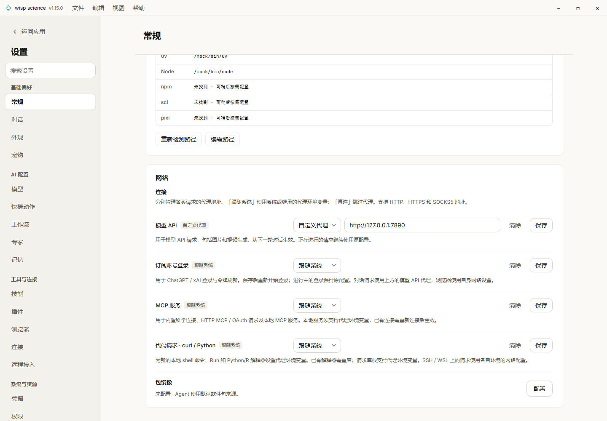
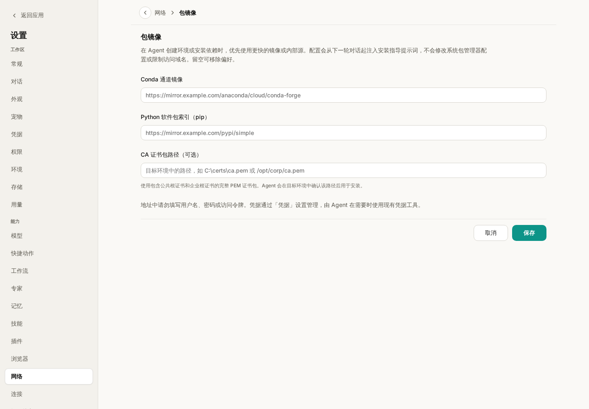

# Network settings

Open **Settings → Network** to configure networking independently of model
profiles. Network is its own item under Preferences, directly below General.
An existing Model API proxy is preserved automatically.

General groups workspace and interaction preferences alongside notifications and updates
(two columns on wide windows, one on narrow windows). Their Save/Cancel actions stay
inside the preference card; the version and manual update check sit with update settings.
Local environment paths stay on General and save on their own. Network has its own page
and save controls. Long environment paths wrap, and proxy controls adapt to the available width.

Each proxy has its own mode, Clear and Save controls. The address field appears
only for **Custom proxy**; **System** and **Direct** do not show an address field.

| Scope | Applies to | Takes effect |
| --- | --- | --- |
| Model API | Wisp's HTTP model providers, image and video generation | Next turn; active requests keep their current client |
| Subscription sign-in | ChatGPT / xAI discovery, device authorization, callback token exchange and token refresh | New sign-in attempts and subsequent token refreshes; active sign-ins keep their route |
| MCP services | Bundled scientific connectors, HTTP MCP (including OAuth), custom and plugin stdio MCP child processes | New connections; reconnect existing services |
| Code requests | Local shell commands, local Runs, and local Python/R interpreter processes | Newly launched processes; restart an existing interpreter |

**System** inherits the platform or process defaults. Child processes inherit
proxy environment variables; they do not automatically read operating system
proxy settings. **Direct** bypasses proxy discovery. **Custom proxy** accepts an
HTTP, HTTPS or SOCKS5 URL. **Clear** selects System; click **Save** to apply.

Model API connection errors that mention a leftover `HTTP_PROXY`/`HTTPS_PROXY`
or an OS system proxy (macOS/Windows) should be resolved here: set Model API to
**Direct**, or enter a proxy that is still running. The error names the proxy in
use. This page is **Settings → Network**, under Preferences, not Models.
Subscription sign-in has its own proxy and defaults to System on upgrade, regardless
of Model API settings. This lets authentication follow the system proxy while local
model APIs connect directly. Browser pages keep the browser's own network settings.
Save, then start a new sign-in. Chat/model API traffic still uses Model API.

Saving one row does not save edits in other rows or in Package mirror. Network
settings can be saved before a model/API key has been configured.

## Per-item routes

A model API address, a subscription, or a custom MCP connection can override
its row on this page. Each has a **Network proxy** choice: **Inherit Network
settings** (the default), **Direct**, or **Custom proxy** with an HTTP, HTTPS or
SOCKS5 address. Inherit uses this page's row for that kind of request.

| Where | Applies to | Inherits |
| --- | --- | --- |
| **Models → edit a model** (or Add API access) | Every model on that API address, including image and video generation and the decision model when it uses the same address | Model API |
| **Models → Subscriptions**, on each card (ChatGPT, ChatGPT Codex, SuperGrok) | That subscription's sign-in, token refresh and model requests | Sign-in and refresh: Subscription sign-in; model requests: Model API |
| **Connections → a custom MCP connection** | That connection's HTTP and OAuth requests, or the proxy variables of its local process | MCP services |

The model route belongs to the API address, not one model: saving it in one
model's form changes it for every model on that address, and models added on
that address later start from it. Model routes apply from the next turn; a new
subscription route applies to new sign-ins and token refreshes, and to model
requests from the next turn. An MCP connection reconnects with its route on the
next turn. Bundled scientific connectors and plugin MCP servers keep the MCP
services row.

Code proxy settings supply both uppercase and lowercase HTTP(S)/ALL_PROXY and
NO_PROXY variables without changing Wisp's host environment. Libraries must
honor these variables (and may need their own SOCKS support). Code can explicitly
override them: this is a routing preference, not a sandbox or firewall. Existing
Python objects and in-flight MCP connections are not killed on save. SSH/WSL
processes use their own environment; a desktop `127.0.0.1` proxy is not forwarded
to another machine. External ACP agents' own model/shell clients retain their existing networking
configuration. Local MCP servers must support proxy environment variables.

## Package mirror

Select **Configure** under Package mirror to enter a Conda channel URL, Python
package index URL (usually ending in `/simple`), and an optional CA bundle path.
Leave a field blank to remove that preference. Save applies the three fields
together; Cancel discards their edits. Escape immediately returns to Network;
another Escape closes Settings.

These values are installation guidance. Wisp refreshes the system prompt at the
next native agent turn, includes it in native delegated-agent instructions, and
passes it as context to ACP turns. The agent is told to use the configured
Conda/pixi channel or pip/uv index when creating an environment or installing
packages, quote arguments for the target shell, check paths/reachability in the
target context, and explain mirror failures before using public hosts.

This does not rewrite global pip/Conda configuration, change a domain allowlist,
test mirror reachability during settings save, or guarantee package availability.
The optional CA path is interpreted in the installation environment, so it can
be a Windows, macOS, Linux or remote path. Use a complete PEM bundle with public
and corporate roots; TLS verification should remain enabled.

Do not put credentials or access tokens in proxy/mirror URLs. Manage secrets in
**Credentials**; the mirror instructions direct the agent to existing credential
tools when authentication is needed. Proxy authentication is not configured by
this page. All new configuration is stored as one backward-compatible settings
record; the old `proxy_url` value is read only when that record is absent.

## Manual smoke checks

1. Start with an existing model proxy; confirm it appears in Settings → Network and is no
   longer editable in Models. Save the MCP proxy and confirm the model value stays.
2. Configure a local HTTP proxy. Use a new local shell/Run and a newly started
   Python interpreter to inspect the proxy variables and make a request against
   a controlled endpoint. On Windows use PowerShell syntax for the shell.
3. Reconnect a custom HTTP and a local stdio MCP service and inspect proxy logs.
4. Set a mirror, ask the agent to set up a project environment, and confirm its
   installation plan uses that source. Clear it and confirm the next turn no
   longer includes the mirror instruction.
5. Open Package mirror and press Escape without focusing its form: only the
   subpage closes. Repeat in Chinese and at a narrow window width.
6. In General, check both preference columns at a wide window size, then narrow
   the window and confirm the groups stack. Edit a long local Python path and
   confirm it stays within the pane. On Network, select Custom proxy in each scope;
   inputs and save actions should stay within the pane. Confirm the preference Save
   action and per-scope network saves still apply independently. Repeat with English
   and Chinese labels.
7. Set Model API to a local proxy, then set one model's Network proxy to Direct.
   Confirm requests to that API address bypass the proxy from the next turn, a
   second model on the same address shows Direct, and a model on another
   address still goes through the proxy.
8. On a subscription card choose Custom proxy and save, then refresh its token
   or start a new sign-in and confirm the proxy log shows the request. Set one
   custom MCP connection to Direct while MCP services uses a proxy and confirm
   only that connection bypasses it after reconnecting.
