# GPUI 设计语言「实验记录本」与共用图标语言 — 设计稿

状态：提案，未实现。等 GPUI 的 UI 功能与 WebView 对齐（见 [gpui-parity.md](../../gpui-parity.md)）后，按 §11 的顺序开始实现。在那之前，GPUI 的现行规则仍是 [gpui-design-language.md](../../gpui-design-language.md)（「纸本笔记」），`surfaces.rs` 里的测试也仍按它检查。日期：2026-11-16。

§9 的图标语言对 WebView 和 GPUI 都适用；其余各节只管 GPUI。

示意图在 [docs/assets/gpui-lab-record/](../../assets/gpui-lab-record/)，由同目录的 `figures.html` 截图得到（§12）。它们是网页画的，用来定规则和比例；真实效果以 GPUI 实现后为准。图里的图标取自仓库现有的共用图标集。

## 1. 问题

「纸本笔记」落地后（#1732–#1735），GPUI 版有了暖纸色、墨色文字、一个青绿色和衬线标题，但整体仍然不好看，也没有自己的样子。2026-11-16 编译 main（`94378857`）后用临时数据逐屏看过首页、会话页、侧栏的文件与运行标签、内嵌终端、设置（模型、通用、环境）、论文、研究历程和深色模式，结论如下。侧栏其余九个标签、命令面板和各对话框这次没有逐个看。

| 位置 | 看到的 |
| --- | --- |
| 会话页 | 工具调用、“接下来可以问”、输入框、运行卡片都是同一种白色圆角卡。已经发生的事和等你操作的东西长得一样，分不出轻重。 |
| 文字 | 界面上字太多：侧栏十一个标签全是字，折成三行；首页顶栏、设置里的动作、运行卡片上的入口都是一排词。 |
| 图标 | 有图标的地方又是另一个极端：14 px、不分组、没有固定含义。标题栏 6 个，输入框 10 个控件，消息下 8 个，文件每行 3 个。同一个概念在不同地方用不同的图标或干脆用字。 |
| 标题 | Georgia Semibold 的英文配常规粗细的宋体中文，同一行里英文比中文重一级。 |
| 设置 | 内容贴在左边 640 px，右半屏空着；模型、通用、环境三页三种排法；输入框灰底、卡片白底。 |
| 窗口 | 标题栏是系统白条，深色模式下仍是白的，还单独占一行只写“Wisp Science”。 |
| 整体 | 暖纸色加衬线标题加一个强调色，Claude 一类工具也是这样，认不出是 Wisp。 |
| 亮点 | 研究历程页最像 Wisp：时间、类别、内容、状态排成一行，一眼能扫完。 |

## 2. 定位与四条根规则

Wisp 和别的 AI 工具不同的地方在功能上：每个回答都连着运行、文件、依据和时间，研究历程、溯源、论文证据都建立在这上面。这套语言把这一点变成界面的骨架：**对话写成带编号和时间的记录，而不是聊天**。它延续 WebView 的纸、墨和青绿，换掉聊天气泡和卡片堆。

四条根规则，其余各节都从它们推出：

1. **说出来的，用衬线。** 问题、标题、论点、项目名：人或 Wisp 写下的一句主张。
2. **量出来的，用等宽。** 时间、耗时、大小、token 数、路径、编号、模型名：机器测得的事实。
3. **能动手的，才是白色。** 输入框、按钮、待批准的卡片。已经发生的记录直接写在纸面上，不进白卡。
4. **能画出来的，不写字。** 对象、动作、状态先用图标表示；图标单独认不出时才配字。每个概念在全应用只有一个图标（§9）。

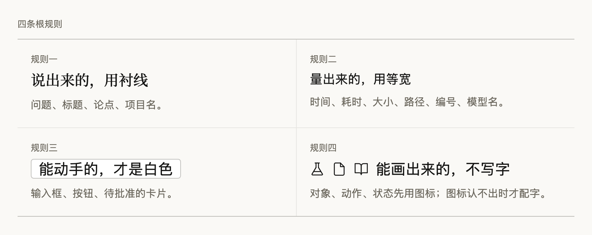

## 3. 记录行与章

### 3.1 记录行

全应用的一个基本单位。一行从左到右是：时间、对象的图标、内容、状态、数值。

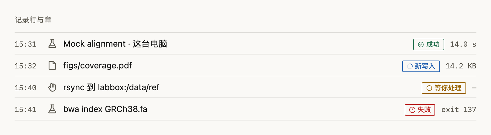

- 时间和数值用“事实”字（§4），淡墨色，数字等宽对齐；对象是 16 px 的淡墨图标（运行、文件、批准……取自 §9.3 的词表），不再写“运行”“文件”两个字；内容是正文，放不下时截断并在悬停时给全文。
- 内容是常规粗细。行高 32 px 以上，行与行之间一条细线；一组记录行的第一行上方也有一条。
- 没有某一列时那一列留空，其余列的位置不变，所以相邻的行能上下对齐。
- 用在：会话里的工具调用和运行、侧栏的运行与文件、研究历程、首页的最近会话、溯源。这些地方不再各画各的卡片。
- 一行能展开时（工具的输入输出、运行的日志），展开的内容在这一行下面缩进显示，细线画在展开内容之后。

### 3.2 章

状态的标记：方角（2 px）、1 px 细边、没有底色，里面只有一个词，“事实”字，常规粗细。

| 章 | 颜色（主题里的名字） | 窄处单用的图标 | 固定的词 |
| --- | --- | --- | --- |
| 成功 | `success` | `circle-check` | 成功、完成、已保存 |
| 等待 | `warning` | `circle-ellipsis` | 等你处理、待批准、排队中 |
| 失败 | `danger` | `circle-alert` | 失败、已中断、已拒绝 |
| 进行 | `info` | `loader` | 运行中、新写入、同步中 |

- 章带词，不单靠颜色。地方很窄放不下章时（侧栏的会话行），改用带状态色的状态图标，提示文字里写出那个词。首页项目格子里的“等待”章是唯一带图标的：铃铛加个数。
- 一行至多一个章。计数和标签仍可用圆胶囊；状态不用。
- 章的文字在浅色主题上要达到 4.5:1，所以浅色下用各状态色的 `active` 深色值，深色主题用本色。加一条测试检查两种主题。

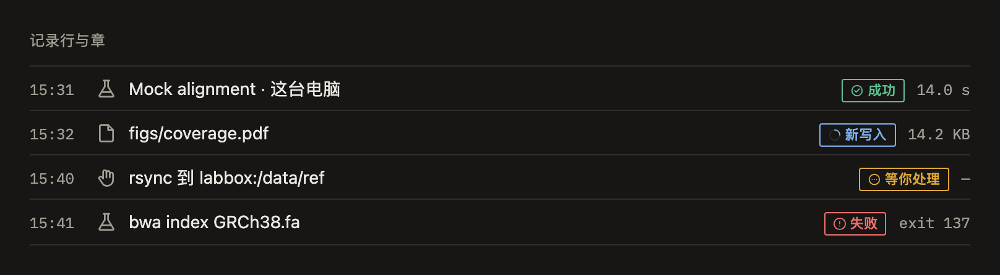

## 4. 文字

四个角色，字号和现在一样只有四档。

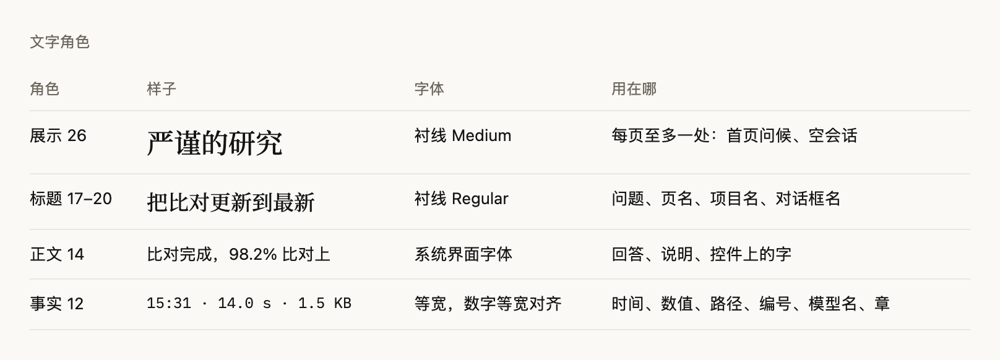

| 角色 | 字号 | 字体 | 用在哪 |
| --- | --- | --- | --- |
| 展示 | 26–30 | 衬线 Medium | 每页至多一处：首页问候、空会话 |
| 标题 | 17–20 | 衬线 Regular | 问题、页名、项目名、会话名、对话框名 |
| 正文 | 14 | 系统界面字体 | 回答、说明、控件上的字 |
| 事实 | 12 | 等宽，数字等宽对齐 | 时间、数值、路径、编号、模型名、章、快捷键 |

- **标题用衬线 Regular，只有展示字用 Medium；不用 Semibold 或 Bold。** 这样英文和中文的粗细一致，一屏里有好几个标题时也不显得重。
- **打包两副字体**：Source Serif 4 和 IBM Plex Mono，都是 OFL 许可；WebView 的研究图谱标题已经在用 Source Serif。三个平台看到同一副英文字。
- 中文衬线不打包（一个字重就超过 10 MB），取系统的：Songti SC、Source Han Serif SC、Noto Serif CJK SC。都没有时（常见于 Windows，只有中易宋体），中文标题退回界面字体的 Medium，不用中易宋体。
- 次要信息靠淡墨色区分，不靠缩小；“事实”字只给规则二说的那些内容。

### 4.1 字重

界面上的字默认都是常规粗细。加粗的字一多，眼睛不知道先看哪里；所以轻重先靠位置、字的角色（衬线标题）和颜色（墨与淡墨）来分，字重排在最后。

- **常规粗细**用于所有界面文字：导航、标签、列表和记录行的内容、设置项的名称、按钮上的字、条件行的值、章、分组标题、表头。
- **Medium 只用在三处**：展示字（每页至多一处）；实心主按钮上的字（每页或每个对话框至多一个）；一个区域里唯一需要先被看到的那一行，例如对话框里要用户确认的那句话。一个区域（一页、一个面板、一个对话框、一张卡片）里，界面自己加的 Medium 至多一处。
- **选中、打开、当前**靠底色、墨色或青绿表示，不靠加粗。
- **不用 Semibold 和 Bold。** 回答正文里作者自己标的强调（Markdown 的粗体）是内容，照样显示，用 Medium 而不是 Bold。
- 名称和说明并排时，名称是墨色、说明是淡墨，两者同一字重。

- 界面里的代码和终端仍用等宽字，字号跟“代码大小”设置走。

## 5. 颜色

纸、墨、青绿和状态色的值不变，沿用 `apps/gpui/assets/wisp-theme.json`，WebView 用户认得出；淡墨和细线各调浅一档（§14），让次要信息退后。淡墨在纸和页边上都要达到 4.5:1。变的主要是用法。

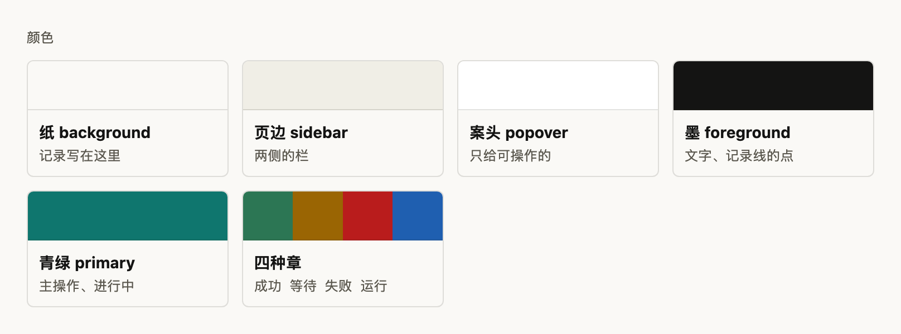

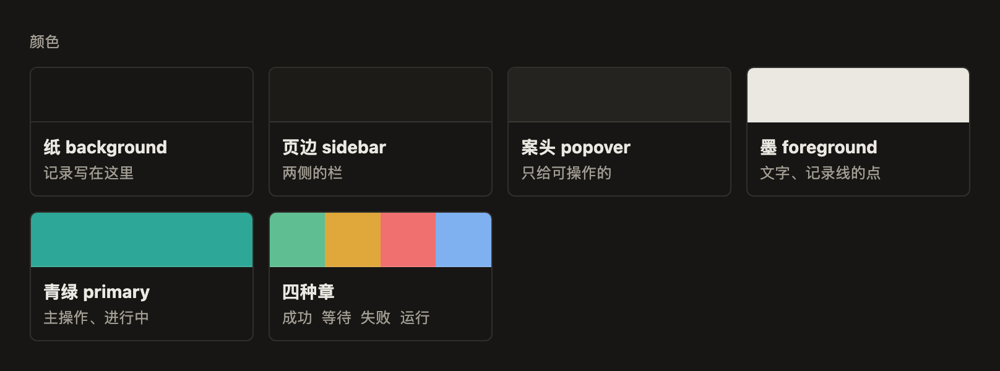

| 名字 | 主题键 | 浅色 | 深色 | 用法 |
| --- | --- | --- | --- | --- |
| 纸 | `background` | `#faf9f6` | `#171614` | 页面；记录写在这里 |
| 页边 | `sidebar` | `#f0eee6` | `#1c1b18` | 左侧栏、右侧面板、标题栏 |
| 案头 | `popover` | `#ffffff` | `#1f1e1b` | 只给能操作的：输入框、按钮、待处理的卡片、对话框、菜单 |
| 墨 | `foreground` | `#141413` | `#ebe8e2` | 文字、记录线上的点、选中的图标 |
| 淡墨 | `muted_foreground` | `#6b675d` | `#958f86` | 次要文字、时间、平时的图标 |
| 线 | `border` | 墨的 9% | 纸白的 8% | 细线 |
| 青绿 | `primary` | `#0f766e` | `#2da898` | 主操作、链接、焦点、正在进行的那一条、已打开的模式 |

- 白色的反面也成立：只读的内容不放在白底上。设置里的输入框从灰底改成白底细边；只读的值直接写在纸面上。
- 深色主题里“案头”和“页边”只差一点亮度，可操作的东西靠细边来认，所以深色下白卡的边用更实的线（`input.border`）。
- 设置 › 通用里的其他配色（Codex、GitHub、Catppuccin、Everforest、Gruvbox）继续盖在这些名字上，上面的规则对它们同样成立。

## 6. 形状与间距

- **圆角 4 / 6 / 2**：控件和列表行 4 px（`radius`），卡片、输入框、对话框、菜单 6 px（`radius_lg`），章 2 px。现在的 8 / 12 是组件库的默认值。圆胶囊只留给计数、标签和开关。
- **线与阴影**：纸面上只用细线；只有浮在纸上的层（对话框、菜单、命令面板）有阴影。和现行规则一样。
- **卡片**只用于需要逐个处理的东西：待批准、计划、提问、备忘、记忆草稿。记录不进卡片。
- **间距**用 rem 档位，不写像素；像素只用于版式宽度。和现行规则一样。
- **栏宽**：阅读栏沿用 `surfaces::READING_WIDTH`；表单栏 620–720；首页 760–880。都居中，不再有贴左的页面。

## 7. 版式

### 7.1 窗口

- 标题栏自绘：颜色跟主题（页边色），红绿灯嵌在里面；Windows 和 Linux 上是同一条栏，右端放系统的窗口按钮。
- 会话和文档的标签页放在这一条里，每个标签是对象图标加名字；没有“Wisp Science”字样的空标题行。
- 右端是搜索、终端、侧栏面板、更多四个图标按钮。
- **等你处理的提醒在右上角。** 四个按钮左边是一个铃铛加个数（等待色），没有东西等你时不显示。点开是一个浮层，列出等你处理的会话（记录行：时间、图标、标题，别的项目的带项目名），点一行打开那个会话。左侧栏不再放“等你处理”的列表，那里的空间留给会话。

### 7.2 会话页

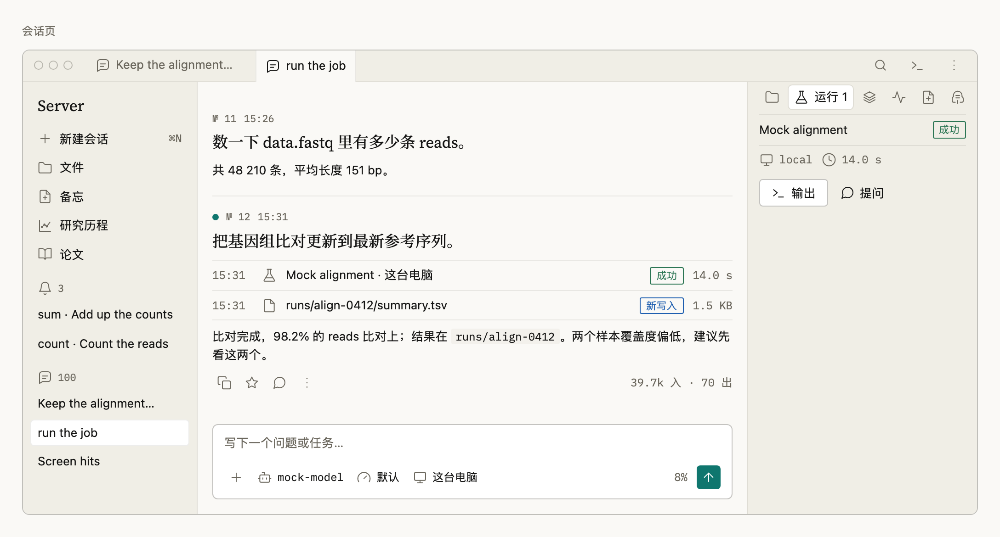

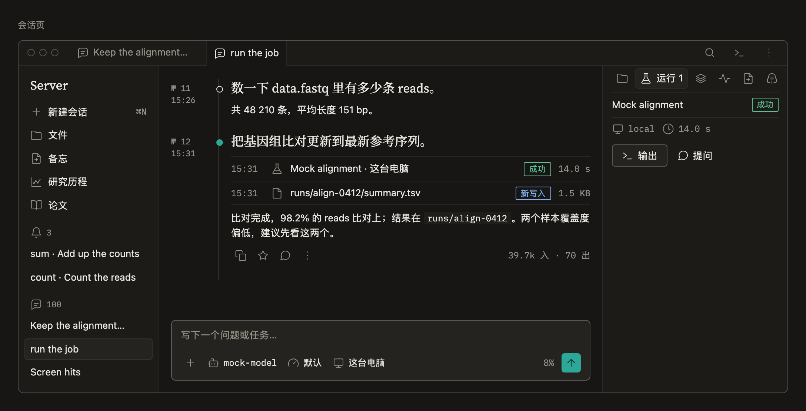

- **每轮对话是一条记录。** 阅读栏分两列：左边 64 px 的边栏写编号和时间（“事实”字，淡墨）；右边是内容，内容左侧一根竖线从第一条贯穿到最后一条。
- **记录线上的点**：每条记录在竖线上有一个空心墨点；正在进行的那一条是实心青绿点，缓慢明暗。
- **问题是这一条的标题**，左对齐，不再有右对齐的灰色气泡。短问题（一段、不超过 120 字）用衬线“标题”字；更长的用正文字。超过三行的问题收起，点开看全文；附件列在问题下面。
- **工具调用和运行是记录行**（§3.1），连续的几行合成一组。运行的行可点开侧栏的运行标签。
- **回答是正文**，写在纸面上。
- **一条下面的小动作**是一排图标按钮：复制、收藏、追问三个常用的直接露出，其余进“更多”；悬停或最新一条时显示。token 用量是“事实”字，靠右。
- **编号**按这个会话里用户发出的轮次从 1 起，显示为 `№ 12`。研究历程、溯源、论文证据引用会话内容时指向编号。压缩、回退、分支之后编号怎样保持稳定见 §13。
- **左侧栏**：导航是图标加字；“会话”分组的标题是图标加计数。等你处理的提醒不在这里，在标题栏右上角（§7.1）。
- **左侧栏以会话为主。** 窗口够高时，导航是一列图标加字的行。窗口矮到会话列表占不到侧栏高度的六成时（侧栏约 1085 px 以下，也就是一般笔记本屏幕上的窗口），导航收成一行图标按钮（新建会话、文件、备忘、能力、研究历程、论文、收藏，各带提示文字），搜索框留在这一行下面，其余高度都给会话列表。窗口变高后自动展开。
- 等你处理的东西（批准、计划、提问、记忆草稿、“接下来可以问”）仍在阅读栏里、输入框上方，是白卡，因为能操作；规则同现行的 `surfaces::bar`，圆角改 6。

### 7.3 输入框

- 一个白色的框：上面写字，下面一行。
- 下面一行左端一个“＋”，收起附件、链接、快捷动作、斜杠命令、技能；中间是**条件行**：模型、强度、运行位置，每一段是图标加当前的值（值用“事实”字），不写“模型”“强度”这些标签，点某一段改那一项；右端是上下文占用的百分比和发送按钮（青绿底的向上箭头）。
- 改变 Wisp 行为的设置（先计划、完全访问、审阅中）打开时，作为青绿色的图标加字的一段加在条件行里；处在默认值时不显示，从“＋”里打开。
- 窗口变窄时条件行先折行，发送按钮始终留在框里。

### 7.4 右侧面板

- 标签永远一行，每个标签是它的对象图标；打开的那个是白底、图标加名字（运行还带正在跑的个数），其余只有淡墨图标，悬停给名字。十一个标签在 340 px 里放得下。
- 按 `desktop.ui.panel_tabs` 的顺序排；面板窄到放不下时，多的进“更多”。不折行。
- 内容用记录行和章；需要逐个处理的（备忘、习惯与笔记、运行的清理询问）用白卡。
- 宽度和让位规则同现行规范。

### 7.5 首页

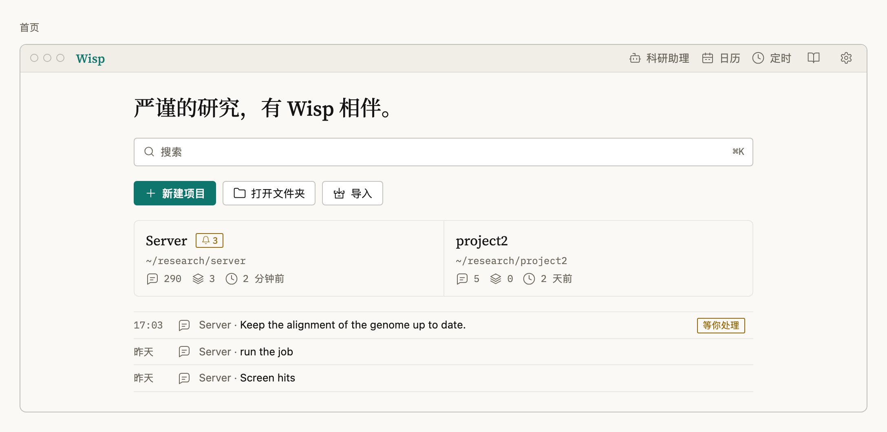

- 顶部一条栏：左边字标；右边要去的地方是图标加字，文档和设置是图标按钮。
- 一栏居中：问候（展示）、搜索框（白）、开始的方式（“新建项目”实心，“打开文件夹”“导入”描边，都带图标）。
- 项目是并排的格子，中间用细线分开：名字（标题）、文件夹（事实）、一行图标加数字（会话数、产物数、上次动过的时间），有东西等你时一个带铃铛和个数的“等待”章。项目的动作在悬停时出现。
- 最近会话是记录行：时间、图标、项目与标题、章。

### 7.6 设置

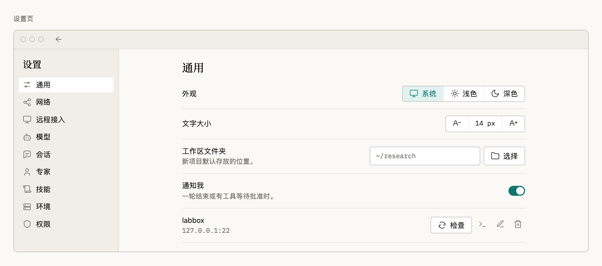

- 左边导航在页边色上，每项图标加字；右边内容居中成一栏（620–720 px），页名是标题。
- 每页同一种行：名称和说明在左，控件在右，行间细线。说明只在名称说不清时才写。模型、环境这类有列表的页，列表在上、所选项的表单在下，仍在同一栏里。
- 多选一用分段选择，选项能画的配图标；开和关用开关；输入框白底细边；对一项的几个动作里，最常用的一个是图标加字的描边按钮，其余是图标按钮，危险的那个放最后并用失败色。

### 7.7 其余页面

- 研究历程已经是记录行的样子，只需把类别换成图标、时间换成“事实”字、状态换成章。
- 论文、能力、备忘、收藏：左栏页边色，内容居中成栏；空的时候是一句淡墨的话加至多一个描边按钮。
- 内嵌终端在阅读栏之外占满中间区域的宽度，它的栏头和标题栏同一种样子。

## 8. 控件

- **按钮**：每页或每个对话框至多一个实心青绿按钮；其他是描边（白底细边）、纯文字或图标按钮。圆角 4。
- **图标按钮**：26 px 见方以上的点击区，16 或 18 px 的图标，一律有提示文字；什么时候可以不配字见 §9.4。
- **分段选择**：多选一、选项不超过五个时用；选中的一段是淡青绿底加青绿字。
- **开关**、**对话框**、**Escape 栈**：同现行规范（`surfaces::switch`、`surfaces::dialog`、`layers.rs`），对话框圆角改 6。
- **动效**只有两处：进行中那条记录的点缓慢明暗；浮层出现时 120 ms 淡入。系统设了“减少动态效果”时都关掉。

## 9. 图标语言（WebView 与 GPUI 共用）

两个前端今天已经共用一套图：WebView 的 `compose_icon()`（`ui/src/app_support/messages.rs`）是来源，GPUI 的 `apps/gpui/assets/icons/*.svg` 是它的逐个导出，`assets.rs` 里有测试保证两边相同。2026-11-16 时两边各 126 个、名字完全一致，全部是 24 × 24 画布、线宽 2（这份设计稿改为 1.5，见 §9.1）。缺的是规则：怎么画、多大、什么颜色、哪个概念用哪个、什么时候可以不配字。这一节补上，并且对两个前端都生效。

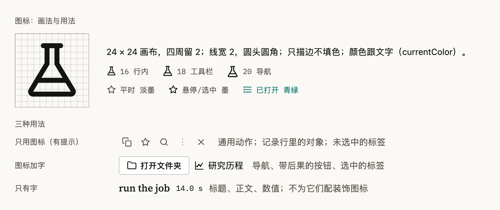

### 9.1 画法

- 24 × 24 画布，图形四周至少留 2；线宽 1.5，线头和转角都是圆的；只描边，不填色；`stroke="currentColor"`。线宽 1.5 在 16 px 下正好是 1 px，和正文的笔画一样粗；原来的 2 在 16 px 下是 1.33 px，比字粗，边缘也发虚。
- 例外只有两类：表示“已选中”的实心变体（如 `star-filled`），和 1 个单位半径的小圆点。
- 正面、平面、单一线宽。不画透视、阴影、渐变、双色。
- 细节在 16 px 下要能认：相邻两条线之间至少留 2 个单位。
- 同一组里的图标看起来要一样大、一样重。撑满画布的图形（叉、加号）要内缩到和旁边的图标视觉上等大；只有点的图形（“更多”）点的半径至少 1.25，不能比线条图标轻一截。
- “更多”是横排的三个点（`more`），不用竖排：竖排三点在桌面上像拖动手柄或分隔线。
- 学科图标（烧瓶、DNA、数据库）和通用图标同一种画法，不另起一套风格。
- 名字用小写加连字符，说的是画的东西（`flask`），不是用在哪里（不叫 `run-icon`）。
- 不用 emoji、文字符号或图标字体当图标。模型输出里的 emoji 是内容，不在此列。

### 9.2 大小与颜色

| 位置 | 大小 | 点击区 |
| --- | --- | --- |
| 行内、记录行、和正文并排 | 16 | 跟所在的行 |
| 工具栏、标签、图标按钮 | 16 或 18 | 26 以上 |
| 导航、图标词表、空状态 | 20 | 32 以上 |
| 章里 | 11 | 无 |

- 线宽随图一起缩放，不为小尺寸另画一套。
- 颜色只有三种状态：平时淡墨；悬停或选中是墨；一个模式处在打开状态时是青绿。
- 状态色只给 §3.2 的四个状态图标，和危险动作（删除）的图标。别的图标不用状态色，也不用别的颜色。
- 图标和它旁边的字同色时，颜色跟字走。

### 9.3 词表：一个概念一个图标

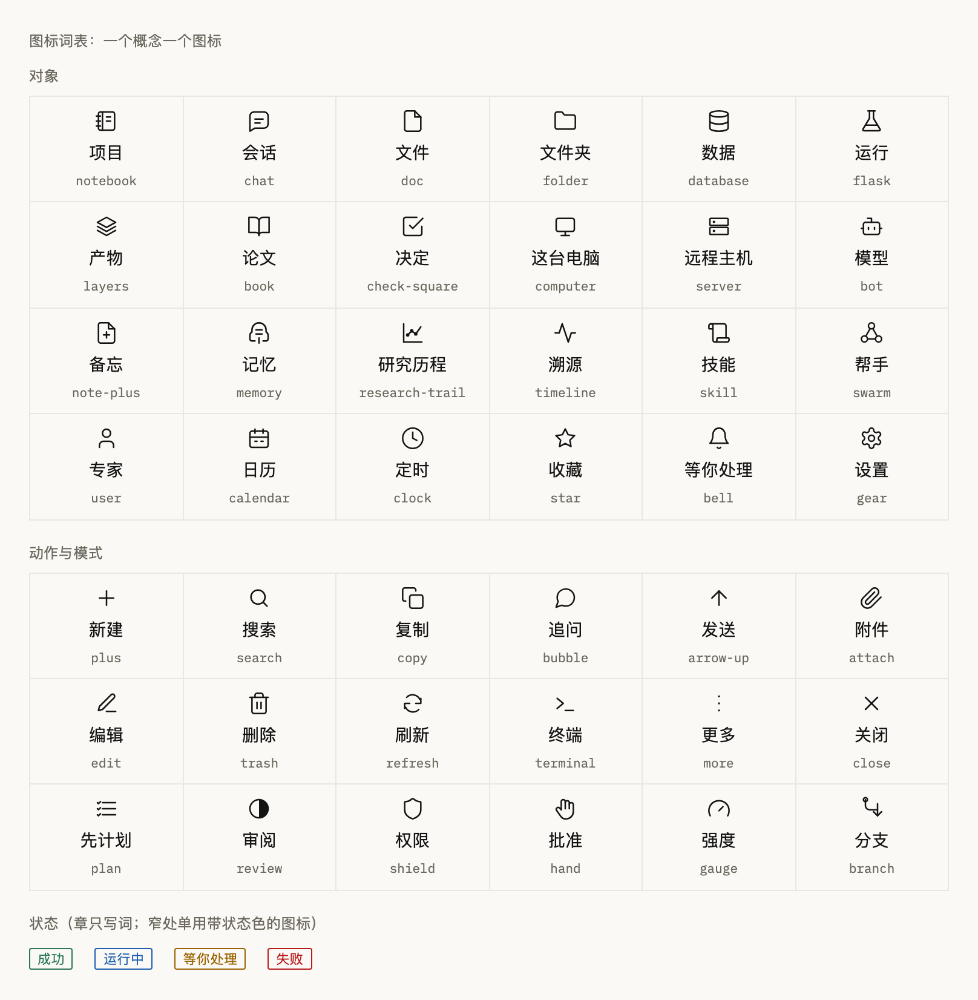

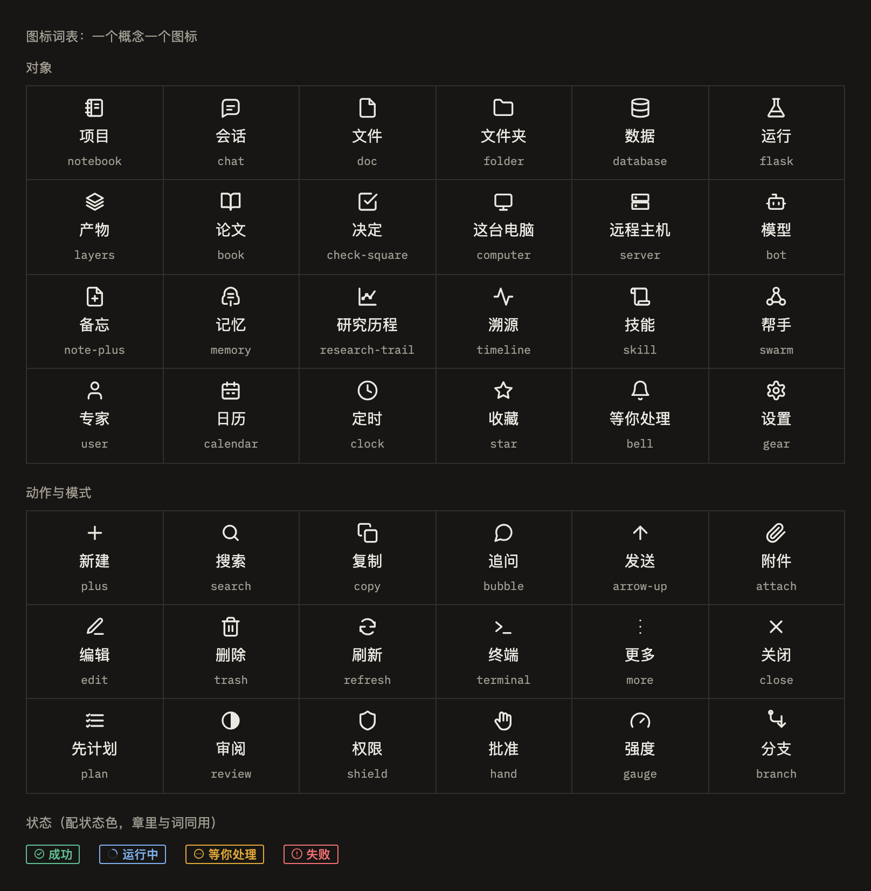

| 类 | 概念 → 图标名 |
| --- | --- |
| 对象 | 项目 `notebook` · 会话 `chat` · 文件 `doc` · 文件夹 `folder` · 数据 `database` · 运行 `flask` · 产物 `layers` · 论文 `book` · 决定 `check-square` · 这台电脑 `computer` · 远程主机 `server` · 模型 `bot` · 备忘 `note-plus` · 记忆 `memory` · 研究历程 `research-trail` · 溯源 `timeline` · 技能 `skill` · 帮手 `swarm` · 专家 `user` · 日历 `calendar` · 定时 `clock` · 收藏 `star` · 等你处理 `bell` · 设置 `gear` |
| 动作 | 新建 `plus` · 搜索 `search` · 复制 `copy` · 追问 `bubble` · 发送 `arrow-up` · 附件 `attach` · 编辑 `edit` · 删除 `trash` · 刷新 `refresh` · 终端 `terminal` · 更多 `more` · 关闭 `close` |
| 模式 | 先计划 `plan` · 审阅 `review` · 权限 `shield` · 批准 `hand` · 强度 `gauge` · 分支 `branch` |
| 状态 | 成功 `circle-check` · 进行 `loader` · 等待 `circle-ellipsis` · 失败 `circle-alert` |

- 词表里的概念在任何地方都用这个图标：导航、标签、记录行、按钮、菜单、空状态。反过来，一个图标也只表示一个概念；同一个菜单里不出现两个相同的图标（AGENTS.md 已有这条）。
- 这张表用的全是现有图标，是目标状态，不是现状：今天的代码里有同一概念用了别的图标的地方（例如研究历程页里运行用 `flask`，会话里工具调用用 `wrench`），落地时逐处对上，并在这张表上补全没列到的概念（划线、笔记本、环境、侧边问答等）。
- 要加新概念时先查词表里有没有近义的；没有才画新图，并同时加进词表。
- 同一屏里相邻的两个入口不用同一个图标。“这个对象的更多操作”用 `more`；“放不下的其余项”（标签条、工具条的溢出）用 `chevron-down`，两者不混用。
- 一件事只留一个入口：已经有开关能关掉的面板，不再另放一个关闭的叉。
- 贴着窗口右边缘的图标上下对齐：标题栏最右的图标和它下面面板最右的图标落在同一条竖线上。

### 9.4 图标和字

按“这个图标单独放着，用户认不认得”分三种用法：

| 用法 | 用在哪 |
| --- | --- |
| 只用图标（必须有提示文字） | 通用动作：关闭、返回、搜索、更多、复制、发送、附件、刷新、展开与收起；记录行里的对象；未选中的标签；一行末尾的次要动作 |
| 图标加字 | 导航；带后果的按钮（新建项目、导入、检查）；选中的标签；条件行里的值；菜单项；章 |
| 只有字 | 标题、正文、数值、说明。不为它们配装饰图标 |

- 界面上不再出现成排的纯文字入口：一个入口要么是图标，要么是图标加字。
- 只用图标时，这个图标必须在词表里，并且有提示文字（WebView 的 `title` / `aria-label`，GPUI 的 tooltip）。
- 一个区域里连着的图标按钮不超过四个，再多的进“更多”；菜单里每项都是图标加字。
- 字能省就省：有图标之后，标签写值不写名（`mock-model`，不写“模型：mock-model”），计数写数不写量词（图标加 `290`，不写“290 个会话”）。

### 9.5 来源与同步

- 在 WebView 还在的阶段，来源仍是 `compose_icon()`，GPUI 的文件由它导出，现有的相等测试继续管着。新图标先加进 `compose_icon()`，再导出到 GPUI。
- WebView 退役时，来源改为图标文件本身，放到两个工作区都能引用的目录；词表（概念、图标名、中英文名）作为一个数据文件放在旁边，测试检查词表里的每个图标都存在、每个概念只出现一次。这一步的目录和文件格式到时再定（§13）。

## 10. 和现行规范、WebView 的关系

| 现行规范（纸本笔记） | 这份设计稿 |
| --- | --- |
| 颜色的值、纸与页边、一个青绿 | 不变 |
| 细线、只有浮层有阴影、每页一个实心按钮 | 不变 |
| 开关、对话框的形状与宽度、Escape 栈、共用图标集 | 不变 |
| 阅读栏、输入框上方的条、侧栏的宽度与让位、中间文档与分栏 | 不变 |
| 四档字号 | 不变；Caption 改为等宽的“事实”字并限定用途 |
| 衬线 Georgia Semibold | 改为 Source Serif 4，标题 Regular、展示字 Medium，随应用打包 |
| 行首标签、标题等多处用 MEDIUM | 界面文字默认常规粗细，Medium 只留三处（§4.1） |
| 圆角 8 / 12 | 改为 4 / 6，章 2 |
| 白卡用于卡片、输入框、对话框、菜单 | 收紧为只给能操作的 |
| 用户消息是气泡，工具调用是卡片 | 改为编号记录、记录线、记录行 |
| 状态是带颜色的词或图标 | 改为章 |
| 输入框里设置是图标或词 | 改为“＋”和图标加值的条件行 |
| 侧栏标签是词（“no pill or icon for a name”），可折行 | 改为一行图标，选中的带名字 |
| 图标只规定了来源 | 增加画法、大小、颜色、词表和配字规则（§9） |
| 系统标题栏 | 改为自绘，和标签页合一 |

延续 WebView 的：纸色、墨色、青绿和状态色；衬线标题与 Source Serif；共用的线条图标；细线分隔。GPUI 自己的：编号记录与记录线、记录行与章、等宽的“事实”字、条件行、合一的标题栏。§9 的图标语言两边共用，WebView 可以先于 GPUI 采用。

## 11. 落地顺序

等 UI 功能对齐后开始。每一步是一个 PR，同时把那一步的规则写进 [gpui-design-language.md](../../gpui-design-language.md)（图标的规则同时写进 [ui-design-principles.md](../../ui-design-principles.md)），并更新 `surfaces.rs` 里守规则的测试；全部完成后这份设计稿只留作记录。

1. **主题与字体。** `wisp-theme.json` 的 `radius` / `radius.lg` 改 4 / 6；打包 Source Serif 4 和 IBM Plex Mono 并在启动时注册；`surfaces::title` / `display` 改 Medium 与新的回退顺序；`main.rs` 的 `TitlebarOptions` 改为自绘标题栏。测试：字体回退顺序、中文衬线不可用时的退回、两种主题下标题栏取页边色。
2. **图标语言。** 把词表落成数据并加测试（每个概念一个图标、图标都存在）；GPUI 加按 §9.2 取大小和颜色的图标助手与图标按钮助手，把现有用法对到词表上；WebView 按同一张词表核对 `compose_icon` 的用法。这一步不依赖其他步骤，也可以最先做。
3. **记录行与章。** `surfaces.rs` 加 `record_row`、`record_group`、`stamp` 和“事实”字的助手；先换首页最近会话、研究历程、侧栏的运行与文件。测试：章在两种主题下的对比度；状态不再用胶囊；这些列表只从 `record_row` 画。
4. **会话页。** 编号记录与记录线、工具调用改记录行、问题改衬线标题、一条下面的图标动作。改动最大，单独一个 PR，并在真机上逐屏核对后再合并。测试：编号随轮次递增；会话里没有气泡和工具卡片的手画形状。
5. **输入框。** “＋”菜单与条件行。测试：默认值的设置不出现在条件行；窄窗口下发送按钮留在框内。
6. **设置与其余页面。** 居中栏、统一的设置行、白底输入框、分段选择；侧栏标签改一行图标（现在检查“标签没有图标”的测试随之反过来）。测试：设置各页只从 `setting` 行和同一栏画；侧栏标签不折行、未选中的标签都有提示文字。

第 4 步之前的每一步都能单独上线，不依赖后面的步骤。

## 12. 示意图

| 文件 | 内容 |
| --- | --- |
| `rules.png` | 四条根规则 |
| `record-row.png`、`record-row-dark.png` | 记录行与四种章 |
| `conversation.png`、`conversation-dark.png` | 会话页：编号记录、记录线、条件行、侧栏图标标签、合一的标题栏 |
| `home.png` | 首页 |
| `settings.png` | 设置 › 通用 |
| `icons.png` | 图标的画法、大小、颜色状态和三种用法 |
| `icon-vocabulary.png`、`icon-vocabulary-dark.png` | 图标词表 |
| `colour.png`、`colour-dark.png` | 颜色 |
| `type.png` | 四个文字角色 |

来源是 `docs/assets/gpui-lab-record/figures.html`：每个 `<figure data-fig="名字">` 对应一张图，网址加 `?theme=dark` 是深色；图标是从 `apps/gpui/assets/icons` 内联进去的。图是用仓库里 `ui-tests` 的 Playwright Chromium 在 2 倍像素密度下对每个 `figure` 元素截的；改了 `figures.html` 后同样重截并一起提交。页面从 Google Fonts 取 Source Serif 4、IBM Plex Mono 和 Noto Serif SC，离线时会退回系统字体，截图前要确认字体已加载。

## 13. 未决问题

- **编号的稳定性。** 上下文压缩、回退（rewind）、话中话分支之后，`№` 取什么值，才能让研究历程和论文证据里已有的引用不失效。需要先确定编号是存下来的还是每次按轮次算的。
- **只用图标的标签认不认得。** 侧栏十一个标签只剩图标后，新用户要靠悬停才知道是什么。备选是窗口够宽时全部带名字、变窄时才收成图标；等实机试过再定。
- **词表没列全。** 划线、笔记本、环境、侧边问答、研究职责、聊天应用、宠物等概念还没有定图标，有的需要新画。
- **图标的来源搬到哪里。** WebView 退役后图标文件和词表放哪个目录、词表用什么格式、WebView 退役前要不要先搬（§9.5）。
- **Windows 上的中文标题。** 没有可用的中文衬线时退回界面字体，英文仍是衬线，混排的样子需要在 Windows 上实看。
- **打包字体的体积与许可文件。** 两副字体各取哪些字重、可变字体还是静态字体，以及 OFL 许可文件放在哪里。
- **其他配色。** 第三方配色（Catppuccin、Gruvbox 等）里“案头”和“纸”的差别可能很小，“白色才能动手”要靠细边成立，需要逐个配色核对。
- **没看过的界面。** 侧栏其余标签、命令面板、各对话框、首次使用引导还没有对照这份设计稿逐屏核对，落地时可能需要补规则。

## 14. 实机后的修订

2026-11-16 开始实现后，按实机截图改了设计稿的这些地方：

- **调轻。** 有人形容实机页面有“涂抹的浓重感”。放大看，原因是图标线条比文字笔画粗且边缘发虚、衬线 Medium 在 GPUI 里显得像粗体、淡墨不够淡、细线和带框的章叠得太多。因此：图标线宽 2 改 1.5（§9.1，两个前端同时生效）；标题改衬线 Regular，只有展示字留 Medium（§4）；淡墨和细线各调浅一档（§5）；章里不再放图标，字重改常规（§3.2）。
- **长问题。** 只有短问题用衬线标题字，更长的用正文字（§7.2）。
- **等你处理。** 列表从左侧栏挪到标题栏右上角的铃铛里（§7.1），左侧栏只留导航和会话。
- **左侧栏。** 窗口矮时导航收成一行图标，把高度让给会话列表（§7.2）。
- **右上角的图标。** 标题栏的“更多”、面板的“更多标签”和关闭叉挤在一起：两个相同的竖排三点意思不同，三点比旁边的线条图标轻，叉又大又和侧栏开关重复，三者也不对齐。改为横排三点、溢出用向下尖角、去掉叉、右边缘对齐（§9.1、§9.3）。
- **字重。** 实机上很多行都是 Medium，关注点散乱。新增 §4.1：界面文字默认常规粗细，Medium 只留给展示字、实心主按钮和一个区域里唯一要先看到的那一行。
- **首页的少用入口**收进“更多开始方式”菜单，开始入口保持一行。

